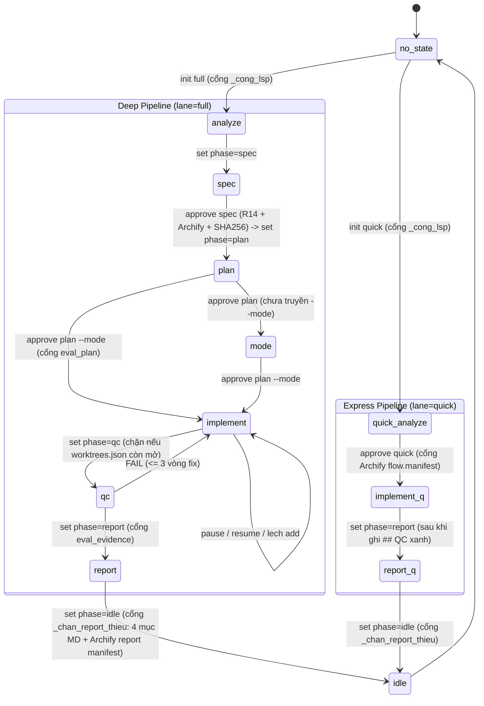

# Báo Cáo Nghiên Cứu & Kiểm Toán Chuyên Sâu (Part 2): Pipeline TDQ-Workflow, 11 Skills & 6 Subagents + Tính Tương Thích Antigravity

- **Nguồn chuẩn (Source Repo)**: `C:\Users\admin\Documents\Projects\ForAgentCode\TDQ-Workflow` — phiên bản `0.97.0` (`.claude-plugin/plugin.json:4`)
- **Plugin Antigravity đã sinh (Installed AGY Plugin)**: `C:\Users\admin\.gemini\config\plugins\tdq-workflow` — phiên bản `0.74.0` (`plugin.json:4`, `manifest.json:135`)
- **Tài liệu chuẩn Antigravity đối chiếu**:
  - `C:\Users\admin\.gemini\antigravity\builtin\skills\agy-customizations\SKILL.md` (`:1-106`)
  - `C:\Users\admin\.gemini\antigravity\builtin\skills\agy-customizations\docs\skills.md` (`:1-70`)
  - `C:\Users\admin\.gemini\antigravity\builtin\skills\agy-customizations\docs\plugins.md` (`:1-112`)
  - `C:\Users\admin\.gemini\antigravity\builtin\skills\migrate-agent-settings\SKILL.md` (`:1-197`)
  - `C:\Users\admin\.gemini\antigravity\builtin\skills\migrate-workflows\SKILL.md` (`:1-132`)
  - `C:\Users\admin\.gemini\antigravity\builtin\skills\plugin\SKILL.md` (`:1-309`)

---

## PHẦN 1: PHÂN RÃ TOÀN DIỆN PIPELINE & STATE MACHINE (`tdq_state.py`, `tdq_team.py`, `tdq_archify.py`, `tdq_finish.py`)

### 1.1. Các Tầng Nhập Cảnh (Entry Tiers), Lanes, Modifiers & Chế Độ Thực Thi

| Phân loại | Định danh máy / Aliases | Nguồn định nghĩa (File:Line) | Cơ chế hoạt động & Ràng buộc |
|---|---|---|---|
| **Tier `nhỏ`** (Trả lời / sửa tại chỗ) | Không ghi vào `state.json` | `skills/tdq-intake/SKILL.md:17-31`, `skills/tdq-intake/references/lane-decision.md:3-5` | Chỉ vào khi thỏa **đủ 4 điều kiện**: (1) không đổi hành vi sản phẩm hoặc chỉ đổi 1 điểm hiển nhiên (typo, hằng số, chuỗi hiển thị, version); (2) không thêm/xóa file nguồn; (3) không đụng hooks, state, cổng duyệt; (4) xong gọn trong 1 lượt không cần user quyết định. Không chạy `init`, không mở nhánh git, không tạo plan/QC; nếu có sửa repo vẫn phải chạy `tdq_finish.py --log` (`tdq-intake/SKILL.md:28`). **Escape rule bắt buộc** (`:30-31`): vỡ bất kỳ điều kiện nào giữa chừng → DỪNG, nêu điều kiện vỡ, mở request bình thường từ Part A. |
| **Lane `quick`** (Express Mode) | `lane = "quick"` · Nhãn: `express mode` · Aliases: `quick`, `nhanh`, `express` | `scripts/tdq_state.py:40-50`, `skills/tdq-intake/SKILL.md:129-146`, `skills/tdq-intake/references/quick-lane.md:1-124` | Gộp spec + plan vào **1 file duy nhất** `docs/tdq/plan/<slug>.md` (giới hạn `≤ 40` dòng, `quick-lane.md:60`, `quick-lane-mini.md:3-26`). Chỉ có **1 cổng duyệt duy nhất** (`approve quick`). Luồng 10 bước: `phase=analyze` (hiển thị hàng ảo `quick_analyze`, không cổng duyệt) → ghi `brief/<slug>.md` → tạo mini-plan `≤ 40` dòng + render Archify `plan/<slug>-flow.html` → hỏi `muc_qc` + trình mini-plan rồi DỪNG chờ duyệt → `approve quick` (tự chuyển `phase=implement`) → TDD tick `[ ]→[~]→[x]` (hoặc phát song song tối đa **4** `tdq-implementer` nếu có `≥ 3` task tách biệt `Chạm:`, `quick-lane.md:91-94`) → ghi `## QC` ngay cuối file plan (`quick-lane-qc.md:35-83`) → `set phase=report` → xuất báo cáo Markdown + HTML (`reports/<slug>.md` + `.html`) → hỏi commit → `set phase=idle`. |
| **Lane `full`** (Deep Mode) | `lane = "full"` · Nhãn: `deep mode` · Aliases: `full`, `deep`, `chuyen-sau`, `chuyensau`, `chuyên sâu`, `chuyen sau`, `chuyên-sâu` | `scripts/tdq_state.py:40-59`, `skills/tdq-intake/SKILL.md:33-128` | Luồng đầy đủ 2 cổng duyệt tài liệu + 1 cổng chọn mode: `no_state` → `analyze` (6 bước B0-B5 trong `analyze-full.md:19-131` + chốt `muc_qc`) → `spec` (cổng duyệt 1: `approve spec`) → `plan` (cổng duyệt 2: `approve plan`) → `mode` (nếu chưa chốt `implement_mode`) → `implement` → `qc` (`docs/tdq/qc/<slug>.md`) → `report` (`docs/tdq/reports/<slug>.md` + `.html`) → `idle`. |
| **Shortcut `_tdq_direct`** | Từ khóa `_tdq_direct` (case-insensitive) trong prompt user | `skills/tdq-intake/SKILL.md:79`, `skills/tdq-intake/references/quick-lane.md:24` | Bỏ qua câu hỏi chọn pipeline (Part A bước 2) và bỏ qua phỏng vấn; tự động chạy `tdq_state.py init <slug> quick`, mở nhánh git theo request và nhảy thẳng sang Part C (chạy B1 quét code + viết mini-plan `≤ 40` dòng). **Vẫn giữ nguyên 1 cổng duyệt `approve quick`** trước khi code (`quick-lane.md:24`). |
| **Modifier `_ultracode`** | Hậu tố `_ultracode` khi user trả lời cổng lane (`1a_ultracode`, `express_ultracode`, `deep_ultracode`) | `skills/tdq-intake/references/lane-decision.md:72-74`, `skills/tdq-conventions/references/ultracode.md:1-63` | Chỉ kích hoạt khi xuất phát từ tin nhắn thật của con người (human provenance), bị tước bỏ hậu tố trước khi gọi `tdq_state.py init` (`lane-decision.md:73-74`). Kích hoạt điều phối đa hướng (multi-route analyze, multi-reviewer cho spec/plan, multi-implementer qua TDQ worktrees, multi-auditor cho QC), nhưng **TDQ vẫn giữ độc quyền** `state.json`, cổng duyệt, worktrees và git (`ultracode.md:20-55`). |
| **3 Execution Modes (`implement_mode`)** | `VALID_MODES = ("main", "subagent", "codex")` | `scripts/tdq_state.py:38, 63-79, 1518-1620`, `skills/tdq-plan/references/mode-gate.md:25-159` | - **`main`** (`inline implement`, aliases: `main`, `inline`, `inline implement`, `lam truc tiep`, `làm trực tiếp`): Leader tự code tuần tự theo đúng thứ tự đợt (`wave`). - **`subagent`** (`sub-agent implement`, aliases: `subagent`, `team`, `sub-agent`, `giao tro ly`, `giao trợ lý`): Leader chia đợt qua `tdq_team.py`, giao các task `giao` cho `tdq-implementer` chạy song song trên worktree riêng, tự làm các task `tu_lam`. - **`codex`** (`codex implement`, aliases: `codex`, `giao codex`): Kiểm điều kiện qua `scripts/tdq_codex.py check --json` (`tdq_state.py:1581-1600`, 4 nguyên nhân chặn ở `mode-gate.md:95-108`). Chạy vòng 4 nhịp mỗi task (`codex-mode.md:39-113`): Leader chụp mốc (`tdq_vungfile.py`) & tự viết test đỏ → chạy thấy đỏ → gọi `tdq_codex.py run <task> --vung ... --khoa ... --da-thay-do` → Leader chạy lại test + hậu kiểm vùng file (`hoan-tac` ngay nếu tràn vùng). |
| **3 Modes của `tdq-lean`** | Tham số `[review \| audit \| debt]` (mặc định `review`) + khóa state `muc_gat` (`lite\|full\|ultra\|off`) | `skills/tdq-lean/SKILL.md:4, 15-75`, `scripts/tdq_state.py:165-185` | `tdq-lean` là skill độc lập **chỉ đọc (read-only), không đổi `phase`** (`tdq-lean/SKILL.md:10`): - `review`: soi `git diff` / `git diff --staged` của thay đổi hiện tại. - `audit`: quét toàn bộ cây thư mục mã nguồn. - `debt`: chạy `scripts/kiem_no_marker.py` gom các marker nợ kỹ thuật `ponytail:` thiếu trần/điều kiện trả (`:59-68`). Dùng 5 nhãn cố định: `delete`, `stdlib`, `native`, `yagni`, `shrink` (`:15-26`). Song song đó, `state.json` có trường `muc_gat` (`default="ultra"`, `tdq_state.py:165-185`) lọc tập luật clean/lean qua `luat_gon.py`. |

---

### 1.2. Cấu Trúc `state.json` (Schema v6) & Bảng Chuyển Pha Cứng (`PHASE_TABLE` + Hard Gates)

#### A. Schema `docs/tdq/state.json` (`SCHEMA_VERSION = 6`, `scripts/tdq_state.py:93, 213-296`)
`default_state()` khởi tạo **39 trường**:
- **Định danh & Luồng**: `schema_version` (`6`), `active_request` (slug định dạng `^\d{4}-\d{2}-\d{2}-\d{4}-[a-z0-9]+(?:-[a-z0-9]+)*$`, kiểm tại `tdq_state.py:115-141`), `previous_request`, `lane` (`"quick"|"full"|None`), `phase` (`"idle"`), `started_at`, `updated_at`, `phase_history` (mảng `{phase, at}`).
- **Ngôn ngữ & Mức kiểm soát**: `doc_lang` (mặc định `"vi"`, whitelist ISO 639-1 tại `:96-112`), `muc_gat` (`"ultra"`), `muc_qc` (`"full"`), `lsp_bo_qua` (lý do bỏ qua cổng LSP), `archify_bo_qua` (lý do bỏ qua cổng Archify).
- **Tài liệu & Cổng duyệt Spec / Plan / Quick**:
  - Brief: `brief_file`
  - Spec: `spec_file`, `spec_approved`, `spec_sha256`, `spec_approved_at`, `spec_approved_by`, `spec_descriptor` (`{file, sha256, approved_at, approved_by}`), `spec_bo_qua_do`
  - Plan: `plan_file`, `plan_approved`, `plan_sha256`, `plan_approved_at`, `plan_approved_by`, `plan_descriptor`
  - Quick: `quick_approved`, `quick_approved_at`, `quick_approved_by`, `quick_descriptor`
- **Thực thi, Tạm dừng, Độ lệch, Git & Eval**: `implement_mode` (`"main"|"subagent"|"codex"|None`), `implement_pause` (`{kind, reason, paused_at}|None`), `lech_spec` (danh sách mục lệch ngưỡng spec), `loai_request` (`feature|bugfix|hotfix|chore|docs`), `nhanh_goc`, `nhanh_request`, `eval_plan_file`, `eval_enabled`.

#### B. Tập Pha Hợp Lệ & Sơ Đồ Chuyển Pha
- **`VALID_PHASES`** (`tdq_state.py:80`): `{"idle", "analyze", "spec", "plan", "mode", "implement", "qc", "report"}`. Pha di sản `"diagram"` được hàm `read_state()` tự động quy đổi sang `"spec"` trên bộ nhớ (`LEGACY_PHASE_ALIASES`, `tdq_state.py:85, 445-458`).
- **`PHASE_TABLE`** (`tdq_state.py:1178-1513`) bổ sung thêm 3 khóa tra cứu hiển thị: `"no_state"` (khi chưa có request mở), `"quick_analyze"` (khi `lane=="quick"` và `phase=="analyze"` trước khi duyệt), `"quick"` (khi `lane=="quick"`), cùng 2 hàng biến thể theo mode là `IMPLEMENT_SUBAGENT_ROW` (`:1390`) và `IMPLEMENT_CODEX_ROW` (`:1518`).

#### C. Danh Sách Đầy Đủ Các Cổng Chặn Cứng (Hard Transition Gates) Trong `tdq_state.py`
1. **Cổng mở request (`init <slug> [lane]`, `tdq_state.py:2531-2560, 2847-2898`)**:
   - Kiểm định dạng slug `YYYY-MM-DD-HHMM-<kebab>` (`:115-141`).
   - Gọi `_cong_lsp()` (`:2531-2560`): chạy kiểm tra các module ngôn ngữ của repo qua `tdq_lsp.py`; từ chối `init` nếu có module chưa chứng minh LSP hoạt động, trừ khi truyền `--bo-qua-lsp "<lý do>"` (ghi vào `lsp_bo_qua`).
   - Gọi `_dong_so_request_cu()` (`:461-492`): đóng sổ timing của request cũ trước khi xóa trắng state mở request mới.
2. **Cổng vào `plan` (`_chan_spec_chua_duyet`, `tdq_state.py:2277-2288, 2936-2937`)**:
   - Lệnh `set phase=plan` ở `lane == "full"` bị từ chối với mã thoát khác 0 nếu `spec_approved != True`.
3. **Cổng vào `implement` (`_chan_eval_plan_chua_co`, `tdq_state.py:2341-2371, 2938-2939`)**:
   - Khi `eval_enabled` bật và vùng `Chạm:` đụng vào file hành vi của skill/hook/plugin, từ chối vào `implement` nếu chưa có `eval_plan_file` hợp lệ.
4. **Cổng vào `qc` (`_chan_worktree_con_mo`, `tdq_state.py:2291-2312, 2934-2935`)**:
   - Đọc `docs/tdq/worktrees.json`; nếu còn bất kỳ worktree nào chưa gộp/dọn của `active_request`, từ chối `set phase=qc` và bắt chạy `tdq_team.py merge/sweep --clean`.
5. **Cổng vào `report` (`_chan_eval_evidence_chua_co`, `tdq_state.py:2374-2432, 2940-2941`)**:
   - Khi có eval plan yêu cầu bằng chứng chạy thử (`pre_report`), chặn `set phase=report` cho tới khi đủ biên bản trial đạt chuẩn.
6. **Cổng đóng request về `idle` (`tdq_state.py:2435-2495, 2928-2933`)**:
   - Ở `lane == "quick"`, **cấm nhảy tắt** từ `implement` sang `idle` (`:2928-2931`: bắt buộc qua `set phase=report` trước).
   - Hàm `_chan_report_thieu()` (`:2435-2495`): với các request có slug từ mốc `ARCHIFY_GATE_CUTOFF = "2026-11-09-0143"` (`:2095`), bắt buộc `docs/tdq/reports/<slug>.md` tồn tại, chứa đủ **4 đề mục bắt buộc** (`trước request`/`before request`, `sau request`/`after request`, `đã test`/`what was tested`, `kết quả test`/`test result`) VÀ `docs/tdq/reports/<slug>.manifest.json` đạt trạng thái `current` qua `archify_artifacts.check_binding` + `check_manifest` (trừ khi đã khai `archify_bo_qua`).
7. **Cơ chế `pause`/`resume` và `lech` (`tdq_state.py:2600-2775`)**:
   - `pause --loai <mat-truy-cap|pha-huy|dau-vao-user|tran-qc> --ly-do "<why>"` (`:89-91, 2600-2652`): lối thoát hợp pháp duy nhất để kết thúc lượt trong pha `implement` khi còn task chưa `[x]` mà không bị Stop hook `[TDQ:UNFINISHED]` chặn.
   - `lech add|list|duyet|bac` (`:2684-2775`): ghi sổ khi một ngưỡng số học trong spec không thể đạt được ở `implement`/`qc`, giữ nguyên nội dung spec (không làm lệch SHA-256) và trình user quyết định ở `report`.

---

### 1.3. Cơ Chế Cổng Duyệt (Approval Gates), Băm Nội Dung `sha256_noi_dung` & Luật Provenance

1. **Hàm băm nội dung miễn nhiễm phần đầu (`sha256_noi_dung`, `scripts/tdq_state.py:582-603`)**:
   - Không băm toàn bộ file thô mà tìm tiêu đề cấp 2 đầu tiên (`^## ` ở đầu dòng) rồi **chỉ băm từ dòng `## ` đầu tiên đến hết file** (sau khi chuẩn hóa CRLF → LF).
   - Nhờ vậy, việc cập nhật metadata ở phần đầu file (dòng trạng thái, ngày giờ) không làm hỏng chữ ký duyệt, trong khi mọi chỉnh sửa vào thân tài liệu (từ `## §1` trở đi) đều làm đổi mã SHA-256 và bị phát hiện là `"stale"` (`file_freshness`, `:606-625`, tự động cảnh báo/reset hiệu lực duyệt qua hook).
   - Chú ý tương thích với Archify: khi `archify_artifacts.bind_document()` gắn khối `<!-- tdq-archify-binding:start --> ... <!-- tdq-archify-binding:end -->` vào cuối file Markdown (`archify_artifacts.py:813-826`), việc render & bind Archify **phải thực hiện TRƯỚC khi gọi `tdq_state.py approve`**, vì khối comment nằm sau `## ` nên nằm trong vùng băm của `sha256_noi_dung`!
2. **Các tham số & cổng kiểm tra trong `cmd_approve` (`scripts/tdq_state.py:2155-2274`)**:
   - Bắt buộc truyền `--by "<nguyên văn câu của user>"` (không rỗng, `:2184-2189`).
   - Hỗ trợ `--expected-sha <hex>` (`:2205-2209, 2233-2234`): chống race-condition TOCTOU (nếu file trên đĩa đã đổi khác bản vừa trình user thì từ chối duyệt).
   - Hỗ trợ `--strict` (`:2210-2220`): đối chiếu chéo câu `--by` với tin nhắn cuối của con người trong transcript phiên chạy (`_tin_user_cuoi_trong_transcript`, `:2015-2054`).
   - **Cổng `_r14_gate` cho `approve spec` (`:2057-2082`)**: nếu DoD có con số ngưỡng hiệu năng/kích thước mà thiếu mục `Đo trước` + `Dự phòng nếu trượt` trong spec thì chặn duyệt (chỉ vượt được khi có `--bo-qua-do "<lý do>"` do user cho phép).
   - **Cổng `_archify_gate` cho `approve spec` và `approve quick` (`:2098-2152`)**: với slug `>= 2026-11-09-0143`, bắt buộc `docs/tdq/spec/<slug>-preview.manifest.json` (với `spec`) hoặc `docs/tdq/plan/<slug>-flow.manifest.json` (với `quick`) phải `current` cả về binding lẫn source fingerprint; chỉ bỏ qua khi có `--bo-qua-archify "<lý do>"`.
3. **Ngôn ngữ chat tự nhiên & Luật nguồn gốc con người (`skills/tdq-conventions/references/approval.md:1-76`)**:
   - Chấp nhận câu trả lời tự nhiên của user bằng mọi ngôn ngữ: `"ok"`, `"duyệt"`, `"làm đi"`, `"chốt"`, `"1a 2b"`, `"inline"`, `"sub-agent"` (`approval.md:19-28`, `MODE_ALIASES` tại `tdq_state.py:69-79`).
   - Câu có kèm điều kiện (`"duyệt nhưng bỏ phần X"`, `"ok với điều kiện..."`) **KHÔNG phải là duyệt** (`approval.md:31-35`): phải sửa lại file, trình lại tóm tắt và DỪNG chờ câu gật đầu mới.
   - **Cấm giả mạo nguồn gốc duyệt (`approval.md:37-46`)**: các notification hệ thống (`<task-notification>`, `<system-reminder>`, kết quả subagent, stop-hook feedback, cron/timer) **không bao giờ** được tính là lời duyệt của user. Cấm tuyệt đối gọi `EnterPlanMode` (`:48-50`) hoặc `AskUserQuestion` (`user-facing-block.md:102-103`).

---

### 1.4. Cơ Chế Tick Task Trong Plan & DoD (`[ ]` → `[~]` / `[>]` → `[x]`)

Định nghĩa tại `scripts/tdq_state.py:768-889`, `skills/tdq-build/SKILL.md:30-45` và `skills/tdq-build/references/team-mode.md:120-121, 160`:
- Regex nhận diện dòng task (`_TASK_LINE`, `tdq_state.py:768`): `^\s*-\s*\[( |~|x|>)\]\s*\*\*([A-Za-z][A-Za-z0-9.]*)\*\*`.
- **4 trạng thái ô vuông task**:
  1. `[ ]` (`chua_lam`): Chưa bắt đầu.
  2. `[~]` (`dang_lam`): **Leader đang trực tiếp làm** — tại mọi thời điểm chỉ được phép có **tối đa 1 task `[~]`**. Luật `ANTI-4 (Late Tick)` (`team-mode.md:160`) và hook `edit_gate.py` (`[TDQ:TICK]`, `reminder-codes.md:37-45`) chặn sửa code sản phẩm ngoài `docs/` và `tests/` nếu chưa có đúng 1 task mang dấu `[~]` (hoặc quá 2 lần `Edit` mà chưa tick).
  3. `[>]` (`dang_giao`): **Đã mở worktree và phát cho sub-agent (`tdq-implementer`)** — cho phép nhiều task `[>]` cùng lúc (tối đa trần `TRAN_SONG_SONG = 4`, `tdq_team.py:79`).
  4. `[x]` (`xong`): Test đã xanh (và đã `merge` thành công nếu là nhánh sub-agent); phải tick ngay lập tức khi xong từng task, cấm gom cuối buổi tick một lượt (`tdq-build/SKILL.md:32-35`).
- **Tick Definition of Done (`dod_tick_state`, `tdq_state.py:831-889`)**: bộ đếm độc lập quét các dòng `- [ ]` / `- [x]` nằm dưới tiêu đề `## Definition of Done` (hoặc `## 6. ... Definition of Done`) để kiểm soát tiến độ nghiệm thu ở pha `qc`.

---

### 1.5. Team / Wave / Worktree Mode & Thuật Toán TCAS AST (`scripts/tdq_team.py:1-1782`)

1. **Luật Phân Vai Leader & Tập Lý Do Giữ Việc Đóng (`LY_DO_GIU`, `tdq_team.py:59-68`, `team-mode.md:64-78`)**:
   - `tdq_team.py assign` đọc toàn bộ `docs/tdq/plan/<slug>.md`, trích xuất mã task, thời lượng ước tính `(eNm)`, phụ thuộc `Cần:`, công cụ `Dùng:`, vùng `Chạm:` và xuất sổ `docs/tdq/team/<slug>.json`.
   - Mặc định mọi task là **`giao` (delegate)**. Leader chỉ được giữ lại (`tu_lam`) nếu khớp **đúng 1 trong 5 lý do đóng** (kiểm tự động qua `tdq_team.py audit`, thoát khác 0 nếu tự chế lý do thứ 6):
     - `phu-thuoc`: mô tả gọi tên task khác chưa `[x]`.
     - `vung-khoa`: task không khai dòng `Chạm:`.
     - `mcp`: dòng `Dùng:` có nhãn `(mcp)`.
     - `file-luat`: vùng `Chạm:` đụng `skills/`, `hooks/`, `agents/`, `.claude/`, `.codex/`, `CLAUDE.md`, `AGENTS.md` (`VUNG_LUAT`, `tdq_team.py:70-73`).
     - `hop-dong`: task xây dựng kiểu dữ liệu/hằng số/contract dùng chung được nhiều task sau trỏ `Cần:` tới.
2. **Phát Hiện Va Chạm TCAS Bằng Cây Cú Pháp AST (`detect_tcas_collision`, `tdq_team.py:423-513`)**:
   - Khi xếp đợt (`_dot_som_nhat`, `:516-564`), hai task bị coi là va chạm và không được xếp chung 1 đợt song song nếu:
     - **Va chạm trực tiếp vùng file**: giao của tập `Chạm:` khác rỗng (`HOT FILE` được cảnh báo ngay khi `assign`, `:656-672`).
     - **Va chạm ngữ nghĩa qua AST Import (TCAS)**: `extract_ast_imports()` (`:423-458`) dùng `ast.parse` quét mọi câu lệnh `import` / `from ... import` trong các file `.py` thuộc vùng `Chạm:` của task A, đối chiếu với `file_to_module_names()` (`:461-482`) của các file thuộc vùng `Chạm:` của task B. Nếu task A import trực tiếp module mà task B đang sửa (hoặc ngược lại), TCAS đẩy chúng sang hai đợt kế tiếp nhau để tránh gãy contract khi gộp nhánh!
3. **Đường Găng `b_level` & Vòng Lặp Wave / Worktree (`tdq_team.py:351-376, 736-1360`)**:
   - `b_level()` (`:351-376`): tính độ dài đường đi còn lại dài nhất theo trọng số phút `(eNm)` trên DAG phụ thuộc. `tdq_team.py wave` (`:736-794`) ưu tiên phát trước các task có `b_level` cao nhất, giới hạn trần **`TRAN_SONG_SONG = 4` nhánh đồng thời** (`:79`), và tự khóa vùng file của các task đang `[>]`.
   - `open <task>` (`:1092-1128`): tạo nhánh `tdq/<slug>/<task>` từ nhánh tích hợp (`nhanh_request` hoặc `tdq/<slug>/tich-hop`) và dựng git worktree tại `.tdq-worktrees/<slug>/<task>`, ghi sổ `docs/tdq/worktrees.json`. Để tiết kiệm ổ cứng và thời gian cài gói trên Windows/POSIX, hàm `_noi_thu_muc_dung_chung()` (`:1063-1090`) tự động nối `node_modules` và `.venv` từ repo gốc sang worktree bằng **NTFS Directory Junction (`mklink /J`)** trên Windows (hoặc symlink trên POSIX).
   - `check <task>` (`:1241-1266`): **không tin lời khai `TICK-READY` của subagent** — tự chạy probe xung đột 3 chiều `git merge-tree` VÀ tự thực thi lại lệnh `Test:` của chính task đó ngay trong worktree (`_kiem_test_cua_task`, `:1176-1238`, tách bạch lỗi `PLAN error` và `CODE error`).
   - `merge <task>` (`:1291-1360`): rebase nhánh task lên đầu nhánh tích hợp (nếu xung đột thì `git rebase --abort` ngay, hướng dẫn dùng `resolve <task>` để in cả 2 phía), probe lại, chạy lại test một lần nữa, merge `--no-ff` có bật `rerere.enabled=true`, rồi tự động gỡ worktree + xóa nhánh con + cập nhật `worktrees.json`.
   - `sweep [--clean]` (`:1450-1545`): quét dọn mọi worktree mồ côi trên toàn repo. Hai hàm `canh_bao_lach_luat` (`:1580`) và `ngoai_vung_khai` (`:1638`) cung cấp dữ liệu cho hook `[TDQ:TEAM]` chặn leader làm hộ việc đã giao hoặc subagent sửa tràn ra ngoài `Chạm:`.

---

### 1.6. Các Tầng QC (`muc_qc`: `lite`, `full`, `ultra`, `off`)

Định nghĩa tại `scripts/tdq_state.py:190-211`, `899-1044` và `skills/tdq-build/references/qc.md:22-195`:
- Mặc định `muc_qc = "full"` (nếu giá trị lạ/hỏng cũng fail-closed về `"full"`, `tdq_state.py:204-211`).
- **4 tầng QC**:
  1. **`lite`**: Kiểm toàn bộ mục DoD của spec + chạy unit test vùng chạm (`tdq_test.py vung-cham`).
  2. **`full` (mặc định)**: Kiểm toàn bộ DoD + chạy full unit test suite toàn dự án một lần (`tdq_test.py tron-bo --workers 1 --fresh --reuse off`, `qc.md:97`).
  3. **`ultra`**: Gồm toàn bộ `full` + **smoke test** (khởi chạy thật sản phẩm) + **runtime test** (bơm đầu vào thật kiểm đầu ra thật, mỗi lệnh có trần timeout cứng **120 giây**, `qc.md:122-145`) + gọi subagent độc lập `tdq-qc-tester`.
  4. **`off`**: Không bao giờ được gợi ý trong bảng hỏi; chỉ có hiệu lực khi chính user chủ động gõ chữ tắt QC (`qc.md:38-40`).
- **4 mục kiểm cố định của Deep QC (`QC-F1`..`QC-F4`, `qc.md:95-107`)**: `QC-F1` (test suite theo tầng), `QC-F2` (hồi quy vùng chạm), `QC-F3` (ràng buộc kiến trúc §5 của spec), `QC-F4` (5 câu tự kiểm clean-code).
- **Tách bạch lỗi thực thi và phán quyết (`qc_result_state`, `tdq_state.py:899-1044`)**: bộ đọc biên bản `docs/tdq/qc/<slug>.md` phân biệt rõ `timeout` / `missing` / `error` với kết quả `PASS` / `FAIL`. Nếu `FAIL`, quay lại sửa tối đa **3 vòng** (`## QC vòng N — fix`, `qc.md:77-85`); quá 3 vòng phải `pause --loai tran-qc` để hỏi user.

---

### 1.7. Luồng Archify 2 Tầng (2-Tier Flow) & Cơ Chế Binding Chống Tự Làm Cũ (`tdq_archify.py` + `archify_artifacts.py`)

Định nghĩa tại `scripts/tdq_archify.py:1-1322`, `scripts/archify_artifacts.py:1-1111`, `skills/tdq-spec/references/archify-ba.md:1-48`, `skills/tdq-intake/references/archify-quick.md:1-18`, `skills/tdq-build/references/archify-lifecycle.md:1-33`:

1. **Tầng 1 — Task / Request BA Preview & Report HTML (Theo từng Request)**:
   - **Deep Spec (`archify-ba.md:27-48`)**: Trước khi trình duyệt spec, sinh candidate tại `docs/tdq/artifacts/<slug>/truoc-sau.archify.md` rồi chạy `tdq_archify.py render --type explainer --out docs/tdq/spec/<slug>-preview.html --document docs/tdq/spec/<slug>.md --request <slug> --lane full --evidence-kind planned`. Cổng `_archify_gate` của `approve spec` bắt buộc `docs/tdq/spec/<slug>-preview.manifest.json` phải `current`.
   - **Express Mini-plan (`archify-quick.md:11-18`)**: Render `docs/tdq/plan/<slug>-flow.html` gắn với `docs/tdq/plan/<slug>.md` (`<slug>-flow.manifest.json`), kiểm cứng tại `approve quick`.
   - **Closing Report (`report-template.md:12-38`, `archify-lifecycle.md:18-20`)**: Ở cả `full` và `quick`, pha `report` render báo cáo đối chiếu Trước/Sau + Kết quả test ra `docs/tdq/reports/<slug>.html` gắn với `docs/tdq/reports/<slug>.md` (`--evidence-kind working-tree` hoặc `committed`), kiểm cứng bởi `_chan_report_thieu` trước khi cho về `idle`.
2. **Tầng 2 — Master Architecture Portal (`docs/architecture/`, Cấp Toàn Dự Án)**:
   - Quản lý qua `tdq_archify.py status` và `tdq_archify.py sync-master --model docs/tdq/models/master.model.json --project . --out docs/architecture` (`tdq_archify.py:667-799, 1137-1165`, có thể cầu nối từ đồ thị `graphify-out/graph.json` qua `tdq_archify.py bridge`, `:520-664`).
   - Xuất bản nguyên tử qua `publish_bundle()` (`archify_artifacts.py:1048-1072`) dùng khóa file độc quyền `BundleLock` (`.architecture.lock`, `:145-208`), cấm symlink, kiểm SHA-256 của `index.html` trước khi tráo thư mục và tự rollback về bản `.bak` nếu lỗi.
   - Cuối mỗi lượt sửa code, `tdq_finish.py` gọi `mark_stale()` (`archify_artifacts.py:1074-1111`) đối chiếu `source_fingerprint` toàn dự án với `docs/architecture/manifest.json` và ghi `docs/architecture/status.json` (`current` | `stale` | `invalid`). Khi kết thúc request chạm kiến trúc, pha `report` chạy `sync-master` để làm tươi lại bản đồ tổng (`archify-lifecycle.md:21-26`).
3. **Cơ Chế Binding Bất Biến Không Tự Gây Lệch Hash (`archify_artifacts.py:29-30, 210-243, 781-830`)**:
   - `document_digest()` (`:210-243`) tính SHA-256 của tài liệu Markdown **sau khi cắt bỏ khối `<!-- tdq-archify-binding:start --> ... <!-- tdq-archify-binding:end -->`**.
   - Nhờ đó, `handle_render()` (`tdq_archify.py:974-1086`) ghi manifest chứa `document_digest`, tính hash của file manifest, rồi gọi `bind_document()` nhúng `manifest` + `manifest_digest` vào cuối file Markdown mà **không làm thay đổi `document_digest` đã ghi trong manifest** (tránh vòng lặp con gà - quả trứng), kèm cơ chế rollback giao dịch đầy đủ (`_rollback_render_transaction`, `:898-972`).

---

### 1.8. Cổng Đóng Lượt `tdq_finish.py` (`scripts/tdq_finish.py:1-337`)

Chạy ở cuối mọi lượt có sửa đổi tài liệu/code hoặc chuyển pha (`tdq-conventions/SKILL.md:43-50`).
> **Phát hiện nhỏ trong docstring**: Docstring đầu file `scripts/tdq_finish.py:4-10` vẫn ghi *"Four steps, in order"*, nhưng hàm `main()` thực tế (`:315-321`) thực thi **7 bước tuần tự** (gom lỗi non-blocking, đầu ra khi xanh gói gọn `≤ 200` ký tự để tiết kiệm context):

1. **`step_khoa_token`** (`:171-196`): Nếu danh sách `--files` có file `skills/**/*.md`, tự chạy `khoa_token_skill.py --ghi` cập nhật lại `docs/tdq/token-budget.json`.
2. **`step_lint`** (`:106-115`): Chạy `doc_lint.py` kiểm cấu trúc và mục lục dòng cho các file `.md` vừa sửa.
3. **`step_worklog`** (`:117-132`): Tự động nối mục `## HH:MM` vào `docs/workinglog/YYYY-MM-DD.md` từ chuỗi `--log` (thay thế hoàn toàn việc agent phải `Read`/`Edit` file nhật ký bằng tay).
4. **`step_dong_so`** (`:150-169`): Nếu `--phase idle`, gọi `tdq_timing.py close` chốt sổ thống kê thời gian request (chạy **trước** bước đổi pha để `active_request` vẫn còn hiệu lực khi đọc).
5. **`step_phase`** (`:134-148`): Nếu có `--phase`, gọi `tdq_state.py set phase=<phase>` (kích hoạt toàn bộ các cổng chặn cứng ở mục 1.2.C).
6. **`step_archify`** (`:220-275`): Nếu dự án có `docs/architecture/manifest.json`, gọi `archify_artifacts.mark_stale()` cập nhật `docs/architecture/status.json`.
7. **`step_graphify`** (`:198-218`): Nếu có file mã nguồn thay đổi (ngoài `.md`/`.json`/`.txt`), gọi `graphify extract . --code-only` làm mới đồ thị `graphify-out/graph.json`.

---

## PHẦN 2: KIỂM KÊ & KIỂM TOÁN CHUYÊN SÂU 11 (+1) SKILLS VÀ TÍNH TƯƠNG THÍCH ANTIGRAVITY

### 2.1. Tổng Quan Lệch Phiên Bản & Thiếu Hụt Giữa Source Repo (`0.97.0`) và Plugin Đã Cài (`0.74.0`)

1. **Lệch 23 phiên bản (`0.97.0` vs `0.74.0`)**: Bản đang cài tại `C:\Users\admin\.gemini\config\plugins\tdq-workflow` được sinh từ thời v`0.74.0` (`plugin.json:4`, `manifest.json:135`), thiếu toàn bộ hệ sinh thái Archify, Ultracode, Skill Eval, Runtime Speed và Browser MCP được thêm từ `0.75.0` → `0.97.0`.
2. **Lỗi cấu trúc ngay trong `scripts/build_portable.py:206-220` (v`0.97.0` hiện tại)**:
   - Hằng số `THU_TU_SKILL` (`build_portable.py:206-219`) đóng cứng danh sách chỉ gồm **10 skill** (`tdq-conventions`, `tdq-setup`, `tdq-intake`, `tdq-spec`, `tdq-plan`, `tdq-build`, `tdq-lean`, `tdq-checkportable` lấy từ `portable_src/skills/`, `tdq-status`, `tdq-check-status`).
   - **Hệ quả nghiêm trọng**: Hai skill **`tdq-browser-research`** và **`tdq-browser-test`** nằm trong `TDQ-Workflow/skills/` bị bỏ sót khỏi `THU_TU_SKILL` — dù chạy lại `build_portable.py --sinh-agy` ngay trên bản `0.97.0` hôm nay thì plugin Antigravity sinh ra **vẫn mất trắng 2 skill này**!
3. **Danh sách 9 file `references/` bị thiếu trong plugin Antigravity đang cài (`0.74.0`)**:
   - `skills/tdq-build/references/archify-lifecycle.md` (33 dòng)
   - `skills/tdq-build/references/runtime-speed.md` (82 dòng)
   - `skills/tdq-build/references/skill-eval.md` (99 dòng)
   - `skills/tdq-conventions/references/ultracode.md` (63 dòng)
   - `skills/tdq-intake/references/archify-quick.md` (18 dòng)
   - `skills/tdq-intake/references/quick-lane-mini.md` (47 dòng)
   - `skills/tdq-setup/references/mcp-first-guide.md` (61 dòng)
   - `skills/tdq-spec/references/archify-ba.md` (48 dòng)
   - Cùng 2 skill `skills/tdq-browser-research/SKILL.md` (51 dòng) & `skills/tdq-browser-test/SKILL.md` (77 dòng), và hàng loạt script lõi trong `scripts/` (`tdq_archify.py`, `archify_*.py`, `tdq_graphify.py`, `tdq_readiness.py`, `tdq_skill_eval.py`, `tdq_runtime_bench.py`, v.v.).
4. **Hướng dẫn cài đặt sai chuẩn & lỗi JSON trong `README.md` sinh cho Antigravity (`build_portable.py:260-296`, `plugins\tdq-workflow\README.md:14-24`)**:
   - Khuyên user sửa tay `~/.gemini/config/config.json` và ghi thêm vào `~/.gemini/config/skills.json` — trái ngược với chuẩn plugin hiện tại của Antigravity (`plugin/SKILL.md:118-121, 295-300`), nơi plugin trong `~/.gemini/config/plugins/<name>/` tự động nạp `skills/` khi bật qua RPC/UI và việc sửa tay `config.json` không kích hoạt live-reload của Language Server.
   - Nặng hơn, tại `C:\Users\admin\.gemini\config\plugins\tdq-workflow\README.md:22`, đường dẫn Windows được nội suy thô vào chuỗi JSON mẫu mà không escape dấu gạch chéo ngược:
     `{ "entries": [ { "path": "C:\Users\admin\.gemini\config\plugins\tdq-workflow/skills" } ] }` → chứa `\U`, `\a`, `\g`, `\c`, `\p` (invalid JSON escape) và `\t` (bị hiểu thành ký tự TAB)!

---

### 2.2. Bảng Kiểm Kê Chi Tiết 11 (+1) Skills & Kiểm Toán Frontmatter

Theo đặc tả bộ nạp skill của Antigravity (`agy-customizations/docs/skills.md:47-55` và `migrate-agent-settings/SKILL.md:107-115`), YAML frontmatter của `SKILL.md` **chỉ nhận diện 2 trường chuẩn**: `name` (khớp tên thư mục, lowercase + gạch ngang) và `description`. Mọi trường đặc thù của Claude Code (`user-invocable`, `argument-hint`, `allowed-tools`, `when_to_use`, `context`) bị bỏ qua hoặc cần gộp vào `description`.

| # | Tên Skill | Đường dẫn gốc (`SKILL.md`) | Dòng (Src `0.97.0` vs AGY `0.74.0`) | Frontmatter hiện tại | Đánh giá tương thích Frontmatter trên Antigravity |
|---|---|---|---|---|---|
| 1 | `tdq-intake` | `skills/tdq-intake/SKILL.md:1-4` | 148 vs 146 | `name`, `description` | **Hợp lệ 100%**. Mô tả rõ ràng khi nào kích hoạt ("Use for EVERY new prompt..."). |
| 2 | `tdq-spec` | `skills/tdq-spec/SKILL.md:1-4` | 97 vs 87 | `name`, `description` | **Hợp lệ 100%**. |
| 3 | `tdq-plan` | `skills/tdq-plan/SKILL.md:1-4` | 121 vs 121 | `name`, `description` | **Hợp lệ 100%**. |
| 4 | `tdq-build` | `skills/tdq-build/SKILL.md:1-4` | 171 vs 174 | `name`, `description` | **Hợp lệ 100%**. |
| 5 | `tdq-lean` | `skills/tdq-lean/SKILL.md:1-5` | 75 vs 75 | `name`, `description`, **`argument-hint: "[review\|audit\|debt]"`** (`:4`) | **Lệch nhẹ (Non-standard field)**: `argument-hint` là trường riêng của Claude Code, bị Antigravity bỏ qua. Nên đưa cú pháp tham số `review\|audit\|debt` vào `description` theo chuẩn `migrate-agent-settings/SKILL.md:111-114`. |
| 6 | `tdq-conventions` | `skills/tdq-conventions/SKILL.md:1-5` | 209 vs 191 | `name`, `description`, **`user-invocable: false`** (`:4`) | **Lệch hành vi**: Trong Claude Code, `user-invocable: false` ẩn skill khỏi menu `/tdq-conventions`. Antigravity **không hỗ trợ `user-invocable: false`** (`docs/skills.md:47-55`) nên `/tdq-conventions` vẫn xuất hiện trong danh sách skill/slash command của UI (dù trong `description` đã ghi *"never invoked directly"*). |
| 7 | `tdq-setup` | `skills/tdq-setup/SKILL.md:1-4` | 132 vs 118 | `name`, `description` | **Hợp lệ về frontmatter**, nhưng nội dung thân skill phụ thuộc nặng vào `~/.claude.json` và CLI `claude mcp add` (xem mục 2.3). |
| 8 | `tdq-status` | `skills/tdq-status/SKILL.md:1-4` | 55 vs 53 | `name`, `description` | **Hợp lệ 100%**. |
| 9 | `tdq-check-status` | `skills/tdq-check-status/SKILL.md:1-4` | 71 vs 71 | `name`, `description` | **Hợp lệ 100%**. |
| 10 | `tdq-browser-research` | `skills/tdq-browser-research/SKILL.md:1-4` | 51 vs **THIẾU** | `name`, `description` | Frontmatter hợp lệ nhưng **không tồn tại trong plugin AGY** do thiếu trong `THU_TU_SKILL` (`build_portable.py:206-219`). |
| 11 | `tdq-browser-test` | `skills/tdq-browser-test/SKILL.md:1-4` | 77 vs **THIẾU** | `name`, `description` | Frontmatter hợp lệ nhưng **không tồn tại trong plugin AGY** do thiếu trong `THU_TU_SKILL` (`build_portable.py:206-219`). |
| +1 | `tdq-checkportable` | `portable_src/skills/tdq-checkportable/SKILL.md:1-4` | 64 vs 64 | `name`, `description` | Skill thứ 12 chỉ đóng gói khi xuất bản portable/AGY (`build_portable.py:215`). Frontmatter hợp lệ, nhưng thân skill dòng `27` vẫn nhắc dựng lại `.claude/settings.json`. |

---

### 2.3. Kiểm Toán Chi Tiết Sự Phụ Thuộc Host / Claude Code Bên Trong Nội Dung Các Skills

#### A. Giả Định Về Slash Commands & `$ARGUMENTS`
- **Biến `$ARGUMENTS`**: Quét toàn bộ 75 file `.md` trong `skills/`, `portable_src/skills/` và `agents/` cho thấy **0 lần xuất hiện `$ARGUMENTS`** (kể cả `tdq-lean/SKILL.md:15` cũng đọc tham số tự nhiên *"Read the mode off the argument (`review` when none is given)"* — đây là điểm tốt, tương thích tự nhiên với Antigravity per `migrate-agent-settings/SKILL.md:114`).
- **Slash commands của chính các skill (`/tdq-*`)**: Trong Antigravity (`migrate-workflows/SKILL.md:14`), mọi skill có mặt trong plugin tự động được cấp shortcut `/<skill-name>` trên giao diện chat (`/tdq-intake`, `/tdq-spec`, `/tdq-plan`, `/tdq-build`, `/tdq-lean`, `/tdq-status`, `/tdq-check-status`, `/tdq-setup`). Tuy nhiên các skill gọi nhau thông qua liên kết Markdown tương đối `[tdq-spec](../tdq-spec/SKILL.md)` chứ không ép agent tự gõ `/tdq-spec`, nên luồng đọc liên thông bằng `read_file` hoạt động trơn tru.
- **Slash commands tích hợp sẵn của Host (Built-in Slash Commands)**:
  - `/goal` tại `skills/tdq-build/SKILL.md:21`: **TƯƠNG THÍCH** — Antigravity có sẵn lệnh `/goal` đúng ngữ nghĩa chạy mục tiêu dài hạn cho đến khi hoàn tất!
  - `/mcp` tại `skills/tdq-intake/SKILL.md:54`, `skills/tdq-intake/references/kiem-lsp-hieu-ung.md:60`, `plugins/tdq-workflow/README.md:32`: **KHÔNG TƯƠNG THÍCH** với Antigravity IDE / 2.0 (lệnh kết nối lại MCP của Claude Code CLI; trên Antigravity việc quản lý MCP nằm ở Plugins / MCP Manager).
  - `/skills` tại `plugins/tdq-workflow/README.md:31`: Chỉ là lệnh của `agy` CLI đời đầu, không nằm trong bộ slash commands của Antigravity IDE chat UI.
  - `/code-review` tại `skills/tdq-conventions/references/plugin-routing.md:24` (*"Code review → use the built-in `/code-review`"*): **KHÔNG TỒN TẠI** trong Antigravity.

#### B. Giả Định Về Tên Công Cụ (Claude Tool Names vs Antigravity Native Tools)

| Nhóm công cụ | Tên gọi trong TDQ Skills (`File:Line`) | Công cụ thực tế trên Antigravity | Mức độ xung đột & Hệ quả thực tế |
|---|---|---|---|
| **Hỏi người dùng & Plan Mode** | Cấm `AskUserQuestion` (`user-facing-block.md:103`, `interview.md:50`); cấm `EnterPlanMode` (`approval.md:48-50`); không dùng `TodoWrite` (0 lần xuất hiện) | `ask_question` (native tool), `/plan` (slash command) | **Tương thích tốt nhưng cần lưu ý**: TDQ chủ đích cấm popup để hỏi qua khối văn bản chuẩn 5 phần trong chat. Tuy nhiên trên Antigravity tên tool là `ask_question` chứ không phải `AskUserQuestion` — nếu muốn giữ luật cấm popup trên AGY, rule cần nêu rõ cấm cả `ask_question`! |
| **Gọi Subagent & Chọn Model** | Gọi *"the `Agent` tool"* (`subagent-tuning.md:10-11, 31, 68`), truyền `model: haiku \| sonnet \| opus` (`subagent-tuning.md:19-40`, `team-mode.md:143`, `tdq-conventions/SKILL.md:166`), nhắc tên agent dựng sẵn `general-purpose`, `Explore`, `Plan` (`subagent-tuning.md:25, 60`, `analyze-full.md:67`) | `invoke_subagent(TypeName, Role, Prompt, Model="inherit"\|"flash_lite"\|"flash"\|"pro", Workspace="inherit"\|"branch"\|"share")` hoặc `swarm`; agent dựng sẵn là `self`, `research`, `browser`, `image-generator` | **XUNG ĐỘT NGHIÊM TRỌNG (CRITICAL)**: 1. Antigravity không có tool `Agent`/`Task` và không có subagent tên `Explore`, `Plan`, `general-purpose`. 2. Enum `Model` của `invoke_subagent` chỉ nhận `inherit`, `flash_lite`, `flash`, `pro` — truyền `haiku`/`sonnet`/`opus` sẽ lỗi schema ngay lập tức! 3. Các agent `tdq-implementer`, `tdq-reviewer`, `tdq-qc-tester` hoàn toàn chưa được copy sang plugin Antigravity (xem Phần 3). |
| **Quy ước đặt tên MCP Tool (`__` vs `_`)** | Dùng **2 dấu gạch dưới** của Claude Code: `mcp__lsp__find_references`, `mcp__lsp__go_to_definition`, `mcp__lsp__find_symbol`, `mcp__lsp__list_symbols`, `mcp__lsp__start_lsp` (`tdq-spec/SKILL.md:33-34`, `tdq-plan/SKILL.md:58`, `tdq-build/SKILL.md:120`, `analyze-full.md:41`, `uu-tien-tim-kiem.md:39, 72`); `mcp__chrome-devtools__navigate_page`, `evaluate_script`, `take_snapshot`, `take_screenshot`, `click`, `fill_form`, `hover`, `resize_page`, `list_console_messages`, `list_network_requests`, `get_css_styles` (`tdq-browser-research/SKILL.md:30-47`, `tdq-browser-test/SKILL.md:28-58`) | Dùng **1 dấu gạch dưới**: `mcp_<serverName>_<toolName>` (eager) hoặc `call_mcp_tool` (lazy) + có sẵn subagent gốc `browser` và plugin `chrome-devtools-plugin` | **XUNG ĐỘT NGHIÊM TRỌNG**: 1. Tên hàm MCP trên Antigravity ghép bằng 1 dấu `_` (`mcp_lsp_find_references`, `mcp_tavily-primary_tavily_search`), cộng thêm server `lsp` thậm chí **không có mặt** trong `mcp_config.json` của plugin AGY (`build_portable.py:201` chỉ nhặt server có từ khóa `"tavily"`, bỏ rơi `lsp`!). 2. Các skill browser hướng dẫn gọi `mcp__chrome-devtools__*` và chạy `tdq_devtool_mcp.py launch` ở cổng 9222, trong khi Antigravity có sẵn subagent `browser` chuyên dụng và plugin chính thức `chrome-devtools-plugin`. |
| **Tìm kiếm Web dự phòng** | Nhắc `WebSearch` (`tavily.md:5`) và `WebFetch` (`analyze-full.md:72`) | `search_web` | **Lệch tên tool**: Antigravity dùng `search_web` (không có `WebSearch` / `WebFetch`). |
| **Đọc/Sửa file & Chạy lệnh Shell** | Nhắc `Bash` (`tdq-status/SKILL.md:13, 19`), `Read`, `Edit`, `Write`, `Grep` (`context-budget.md:58, 76, 78, 98, 116-117` dùng tham số `offset`/`limit`; `team-mode.md:160`; `plan-template.md:56`) | `run_command` (PowerShell trên Windows!), `read_file` (tham số `StartLine`/`EndLine`), `edit_file`, `write_file`, `grep_search`/`find_by_name` | **Lệch ngữ nghĩa & cú pháp Shell trên Windows**: 1. `tdq-status/SKILL.md:13` bảo nối 2 lệnh bằng `&&` trong 1 lần gọi `Bash` — trên Windows PowerShell 5.1 (shell mặc định của `run_command` trên Windows), toán tử `&&` gây lỗi cú pháp ParserError! 2. `read_file` của Antigravity dùng `StartLine`/`EndLine` chứ không phải `offset`/`limit`. |

#### C. Giả Định Về Biến Môi Trường, Đường Dẫn Hệ Thống & Lệnh `python3` Trên Windows
1. **`${CLAUDE_PLUGIN_ROOT}` và dấu gạch chéo hỗn hợp (Mixed Slashes)**:
   - Trong source repo, hơn 90 dòng lệnh trong `skills/` gọi `python3 "${CLAUDE_PLUGIN_ROOT}/scripts/..."`.
   - Khi chạy `build_portable.py --sinh-agy` (`build_portable.py:478-485`), chuỗi `${CLAUDE_PLUGIN_ROOT}` được thay cứng bằng `os.path.abspath(dich)`, tạo ra đường dẫn lai gạch ngược và gạch xuôi trong các file đã cài (ví dụ `plugins\tdq-workflow\skills\tdq-intake\SKILL.md:53`):
     `python3 "C:\Users\admin\.gemini\config\plugins\tdq-workflow/scripts/tdq_setup.py"`
   - Ngoài ra, **2 vị trí quên dùng `${CLAUDE_PLUGIN_ROOT}`** mà viết đường dẫn tương đối trần:
     - `skills/tdq-browser-test/SKILL.md:64`: `python3 scripts/tdq_devtool_mcp.py launch`
     - `skills/tdq-setup/references/chrome-devtools-mcp-guide.md:46`: `python3 scripts/tdq_devtool_mcp.py launch`
     → Sẽ báo `FileNotFoundError` ngay lập tức khi chạy ở thư mục dự án của user!
2. **Bẫy lệnh `python3` trên Windows**:
   - Chính `build_portable.py:303-312` và `README.md:53-55` ghi nhận rõ: trên Windows `python3` thường chỉ là stub của Microsoft Store mở cửa hàng ứng dụng (nên trong `hooks.json` script đã đổi sang `py -3`). Thế nhưng **toàn bộ 100% câu lệnh mẫu trong các file `SKILL.md` và `references/*.md` của plugin Antigravity vẫn giữ nguyên chữ `python3 "..."`** (`build_portable.py:478-485` chỉ thay `${CLAUDE_PLUGIN_ROOT}` mà quên thay `python3` thành `py -3` cho bản Windows!).
3. **Đường dẫn cứng `~/.claude/` và lệnh CLI `claude mcp add`**:
   - Xuất hiện dày đặc tại `skills/tdq-setup/SKILL.md:54, 56, 110-121` (`~/.claude.json`, `~/.claude/settings.json`, `claude mcp add --scope user lsp`), `skills/tdq-setup/references/chrome-devtools-mcp-guide.md:11, 27`, `skills/tdq-conventions/references/plugin-routing.md:98-104` (`~/.claude/plugin-tiers.json`), `context-budget.md:121`, `measure-scenario.md:25`, `worklog-images.md:8`, `issue-triage.md:11`, `rules/index.md:46`, `rules/them-ngon-ngu.md:48, 56`, và `portable_src/skills/tdq-checkportable/SKILL.md:27`.
   - Đặc biệt nguy hiểm ở **Bước 1b của `tdq-intake/SKILL.md:52-58`**: mọi request mới đều bắt chạy `tdq_setup.py` + `tdq_lsp.py check` — vốn dò cấu hình `lsp` trong `~/.claude.json` của Claude Code chứ không đọc cấu hình MCP của Antigravity (`~/.gemini/antigravity/mcp_config.json` hoặc plugin `mcp_config.json`), khiến trên máy chỉ dùng Antigravity bước mở request luôn bị vướng cổng `_cong_lsp`!

---

## PHẦN 3: KIỂM KÊ & KIỂM TOÁN CHUYÊN SÂU 6 SUBAGENTS (`agents/*.md`)

### 3.1. Phát Hiện Cấp Cao Nhất: Thư Mục `agents/` Bị Bỏ Quên Hoàn Toàn Khi Đóng Gói Plugin Antigravity

- Trong source repo `C:\Users\admin\Documents\Projects\ForAgentCode\TDQ-Workflow\agents\` có **6 định nghĩa subagent** (`tdq-implementer.md`, `tdq-qc-tester.md`, `tdq-reviewer.md`, `tdq-security-reviewer.md`, `tdq-build-resolver.md`, `tdq-refactor-cleaner.md`).
- Trong hàm `sinh_ban_antigravity()` (`scripts/build_portable.py:461-524`), script chỉ tạo `plugin.json`, copy `THU_TU_SKILL`, copy `scripts/`, copy `hooks/`, sinh `hooks.json`, `mcp_config.json`, `README.md`, `manifest.json` — **hoàn toàn KHÔNG có dòng code nào duyệt hay chuyển đổi thư mục `agents/`!**
- Hệ quả: Tại `C:\Users\admin\.gemini\config\plugins\tdq-workflow\`, **không tồn tại thư mục `agents/`**. Khi `tdq-build` (chế độ `subagent` hoặc QC `ultra`) hoặc `ultracode` yêu cầu gọi `tdq-implementer`, `tdq-qc-tester`, `tdq-reviewer`, `tdq-security-reviewer`, Antigravity không tìm thấy bất kỳ subagent nào trong số 6 agent này!

---

### 3.2. Bảng Đối Chiếu Từng Subagent Với Đặc Tả Chuẩn Antigravity (`migrate-agent-settings/SKILL.md:146-163` & `plugin/SKILL.md:46, 179`)

Theo đặc tả Antigravity (`migrate-agent-settings/SKILL.md:146-163`):
- Subagent của plugin đặt tại `<plugin>/agents/<name>.md`.
- Frontmatter chuẩn của Antigravity yêu cầu:
  - `name` và `description`
  - **`subagent: true`** và **`mainAgent: false`** (để đăng ký làm subagent có thể gọi qua `invoke_subagent`)
  - **`tools: [...]`** là danh sách YAML chứa **tên công cụ gốc của Antigravity** (`read_file`, `edit_file`, `write_file`, `run_command`, `manage_task`, `search_web`, `send_message`, ...).
  - Bỏ các trường riêng của Claude Code như `model`, `effort`, `color`, `permissionMode`, `isolation`.

| # | File Subagent (`TDQ-Workflow/agents/`) | Frontmatter hiện tại (Exact Lines) | Quyền thực tế mong muốn (trong Claude Code) | Chuyện gì xảy ra nếu bê nguyên sang Antigravity? | Frontmatter chuẩn hóa cần có cho Antigravity |
|---|---|---|---|---|---|
| 1 | `tdq-implementer.md` (70 dòng) | `:2` `name: tdq-implementer` `:3` `description: ...` `:4` `model: haiku` `:5` `effort: medium` *(KHÔNG khai `tools:`)* | Toàn quyền sửa code, viết test, chạy test và `git commit` trong worktree. *(Lưu ý: mâu thuẫn nội bộ với `subagent-tuning.md:19` vốn ghi frontmatter của `tdq-implementer` là `inherit`/`high`!)* | **GÃY HOÀN TOÀN**: 1. Thiếu `subagent: true`, `mainAgent: false`. 2. **Bỏ trống `tools:`** trên Antigravity chỉ cấp bộ công cụ mặc định **chỉ đọc (read-only)** (`migrate-agent-settings/SKILL.md:154-156`) → Agent bị mất sạch `edit_file`, `write_file`, `run_command`, **không thể viết code hay chạy test/git commit**! 3. `model: haiku` không hợp lệ trên AGY. | `subagent: true` `mainAgent: false` `tools: [read_file, edit_file, write_file, grep_search, find_by_name, list_dir, run_command, manage_task, send_message]` |
| 2 | `tdq-build-resolver.md` (44 dòng) | `:2` `name: tdq-build-resolver` `:3` `description: ...` `:4` `model: inherit` `:5` `effort: high` *(KHÔNG khai `tools:`)* | Chạy compiler/typechecker (`tsc`, `cargo check`, `go build`, `py_compile`) và sửa lỗi tối thiểu để xanh build. | **GÃY HOÀN TOÀN**: Thiếu `subagent: true` và bỏ trống `tools:` → Rơi về tập mặc định chỉ đọc, không có `run_command` để chạy trình biên dịch và không có `edit_file` để sửa lỗi build! | `subagent: true` `mainAgent: false` `tools: [read_file, edit_file, grep_search, find_by_name, list_dir, run_command, manage_task, send_message]` |
| 3 | `tdq-refactor-cleaner.md` (41 dòng) | `:2` `name: tdq-refactor-cleaner` `:3` `description: ...` `:4` `model: inherit` `:5` `effort: high` *(KHÔNG khai `tools:`)* | Tìm dead code qua LSP (`mcp__lsp__find_references`, dòng `:20`) + AST, xóa code chết và chạy lại test suite sau mỗi cụm xóa. | **GÃY HOÀN TOÀN**: Thiếu `subagent: true`; bỏ trống `tools:` làm mất `edit_file` và `run_command`; dòng `:20` gọi cứng tên MCP kiểu Claude `mcp__lsp__find_references`. | `subagent: true` `mainAgent: false` `tools: [read_file, edit_file, grep_search, find_by_name, list_dir, run_command, manage_task, send_message]` (+ bật MCP nếu dùng LSP) |
| 4 | `tdq-qc-tester.md` (31 dòng) | `:2` `name: tdq-qc-tester` `:3` `description: ...` `:4` **`tools: Bash, Read, Grep, Glob`** `:5` `model: inherit` `:6` `effort: high` | Chạy test, smoke test, runtime test độc lập tại pha `qc` mức `ultra`; cấm sửa code sản phẩm. | **GÃY QUYỀN SHELL**: 1. `tools` viết dạng chuỗi phân cách dấu phẩy thay vì mảng YAML và dùng tên tool của Claude (`Bash`, `Read`, `Grep`, `Glob`). 2. Antigravity không khớp được tên `Bash` → Agent mất `run_command`, không thể chạy bất kỳ lệnh test hay smoke test nào! | `subagent: true` `mainAgent: false` `tools: [read_file, grep_search, find_by_name, list_dir, run_command, manage_task, send_message]` |
| 5 | `tdq-reviewer.md` (36 dòng) | `:2` `name: tdq-reviewer` `:3` `description: ...` `:4` **`tools: Read, Grep, Glob`** `:5` `model: inherit` `:6` `effort: high` | Chỉ đọc để thẩm định lỗ hổng/mâu thuẫn trong spec hoặc plan; cấm sửa file. | Thiếu `subagent: true`, `mainAgent: false`; danh sách `tools: Read, Grep, Glob` là tên Claude không khớp tên tool Antigravity. | `subagent: true` `mainAgent: false` `tools: [read_file, grep_search, find_by_name, list_dir, send_message]` |
| 6 | `tdq-security-reviewer.md` (52 dòng) | `:2` `name: tdq-security-reviewer` `:3` `description: ...` `:4` **`tools: Read, Grep, Glob`** `:5` `model: inherit` `:6` `effort: high` | Kiểm toán bảo mật độc lập (OWASP Top 10, lộ secret, injection, path traversal); chỉ đọc, cấm sửa file. | Thiếu `subagent: true`, `mainAgent: false`; `tools: Read, Grep, Glob` là tên Claude không khớp tên tool Antigravity. | `subagent: true` `mainAgent: false` `tools: [read_file, grep_search, find_by_name, list_dir, send_message]` |

---

### 3.3. Phân Tích Chuyên Sâu 4 Khác Biệt Kiến Trúc Cốt Lõi Khi Chạy Subagent Trên Antigravity

1. **Hậu quả của việc bỏ trống `tools:` hoặc giữ tên Claude (`Bash`, `Read`, `Edit`, `Grep`, `Glob`)**:
   - **Ngược hoàn toàn triết lý mặc định giữa 2 nền tảng**:
     - Trên **Claude Code**: Không khai báo `tools:` nghĩa là **kế thừa TẤT CẢ công cụ** của agent cha (`Edit`, `Write`, `Bash`, MCP...).
     - Trên **Antigravity** (`migrate-agent-settings/SKILL.md:154-157`): Không khai báo `tools:` chỉ cấp **tập công cụ mặc định nhỏ gọn chỉ đọc (read-only default set)**; muốn sửa file hoặc chạy lệnh bắt buộc phải liệt kê tường minh `edit_file`, `write_file`, `run_command`, `manage_task`.
   - Do tác giả TDQ-Workflow thiết kế theo luật Claude Code nên 3 agent cần quyền ghi mạnh nhất (`tdq-implementer`, `tdq-build-resolver`, `tdq-refactor-cleaner`) đều bỏ trống `tools:`, còn `tdq-qc-tester` lại ghi `tools: Bash, Read, Grep, Glob` (chuỗi đơn chứa tên tool Claude). Nếu không biên dịch lại trường `tools:` sang mảng YAML tên công cụ Antigravity, **4/6 subagent mất hoàn toàn khả năng thực thi nhiệm vụ chính**.

2. **Hậu quả của việc thiếu `subagent: true` và `mainAgent: false`**:
   - Theo `migrate-agent-settings/SKILL.md:148-153`, định nghĩa agent trong Antigravity phân biệt rõ agent chính (`mainAgent`) và agent con được gọi qua `invoke_subagent` (`subagent: true`, `mainAgent: false`). Thiếu hai cờ này khiến bộ nạp plugin không đăng ký đúng chúng vào danh mục `TypeName` cho `invoke_subagent`.

3. **Cơ chế cô lập Worktree: `.tdq-worktrees` thủ công vs `isolation: worktree` (Claude) vs `invoke_subagent(Workspace="share"|"branch")` (Antigravity)**:
   - **Thực tế trong TDQ-Workflow**: Cả 6 file `agents/*.md` **KHÔNG dùng** `isolation: worktree` trong frontmatter của Claude Code! Thay vào đó, TDQ tự quản lý worktree bằng script Python: Leader gọi `tdq_team.py open <task>` để tạo nhánh `tdq/<slug>/<task>` tại thư mục `.tdq-worktrees/<slug>/<task>` (`tdq_team.py:1092-1128`), rồi truyền đường dẫn tuyệt đối vào trường `WORKTREE:` trong prompt giao việc cho `tdq-implementer` (`agents/tdq-implementer.md:15, 22`: *"cd into WORKTREE first. Confirm `git branch --show-current` matches the task branch"*).
   - **Tương tác với Antigravity `invoke_subagent(Workspace=...)`**:
     - Nếu gọi `invoke_subagent(..., Workspace="inherit")` (mặc định của Antigravity): Subagent dùng chung cây thư mục gốc với Leader và hoàn toàn có thể làm việc bên trong đường dẫn con `.tdq-worktrees/<slug>/<task>` do `tdq_team.py open` dựng sẵn! Tuy nhiên cần lưu ý: trên Antigravity, mỗi lần gọi `run_command` mở một phiên PowerShell mới tại thư mục gốc workspace (`Command Working Directory` không lưu trạng thái `cd` qua các lần gọi!), nên chỉ thị tại `agents/tdq-implementer.md:22` (*"cd into WORKTREE first"*) sẽ bị rơi về root ở lệnh kế tiếp nếu subagent không ghép `Set-Location "<WORKTREE>"; ...` trong mỗi lần `run_command`!
     - Ngược lại, nếu ai đó gọi `invoke_subagent(..., Workspace="share" | "branch")` của Antigravity **cùng lúc** với `tdq_team.py open`: sẽ tạo ra **2 lớp cô lập chồng chéo nhau** (Antigravity tạo một worktree/clone riêng ở chỗ khác, trong khi `tdq_team.py check/merge` của Leader lại đợi commit trên nhánh `tdq/<slug>/<task>` nằm trong `.tdq-worktrees/<slug>/<task>` của workspace cha — dẫn tới Leader không thấy code nếu dùng `Workspace="branch"`!). Chính `team-mode.md:81-82` cũng nhấn mạnh: *"use no Workflow-native isolation. Leader alone runs assign/audit/open/check/merge/tick/sweep."* Vì vậy trên Antigravity, giữ `Workspace="inherit"` + dùng đường dẫn tuyệt đối tới `.tdq-worktrees/<slug>/<task>` là khớp kiến trúc TDQ nhất!

4. **Khác biệt Sống Còn Về Kênh Trả Kết Quả Của Subagent (`send_message` vs Plain Text Output)**:
   - Cả 6 file `agents/*.md` của TDQ (`tdq-implementer.md:45-62`, `tdq-qc-tester.md:29-31`, `tdq-reviewer.md:26-36`, `tdq-security-reviewer.md:40-52`, `tdq-build-resolver.md:36-44`, `tdq-refactor-cleaner.md:33-41`) đều hướng dẫn subagent kết thúc bằng cách in thẳng khối văn bản kết quả ra màn hình (*"Return ONLY this block, ≤ 20 lines"*).
   - **Trên Antigravity**: Văn bản thông thường (plain text response) của subagent **KHÔNG tự động chuyển về cho agent cha**! Nếu subagent không gọi công cụ `send_message(Recipient=<caller_conversation_id>, Message="<khối kết quả>")`, agent cha chỉ nhận thông báo rằng subagent đã chuyển sang trạng thái rỗi (`idle`) mà **mất trắng toàn bộ báo cáo `TASK/STATUS/FILES/TEST/BRANCH/TICK-READY` hoặc biên bản QC/Review**!
   - Do đó, khi biên dịch `agents/*.md` sang plugin Antigravity, `build_portable.py` **bắt buộc** phải tiêm thêm chỉ thị gọi `send_message` gửi khối kết quả về `caller id` của Leader vào cuối system prompt của cả 6 subagent!

---

## PHẦN 4: TỔNG HỢP DANH MỤC KHUYẾN NGHỊ KỸ THUẬT ĐỂ PORT SANG ANTIGRAVITY CHUẨN 100%

1. **Nâng cấp `scripts/build_portable.py` (`sinh_ban_antigravity`, `:206-220, 461-524`)**:
   - Bổ sung `tdq-browser-research` và `tdq-browser-test` vào `THU_TU_SKILL` (`:206-219`), đồng thời cập nhật lại plugin từ `0.74.0` lên `0.97.0` để kéo đủ 9 file `references/` và bộ script Archify/Graphify/Eval.
   - Bổ sung bước biên dịch thư mục `agents/*.md` sang `<dich>/agents/*.md`:
     - Chèn `subagent: true` và `mainAgent: false`.
     - Ánh xạ tường minh trường `tools:` sang mảng YAML công cụ Antigravity (cấp `[read_file, edit_file, write_file, grep_search, find_by_name, list_dir, run_command, manage_task, send_message]` cho `tdq-implementer`, `tdq-build-resolver`, `tdq-refactor-cleaner`; `[read_file, grep_search, find_by_name, list_dir, run_command, manage_task, send_message]` cho `tdq-qc-tester`; `[read_file, grep_search, find_by_name, list_dir, send_message]` cho `tdq-reviewer`, `tdq-security-reviewer`).
     - Loại bỏ `model: haiku` và `effort: ...` khỏi frontmatter agent.
     - Nối thêm chỉ thị bắt buộc dùng `send_message` trả báo cáo về Caller Agent, và nhắc `Set-Location "<WORKTREE>";` trong mỗi lệnh `run_command` của `tdq-implementer`.
2. **Chuẩn hóa lệnh gọi & đường dẫn cho Windows + Antigravity trong các bản build `skills/`**:
   - Thay `python3 "` bằng `py -3 "` khi `he_dich == "windows"` và chuẩn hóa dấu gạch chéo đường dẫn (forward slashes `/`), đồng thời sửa 2 chỗ gọi trần `python3 scripts/tdq_devtool_mcp.py` (`tdq-browser-test/SKILL.md:64`, `chrome-devtools-mcp-guide.md:46`).
   - Sửa lỗi unescaped backslashes trong JSON mẫu của `README_AGY` (`build_portable.py:279`) và cập nhật hướng dẫn cài đặt theo chuẩn Plugin Manager của Antigravity (`plugin/SKILL.md`).
3. **Ánh xạ lớp công cụ Host trong `skills/`**:
   - Đổi quy ước gọi MCP từ 2 gạch dưới (`mcp__lsp__*`, `mcp__chrome-devtools__*`) sang 1 gạch dưới của Antigravity (`mcp_lsp_*`, `mcp_chrome-devtools_*`) hoặc tích hợp server `lsp` vào `mcp_config.json` của plugin + hỗ trợ dùng subagent `browser` gốc của Antigravity.
   - Thay hướng dẫn gọi `Agent` tool (`model: haiku|sonnet|opus`, `Explore`/`general-purpose`) trong `subagent-tuning.md` và `team-mode.md` sang `invoke_subagent` (`Model: "flash_lite"|"flash"|"pro"|"inherit"`, `Workspace: "inherit"`, `TypeName: "research"|"tdq-implementer"|...`).
   - Bổ sung tên `ask_question` bên cạnh `AskUserQuestion` trong `user-facing-block.md:103`, đổi `WebSearch`/`WebFetch` sang `search_web`, tránh cú pháp `&&` của Bash trong `tdq-status/SKILL.md:13` trên PowerShell 5.1, và cập nhật `tdq_setup.py`/`tdq_lsp.py` để nhận diện cấu hình MCP của Antigravity bên cạnh `~/.claude.json`.
