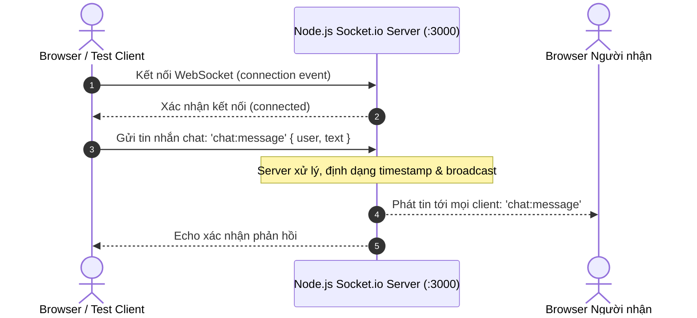

# Mini-plan: Khởi tạo và Smoke Test WebChat Socket.io tại Desktop (`test_kientruc_tdqworkflow`)

Soul: chất lượng > runtime > context cost · luật gốc: skills/tdq-conventions/references/soul.md

## Mục tiêu
Khởi tạo một dự án độc lập tại `C:\Users\admin\Desktop\test_kientruc_tdqworkflow` ứng dụng Node.js & Socket.io, xây dựng đầy đủ Server, Client giao diện trực quan, kịch bản Automated Smoke Test thời gian thực (real-time message ping-pong qua socket) và trình diễn toàn bộ quy trình vận hành chuẩn mực của TDQ Workflow.

## Cấu trúc dự án trên Desktop
```
C:\Users\admin\Desktop\test_kientruc_tdqworkflow\
├── package.json          # Quản lý dependency (express, socket.io, socket.io-client)
├── server.js             # HTTP & WebSocket Server xử lý phòng chat và tin nhắn
├── public\
│   └── index.html        # Giao diện WebChat trực quan, kết nối real-time
├── tests\
│   └── smoke_test.js     # Kịch bản kiểm thử client-server socket tự động
└── README.md             # Hướng dẫn chạy và giải trình kiến trúc luồng dữ liệu
```

## Luồng hoạt động & Sơ đồ kiến trúc (Fresher-Centric §2c)



## Giải thuật xử lý cốt lõi (§3c)
1. **Khởi tạo kết nối**: Server lắng nghe cổng 3000, bắt sự kiện `connection` và sinh `socket.id`.
2. **Xử lý tin nhắn (Real-time Broadcast)**:
   - Client emit sự kiện `chat:message` chứa payload `{ user, text }`.
   - Server kiểm tra tính hợp lệ (phòng vệ chống payload rỗng, cắt tỉa khoảng trắng).
   - Server gắn thêm `id` duy nhất và `timestamp`, sau đó thực hiện `io.emit('chat:broadcast', data)`.
3. **Automated Smoke Test**:
   - Khởi động server trong tiến trình ngầm.
   - 2 socket-client ảo (`Client1`, `Client2`) kết nối song song vào server.
   - `Client1` gửi tin nhắn "Xin chào từ TDQ Workflow".
   - `Client2` bắt sự kiện và khẳng định nội dung nhận được khớp 100%.
   - Đóng kết nối an toàn và dừng server (Graceful shutdown).

## Các bước triển khai (Tasks)
- [ ] **T1**: Tạo thư mục dự án `C:\Users\admin\Desktop\test_kientruc_tdqworkflow` và khởi tạo `package.json`.
- [ ] **T2**: Viết `server.js` tích hợp Express + Socket.io xử lý broadcast tin nhắn và tĩnh hóa client UI.
- [ ] **T3**: Thiết kế giao diện WebChat `public/index.html` với UX hiện đại, responsive.
- [ ] **T4**: Viết script kiểm thử tự động `tests/smoke_test.js` xác thực luồng truyền tin 2 chiều qua socket.
- [ ] **T5**: Chạy kịch bản smoke test, thu thập log và trình diễn quy trình vận hành cho người dùng.

## Definition of Done (QC)
- [ ] Q1: Thư mục dự án tồn tại trên Desktop với đầy đủ các file mã nguồn.
- [ ] Q2: Cài đặt dependencies `express`, `socket.io`, `socket.io-client` thành công.
- [ ] Q3: Script `smoke_test.js` chạy hoàn tất với kết quả PASS 100% (Client nhận trọn vẹn broadcast).
- [ ] Q4: Trình diễn chi tiết các bước vận hành và hướng dẫn mở trình duyệt trải nghiệm trực tiếp.
