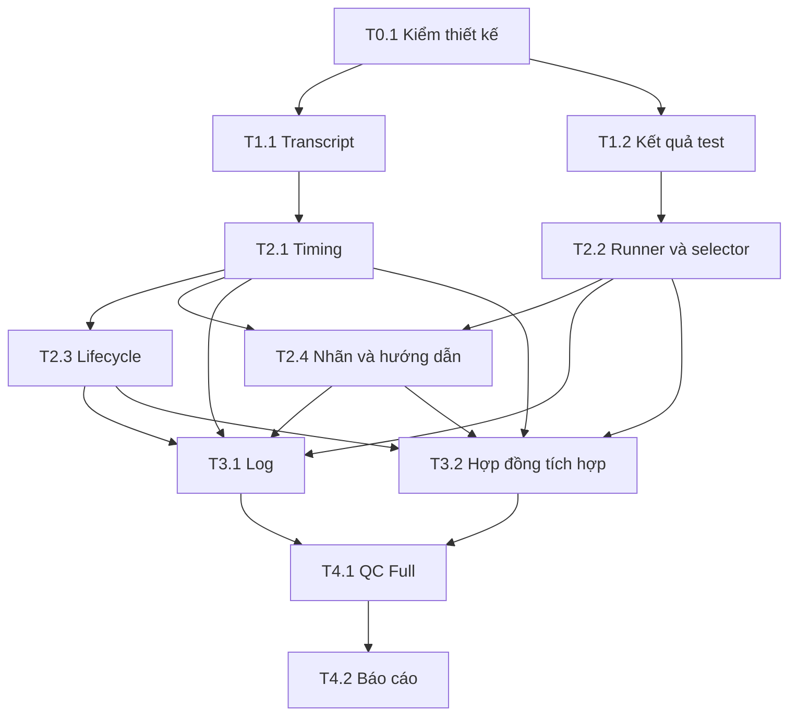

# PLAN — Đợt 1: đo đúng và bảo toàn lỗi

Ngày: 2026-10-27 · Spec: ../spec/2026-10-27-1246-do-dung-bao-toan-loi.md (bản 1.0, ĐÃ DUYỆT) · Lane: full
Soul: chất lượng > runtime > context cost · luật gốc: skills/tdq-conventions/references/soul.md
Mode thực thi: subagent — người dùng chọn `1a`, đã ghi implement_mode.
Trạng thái plan: HOÀN THÀNH — 15/15 task và 7/7 DoD; chờ quyết định bàn giao Git

Phê duyệt spec: người dùng nhắn nguyên văn `duyệt spec`, đã ghi qua CLI lúc 13:21 ngày 27/10/2026, Asia/Bangkok. Phê duyệt plan: `duyệt plan`, ghi lúc 13:49:57 cùng ngày. QC: **Full**. Nhánh: `bugfix/do-dung-bao-toan-loi`, nhánh gốc `dev`.

## Mục lục

- Quy tắc thi hành
- Thiết kế Trước vs Sau và vùng ảnh hưởng
- P0 — Kiểm mốc thiết kế
- P1 — Nguồn dữ liệu và kết quả có cấu trúc
- P2 — Tích hợp vào các entry point hiện có
- P3 — Log & test bắt buộc
- P4 — QC Full và bàn giao
- Cụm song song — phụ thuộc và file nóng
- Ánh xạ đầu ra
- Definition of Done
- Ước tính và mô phỏng cách chạy

## Quy tắc thi hành

1. Chỉ thực hiện sau khi plan được duyệt và người dùng chọn cách chạy. Thứ tự trong mỗi chuỗi phải theo `Cần:`; các nhánh độc lập được nêu ở phần cụm song song. Không tự spawn agent ở bước lập plan.
2. Task sửa code: `[ ]` → `[~]` → test đỏ có nguyên nhân đúng → sửa → test xanh → tick `[x]` ngay. ImportError do file mới chưa tồn tại không được dùng thay bằng chứng tái hiện E1–E4; dùng fixture chạm entry point cũ để chứng minh lỗi trước, rồi bổ sung unit test module mới.
3. `Chạm:` là vùng được phép ghi của task. Caller chỉ cần hồi quy được liệt kê ở bảng ảnh hưởng, không mở rộng vùng ghi chỉ vì có tham chiếu. Sửa ngoài vùng cần được giải thích và ghi lại trong plan trước khi làm; vẫn nằm trong đầu ra spec đã duyệt.
4. Lệnh test chạy từ root checkout này, dùng Python đang có và `scripts/` trong checkout để kiểm bản vừa sửa. Không dùng runner trong cache plugin làm bằng chứng rằng source mới đã đúng. Lệnh CLI quản lý state request thật vẫn dùng bản plugin đang cài.
5. Mỗi task code chạy phép kiểm ở dòng Test, sau đó `python scripts/tdq_test.py vung-cham --files` với đúng file của task. Nếu phép kiểm được chọn trùng hoàn toàn, lưu bằng chứng một lượt đã chạy, không lặp chỉ để có thêm log. Trong lúc sửa runner, chạy unittest trực tiếp trước để lỗi của chính selector không làm mất kiểm chứng.
6. Full suite của repo chỉ ở QC-F1 và sau vòng sửa QC cuối. Fallback rộng vì source không phân tích được vẫn giữ quy tắc an toàn hiện có và ghi lý do. Không chạy lại full suite chỉ vì viết report hoặc tick plan.
7. Mọi test gọi init/set/close/finish dùng `TemporaryDirectory`, truyền `TDQ_PROJECT_DIR` trong `env` của chính subprocess; runner dùng `--repo` trỏ fixture. Đặt `TDQ_KHONG_CHAM_MAY=1`, `TDQ_KHOI_TAO_NEN=0` cho tiến trình test. Không dùng state/project thật của người dùng làm fixture.
8. Không đặt UTF-8 toàn cục cho suite. Fixture subprocess được đặt encoding riêng khi cần đọc JSON. Mọi fixture dùng dữ liệu tổng hợp theo schema log đã khảo sát, không commit hội thoại hoặc secret thật.
9. Pytest/xdist vẫn tùy chọn. Một fixture kiểm backend pytest thật có thể skip riêng khi thiếu dependency, nhưng parser XML, verdict và fallback vẫn phải có unit test stdlib. Khi chạy fixture pytest trên máy có xdist, đặt `PYTEST_XDIST_AUTO_NUM_WORKERS=1` trong env riêng của fixture để không mở cả CPU; không đổi worker mặc định của plugin. Biến này đã được đối chiếu với xdist cục bộ.
10. Timeout ở harness fixture giữ giới hạn subprocess đã dùng trong test repo; không thêm timeout mặc định cho toàn suite. Mock chỉ ở ranh giới tiến trình/host để tiêm lỗi timeout/hủy, không mock chính chức năng đang chứng minh.
11. QC trượt: thêm task sửa đúng định dạng dưới mục QC vòng N, kiểm lại mục trượt/vùng ảnh hưởng và full sau vòng sửa cuối theo quy tắc workflow. Không hạ DoD, đổi FAIL thành SKIP, hoặc dùng kết quả baseline trước sửa thay kết quả cuối.
12. Không thay source hợp đồng approval, soul, mode, worker/reuse/preflight; không commit, merge, push hoặc nâng bản plugin ở request này.

## Thiết kế Trước vs Sau và vùng ảnh hưởng

| Khía cạnh | Trước | Sau theo spec đã duyệt |
|---|---|---|
| Timing | Cộng gap assistant, cắt ở 300 giây, gọi là model time | Ghép ID có bằng chứng; hợp khoảng; quality/reason và null khi không đo được |
| Transcript | Đường Claude Windows sai; timing không nhận Codex | Resolver theo host/project/session, tự dò ghi project_window |
| Runner | FAIL có thể mất danh tính module; report thiếu dễ bị xử lý không nhất quán | Kết quả cấu trúc; đối chiếu exit/count/report; giữ lỗi chưa ánh xạ |
| Selector | Direct rỗng có thể PASS 0 module | Thử bắc cầu/fallback cho source; phân biệt SKIP và INCOMPLETE |
| Consumer | Số đo v1 có nghĩa cũ, lifecycle có import muộn | V2 có tên đo riêng, v1 giữ nhãn cũ, close-once/init vẫn đúng |

Thiết kế duy nhất dùng để triển khai là [spec đã duyệt](../spec/2026-10-27-1246-do-dung-bao-toan-loi.md), [preview HTML](../spec/2026-10-27-1246-do-dung-bao-toan-loi-preview.html) và [manifest](../spec/2026-10-27-1246-do-dung-bao-toan-loi-preview.manifest.json). Không tạo sơ đồ thiết kế khác trong plan.

Giữ nguyên bản spec đã gắn manifest, kể cả dòng trạng thái của bản xuất ban đầu: trạng thái duyệt thực lấy từ CLI và được ghi ở đầu plan/brief. Archify hiện hash cả metadata và newline; chỉ sửa trạng thái trong file cũng làm binding khác. Kiểm đã xác nhận bản nội dung duyệt có digest `223cea52fef1835a30f7a34bd58594d5056589ba3d303ffe08971994797c81b6`.

| Nhóm | Bằng chứng quan hệ đã kiểm | Caller/test cần hồi quy ngoài vùng ghi chính |
|---|---|---|
| Transcript | LSP `default_transcript_dir`: 8 tham chiếu; wrapper được dùng trong timing, token/step audit | `tests/test_token_audit.py`, `tests/test_step_budget.py`; CLI token/step audit giữ Claude-only |
| Timing | LSP `cua_so_phase`, `moc_model`, `_giay_model`, `tong_hop`, formatter, close, main; Graphify `tong_hop → main` | `tdq_state._dong_so_request_cu`, `tdq_finish.step_dong_so`, `tests/test_timing.py`, `tests/test_tdq_finish.py`, `tests/test_archify_finish.py` |
| Runner/selector | LSP `ban_kinh`, các runner/cmd, `module_bo_sot`, `dem`; Graphify `ban_kinh → cmd_vung_cham → main` và `chay_tron_bo → cmd_tron_bo → main` | `tdq_state._tron_bo_vuot` qua `dem_repo`, `tests/test_next_tron_bo.py`; giữ các khóa đếm cũ |
| Vòng đời | LSP `_dong_so_request_cu` và `step_dong_so`: mỗi symbol 2 tham chiếu; grep xác nhận import muộn và subprocess | Entry point init/finish, state thật chỉ ghi qua CLI; không import timing sớm |

Chi tiết 21 truy vấn LSP: [plan-impact.json](../artifacts/2026-10-27-1246-do-dung-bao-toan-loi/plan-impact.json). GCF trả số tham chiếu gồm declaration; đã đối chiếu tên file/caller bằng grep và graph. Graph không chứa mọi test/import muộn. File mới chưa có node LSP; quan hệ mới sẽ được kiểm sau khi có code, không giả lập bằng chứng ở bước plan.

## P0 — Kiểm mốc thiết kế

- [x] **T0.1** (e1m) Kiểm lại spec/preview đã duyệt trước khi code, lưu kết quả cùng baseline E1–E5 và giữ nguyên trạng thái browser-check gốc — Test: `python scripts/tdq_archify.py verify --document docs/tdq/spec/2026-10-27-1246-do-dung-bao-toan-loi.md --manifest docs/tdq/spec/2026-10-27-1246-do-dung-bao-toan-loi-preview.manifest.json` trả binding current trước sửa source.
  - Dùng: `archify`
  - Để: Kiểm artifact thiết kế đã được duyệt bằng CLI cục bộ; dùng lại hướng dẫn Archify đã đọc.
  - Ra: HTML/manifest cùng slug đã có và biên nhận kiểm trong `docs/tdq/artifacts/2026-10-27-1246-do-dung-bao-toan-loi/`.
  - Kiểm: `python scripts/tdq_archify.py verify --document docs/tdq/spec/2026-10-27-1246-do-dung-bao-toan-loi.md --manifest docs/tdq/spec/2026-10-27-1246-do-dung-bao-toan-loi-preview.manifest.json`
  - Không dùng cho: Sinh lại thiết kế đã duyệt, sửa Archify engine hoặc làm xanh browser-check bị lỗi Windows.

**Xong P0 khi:** nội dung spec và preview đúng snapshot phê duyệt. Nếu source thay đổi ngoài request thì phân biệt với đổi thiết kế; không ghi lại binding để giấu khác biệt.

## P1 — Nguồn dữ liệu và kết quả có cấu trúc

- [x] **T1.1** (e12m) Tạo resolver/adapter transcript và chuyển wrapper Claude sang quy tắc đường dẫn đúng; giữ ranh giới không ghi state, đọc JSONL theo dòng, kiểm cwd/session, ghép ID/out-of-order và ghi tình trạng thiếu/hỏng — Test: `python -m unittest discover -s tests -p test_transcript.py` đạt với fixture Windows/POSIX/Unicode, slug trùng, session qua ngày/đồng thời, metadata sai/thiếu, duplicate/conflict, Claude API/tool và Codex thiếu API span.
  - Chạm: `scripts/tdq_transcript.py`, `scripts/token_audit.py`, `tests/test_transcript.py`, `tests/test_token_audit.py` → resolver mới và `default_transcript_dir`; caller audit giữ chữ ký cũ.
  - Cần: T0.1

- [x] **T1.2** (e10m) Tạo hợp đồng kết quả test và parser thuần cho unittest/JUnit XML; chuẩn hóa verdict/count/module, giữ lỗi chưa ánh xạ, không coi exit 0 hoặc report rỗng là đủ PASS — Test: `python -m unittest discover -s tests -p test_tdq_test_result.py` đạt với failure/error/collection/unexpected success, classname không có file, parameter ID, tên module mơ hồ, skip-only và report thiếu/hỏng/mâu thuẫn.
  - Chạm: `scripts/tdq_test_result.py`, `tests/test_tdq_test_result.py` → module mới, nhận dữ liệu và trả kết quả; không chạy subprocess hoặc đổi state.
  - Cần: T0.1

**Xong P1 khi:** các nguồn/parser trả đúng hợp đồng đã duyệt, fixture không chứa nội dung log riêng tư. Phép kiểm wrapper cũ `test_token_audit.py` chạy trong hồi quy vùng chạm của T1.1.

## P2 — Tích hợp vào các entry point hiện có

- [x] **T2.1** (e12m) Thay timing theo gap bằng tổng hợp span, clipping request/phase và hợp khoảng; xuất schema v2, cờ host/session, Markdown/status cùng nghĩa, model_giay null và nhãn v1; giữ close-once — Test: `python -m unittest discover -s tests -p test_timing.py` đạt với lịch thời gian biết trước, overlap, dài hơn 300 giây, phase lặp, streaming cắt, job chưa kết thúc và JSON/Markdown nhất quán.
  - Chạm: `scripts/tdq_timing.py`, `tests/test_timing.py` → `cua_so_phase`, phần thay `moc_model/_giay_model`, `tong_hop`, formatter/close/CLI; caller state được tích hợp ở T2.3.
  - Cần: T1.1

- [x] **T2.2** (e16m) Tích hợp kết quả cấu trúc vào runner, selector và ledger trong một vùng ghi: pytest XML riêng từng invocation, kiểm dependency trước chạy, bảo toàn lỗi sau chạy; direct rỗng thử bắc cầu/fallback; ghi scope và độ đầy đủ của thống kê bỏ sót — Test: `python -m unittest discover -s tests -p test_tdq_test.py` đạt, gồm lớp mới `IndirectSelection` kiểm core → facade → test, direct xanh/indirect đỏ, no-op SKIP, source không test INCOMPLETE, các lỗi backend và ledger đúng verdict.
  - Chạm: `scripts/tdq_test.py`, `tests/test_tdq_test.py`, `tests/test_next_tron_bo.py` → `chay_module`, `chay_tron_bo`, `cmd_vung_cham`, `cmd_tron_bo`, `_module_cua`, `module_bo_sot`, `dem`, `cmd_so`; tái dùng `ban_kinh`/AST hiện có.
  - Cần: T1.2

- [x] **T2.3** (e6m) Chuyển caller đóng sổ của state sang resolver auto và khóa tương thích init/finish bằng fixture lifecycle; giữ import muộn, không chặn init do thống kê và khôi phục TDQ_LOG — Test: `python -m unittest discover -s tests -p test_timing_lifecycle.py` đạt khi có/thiếu log, Codex-only, close lặp, init request mới và finish về idle; không sửa state thật của repo.
  - Chạm: `scripts/tdq_state.py`, `tests/test_timing_lifecycle.py` → `_dong_so_request_cu`; `tdq_finish.step_dong_so` giữ entry point hiện có và được kiểm qua subprocess.
  - Cần: T2.1

- [x] **T2.4** (e4m) Ghi rõ chỉ số gap/latency cũ của step audit là legacy estimate; cập nhật hướng dẫn report/status theo timing v2, không đổi phép tính token/cost hoặc cổng workflow — Test: `python -m unittest discover -s tests -p test_step_budget.py` đạt với wrapper đường dẫn, số liệu legacy và nhãn báo cáo; lint/ngân sách rule chạy qua finish cho đúng file đã sửa.
  - Chạm: `scripts/step_audit.py`, `tests/test_step_budget.py`, `skills/tdq-build/references/report-template.md`, `skills/tdq-status/SKILL.md` → `report` và caller CLI; không chép code vào skill.
  - Cần: T2.1, T2.2

**Xong P2 khi:** entry point mới giữ lỗi/quality/scope đúng và consumer cũ không crash. Sửa runner/selector cùng một task tránh hai người sửa chung `tdq_test.py`; các bước kiểm độc lập vẫn có ca đỏ và output riêng trong bằng chứng T2.2.

## P3 — Log & test bắt buộc

- [x] **T3.1** (e4m) Khóa hợp đồng log runtime bật mặc định, timestamp, lý do fallback/nguồn thiếu, TDQ_LOG=0 và JSON stdout sạch qua entry point công khai — Test: `python -m unittest discover -s tests -p test_phase1_logging.py` đạt với log bật/tắt và lỗi dữ liệu; không mock hàm log hoặc formatter để tự khẳng định xanh.
  - Chạm: `tests/test_phase1_logging.py` → test mới chạy timing/runner thật với project tạm; phần log runtime thuộc chủ file T1.1/T2.1/T2.2/T2.3, sửa thiếu sót tại đúng task chủ.
  - Cần: T2.1, T2.2, T2.3, T2.4

- [x] **T3.2** (e6m) Bổ sung bộ unit test liên thành phần theo Given–When–Then, kiểm kết quả công khai và dữ liệu lưu; có nhóm `Compatibility` cho v1/v2 và ledger, không nhân bản toàn bộ ca parser đã có — Test: `python -m unittest discover -s tests -p test_phase1_contract.py` đạt với hành trình timing/runner/lifecycle chính, ca biên và lỗi/phục hồi của spec §6.
  - Chạm: `tests/test_phase1_contract.py` → fixture tổng hợp và gọi module/CLI thật, không tạo runtime helper mới.
  - Cần: T2.1, T2.2, T2.3, T2.4

**Xong P3 khi:** từng module có unit test, và một lệnh chạy được bộ hợp đồng liên thành phần. Log là tiêu chí runtime riêng, không dựng dịch vụ log mới. Nếu test phát hiện lỗi của file chủ đã tick, mở task fix ghi rõ chủ file và dependency; không để hai người cùng ghi.

## P4 — QC Full và bàn giao

- [x] **T4.1** (e10m) Chạy DoD D1–D6 và QC-F1→F4, lưu command/exit/count/output cùng phạm vi và các giới hạn của backend vào hồ sơ QC — Test: `python scripts/tdq_test.py tron-bo` trên trạng thái cuối đạt; dùng chính lượt đó cho cả D6 và QC-F1, đồng thời hoàn tất bảng QC cố định bên dưới.
  - Cần: T3.1, T3.2

- [x] **T4.2** (e4m) Viết báo cáo trước/sau từ baseline và bằng chứng mới, đối chiếu D7, ghi giới hạn dữ liệu/browser/CI và phương án quay lui; hoàn tất hồ sơ QC trước khi chuyển phase report — Test: `python scripts/doc_lint.py docs/tdq/qc/2026-10-27-1246-do-dung-bao-toan-loi.md docs/tdq/reports/2026-10-27-1246-do-dung-bao-toan-loi.md` đạt, các dẫn chiếu output được mở và đối chiếu với log thực, không chỉ kiểm file có tồn tại.
  - Cần: T4.1

**Xong P4 khi:** D1–D7 và bốn kiểm cố định có kết quả cùng bằng chứng, báo cáo khớp trạng thái cuối. Lint chỉ chứng minh hình thức tài liệu; người thực hiện phải đối chiếu nội dung với output/hash thực trước khi tick D7.

### Kiểm cố định của QC Full

| Mục | Thực hiện | Bằng chứng cần giữ |
|---|---|---|
| QC-F1 | `python scripts/tdq_test.py tron-bo`; sau đó `python scripts/tdq_test.py so --json` | Số test, skipped có lý do, exit/verdict, số lượt full và thống kê bỏ sót; dùng lại lượt D6 |
| QC-F2 | `python scripts/tdq_test.py vung-cham --files` với hợp các đường dẫn nguồn/test thực sự sửa trong T1–T3 | Danh sách module thật sự đã chạy; quan hệ mới/consumer đã có test. Thiếu test không tính PASS |
| QC-F3 | Đối chiếu mọi luật spec §5 bằng import graph/AST và caller; `python scripts/i18n_check.py scripts/tdq_transcript.py scripts/tdq_test_result.py scripts/token_audit.py scripts/tdq_timing.py scripts/tdq_test.py scripts/tdq_state.py scripts/step_audit.py skills/tdq-build/references/report-template.md skills/tdq-status/SKILL.md` | Kết quả cho từng luật: không scripts→hooks/tests; không quyền ghi state mới; runtime mới đúng tầng; skill không sao code; ngôn ngữ theo tầng |
| QC-F4 | Đọc và trả lời 5 câu ở `skills/tdq-conventions/references/clean-code.md` trên diff cuối | Câu trả lời cùng file/vị trí; có “không” phải sửa và nêu việc sửa |

QC-F2 phải ghi nhận các consumer đọc-only `tests/test_tdq_finish.py`, `tests/test_archify_finish.py`, `tests/test_next_tron_bo.py` và token/step audit. Nếu chúng đã nằm trong kết quả selector thì không chạy lại riêng; nếu bị bỏ sót thì bổ sung vào lượt hồi quy và nêu lý do.

Toàn suite tuần tự dùng stdlib là đường chứng nhận bắt buộc trên máy này. Không khẳng định đã chạy mọi OS/Python của CI từ một máy Windows; giữ compatibility test và báo rõ môi trường thực. Không thêm vòng smoke, session runtime dài hạn hoặc agent QC độc lập vì mức người dùng chọn là Full.

Sau thay đổi source, preview `planned` vẫn là snapshot thiết kế được duyệt. Lệnh verify tổng có thể báo source stale đúng với việc source đã đổi; phải phân biệt với binding tài liệu/HTML hỏng. Giữ nguyên manifest gốc và kiểm binding/hash snapshot, ghi source drift trong report; không bind lại để giả vờ preview là kiến trúc hiện tại. Master architecture đang stale từ trước là dữ kiện nền, không thêm dự án sửa toàn bộ master vào đợt này.

## Cụm song song — phụ thuộc và file nóng

| Cụm có thể tách | Task | Vùng ghi / giới hạn |
|---|---|---|
| A — Transcript/timing | T1.1 → T2.1 → T2.3 | Nguồn log, tổng hợp thời gian và caller lifecycle |
| B — Kết quả test | T1.2 → T2.2 | Parser kết quả, runner, selector và ledger |
| Giao điểm — người điều phối giữ | T2.4 sau T2.1/T2.2 | Nhãn legacy và hướng dẫn có nghĩa ổn định sau tích hợp; có file skill nên máy xếp `file-luat` |
| C — Kiểm hợp đồng | T3.1 và T3.2 sau P2 | Hai file test độc lập; không ghi source của cụm A/B |
| Các task khác người điều phối giữ | T0.1, T4.1, T4.2 | Binding, QC cuối và báo cáo; cùng T2.4 là 4 task giữ, 7 task có thể giao |

Không có đường dẫn ghi nào được khai ở hai task trong bản plan này. Các file dễ xung đột đã có **một task chủ ghi duy nhất**: `tdq_timing.py` thuộc T2.1; `tdq_test.py` thuộc T2.2; `tdq_state.py` thuộc T2.3. T3 chỉ viết test của nó; lỗi runtime được gửi về chủ file/fix task có thứ tự. Điều này giữ đúng luật file nóng, không chỉ đổi tên hai người cùng sửa thành “tuần tự”.

Không có task mang nhãn `(mcp)`: Archify ở T0.1 dùng CLI. LSP là công cụ khảo sát/kiểm vùng chạm, không phải một hợp đồng skill giao việc bắt buộc chỉ một host chạy. Trước lần dùng MCP trong triển khai phải probe kết nối; chỉ kiểm setup lại khi bằng chứng hỏng hoặc môi trường đổi.

## Ánh xạ đầu ra

| Spec §2 | Task tạo/kiểm đầu ra | Node/quy tắc trong preview | DoD |
|---|---|---|---|
| O1 timing v2 | T2.1, T2.3, T3.1, T3.2 | pairing → union → timing_record; unknown giữ quality | D1, D5 |
| O2 nguồn transcript | T1.1, T2.3 | logs → identity → pairing; project/session và nguồn thiếu | D2 |
| O3 kết quả test | T1.2, T2.2, T3.1, T3.2 | runner → verdict → ledger; exit/count/report | D3 |
| O4 test gián tiếp | T2.2, T3.2 | changes → selection; còn rỗng không tự PASS | D4 |
| O5 tương thích/hồi quy | T2.3, T2.4, T3.1, T3.2, T4.1 | snapshot legacy, lifecycle, QC Full và consumer | D5, D6 |
| O6 hồ sơ bàn giao | T0.1, T4.1, T4.2 | Thiết kế planned, bằng chứng thực và giới hạn | D7 |

## Definition of Done

Đúng 7 dòng tương ứng D1–D7 trong spec §6. Các command dưới đây là phép kiểm chính; kết quả có thể dùng lại từ task/QC-F1 khi code và đầu vào không đổi, không yêu cầu chạy lần nữa để tick. Bốn kiểm cố định bổ sung được ghi riêng trong hồ sơ QC, không nhân số dòng DoD.

- [x] D1 Thời gian/API/tool/union/quality đúng lịch fixture, không đoán model hoặc idle — `python -m unittest discover -s tests -p test_timing.py`
- [x] D2 Nguồn Claude/Codex đúng host/project/session, nguồn thiếu/hỏng không thành 0 hợp lệ — `python -m unittest discover -s tests -p test_transcript.py`
- [x] D3 Hai backend bảo toàn verdict và lỗi, report thiếu hoặc skip-only không PASS — `python -m unittest discover -s tests -p "test_tdq_test*.py"`
- [x] D4 Lỗi gián tiếp bị bắt tại phạm vi bắt buộc; phân biệt direct/no-op/thiếu test — `python -m unittest discover -s tests -p test_tdq_test.py -k IndirectSelection`
- [x] D5 V1/v2, ledger và consumer/lifecycle giữ hợp đồng, lịch sử không viết lại, close-once và JSON sạch — `python -m unittest discover -s tests -p test_phase1_contract.py -k Compatibility`
- [x] D6 Trạng thái cuối đạt toàn unit suite và các kiểm QC Full đã nêu, không dùng baseline cũ để chứng nhận — `python scripts/tdq_test.py tron-bo`
- [x] D7 QC/report có before/after, bằng chứng tái lập, snapshot thiết kế và giới hạn đúng, có phương án quay lui — `python scripts/doc_lint.py docs/tdq/qc/2026-10-27-1246-do-dung-bao-toan-loi.md docs/tdq/reports/2026-10-27-1246-do-dung-bao-toan-loi.md`

Đối với D5, nhóm `Compatibility` gọi entry point thực để kiểm cả đọc dữ liệu cũ và ghi mới; không chỉ kiểm field tồn tại. Đối với D7, command lint là kiểm hình thức, bổ sung đối chiếu nội dung và hash từ T0.1/T4.2 vào cùng một mục bằng chứng; không gọi việc chỉ có file là đủ PASS.

## Ước tính và mô phỏng cách chạy

| Giai đoạn | Task | Tổng eNm |
|---|---|---|
| P0 | 1 | 1 phút |
| P1 | 2 | 22 phút |
| P2 | 4 | 38 phút |
| P3 | 2 | 10 phút |
| P4 | 2 | 14 phút |
| Tổng | 11 | 85 phút |

eNm là ước tính thời gian agent làm việc nếu thực hiện các task nối tiếp, không gồm chờ duyệt và không phải cam kết thời hạn. Không suy ra phần trăm tăng tốc workflow từ con số này.

Mô phỏng đã chạy trên chính file plan bằng `tdq_bench.py simulate`, bộ hằng số `docs/tdq/bench/2026-08-17-2001-smoke-test-main-vs-doi-thuc-do.json`, hệ số agent 1.5. Kết quả: **main 22,4 phút; đội 12,3 phút; Winner đội, chênh 10,1 phút**. Máy phân 7 task có thể giao, người điều phối giữ 4, thành 4 đợt giao việc. Đề xuất `subagent` theo kết quả này, chưa phải lựa chọn của người dùng. [Biên nhận mô phỏng và kiểm cấu trúc plan](../artifacts/2026-10-27-1246-do-dung-bao-toan-loi/plan-simulation.json).

Bộ hằng số là mẫu cũ trên macOS, trộn số đo nhập tay và stub. Công thức dùng thời lượng task đồng đều, không dùng eNm riêng của từng task, và cho phép phần người điều phối làm xen kẽ mà chưa mô hình hóa đầy đủ phụ thuộc của phần đó. Vì vậy 22,4/12,3 phút chỉ là điểm so sánh theo mô hình; không phải ETA thực tế, benchmark Windows hiện tại hoặc cam kết tăng tốc. Tổng eNm 85 phút là ước tính công việc riêng; đánh giá A/B toàn workflow vẫn thuộc đợt 3.

Máy cho chọn `main` hoặc `subagent`; người dùng đã chọn `subagent` bằng `1a` sau khi duyệt plan. `codex` không được workflow cho chọn vì chưa có ủy quyền gọi CLI phụ; không xem việc đang dùng ứng dụng Codex là ủy quyền đó.

## QC vòng 1 — fix

Lượt QC-F1 đầu: 3.206 test, 9 skip, 5 failure; giữ nguyên biên nhận và 4 module bỏ sót trong ledger. Vòng sửa này nằm trong đầu ra tương thích/hồ sơ đã duyệt, không thay đổi gate hoặc worker mặc định.

- [x] **QC1.1** Cập nhật kiểm tra ngân sách gói portable cho đúng hai module runtime đã duyệt; giữ nguyên trần của phần còn lại, kiểm hai module có trong gói và import closure — Test: `python -m unittest discover -s tests -p test_build_portable.py`
  - Chạm: `tests/test_build_portable.py` → kiểm cây release, không thay bộ lọc runtime.

- [x] **QC1.2** Xác minh lỗi Archify native browser-check trên Windows, thử cách chạy được engine hỗ trợ; giữ lỗi thật và ghi giới hạn nếu môi trường không đạt, không skip hay sửa test để che lỗi — Test: `python -m unittest discover -s tests -p test_archify_e2e.py`

- [x] **QC1.3** Đồng bộ chỉ mục report-template và neo L037 với nghĩa timing v2, giữ nguyên luật lịch sử, cập nhật token lock từ nội dung thật — Test: `python -m unittest discover -s tests -p test_luat_skill.py`
  - Chạm: `skills/tdq-build/references/report-template.md`, `docs/tdq/audit/luat-hien-co.md`, `docs/tdq/token-budget.json` → chỉ metadata/neo luật; chạy thêm test_doc_index vì lỗi được phát hiện ở đó.
  - Cần: T2.4

T4.1 tiếp tục sau QC1.1–QC1.3. Chỉ chạy lại toàn suite một lần sau vòng sửa cuối; các lượt đỏ không bị xóa hoặc đổi nhãn.

Kết quả QC1.2: native Archify đạt 2 test (có subtest full/quick), 12.788s, exit 0 khi khởi chạy từ Explorer ở quyền thường. Không thay test, browser engine, dependency hoặc cấu hình bảo mật. Lỗi quyền cao giữ trong biên nhận đầu; Full cuối phải chạy trong cùng bối cảnh quyền thường.

## QC vòng 2 — fix

Lượt Full ở quyền thường phát hiện test cập nhật plugin đang dùng cả ROOT thật làm nguồn, kéo theo cache không đọc được trong worktree cũ. Không đổi ACL hay xóa worktree của người dùng. Sửa tính cô lập của fixture, vẫn phải kiểm copy dữ liệu và metadata cập nhật thật; không mock thành công, không sửa runtime updater ngoài phạm vi.

- [x] **QC2.1** Cô lập nguồn plugin của test tự cập nhật trong thư mục tạm, giữ kiểm đường copy fallback thật và xác nhận payload/installed metadata; tránh đọc repo cùng cache cá nhân làm fixture — Test: `python -m unittest discover -s tests -p test_mcp_first_auto_setup.py`
  - Chạm: `tests/test_mcp_first_auto_setup.py` → chỉ fixture của test cập nhật plugin, không sửa scripts/tdq_setup.py hoặc quyền filesystem.

T4.1 hoàn tất sau QC2.1 và lượt Full kiểm lại. Tổng thực tế ba lượt Full; sổ cuối có ngân sách ba lượt, dự kiến ban đầu hai lượt. Giữ nguyên mọi lượt đỏ. F2 chọn full vì vùng chạm 129/167 đạt ngưỡng; tái sử dụng bằng chứng F1 cùng HEAD/hash, bổ sung 84 test từ sáu module pytest chưa được unittest thu thập. Proof kết hợp đủ 167/167 module nằm trong hồ sơ QC; không chạy lại toàn suite chỉ để đổi nhãn kiểm.
