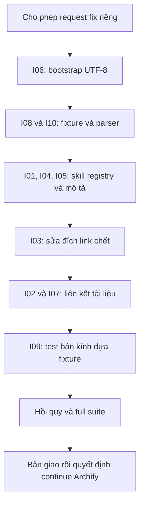

# REPORT — Phân tích và đề xuất xử lý 10 issue nền

Ngày: 2026-10-25 · Request: 2026-10-25-1113-phan-tich-muoi-issue · full / main / QC full
Soul: chất lượng > runtime > context cost · luật gốc: skills/tdq-conventions/references/soul.md

**Phạm vi: chỉ đề xuất, chưa fix.** Đây không phải thông báo repo đã xanh. Mọi file sửa nêu bên dưới là phạm vi tương lai, chỉ triển khai sau khi được cho phép riêng. Trạng thái: hoàn tất nội dung phân tích và kiểm chứng theo phạm vi tài liệu; **toàn repo vẫn FAIL**, lifecycle chưa đóng vì gate worktree cũ. Full suite mới:2974tests trong637.997s,9failures,2errors,10skipped,exit1. Ngoài10issue còn có lỗi WinError32 chưa đối chứng baseline, được ghi riêng bên dưới.

## Kết luận điều hành

I01–I07 là thiếu đồng bộ quy chuẩn/tài liệu/bootstrap; I08 và I10 có bằng chứng trực tiếp fixture/phép kiểm sai với contract hiện tại; I09 là giới hạn đo trên repo biến động và selector cố ý bảo thủ. Không nên áp cùng một cách "sửa production" cho cả 10.

Ưu tiên đề xuất: bảo vệ bootstrap I06; chỉnh phép kiểm đúng contract I08/I10; xử lý nhóm skill I01/I04/I05; sửa link chết rồi wiring I03/I02/I07; cuối cùng chuẩn hóa test bán kính I09. Có thể đổi thứ tự theo phạm vi release, nhưng không làm suy yếu kiểm để đạt số xanh.

Baseline kế thừa: a03d698 và 5d6570d đều tái hiện 10 lỗi theo QC Archify. Log cuối Archify: 2974 tests,9 failures,1 error,10 skipped. Kết quả đó không thay thế lượt QC mới của báo cáo này.

## I01 — Browser skills không nói rõ pha kế tiếp

- **Triệu chứng:** hai dòng Next step bị test quy chuẩn từ chối.
- **Nguyên nhân:** browser-research và browser-test là công cụ phục vụ nhiều phase nhưng dòng cuối chỉ nói tác vụ kế tiếp, không chỉ rõ phase giữ nguyên hay chuyển.
- **Bằng chứng:** `skills/tdq-browser-research/SKILL.md:51`, `skills/tdq-browser-test/SKILL.md:77`; `tests/test_luat_gate_chat.py:90`. ĐÃ XÁC MINH qua source và failure baseline.
- **Phân loại:** lỗi hợp đồng tài liệu, không phải lỗi kết nối trình duyệt.
- **Phương án chọn:** thêm ý `the phase does not change` và trả điều phối cho skill gọi; giữ hướng dẫn xuất nghiên cứu/QC hiện tại. Tool skill không tự chuyển phase.
- **Phương án loại:** ép research về analyze và browser-test về qc; sai khi chúng được dùng ở implement hoặc kiểm preview trước duyệt.
- **Vùng ảnh hưởng:** hai SKILL.md; cập nhật index/token lock/neo luật bằng generator nếu dòng thay đổi. Không sửa tdq_state.PHASE_TABLE.
- **Test bảo vệ:** dương: cả hai skill nêu giữ phase và còn đường bàn giao; âm: bỏ câu phase phải bị phát hiện. Thử đọc skill trong analyze/implement/qc, không sinh lệnh set phase ngoài caller. Rollback: hoàn nguyên riêng câu sửa nếu lệch contract, giữ test báo đỏ.

## I02 — Ba reference chưa được liên kết trực tiếp

- **Triệu chứng:** knowledge-template.md, chrome-devtools-mcp-guide.md và mcp-first-guide.md bị liệt kê ngoài tầng một.
- **Nguyên nhân:** file tồn tại nhưng chưa có SKILL.md trỏ thẳng; link từ template/reference khác không đáp ứng hợp đồng repo.
- **Bằng chứng:** `tests/test_reference_mot_tang.py:155`; các file dưới skills/tdq-conventions/references và skills/tdq-setup/references. Đây là luật nội bộ repo, không quy kết thành chuẩn bắt buộc của mọi nền tảng.
- **Phân loại:** wiring tài liệu.
- **Phương án chọn:** conventions trỏ knowledge-template ở mục cây tài liệu; setup trỏ hai guide ở bước MCP. Link đúng chủ, có điều kiện khi nào đọc; giữ instruction hiện có khi cân trần dòng.
- **Phương án loại:** đưa vào whitelist DIEU_PHOI để miễn kiểm, hoặc nối tất cả vào một skill không liên quan. Cả hai chỉ che thiếu ownership.
- **Vùng ảnh hưởng:** skills/tdq-conventions/SKILL.md và skills/tdq-setup/SKILL.md; index/ledger/token lock liên quan. I03 phải xử lý trước khi quảng bá guide có link chết.
- **Test bảo vệ:** dương: ba reference đều reachable trực tiếp; âm: bỏ từng link phải fail và chỉ đúng file. Kiểm line/token cap, relative link và nội dung cũ không bị rút mất. Rollback từng link độc lập, không sửa whitelist.

## I03 — Link hướng dẫn script không tồn tại

- **Triệu chứng:** chrome-devtools-mcp-guide.md trỏ chrome-devtools-mcp-scripts.md không có trên đĩa.
- **Nguyên nhân:** tài liệu trỏ tên cũ/không được bàn giao; runtime thực tế nằm ở tdq_devtool_mcp.py. Chưa đủ chứng cứ khẳng định mọi nội dung tưởng định của file mất đã nằm trong script.
- **Bằng chứng:** `skills/tdq-setup/references/chrome-devtools-mcp-guide.md:3`; `tests/test_reference_mot_tang.py:193`; script thật `scripts/tdq_devtool_mcp.py:1`.
- **Phân loại:** link chết trong tài liệu.
- **Phương án chọn:** đối chiếu nội dung guide và CLI thực, thay link bằng đường dẫn tương đối có thật tới script/hướng dẫn hiện có; diễn đạt rõ đó là mã thực thi, không hứa có hướng dẫn nâng cao chưa tồn tại. Viết tiếng Anh ở rule layer.
- **Phương án loại:** tạo một file rỗng chỉ để tồn tại, hoặc đổi thành text tên file không tồn tại nhằm né regex link checker.
- **Vùng ảnh hưởng:** guide và các link giới thiệu nó; không viết lại launcher hoặc thêm dependency.
- **Test bảo vệ:** dương: link mới resolve đúng file và lệnh được mô tả khớp CLI; âm: link Markdown không có đích vẫn fail. Kiểm thư mục project khác để không hard-code admin path. Rollback tài liệu không ảnh hưởng runtime.

## I04 — Registry giới hạn chưa đăng ký hai browser skills

- **Triệu chứng:** 11 skill directories nhưng chỉ 9 keys trong bảng giới hạn.
- **Nguyên nhân:** thêm browser skills không đồng bộ registry SKILL_LINE_LIMITS. Test tên exactly_six_skills lỗi thời về tên nhưng assertion thực so sets, không phải cố định số6.
- **Bằng chứng:** `scripts/doc_lint.py:36`; `tests/test_skill_shape.py:123`. Comment quy tắc headroom ở `scripts/doc_lint.py:45` yêu cầu có số đo chứ không tự bịa trần.
- **Phân loại:** thiếu khai báo code/config hợp đồng và thiếu shape coverage, không phải lý do xóa tính năng.
- **Phương án chọn:** đăng ký hai keys với cap đo trên nội dung sau I01, headroom có giải trình theo quy tắc hiện hữu; bổ sung shape tests tương ứng, đổi tên/docstring test về registry consistency. Không thay các cap đã tồn tại.
- **Phương án loại:** bỏ hai skill khỏi so sánh hoặc tăng mọi cap đồng loạt. Các con số 60/85 từng được khảo sát nêu chỉ là ứng viên chưa duyệt, không là kết quả đã đo sau sửa.
- **Vùng ảnh hưởng:** doc_lint registry, test_skill_shape, hai browser skills; kiểm portable skill inventory riêng vì packaging có bảng thứ tự độc lập.
- **Test bảo vệ:** dương: mọi skill có key và không vượt cap; âm: skill lạ, thiếu key, nội dung cap+1 đều fail. Kiểm không thêm duplicate keys. Rollback registry/shape test cùng nhau, không xóa browser feature.

## I05 — Description vượt ngân sách 1800 ký tự

- **Triệu chứng:** tổng2051, vượt251 ký tự.
- **Nguyên nhân:** tổng description của11 skills lớn hơn ngân sách toàn context. Đây là số ký tự Python, không đồng nghĩa token count; thân luật và description có chức năng khác nhau.
- **Bằng chứng:** `tests/test_token_budget.py:100`; phép đo đọc frontmatter main ngày2026-10-25 trả2051. Bốn description dài: spec230, setup221, check-status216, plan210.
- **Phân loại:** ngân sách routing metadata.
- **Phương án chọn:** cô đọng đúng bốn description trên, giữ điều kiện gọi, bước duyệt, ngôn ngữ và phạm vi. Câu ứng viên và số đo nằm ở mục Ngân sách ứng viên bên dưới, chưa ghi vào skill thật.
- **Phương án loại:** nâng1800→2100; xóa trigger hoặc chuyển luật thân skill vào mô tả để bù. Không dùng số token ước lượng để báo ký tự đã đạt.
- **Vùng ảnh hưởng:** frontmatter bốn SKILL.md khi triển khai; token lock generator; tests/token/router. Không sửa thân quy trình hoặc approval.
- **Test bảo vệ:** dương: tổng≤1800 và routing cho spec sau analyze, plan sau spec duyệt, setup khi search fail/new machine, check-status khi resume đều đúng; âm: mô tả vượt cap và câu làm mất trigger phải fail. Router test dựa keyword không đủ chứng minh ngữ nghĩa, cần review bảng before/after. Rollback bốn descriptions cùng lock, không nâng cap.

## I06 — Năm entrypoint thiếu đường bootstrap UTF-8

- **Triệu chứng:** scanner tìm năm entrypoint chưa tới chokepoint: scripts/tdq_devtool_mcp.py, scripts/tdq_harvest.py, hooks/scripts/doc_file_gate.py, hooks/scripts/stop_batch_checker.py, hooks/scripts/strategic_compact_gate.py.
- **Nguyên nhân:** các entrypoint mới chưa dùng bootstrap chung; test hiện dò marker text, không chứng minh mọi nhánh chạy hoặc crash Unicode thật. Encoding Windows phụ thuộc console/redirect/env, không luôn là cp1252.
- **Bằng chứng:** `tests/test_utf8_io.py:127` (scanner), `tests/test_utf8_io.py:133` (kiểm child encoding); chokepoint `_common` ở `tests/test_utf8_io.py:118`.
- **Phân loại:** thiếu tuân thủ runtime bootstrap; mức ảnh hưởng thực tế cần kiểm từng entrypoint.
- **Phương án chọn:** hai scripts dùng import utf8_io theo idiom hiện có; ba hooks đi qua _common nếu phù hợp dependency. Chỉ thêm sys.path khi cách gọi standalone thực sự thiếu module; không nhét machinery dư. Kiểm mọi import side effect, portable closure và cwd khác root trước chốt patch.
- **Phương án loại:** chỉ đặt PYTHONUTF8 ở shell người dùng, chèn comment chứa marker để scanner xanh, hoặc đổi scanner loại trừ các file.
- **Vùng ảnh hưởng:** đúng năm file, dependency bootstrap và packaging tests. scripts không import hooks. Không làm mất JSON stdout của hook vì log bootstrap.
- **Test bảo vệ:** stdout/stderr tiếng Việt và ký hiệu dưới PYTHONIOENCODING=cp1252, env UTF8 disabled; redirected streams, pythonw None, import lặp và cwd tạm. Mock network/browser ở fixture, không khởi chạy máy thật chỉ để kiểm encoding. Âm: bỏ bootstrap thì case cưỡng bức encoding phải bắt được. Rollback từng entrypoint nhưng giữ fail report.

## I07 — Thiếu Vision Test Loop ở spec và template

- **Triệu chứng:** test dừng ở tdq-spec/SKILL.md; spec-template cũng cần được kiểm, không chỉ fix assertion đầu.
- **Nguyên nhân:** hướng dẫn/chuỗi nhắc Vision Test Loop không phải link tới vision-test-loop.md, nên hợp đồng wiring không được thỏa.
- **Bằng chứng:** `tests/test_vision_test_loop_doc.py:79`–90 liệt kê6 file; `skills/tdq-spec/references/spec-template.md:143` có nhắc tên nhưng không phải link trực tiếp tới tài liệu.
- **Phân loại:** thiếu liên kết quy chuẩn.
- **Phương án chọn:** thêm reference đúng relative path vào SKILL.md và template tại nơi viết DoD/visual requirements. Chỉ áp dụng visual checks khi task có UI, không ép mọi docs task chạy browser.
- **Phương án loại:** gỡ file khỏi wired_files hoặc thêm tên vào comment để test substring xanh mà không có link dùng được.
- **Vùng ảnh hưởng:** tdq-spec/SKILL.md, spec-template, index/token/ledger; giữ giới hạn dòng, không xóa quy tắc khác.
- **Test bảo vệ:** dương: cả6 references đúng đích, nội dung phase phù hợp; âm: bỏ link ở phần tử cuối vẫn fail. Chạy link checker và i18n, không chỉ substring assertion. Rollback cùng index/ledger.

## I08 — Fixture denial nằm trong phase được phép tìm kiếm

- **Triệu chứng:** json.loads(out1) lỗi vì stdout rỗng, exit0.
- **Nguyên nhân:** fixture đặt phase analyze, nhưng policy cho phép grep ở analyze/quick_analyze/spec. Hook allow kết thúc không in JSON deny; test tự kỳ vọng sai điều kiện denial.
- **Bằng chứng:** `tests/test_reminder_contract.py:174`, `tests/test_reminder_contract.py:190`; `scripts/search_rules.py:838`; `hooks/scripts/search_gate.py:189`. Probe thực: analyze=True, implement=False với cùng search và trạng thái chưa gọi concept.
- **Phân loại:** fixture test không đồng bộ policy, không phải lỗi serializer đã được chứng minh.
- **Phương án chọn:** denial-repeat test đặt phase implement với state tối thiểu hợp lệ; giữ2 lần gọi trong cùng session/turn, chưa có concept query, readiness có layer hoạt động để tránh breaker làm lệch case. Thêm test riêng cho exploratory phase: exit0/không deny và không ép JSON khi rỗng. Giữ assert deny/recovery/shorter ở case denial.
- **Phương án loại:** sửa sản phẩm chặn analyze, hoặc parse rỗng thành dict rồi bỏ assert deny. Đều thay policy/giảm sức kiểm.
- **Vùng ảnh hưởng:** test_reminder_contract, fixtures/hook integration tests; không cần sửa search_rules nếu các probes đạt contract.
- **Test bảo vệ:** deny lần1 đầy đủ, lần2 ngắn hơn và còn đường phục hồi, turn mới reset, readiness unavailable stand-down, analyze/quick_analyze/spec allow. Xác minh stderr có log lỗi không bị bỏ qua. Rollback fixture độc lập, không đổi policy để chữa test.

## I09 — Cap số module phụ thuộc vào repo đang tăng trưởng

- **Triệu chứng:** selector trả4 module nhắc ask_gate nhưng test yêu cầu≤3.
- **Nguyên nhân:** chon_theo_ten_module regex trên toàn source, gồm docstrings. test_subagent_start nhắc ask_gate trong lịch sử hooks; test_tdq_test tự nhắc symbol của phép đo. Con số3 từ repo cũ không là bằng chứng rằng module thứ4 sai.
- **Bằng chứng:** `scripts/tdq_test.py:198`–203; `tests/test_tdq_test.py:220`–225; `tests/test_subagent_start.py:118`. Tập thực: test_ask_gate, test_hook_windows, test_subagent_start, test_tdq_test. Graph stale gợi ý ban_kinh → cmd_vung_cham → main, không đủ thay chứng cứ text.
- **Phân loại:** phép kiểm performance/size gắn snapshot repo; có false-positive bảo thủ, chưa chứng minh false-negative hay defect selector.
- **Phương án chọn:** test selection trên fixture nhỏ có module caller/noncaller/scanner xác định, giữ giới hạn dựa số đo fixture; test integration repo giữ required callers + scanner provenance + ngưỡng fallback và log số lượng. Mọi thay assert phải có coverage tương đương hoặc mạnh hơn, không đơn giản bỏ cap. Ghi baseline đo mới và lý do từng module.
- **Phương án loại:** tăng3→4 mà không giải thích; xóa comment lịch sử chỉ để giảm selection; loại module thứ4 khỏi selector. Phương án AST lọc comment/docstring chỉ xét sau khi chứng minh giữ imports động, string paths và config contracts, vì chi phí lớn và có thể mất coverage.
- **Vùng ảnh hưởng:** test_tdq_test và fixture; chỉ sửa production selector trong request riêng nếu có bằng chứng defect. Không bỏ test scanner đọc hooks/.
- **Test bảo vệ:** module có call/import/path string phải được chọn; unrelated module không chọn trên fixture; directory scanner được chọn; unknown/deleted source fallback toàn bộ; cap fixture vượt dự kiến phải fail. Rollback test bằng phiên bản trước và giữ cả số đo mới, không tô xanh dữ liệu.

## I10 — Phép tách chuỗi lệnh làm hỏng đường dẫn có quote

- **Triệu chứng:** isabs nhận token có dấu nháy hoặc mảnh cuối path và báo không tuyệt đối.
- **Nguyên nhân:** generator bao path bằng nháy kép; consumer test c.split()[-1] không phải parser command line. Cả path không có space vẫn có quote; path có space còn mất prefix. Mixed separators không phải nguyên nhân đã được chứng minh của failure này.
- **Bằng chứng:** `scripts/build_portable.py:436`; `tests/test_tuong_thich_host.py:70`–75. Probe đường dẫn C:/Users/Test User/hook.py tuyệt đối, naive token User/hook.py\" không tuyệt đối.
- **Phân loại:** lỗi phép kiểm command, chưa chứng minh host runtime hỏng.
- **Phương án chọn:** kiểm schema command do generator sở hữu: interpreter prefix hợp lệ + đúng một script argument quote hợp lệ, lấy path theo parser/contract Windows/POSIX tương ứng; kiểm absolute trên path đã parse, không trên command. Tận dụng parser sẵn có nếu có và đúng semantics; shlex POSIX không mặc nhiên dùng cho Windows. Phần mở rộng ký tự shell phải có test host riêng trước tuyên bố runtime portable toàn diện.
- **Phương án loại:** bỏ quote generator; split rồi strip mọi quote; replace backslash/slash hàng loạt. Những cách đó phá path spaces, mất escaping hoặc che malformed input.
- **Vùng ảnh hưởng:** test_tuong_thich_host và fixture parser/command tests; build_portable chỉ thay khi phát hiện producer sai bằng chứng độc lập.
- **Test bảo vệ:** Windows drive, UNC, POSIX root, space, Unicode, tên8.3 có~, interpreter py -3/python3; âm: relative, ~ chưa bung, quote không cân, thiếu script, trailing argument ngoài contract. Dùng fixture không chạy arbitrary shell input. Rollback test parser không làm đổi command generator.

## Ngân sách ứng viên — chưa áp dụng

Đo bằng len trên đúng chuỗi bên dưới, giữ nguyên7 descriptions còn lại: tổng2051→1709 ký tự, giảm342, dư91 so với trần1800. Đây là đo câu đề xuất, KHÔNG phải số đo source đã sửa. Không thay SKILL.md, không tuyên bố router sau patch đã PASS.

| Skill | Trước | Ứng viên | Nội dung ứng viên |
|---|---|---|---|
| tdq-spec | 230 | 134 | Write and register a spec in the user language after deep analysis. Stop for approval; once approved, write the plan in the same turn. |
| tdq-plan | 210 | 126 | After spec approval, write a checkbox plan with task tests. Stop for plan approval, ask run mode, then build in the same turn. |
| tdq-setup | 221 | 137 | Install and verify search dependencies: LSP, import roots, Graphify and module checks. Use at intake, on search failure or a new machine. |
| tdq-check-status | 216 | 138 | Recover an unfinished request from disk after session loss, machine switch or another agent run. Report; continue after user confirmation. |

Review nghĩa: spec giữ user language, sau analyze, đăng ký, chờ duyệt, sang plan cùng turn; plan giữ sau spec duyệt, task checks, duyệt plan, hỏi mode; setup giữ LSP/import roots/Graphify và ba tình huống gọi, không khóa số rung dễ cũ; check-status giữ đọc disk, ba tình huống resume, user confirmation. Tên deep analysis tương đương trigger hiện tại cần kiểm router ở lần fix, không chỉ so số ký tự.

## Lộ trình xử lý đề xuất

Sơ đồ thứ tự đề xuất, không biểu diễn các bước đã fix; bảng sau mang cùng nội dung để đọc không cần renderer. Mermaid chưa được review hình ảnh, không coi đây là bằng chứng UI.

Chưa triển khai bất kỳ bước fix nào. Một request bugfix riêng cần chốt phạm vi source và test trước khi thực hiện.

| Đợt | Issue | Điều kiện đi tiếp |
|---|---|---|
| A | I06 | Bootstrap không làm đổi JSON/log và portable imports; ca encoding cưỡng bức đạt |
| B | I08, I10 | Test phản ánh policy/argv, không đổi runtime đúng |
| C | I01, I04, I05 | Đủ registry/shape, phase không đổi; descriptions đo thật dưới cap và routing giữ nghĩa |
| D | I03 → I02, I07 | Đích link thật, ownership đúng, giới hạn skill và ledger/index đồng bộ |
| E | I09 | Fixture coverage thay số đo biến động; không bỏ caller/scanner |
| F | Tổng hợp | Vùng chạm rồi full suite sau vòng sửa cuối; tách lỗi mới với baseline |

## Giới hạn và quyết định

- Báo cáo đề xuất có thể hoàn thành trong khi sản phẩm còn đỏ; không gọi10issue đã sửa.
- Không đổi policy, budgets hoặc assertions bằng request này. Số trần cho skill mới và thay cấu trúc test I09 cần được duyệt ở request fix.
- Đã giữ snapshot state/approval Archify: `docs/tdq/2026-10-24-2348-hoan-thien-archify.resume.json`; hướng dẫn `docs/tdq/reports/2026-10-24-2348-hoan-thien-archify-resume.md`. Khi user yêu cầu continue: đối chiếu branch/dirty state/digest, dùng tdq_state API để khôi phục, không tạo lời duyệt hộ user.
- Sáu worktree Archify còn dirty được giữ nguyên. Không tự commit/push/merge/clean; hoàn tất phân tích không tự giải quyết gate dọn worktree cũ.
- Một số assertions chỉ dò text; test xanh tương lai phải kèm kiểm behavior/links/encoding, không chỉ thêm marker vào comment.

## Kết quả QC và phát hiện bổ sung ngoài 10 issue

- Targeted9modules:10failed,116passed,2subtests passed trong15.18s; đúng10issue đã phân tích. Log: `docs/tdq/2026-10-25-1113-phan-tich-muoi-issue-tests.log`.
- Full suite request mới, Elevated=False:2974tests trong637.997s,9failures,2errors,10skipped,exit1. Log: `docs/tdq/2026-10-25-1113-full-stderr.log`, stdout/status cùng prefix. Không có tác vụ kiểm nền còn chạy.
- Lỗi bổ sung: `tests/test_tu_khoi_tao.py:482`, test_chong_hai_phien_mo_lien_nhau_chi_bat_mot_lan gọi os.remove trên da-chay.txt khi file còn bị process giữ, WinError32. Rerun riêng:1failed trong0.57s. Đây là phát hiện ngoài inventory, CHƯA đối chứng hai baseline và CHƯA xác định nguyên nhân gốc; không gọi là hồi quy mới do request tài liệu hoặc mặc nhiên lỗi cũ. Không áp patch hay mở rộng10issue âm thầm.
- C1/C2/C3/C5 sau suite đều đạt:10hồ sơ đủ trường, citations resolve, phương án và resume có mặt,356file nguồn giữ nguyên hash. Lint được chạy lại sau cập nhật cuối. Không có chứng cứ nguồn bị sửa trong request này.
- Ledger:1lượt tron-bo,0radius misses; runner không có lượt vung-cham ghi ledger nên0 không chứng minh đủ coverage. QC-F2 dựa targeted9modules đã khai, tránh full suite trùng cho docs.
- Kiểm chứng tài liệu đạt không đồng nghĩa runtime đạt: giữ QC-F1 FAIL và ghi giới hạn này khi bàn giao. Đề xuất phát hiện WinError32 thành đầu việc triage riêng nếu người dùng muốn xử lý.

## Thời gian

Output `python scripts/tdq_timing.py show` lúc13:32 ngày2026-10-25:

| Phase | Wall clock | Model time | Times entered |
|---|---|---|---|
| idle | 0s | — | 1 |
| analyze | 48 min | — | 1 |
| spec | 18 min | — | 1 |
| plan | 51 min | — | 1 |
| implement | 18 min | — | 1 |
| **Total** | **2h 14min** | **—** | |

Công cụ không tìm thấy thư mục transcript nên không có model time; wall clock gồm thời gian chờ user. Không dùng bảng này để suy agent thực thi chậm/nhanh hơn mô phỏng.

**Git:** chưa commit/push/merge. **Tiếp theo:** người dùng quyết định riêng có triển khai các phương án hay không; request Archify tiếp tục từ snapshot khi được yêu cầu, không tự nghiệm thu.
