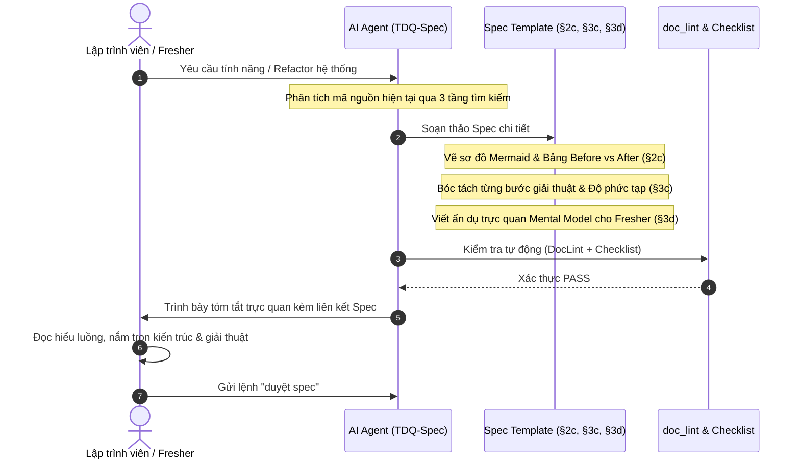

# SPEC — Nâng cấp Spec giải thích trực quan Flow hoạt động và Thuật toán cho Fresher Dev

Ngày: 2026-10-18 · Bản: 1.0 · Brief: ../brief/2026-10-18-0115-giai-thich-flow-thuat-toan-spec.md · Lane: full
Soul: chất lượng > runtime > context cost · luật gốc: skills/tdq-conventions/references/soul.md
Trạng thái: CHỜ DUYỆT

## Mục lục

- 1. Mục tiêu & phạm vi
- 1b. Lộ trình
- 2. Đầu ra cụ thể
- 2b. Ranh giới module
- 2c. Luồng hoạt động & Sơ đồ kiến trúc mẫu
- 3. Cách tiếp cận & lý do
- 3b. Năng lực & công cụ
- 3c. Giải thuật & Xử lý cốt lõi
- 3d. Mental Model cho Fresher Dev
- 4. Yêu cầu bắt buộc
- 5. Ràng buộc & rủi ro
- 6. QC & Definition of Done
- 7. Câu hỏi còn mở

## 1. Mục tiêu & phạm vi
- **Mục tiêu**: Chuẩn hóa cấu trúc Spec của TDQ Workflow bằng cách bổ sung bắt buộc 3 thành phần giải trình kiến trúc. Đảm bảo một lập trình viên fresher khi tiếp cận tài liệu Spec có thể lập tức hiểu trọn vẹn luồng tương tác, sự khác biệt Before vs After, và từng bước thuật toán cốt lõi. Giúp dev làm chủ và kiểm soát 100% mã nguồn dự án.
- **Trong phạm vi**:
  - Cập nhật khuôn mẫu đặc tả `skills/tdq-spec/references/spec-template.md`.
  - Cập nhật cẩm nang hướng dẫn `skills/tdq-spec/references/spec-template-huong-dan.md` bổ sung checklist tự soát "Fresher Accessibility Check".
  - Cập nhật tài liệu quy trình `skills/tdq-spec/SKILL.md` và định dạng tóm tắt chat `user-facing-block.md`.
  - Bổ sung unit tests kiểm tra tính toàn vẹn của cấu trúc spec mới.
- **NGOÀI phạm vi**:
  - Không làm thay đổi cú pháp CLI của `tdq_state.py` hay các lệnh core khác.
  - Không nén hoặc cắt bỏ các mục hiện có của Spec (§1, §2, §2b, §3, §3b, §4, §5, §6).

## 1b. Lộ trình

| Bước/phase | Chạy? | Vì sao |
|---|---|---|
| Research web | CÓ | Nghiên cứu các chuẩn biểu diễn kiến trúc và Mermaid workflow tốt nhất |
| Interview | BỎ | Yêu cầu kỹ thuật và trải nghiệm người dùng đã được định hình rõ ràng |
| QC độc lập (agent) | CÓ | Dùng agent thẩm định tính sư phạm và độ chặt chẽ của mẫu spec mới |

## 2. Đầu ra cụ thể
| # | Đầu ra | Đường dẫn/vị trí | Đo "xong" bằng |
|---|---|---|---|
| 1 | Khuôn mẫu Spec mới tích hợp Flow & Algorithm | `skills/tdq-spec/references/spec-template.md` | Có đủ các mục §2c, §3c, §3d |
| 2 | Cẩm nang hướng dẫn lập Spec cho Fresher | `skills/tdq-spec/references/spec-template-huong-dan.md` | Có checklist Fresher Accessibility Check |
| 3 | Hướng dẫn Skill TDQ-Spec & Chat Block | `skills/tdq-spec/SKILL.md` | Cập nhật các bước thẩm định luồng |
| 4 | Bộ test tự động kiểm thử Spec Template | Vùng kiểm thử test suite | Pytest PASS 100% |

## 2b. Ranh giới module

| Module | Vùng file | Phụ thuộc module | Đầu ra §2 nào |
|---|---|---|---|
| Mod-Template | `skills/tdq-spec/references/spec-template.md`, `skills/tdq-spec/references/spec-template-huong-dan.md` | không | 1, 2 |
| Mod-Skill | `skills/tdq-spec/SKILL.md` | Mod-Template | 3 |
| Mod-Test | `tests/test_*.py` | Mod-Template | 4 |

## 2c. Luồng hoạt động & Sơ đồ kiến trúc mẫu

### Sơ đồ tuần tự: Vòng đời chuyển hóa từ Ý tưởng sang Spec thấu suốt

### Bảng đối chiếu Trước vs Sau khi nâng cấp Spec Template:

| Khía cạnh | Cấu trúc Spec cũ (trước 0.74.0) | Cấu trúc Spec mới đề xuất |
|---|---|---|
| **Luồng tương tác** | Chỉ mô tả danh sách module rời rạc ở bảng §2b | Sơ đồ Mermaid tuần tự (§2c) trực quan hóa từng bước dữ liệu |
| **Refactor / Update** | Khó nhận biết điểm cũ và mới thay đổi thế nào | Bảng Before vs After (§2c) chỉ rõ thành phần cũ vs mới |
| **Giải thuật cốt lõi** | Ẩn trong mã nguồn hoặc chỉ nói cách tiếp cận chung | Step-by-step logic (§3c) kèm độ phức tạp $O(N)$ và edge cases |
| **Góc nhìn Fresher** | Dễ bị quá tải bởi thuật ngữ kỹ thuật phức tạp | Có Mental Model (§3d) dùng ẩn dụ đời thực dễ tiếp cận |
| **Quyền kiểm soát của Dev** | Thụ động phê duyệt tóm tắt ngắn | Chủ động nắm chắc 100% cơ chế trước khi AI gõ code |

## 3. Cách tiếp cận & lý do
- **Chọn**: Chuẩn hóa thành 3 mục cấu trúc độc lập bên trong `spec-template.md`:
  1. `## 2c. Luồng hoạt động & Sơ đồ kiến trúc (Architecture & Flow)`.
  2. `## 3c. Giải thuật & Xử lý cốt lõi (Algorithm & Logic Breakdown)`.
  3. `## 3d. Mental Model & Thuật ngữ cho Fresher Dev`.
- **Vì**:
  - Không phá vỡ quy chuẩn `doc_lint` hiện tại (vẫn giữ nguyên §3b Năng lực & công cụ theo luật R8).
  - Tận dụng khả năng render Mermaid có sẵn trong Artifacts và Markdown viewer của GitHub/VS Code.
  - Tách bạch giữa "Luồng kiến trúc tổng thể" (§2c) và "Giải thuật chi tiết cấp hàm" (§3c).
- **Đã loại**:
  - *Phương án nhồi nhét vào bảng §2b*: Khiến bảng module bị phình to, rối mắt và mất tính phân tách file area.
  - *Phương án tạo tài liệu riêng ngoài file Spec*: Làm phân mảnh tài liệu, dev phải mở nhiều tệp cùng lúc.

## 3b. Năng lực & công cụ

| Skill | Nguồn | Phán quyết | Dùng ở đâu / Lý do loại |
|---|---|---|---|
| `tdq-workflow:tdq-spec` | plugin:tdq-workflow | DÙNG | Cập nhật khuôn mẫu spec và hướng dẫn lập spec |
| `tdq-workflow:tdq-conventions` | plugin:tdq-workflow | NỀN | Quy tắc chung và user-facing-block |
| Đã xét 5 skill khác | user/plugin/built-in | KHÔNG | khác lĩnh vực |

## 3c. Giải thuật & Xử lý cốt lõi

### Quy trình biên soạn Spec thấu suốt dành cho AI:
1. **Bước 1 - Khảo sát Hiện trạng & Thiết lập Baseline**:
   - Sử dụng LSP để xác định chính xác các symbol, entrypoint và callers hiện tại.
   - Ghi nhận trạng thái "Before" của luồng xử lý vào nhật ký phân tích.
2. **Bước 2 - Lập Sơ đồ Kiến trúc & Luồng tương tác (§2c)**:
   - Dựng sơ đồ Mermaid Sequence Diagram thể hiện chuỗi gọi hàm giữa các thành phần.
   - Nếu là refactor: Lập bảng so sánh Before vs After chỉ ra thành phần thay thế.
3. **Bước 3 - Bóc tách Giải thuật & Độ phức tạp (§3c)**:
   - Trình bày thuật toán dưới dạng danh sách các bước đánh số rõ ràng (1, 2, 3...).
   - Xác định độ phức tạp tính toán Time Complexity $O(T)$ và Space Complexity $O(S)$.
   - Liệt kê tối thiểu 2 ca góc hiểm (Edge cases: rỗng, lỗi mạng, giá trị biên) và cách xử lý phòng thủ.
4. **Bước 4 - Đơn giản hóa & Xây dựng Mental Model (§3d)**:
   - Sử dụng một ẩn dụ thực tế (analogy) giúp lập trình viên fresher dễ dàng liên tưởng.
   - Định nghĩa bảng chú giải thuật ngữ chuyên ngành (Glossary).
5. **Bước 5 - Thẩm định Fresher Accessibility**:
   - Tự đặt câu hỏi: "Một dev mới ra trường đọc vào có hiểu được và code lại được không?". Nếu câu trả lời là "Không", lập tức viết lại cho rõ ràng hơn.

## 3d. Mental Model cho Fresher Dev

- **Ẩn dụ "Bản vẽ xây dựng có thuyết minh"**:
  - Bản Spec cũ giống như một danh mục vật liệu xây dựng (liệt kê danh sách các module và file cần sửa).
  - Bản Spec mới bổ sung "Sơ đồ mặt cắt hệ thống ống nước/dây điện" (§2c) và "Hướng dẫn vận hành máy bơm" (§3c). Nhờ đó, ngay cả một kỹ sư tập sự cũng biết nước chảy từ đâu qua đâu, áp suất bao nhiêu, và khi tắc đường ống thì van xả tự động kích hoạt thế nào.

## 4. Yêu cầu bắt buộc
- Log service: BỎ — việc này là chuẩn hóa tài liệu và khuôn mẫu đặc tả, không có runtime service độc lập.
- Không placeholder, không TODO stub, không mock trình bày như dữ liệu thật.
- Khuôn mẫu mới phải tuân thủ tuyệt đối DocLint (câu dưới 40 từ, bảng markdown chuẩn chỉ).
- Mỗi mục mới bổ sung phải có hướng dẫn mẫu cụ thể (RIGHT/WRONG examples) để Haiku hay bất kỳ model nào cũng tuân thủ đúng.

## 5. Ràng buộc & rủi ro
Ràng buộc kiến trúc phải giữ:
- `Soul: chất lượng > runtime > context cost` — tài liệu spec phải đặt chất lượng truyền đạt và tính thấu suốt của dev lên hàng đầu.
- R8 trong `doc_lint.py`: Không được sửa đổi cấu trúc bảng §3b đã được kiểm tra tự động.

| Rủi ro | Ảnh hưởng | Cách giảm |
|---|---|---|
| Spec bị quá dài, gây phình token | Tăng chi phí ngữ cảnh | Khống chế sơ đồ Mermaid súc tích, giải thuật viết dạng bullet points ngắn gọn |
| Model yếu (Haiku) bỏ qua vẽ sơ đồ | Spec thiếu mục §2c | Viết rõ luật bắt buộc trong SKILL.md và test tự động phát hiện thiếu mục |

## 6. QC & Definition of Done
| # | Hạng mục kiểm | Điều kiện PASS | Đo trước | Dự phòng nếu trượt |
|---|---|---|---|---|
| Q1 | Cấu trúc spec-template.md | Có đủ 3 mục §2c, §3c, §3d và ví dụ mẫu | — | Bổ sung trực tiếp vào template |
| Q2 | DocLint trên spec-template.md | `python3 scripts/doc_lint.py` thoát 0, không có lỗi R5/R6 | 0 lỗi | Tách câu ngắn dưới 40 từ |
| Q3 | Bộ test tự động kiểm thử Spec | Toàn bộ test case kiểm tra cấu trúc spec mới đều xanh | 0 test | Viết test assertion chặt chẽ |
| Q4 | Tính sư phạm cho Fresher | Đánh giá bởi subagent reviewer đạt tiêu chí thấu suốt | — | Điều chỉnh ngôn ngữ trực quan hơn |

DoD:
- `skills/tdq-spec/references/spec-template.md` chứa đầy đủ 3 section mới: §2c, §3c, §3d.
- `skills/tdq-spec/references/spec-template-huong-dan.md` có checklist "Fresher Accessibility Check".
- `skills/tdq-spec/SKILL.md` cập nhật protocol thẩm định luồng.
- Bộ test tự động kiểm chứng cấu trúc spec mới đạt PASS 100%.

## 7. Câu hỏi còn mở
(Phải RỖNG. Còn câu hỏi → quay lại phase analyze.)
