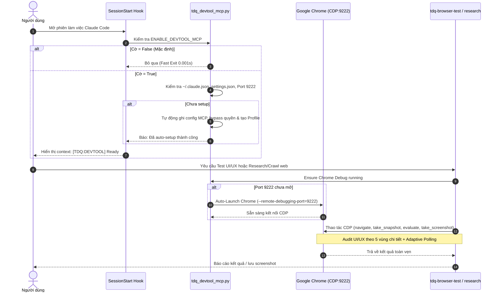

# SPEC — Tích Hợp Tùy Chọn Cấu Hình enable-devtoolmcp & Bộ Kỹ Năng Trình Duyệt Vào TDQ Workflow

Ngày: 2026-10-18 · Bản: 1.1 · Brief: ../brief/2026-10-18-1630-feasibility-enable-devtoolmcp.md · Lane: full
Soul: chất lượng > runtime > context cost · luật gốc: skills/tdq-conventions/references/soul.md
Trạng thái: CHỜ DUYỆT

## Mục lục

- 1. Mục tiêu & phạm vi
- 1b. Lộ trình
- 2. Đầu ra cụ thể
- 2b. Ranh giới module
- 2c. Luồng hoạt động & Sơ đồ kiến trúc
- 3. Cách tiếp cận & lý do
- 3b. Năng lực & công cụ
- 3c. Giải thuật & Xử lý cốt lõi
- 3d. Mental Model cho Fresher Dev
- 4. Yêu cầu bắt buộc
- 5. Ràng buộc & rủi ro
- 6. QC & Definition of Done
- 7. Câu hỏi còn mở

## 1. Mục tiêu & phạm vi
- **Mục tiêu**: Bổ sung cờ cấu hình `ENABLE_DEVTOOL_MCP` vào plugin TDQ Workflow, kiểm tra tại hook `SessionStart`, tự động thiết lập (auto-setup) theo cẩm nang `CHROME_DEVTOOLS_MCP_GUIDE.md` khi người dùng bật cờ, cấu hình bypass quyền 2 tầng và cơ chế Auto-Launch Chrome; đồng thời bổ sung 2 kỹ năng chuyên biệt: `tdq-browser-test` (kiểm thử UI/UX chuyên sâu, duyệt từng vùng layout, audit phần tử chi tiết, chống kiểm thử sơ sài) và `tdq-browser-research` (cào data / deep research) có cơ chế xử lý timeout phòng thủ chống sót dữ liệu đối với các trang web phản hồi chậm.
- **Trong phạm vi**:
  - Cập nhật `.claude-plugin/plugin.json` thêm trường `ENABLE_DEVTOOL_MCP`.
  - Tích hợp kiểm tra tại `hooks/scripts/session_start.py` (non-blocking).
  - Bổ sung hàm thiết lập tự động vào `scripts/tdq_devtool_mcp.py` và liên kết với `scripts/tdq_setup.py`.
  - Sao chép cẩm nang hướng dẫn `CHROME_DEVTOOLS_MCP_GUIDE.md` vào `skills/tdq-setup/references/chrome-devtools-mcp-guide.md`.
  - Tạo 2 skills mới: `skills/tdq-browser-test/SKILL.md` (chuẩn hóa quy trình kiểm thử giao diện phân vùng 5 lớp: Visual Layout, Interactive Elements, Responsive Breakpoints, Console/Network Errors, Accessibility/Contrast) và `skills/tdq-browser-research/SKILL.md` (Adaptive Polling và Exponential Backoff Timeout).
  - Viết bộ kiểm thử tự động kiểm tra toàn bộ cấu hình, hàm setup và 2 skill.
- **NGOÀI phạm vi**:
  - Không can thiệp vào mã nguồn nội bộ của Chrome DevTools MCP server (`ChromeDevTools/chrome-devtools-mcp`).
  - Không sửa đổi profile mặc định chứa mật khẩu/thông tin cá nhân của người dùng trên Chrome (chỉ dùng profile cách ly `ChromeDevProfile`).

## 1b. Lộ trình

| Bước/phase | Chạy? | Vì sao |
|---|---|---|
| Research web | BỎ | Đã có tài liệu chuẩn `CHROME_DEVTOOLS_MCP_GUIDE.md` và mã nguồn repo gốc ngay trên máy |
| Interview | CÓ | Đã chốt lựa chọn 1A (Auto-Launch thông minh), 2B (Tách 2 skill chuyên biệt), và yêu cầu kiểm thử UI/UX phân vùng chi tiết chống sót |
| QC độc lập (agent) | CÓ | Dùng `tdq-qc-tester` kiểm tra toàn bộ cấu hình, script setup và test suite |

## 2. Đầu ra cụ thể
| # | Đầu ra | Đường dẫn/vị trí | Đo "xong" bằng |
|---|---|---|---|
| 1 | File cấu hình plugin cập nhật | `.claude-plugin/plugin.json` | Chứa thuộc tính `ENABLE_DEVTOOL_MCP` dạng boolean |
| 2 | Cẩm nang hướng dẫn chuẩn hóa | `skills/tdq-setup/references/chrome-devtools-mcp-guide.md` | File tồn tại, giữ nguyên vẹn nội dung hướng dẫn |
| 3 | Logic kiểm tra tại SessionStart | `hooks/scripts/session_start.py` | Kiểm tra cờ, nếu bật thì verify trạng thái setup trong < 0.05s |
| 4 | Hàm auto-setup và auto-launch | `scripts/tdq_devtool_mcp.py` & `scripts/tdq_setup.py` | Kiểm tra, ghi `~/.claude.json`, `settings.json`, tạo profile Chrome |
| 5 | Skill Kiểm thử UI/UX & E2E Phân Vùng | `skills/tdq-browser-test/SKILL.md` | Cung cấp checklist 5 vùng kiểm tra chi tiết: Bounding Boxes, Viewport, State Toggles, Error Capture, Snapshot |
| 6 | Skill Deep Research & Web Scraping | `skills/tdq-browser-research/SKILL.md` | Cung cấp kịch bản cào data SPA, render JS, trích xuất text/DOM với timeout phòng thủ |
| 7 | Bộ kiểm thử tự động cho tích hợp | Kịch bản kiểm tra tích hợp trong thư mục kiểm thử | 100% test cases PASS |

## 2b. Ranh giới module

| Module | Vùng file | Phụ thuộc module | Đầu ra §2 nào |
|---|---|---|---|
| Config & Plugin Manifest | `.claude-plugin/plugin.json` | không | 1 |
| Setup & Auto-Launch | `scripts/tdq_devtool_mcp.py`, `scripts/tdq_setup.py` | Config | 4 |
| Session Hook | `hooks/scripts/session_start.py` | Setup & Auto-Launch | 3 |
| Documentation | `skills/tdq-setup/references/` | không | 2 |
| Browser Skills | `skills/tdq-browser-test/`, `skills/tdq-browser-research/` | Setup & Auto-Launch | 5, 6 |
| Test Suite | Thư mục kiểm thử tự động | Toàn bộ các module | 7 |

## 2c. Luồng hoạt động & Sơ đồ kiến trúc

### Bảng đối chiếu Trước vs Sau:

| Khía cạnh | Hiện trạng (Trước) | Thiết kế mới (Sau) |
|---|---|---|
| Kiểm tra Giao diện UI/UX | Kiểm tra sơ sài, chỉ check tồn tại thẻ HTML, bỏ sót vỡ layout | Khảo sát phân vùng 5 lớp: layout co giãn, tương tác hover/focus, chụp ảnh viewport, bắt lỗi CSS và console |
| Khởi động Browser Debug | Phải chạy thủ công batch file hoặc lệnh terminal ngoài | Auto-Launch thông minh nếu port 9222 chưa mở |
| Cấu hình MCP & Quyền | Phải chỉnh sửa bằng tay `~/.claude.json` và `settings.json` | Tự động hóa qua cờ `ENABLE_DEVTOOL_MCP` và `tdq_setup.py` |
| Xử lý web SPA chậm | Dễ bị miss dữ liệu nếu trang load AJAX/Fetch muộn | Adaptive Polling + Exponential Backoff timeout phòng thủ |

## 3. Cách tiếp cận & lý do
- **Chọn**: Tách logic quản lý ra module độc lập `scripts/tdq_devtool_mcp.py`, sau đó nhúng vào `tdq_setup.py` và `session_start.py`. Thiết kế quy trình kiểm thử UI/UX chuyên sâu theo mô hình 5 phân vùng trong `tdq-browser-test`.
- **Vì**: Tránh tình trạng AI chỉ nhìn sơ qua mã nguồn HTML mà không kiểm tra độ hiển thị thực tế (banned pattern ANTI-6 trong `vision-test-loop.md`), đồng thời đảm bảo hook chạy nhanh dưới 50ms và không phá vỡ Soul Invariants của TDQ Workflow.
- **Đã loại**: Phương án gộp chung 1 skill lớn `tdq-browser` vì phạm vi kiểm thử UI (cần assert, screenshot, console log) và phạm vi research (cần crawl, parse text, vượt qua paywall/pagination) có mục đích và prompt template hoàn toàn khác nhau.

## 3b. Năng lực & công cụ

| Skill | Nguồn | Phán quyết | Dùng ở đâu / Lý do loại |
|---|---|---|---|
| tdq-setup | plugin:tdq-workflow | DÙNG | Tích hợp kiểm tra và cài đặt chrome-devtools mcp |
| tdq-build | plugin:tdq-workflow | DÙNG | Chạy implement và QC kế hoạch |
| Đã xét 23 skill khác | user/plugin/built-in | KHÔNG | khác lĩnh vực |

## 3c. Giải thuật & Xử lý cốt lõi

- **Quy trình Kiểm thử Giao diện UI/UX Phân Vùng 5 Lớp (Anti-Shallow UI Audit)**:
  1. **Lớp 1 (Cấu trúc & Cây DOM - Tree Verification)**: Dùng `take_snapshot` duyệt cây a11y, xác nhận tất cả các thành phần cốt lõi (header, sidebar, content container, form fields, action buttons) đều hiện diện với UID rõ ràng.
  2. **Lớp 2 (Hiển thị Trực quan & Viewport Check)**: Dùng `resize_page` kiểm tra trên 2 kích thước chuẩn (Desktop 1440x900 và Mobile 375x812). Chụp ảnh `take_screenshot` lưu vào `docs/workinglog/images/` để phát hiện tràn viền hoặc co giật layout.
  3. **Lớp 3 (Trạng thái Tương tác - Element State Interaction)**: Thực hiện tương tác thực: `hover` vào nút/menu để xem chuyển màu CSS, `fill` dữ liệu vào ô nhập, `click` gửi form và kiểm tra trạng thái loading/disabled.
  4. **Lớp 4 (Bắt Lỗi Ngầm - Silent Fault Detection)**: Dùng `list_console_messages` với filter `types: ["error", "warn"]` và `list_network_requests` để phát hiện các request API 4xx/5xx hoặc JavaScript unhandled exceptions.
  5. **Lớp 5 (CSS & Styling Health)**: Dùng `get_css_styles` trên các phần tử nghi ngờ để kiểm tra xung đột cascade layers hoặc font/màu sắc không đồng nhất.

- **Từng bước giải thuật Auto-Launch & Setup**:
  1. Đọc cờ `ENABLE_DEVTOOL_MCP` từ biến môi trường `TDQ_ENABLE_DEVTOOL_MCP` hoặc config file. Nếu `False` -> Thoát ngay.
  2. Kiểm tra socket connection tới `127.0.0.1:9222` với timeout 200ms.
  3. Nếu không kết nối được -> Xác định đường dẫn thực thi Chrome theo hệ điều hành (Windows: `Program Files/Google/Chrome`, macOS: `/Applications/Google Chrome.app`, Linux: `/usr/bin/google-chrome`).
  4. Tạo thư mục profile cách ly `$HOME/ChromeDevProfile` (nếu chưa có).
  5. Gọi subprocess không đồng bộ (detached) khởi chạy Chrome với tham số:
     `--remote-debugging-port=9222 --user-data-dir="<profile>" --remote-allow-origins=* --no-first-run --no-default-browser-check`.
  6. Chờ tối đa 3 giây bằng vòng lặp socket check (mỗi 300ms) để xác nhận port đã mở.

- **Giải thuật Adaptive Timeout cho Web Phản Hồi Chậm (Anti-Miss Engine)**:
  1. Khi điều hướng (`navigate_page`), thiết lập timeout tối thiểu 15 giây.
  2. Sử dụng cơ chế lắng nghe kép:
     - Lớp 1: Gọi `wait_for` với selector hoặc text nhận diện nội dung chính.
     - Lớp 2: Thực thi JS `document.readyState === 'complete'` kết hợp kiểm tra số lượng request mạng đang pending (`performance.getEntriesByType('resource')`).
  3. Áp dụng Exponential Backoff Polling: Kiểm tra DOM mỗi 500ms, 1s, 2s, 4s (tối đa 30s) trước khi kết luận timeout để chống bỏ sót dữ liệu đối với các trang SPA/AJAX nặng.

- **Độ phức tạp tính toán**:
  - Thời gian: $O(1)$ cho kiểm tra trạng thái khởi động; $O(K)$ cho polling DOM với $K \le 30$ vòng lặp.
  - Không gian: $O(1)$ bộ nhớ đệm tiến trình.

- **Các ca góc hiểm (Edge Cases & Defensive Handling)**:
  - Máy chưa cài đặt Chrome: Báo lỗi thân thiện, hướng dẫn tải Chrome hoặc chỉ định `--executablePath`.
  - Profile đang bị khóa bởi tiến trình Chrome khác: Thử tạo thư mục profile con hoặc cảnh báo người dùng.
  - Port 9222 bị chiếm bởi ứng dụng khác không phải Chrome CDP: Kiểm tra phản hồi HTTP từ `http://127.0.0.1:9222/json/version`, nếu không khớp cấu trúc CDP thì thông báo đổi port.

## 3d. Mental Model cho Fresher Dev

- **Ẩn dụ trực quan (Analogy)**: Hãy tưởng tượng việc kiểm thử giao diện giống như kiểm định một chiếc xe hơi mới xuất xưởng: Bạn không thể chỉ đứng từ xa nhìn ngắm rồi bảo "xe trông ổn đấy" (kiểm tra sơ sài). Bạn phải mở cửa xe, ngồi vào ghế lái, bấm từng nút bấm, bật đèn pha, đạp chân ga và chạy thử trên các loại địa hình khác nhau (kiểm thử 5 phân vùng). Kỹ năng `tdq-browser-test` chính là cẩm nang kiểm định viên chi tiết từng hạng mục để không bỏ sót bất kỳ lỗi ẩn nào.
- **Thuật ngữ dự án (Glossary)**:
  - `CDP (Chrome DevTools Protocol)`: Giao thức giao tiếp thời gian thực qua WebSocket cho phép điều khiển lõi trình duyệt Chromium.
  - `Phân vùng 5 lớp`: Phương pháp kiểm thử toàn diện giao diện từ cấu trúc DOM, hiển thị ảnh chụp, tương tác trạng thái, lỗi console đến thuộc tính CSS.
  - `Adaptive Polling`: Cơ chế kiểm tra định kỳ với khoảng thời gian co giãn thông minh để chờ dữ liệu xuất hiện đầy đủ trên giao diện.

## 4. Yêu cầu bắt buộc
- Log service: BỎ — thay đổi trên công cụ cấu hình và tài liệu phụ trợ, không có runtime service độc lập.
- Không placeholder, không TODO stub, không mock dữ liệu khi test tích hợp.
- Tất cả các script Python tuân thủ `stdlib only` (chỉ dùng thư viện chuẩn `json`, `os`, `socket`, `subprocess`, `urllib`).
- Mỗi hàm kiểm tra và auto-setup phải có unit test bao phủ kịch bản thành công và ngoại lệ.

## 5. Ràng buộc & rủi ro
Ràng buộc kiến trúc phải giữ:
- `hooks/scripts/session_start.py` phải hoàn tất dưới 50ms, không được làm trễ thời gian mở phiên của người dùng.
- Không sửa trực tiếp file của người dùng mà không có cơ chế backup an toàn (`.bak`).

| Rủi ro | Ảnh hưởng | Cách giảm |
|---|---|---|
| Khởi động Chrome ngầm làm tốn RAM | Ảnh hưởng hiệu năng máy cấu hình yếu | Chỉ bật Chrome khi cờ `ENABLE_DEVTOOL_MCP` được bật và có tác vụ gọi tới |
| Port 9222 bị xung đột | Không kết nối được CDP | Kiểm tra `http://127.0.0.1:9222/json/version` để xác thực đúng Chromium |

## 6. QC & Definition of Done
| # | Hạng mục kiểm | Điều kiện PASS | Đo trước | Dự phòng nếu trượt |
|---|---|---|---|---|
| Q1 | Cấu hình plugin.json | Trường `ENABLE_DEVTOOL_MCP` xuất hiện và đọc được | 1 | Sửa cú pháp JSON |
| Q2 | Sao chép tài liệu guide | `chrome-devtools-mcp-guide.md` tồn tại đầy đủ | 1 | Chép lại file gốc |
| Q3 | Module auto-setup | Hàm `setup_devtool_mcp()` ghi đúng `~/.claude.json` và `settings.json` | 1 | Kiểm tra quyền ghi file |
| Q4 | Cơ chế Auto-Launch | Hàm `ensure_chrome_running()` khởi chạy thành công Chrome cổng 9222 | 1 | Điều chỉnh đường dẫn chrome.exe |
| Q5 | Skill test & research | File `SKILL.md` của 2 skill mới hợp lệ cú pháp frontmatter và có đủ 5 lớp test UI/UX | 2 | Soát theo doc_lint |
| Q6 | Bộ test tự động | Bộ test tích hợp chạy đạt 100% test cases | 6 | Debug và sửa mã nguồn |

DoD:
- Cờ `ENABLE_DEVTOOL_MCP` được cấu hình chuẩn mực trong plugin.
- Hệ thống tự động nhận diện và thiết lập trọn gói Chrome DevTools MCP.
- Cả 2 kỹ năng `tdq-browser-test` (chuẩn kiểm thử UI/UX 5 lớp chi tiết) và `tdq-browser-research` sẵn sàng hoạt động với cơ chế chống sót dữ liệu.
- Bộ test suite chạy thành công 100%.

## 7. Câu hỏi còn mở
(RỖNG)
