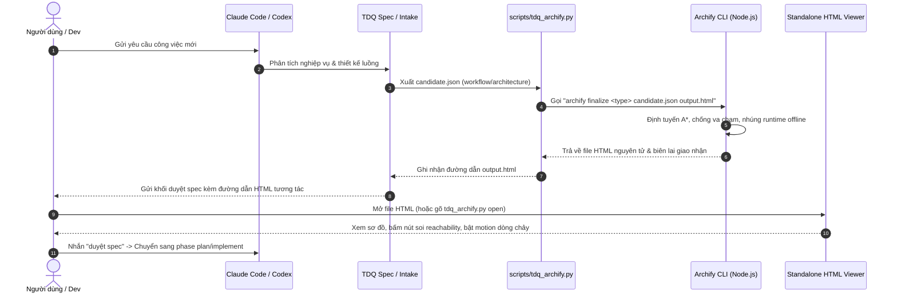

# SPEC — Tích Hợp Archify Vào TDQ-Workflow: Trực Quan Hóa BA & Kiến Trúc Dự Án

Ngày: 2026-10-24 · Bản: 1.0 · Brief: ../brief/2026-10-24-2145-nghien-cuu-tich-hop-archify.md · Lane: full
Soul: chất lượng > runtime > context cost · luật gốc: skills/tdq-conventions/references/soul.md
Trạng thái: CHỜ DUYỆT

## Mục lục

- 1. Mục tiêu & phạm vi
- 1b. Lộ trình
- 2. Đầu ra cụ thể
- 2b. Ranh giới module
- 2c. Luồng hoạt động & Sơ đồ kiến trúc
- 3. Cách tiếp cận & lý do
- 3b. Năng lực & công cụ
- 3c. Giải thuật & Xử lý cốt lõi
- 3d. Mental Model cho Fresher Dev
- 4. Yêu cầu bắt buộc
- 5. Ràng buộc & rủi ro
- 6. QC & Definition of Done
- 7. Câu hỏi còn mở

## 1. Mục tiêu & phạm vi

- Mục tiêu: Thiết kế giải pháp kiến trúc và lộ trình tích hợp toàn diện công cụ Archify (`v3.2.0`) vào TDQ-Workflow ở cả hai pipeline (`quick` và `full`), biến TDQ-Workflow thành công cụ hỗ trợ trực quan hóa kiến trúc và nghiệp vụ (đóng vai trò "Personal Business Analyst" cho từng task), nâng cấp tầng hiển thị của Graphify thành giao diện điều khiển tương tác offline (Master Architecture Console) và thiết lập cơ chế cấu hình Endpoint AI độc lập/dùng chung linh hoạt.
- Trong phạm vi:
  - Thiết kế kiến trúc 2 tầng: **Master Architecture Console** (`docs/architecture/index.html` — toàn dự án) và **Task Scope BA Flow** (`docs/tdq/spec/<slug>-preview.html` — từng feature/request).
  - Thiết kế module CLI điều phối `scripts/tdq_archify.py`: đóng vai trò Adapter trung gian gọi `archify.mjs finalize`, kiểm tra tính khả dụng của Node.js & gói Archify, thực thi giao nhận nguyên tử và cung cấp lệnh mở nhanh trình duyệt (`tdq_archify.py open`).
  - Thiết kế tích hợp Phase `spec` (§2b, §2c) trong `skills/tdq-spec/`: sinh song song file HTML tương tác đa chiều kèm theo tài liệu markdown để lập trình viên và người dùng duyệt trực quan luồng trước khi viết mã.
  - Thiết kế tích hợp Pipeline `quick` trong `skills/tdq-intake/references/quick-lane.md`: hỗ trợ sinh sơ đồ workflow tinh gọn (<10 nút) cho các task chạm từ 2 module trở lên hoặc tác vụ refactor.
  - Thiết kế cơ chế cầu nối Graphify-to-Archify: đọc `graphify-out/graph.json` và chuyển đổi sang Archify JSON-IR để thay thế lớp hiển thị phụ thuộc CDN Mermaid bằng standalone interactive viewer offline 100%.
  - Thiết kế cơ chế Endpoint AI linh hoạt (Hybrid): mặc định dùng Agent session hiện tại (Claude Code / Codex); hỗ trợ cấu hình biến môi trường `ARCHIFY_AI_ENDPOINT`, `ARCHIFY_API_KEY`, `ARCHIFY_MODEL` cho chế độ quét tự động toàn bộ codebase.
  - Bổ sung kiểm tra môi trường và pre-flight check trong `scripts/tdq_setup.py` và `skills/tdq-setup/`.
  - Soạn thảo tài liệu đặc tả kiến trúc tích hợp đầy đủ (`docs/kien-truc-tich-hop-archify.md`) và xây dựng bộ kiểm thử giả lập cho module adapter.
- NGOÀI phạm vi:
  - Không chỉnh sửa trực tiếp vào kho mã nguồn gốc của Archify tại `C:\Users\admin\Documents\archify` (đối xử như một engine phụ thuộc bên ngoài).
  - Không áp đặt bắt buộc sinh file HTML cho các task siêu nhỏ 1 file trong lane `quick` nhằm bảo toàn luật tinh gọn (Lean).

## 1b. Lộ trình

Chép từ brief mục `### Lộ trình`. User duyệt spec là duyệt luôn lộ trình này.

| Bước/phase | Chạy? | Vì sao |
|---|---|---|
| Research web | BỎ | Dự án Archify và TDQ-Workflow đều đã có sẵn mã nguồn đầy đủ trên máy cục bộ |
| Interview | CÓ | Đã hoàn tất 2 vòng phỏng vấn chốt mô hình 2 tầng, cơ chế AI endpoint và trải nghiệm dev |
| QC độc lập (agent) | CÓ | Chạy kiểm định DoD, thẩm định tương thích 2 codebase và chạy bộ test suite ở mức `ultra` |

## 2. Đầu ra cụ thể

| # | Đầu ra | Đường dẫn/vị trí | Đo "xong" bằng |
|---|---|---|---|
| 1 | Tài liệu đặc tả kiến trúc tích hợp (Blueprint RFC) | `docs/kien-truc-tich-hop-archify.md` | Tài liệu hoàn chỉnh mô tả toàn bộ mô hình 2 tầng, data schema, contract CLI và cơ chế endpoint AI |
| 2 | Module CLI điều phối TDQ-Archify | `scripts/tdq_archify.py` | Script Python chuẩn stdlib, bọc các lệnh validate, render, open và cầu nối Graphify-to-Archify |
| 3 | Cập nhật quy chuẩn Spec tương tác BA | `skills/tdq-spec/SKILL.md`, `skills/tdq-spec/references/spec-template.md` | Quy chuẩn hóa việc sinh `<slug>-preview.html` tại §2c và khối chat duyệt spec có link HTML |
| 4 | Cập nhật quy chuẩn Quick Lane BA | `skills/tdq-intake/references/quick-lane.md` | Bổ sung hướng dẫn sinh mini-workflow cho các task chạm $\ge 2$ module hoặc refactor |
| 5 | Cấu hình biến môi trường Endpoint AI | `.env.example` | Bổ sung các biến `ARCHIFY_AI_ENDPOINT`, `ARCHIFY_API_KEY`, `ARCHIFY_MODEL` và tài liệu hướng dẫn |
| 6 | Cập nhật kiểm tra môi trường Archify | `scripts/tdq_setup.py` | Bổ sung bậc kiểm tra Node.js $\ge 18$ và đường dẫn gói Archify trong setup |
| 7 | Bộ kiểm thử tự động cho Adapter | `tests/` | Bộ unit test kiểm tra CLI builder, parser graphify-to-archify, kiểm tra lỗi thiếu Node/Archify |

## 2b. Ranh giới module

Một module = một vùng file không giao nhau.

| Module | Vùng file | Phụ thuộc module | Đầu ra §2 nào |
|---|---|---|---|
| `blueprint-doc` | `docs/kien-truc-tich-hop-archify.md`, `.env.example` | không | 1, 5 |
| `archify-adapter` | `scripts/tdq_archify.py` | `blueprint-doc` | 2 |
| `spec-ba-flow` | `skills/tdq-spec/SKILL.md`, `skills/tdq-spec/references/spec-template.md` | `archify-adapter` | 3 |
| `quick-lane-ba` | `skills/tdq-intake/references/quick-lane.md` | `archify-adapter` | 4 |
| `setup-preflight` | `scripts/tdq_setup.py` | `archify-adapter` | 6 |
| `adapter-tests` | `tests/` | `archify-adapter` | 7 |

## 2c. Luồng hoạt động & Sơ đồ kiến trúc

Trực quan hóa luồng hoạt động tích hợp Archify vào TDQ-Workflow:

Bảng đối chiếu Hiện trạng (Trước) vs Thiết kế mới (Sau):

| Khía cạnh | Hiện trạng (Trước) | Thiết kế mới (Sau) |
|---|---|---|
| Hiển thị luồng trong Spec | Khối Mermaid code text thô sơ trong Markdown, dev khó hình dung toàn cảnh | File HTML tương tác độc lập (`<slug>-preview.html`), có zoom đa tầng, Semantic Passport và motion dòng chảy |
| Khảo sát kiến trúc Graphify | Xuất `CALLFLOW.html` phụ thuộc CDN internet Mermaid.js, sơ đồ tĩnh dễ rối | Chuyển đổi sang Archify viewer offline 100%, hỗ trợ Route-probe tìm đường gọi ngắn nhất và Upstream/Downstream reachability |
| Vai trò BA cho Fresher | Fresher phải tự đọc text và tự hình dung luồng dữ liệu | Có sơ đồ "Personal BA" phân làn UI $\rightarrow$ Core $\rightarrow$ Storage $\rightarrow$ External rõ ràng trước khi code |
| Khả năng mở rộng AI | Phụ thuộc hoàn toàn vào context của Agent trong phiên | Hỗ trợ cơ chế Hybrid: dùng agent hiện tại hoặc cắm Endpoint AI ngoài khi quét toàn bộ repo |

## 3. Cách tiếp cận & lý do

- Chọn: Mô hình 2 tầng (Master Architecture Console + Task Scope BA Flow) điều phối qua module Adapter trung gian `scripts/tdq_archify.py`.
- Vì:
  - Tách bạch rõ ràng giữa góc nhìn vĩ mô (toàn repo) và góc nhìn vi mô (từng task), loại bỏ tình trạng quá tải nhận thức cho dev khi làm việc trên dự án lớn.
  - Python Adapter (`scripts/tdq_archify.py`) tuân thủ nghiêm ngặt kiến trúc TDQ (chỉ dùng thư viện chuẩn stdlib, không thêm dependency ngoài), giao tiếp với Node.js của Archify qua CLI và JSON giao nhận nguyên tử.
  - Cơ chế Hybrid cho phép linh hoạt tối đa: người dùng có thể dùng ngay không tốn thêm chi phí, hoặc cấu hình endpoint AI chuyên dụng khi muốn quét tự động toàn bộ codebase.
- Đã loại:
  - Phương án nhúng cứng code JavaScript của Archify vào các script Python của TDQ: vi phạm nguyên tắc phân tầng và tính độc lập của 2 dự án.
  - Phương án chỉ dùng 1 file HTML duy nhất cho mọi task: làm sơ đồ quá tải thông tin, dev không thể tập trung vào task hiện tại.
  - Phương án bắt buộc sinh HTML cho 100% các task ở quick-lane: vi phạm nguyên tắc Tinh gọn (Lean Principle), làm chậm việc sửa lỗi nhỏ.

## 3b. Năng lực & công cụ

| Skill | Nguồn | Phán quyết | Dùng ở đâu / Lý do loại |
|---|---|---|---|
| `tdq-spec` | plugin:tdq-workflow | DÙNG | Nơi tích hợp logic sinh sơ đồ BA tương tác tại §2b & §2c |
| `tdq-intake` | plugin:tdq-workflow | DÙNG | Nơi tích hợp logic sinh mini-workflow cho express pipeline |
| `tdq-plan` | plugin:tdq-workflow | DÙNG | Tham chiếu node/boundary kiến trúc khi lập WBS task |
| `tdq-setup` | plugin:tdq-workflow | DÙNG | Thêm bước kiểm tra môi trường Node.js và gói Archify |
| `archify` | local/external (`C:\Users\admin\Documents\archify`) | DÙNG | Engine biên dịch hình học A*, 11 renderers và viewer HTML |
| `claude-api` | built-in | DÙNG | Thiết kế module cấu hình Endpoint AI độc lập/dùng chung |
| Đã xét 23 skill khác | user/plugin/built-in | KHÔNG | khác lĩnh vực (dataviz, frontend-design, cdesktop...) |

## 3c. Giải thuật & Xử lý cốt lõi

Bóc tách thuật toán chi tiết để lập trình viên fresher nắm chắc nghiệp vụ logic:

- **Từng bước giải thuật (Step-by-step Execution Logic)**:
  1. **Bước 1 — Phát hiện & Kiểm tra môi trường (Environment Pre-flight)**:
     - Hàm `find_archify_root()`: dò tìm đường dẫn Archify theo thứ tự ưu tiên: biến môi trường `ARCHIFY_ROOT` $\rightarrow$ thư mục lân cận (`../archify`) $\rightarrow$ cache plugin của Claude/Codex.
     - Kiểm tra sự hiện diện của Node.js qua `shutil.which("node")`. Nếu thiếu, trả về thông báo lỗi phòng thủ và cho phép rơi về Mermaid text thông thường.
  2. **Bước 2 — Ánh xạ Cấu trúc Nghiệp vụ sang Archify JSON-IR (Schema Mapping)**:
     - Trong phase `spec`: Agent chuyển đổi các thành phần tại mục §2b (Modules/Lanes) và §2c (Luồng gọi/Nodes/Edges) thành cấu trúc JSON tuân thủ `workflow.schema.json` (v2) hoặc `architecture.schema.json`.
     - Với các task có bảng Trước vs Sau: tự động gắn nhãn thẻ tag `tag: "new"` hoặc `tag: "refactored"`.
  3. **Bước 3 — Biên dịch & Giao nhận Nguyên tử (Compilation & Delivery)**:
     - Gọi `node <archify>/bin/archify.mjs finalize <type> <candidate.json> <output.html> --quality showcase --json`.
     - Engine Archify tự động giải bài toán A* Routing trực giao, kiểm tra va chạm, nhúng font JetBrains Mono Base64, CSS và JS runtime vào file HTML.
  4. **Bước 4 — Liên kết & Hiển thị (Linking & Presentation)**:
     - Đặt file đầu ra tại `docs/tdq/spec/<slug>-preview.html`.
     - In đường dẫn vào khối duyệt spec để người dùng click mở, hoặc cung cấp lệnh `python scripts/tdq_archify.py open docs/tdq/spec/<slug>-preview.html`.
  5. **Bước 5 — Cập nhật Master Map khi hoàn tất (Master Sync)**:
     - Khi merge hoặc nghiệm thu request (phase `report`), gọi `tdq_archify.py sync-master` để cập nhật các thành phần mới vào `docs/architecture/index.html`.
- **Độ phức tạp tính toán**:
  - Thời gian (Time Complexity): $O(N + E)$ cho bước trích xuất JSON-IR (với $N$ là số node $\le 30$, $E$ là số liên kết $\le 50$). Bước giải A* routing do Archify xử lý có độ phức tạp $O(W \times H \log(W \times H))$ trên lưới tọa độ, thời gian thực thi trung bình $< 800\text{ms}$.
  - Không gian (Space Complexity): $O(N + E)$ cho bộ nhớ RAM của Python adapter ($< 10\text{MB}$). File HTML xuất ra có kích thước khoảng $1.2\text{MB}$ (chứa toàn bộ runtime offline).
- **Các ca góc hiểm (Edge Cases & Defensive Handling)**:
  - Máy chưa cài Node.js hoặc đường dẫn Archify không tìm thấy: `tdq_archify.py` trả cảnh báo có cấu trúc, tự động fallback sang hiển thị Mermaid markdown tĩnh trong spec, không làm gián đoạn workflow.
  - File JSON candidate bị lỗi cú pháp schema: Engine Archify trả về mã lỗi `schema/*` kèm gợi ý sửa vị trí nút; adapter bắt mã lỗi và in thông báo hướng dẫn Agent tự sửa mà không gây crash tiến trình.
  - Xung đột ghi đè file: Tuân thủ cơ chế atomic delivery (ghi file tạm `.tmp` rồi rename nguyên tử), không để lại file HTML dở dang.

## 3d. Mental Model cho Fresher Dev

- **Ẩn dụ trực quan (Analogy)**:
  Hãy tưởng tượng việc phát triển một tính năng phần mềm giống như **xây dựng một ngôi nhà**:
  - Sơ đồ Mermaid cũ giống như một **bản vẽ phác tay 2D bằng bút chì** trên giấy nháp: thô sơ, tĩnh lặng, người thợ nhìn vào chỉ thấy các đường nét chung chung.
  - Tích hợp Archify giống như việc cung cấp một **mô hình kiến trúc 3D thực tế ảo (VR/Interactive Model)** trước khi thợ đặt viên gạch đầu tiên:
    - Thợ (Dev) có thể phóng to xem chi tiết từng phòng (Semantic Passport).
    - Bật thử công tắc nước và điện để xem dòng chảy chạy qua những đường ống nào (Motion flow & Route-probe).
    - Thấy rõ ranh giới các khu vực riêng tư và công cộng (Security Boundary).
    - Bản vẽ tổng thể ngôi nhà (Master Map) luôn được cập nhật sau khi hoàn thiện mỗi căn phòng mới (Task Scope).
- **Thuật ngữ dự án (Glossary)**:
  - `Master Architecture Console`: Bản đồ kiến trúc tương tác toàn diện của toàn bộ kho mã nguồn, phản ánh trạng thái thực tế mới nhất.
  - `Task Scope BA Flow`: Bản xem trước trực quan của riêng một task/feature ở phase spec, giúp dev hiểu rõ nghiệp vụ trước khi gõ code.
  - `JSON-IR (Intermediate Representation)`: Định dạng dữ liệu JSON trung gian mô tả các node, edge, lane và thẻ tag theo chuẩn schema của Archify.
  - `A* Orthogonal Routing`: Thuật toán định tuyến đường nối tự động bẻ góc vuông, tự động né vật cản và chống đè chữ.
  - `Reachability (Upstream/Downstream)`: Khả năng bấm vào 1 thành phần để xem toàn bộ các thành phần gọi tới nó hoặc bị nó tác động.

## 4. Yêu cầu bắt buộc

- Log service: BỎ (đây là tài liệu thiết kế kiến trúc và script điều phối CLI, không phải service chạy daemon thường trực).
- Không placeholder, không TODO stub, không mock trình bày như dữ liệu thật.
- Mỗi thành phần trong `scripts/tdq_archify.py` phải có unit test độc lập trong thư mục test, chạy được bằng một lệnh kiểm thử tiêu chuẩn.
- Bám sát 5 nguyên tắc SOLID và quy tắc Clean Code trong `skills/tdq-build/references/rules/python.md`.

## 5. Ràng buộc & rủi ro

Ràng buộc kiến trúc phải giữ (chép từ `docs/kien-truc.md`):
- `Chỉ scripts/tdq_state.py được ghi docs/tdq/state.json; mọi nơi khác chỉ đọc qua CLI.` — không chạm, module mới `tdq_archify.py` chỉ đọc state hoặc gọi `tdq_state.py`.
- `hooks/ được gọi scripts/; scripts/ không được import hooks/` — không chạm, adapter độc lập.
- `File code MỚI bắt buộc nằm trong scripts/ hoặc hooks/` — chạm ở `scripts/tdq_archify.py`.

| Rủi ro | Ảnh hưởng | Cách giảm |
|---|---|---|
| Môi trường máy người dùng chưa có Node.js $\ge 18$ | Không thể chạy CLI của Archify để render HTML | Cơ chế graceful fallback: phát hiện thiếu Node.js sẽ thông báo rõ ràng và giữ nguyên sơ đồ Mermaid tĩnh trong spec |
| Kích thước context token bị phình to nếu mô tả JSON quá dài | Tốn kém chi phí token của LLM | Quy định chặt chẽ: chỉ viết cấu trúc topo logic tối thiểu (<15 nodes cho task thông thường, <700 tokens), nhường việc tính toán tọa độ cho compiler của Archify |
| Xung đột cổng mạng nếu chạy Dev Server nền | Xung đột port hoặc tiến trình mồ côi | Lựa chọn phương án Standalone HTML nguyên tử (offline 100%), không chiếm dụng port mạng nền |

## 6. QC & Definition of Done

Mức QC: `ultra` (theo lựa chọn của người dùng tại phỏng vấn).

| # | Hạng mục kiểm | Điều kiện PASS | Đo trước | Dự phòng nếu trượt |
|---|---|---|---|---|
| Q1 | Tài liệu Blueprint RFC | File `docs/kien-truc-tich-hop-archify.md` được soạn thảo đầy đủ 8 phân hệ kiến trúc, mô hình 2 tầng, contract CLI và data schema | Đo trước: 0 dòng (chưa có) | Dự phòng: Soạn thảo bám sát kết quả phỏng vấn và tài liệu khảo sát |
| Q2 | Module CLI Adapter | File `scripts/tdq_archify.py` thực thi độc lập bằng Python stdlib, vượt qua kiểm tra cú pháp và hỗ trợ đầy đủ các lệnh `check`, `render`, `open`, `sync-master` | Đo trước: 0 file | Dự phòng: Hoàn thiện bám sát contract của `archify/bin/archify.mjs` |
| Q3 | Cập nhật Spec Template & Quick Lane | `skills/tdq-spec/SKILL.md`, `spec-template.md` và `quick-lane.md` có hướng dẫn rõ ràng về việc sinh `<slug>-preview.html` | Đo trước: 0 file cập nhật | Dự phòng: Cập nhật đồng bộ các chỉ dẫn |
| Q4 | Cấu hình biến môi trường AI Endpoint | `.env.example` khai báo đầy đủ các biến `ARCHIFY_AI_ENDPOINT`, `ARCHIFY_API_KEY`, `ARCHIFY_MODEL` kèm hướng dẫn chi tiết | Đo trước: 0 biến Archify | Dự phòng: Thêm section cấu hình Archify vào `.env.example` |
| Q5 | Cập nhật Setup & Pre-flight | `scripts/tdq_setup.py` có hàm kiểm tra sự hiện diện của Node.js và gói Archify | Đo trước: 0 kiểm tra | Dự phòng: Thêm mục kiểm tra Archify không chặn |
| Q6 | Bộ kiểm thử tự động | Bộ test suite của adapter có tối thiểu 5 unit tests bao phủ các case: dò đường dẫn, kiểm tra lỗi thiếu node, build CLI command, parse graphify | Đo trước: 0 tests | Dự phòng: Viết mock test suite đầy đủ cho adapter |
| Q7 | Thẩm định QC Độc lập (Ultra) | Agent QC độc lập đối soát tài liệu thiết kế và chạy toàn bộ test suite, xác nhận 100% test PASS và không có vi phạm kiến trúc | Đo trước: 0/1 báo cáo thẩm định | Dự phòng: Rà soát và sửa lỗi theo khuyến nghị của reviewer |

DoD:
- File `docs/kien-truc-tich-hop-archify.md` hoàn thiện đầy đủ bản vẽ kỹ thuật và hợp đồng giao tiếp.
- Script `scripts/tdq_archify.py` được tạo mới, chạy mượt mà không lỗi cú pháp.
- Các skill `tdq-spec`, `tdq-intake` và script `tdq_setup.py` được cập nhật đồng bộ.
- Bộ test suite của adapter đạt 100% PASS.
- Toàn bộ thay đổi được kiểm định bởi agent thẩm định độc lập theo chuẩn mức `ultra`.

## 7. Câu hỏi còn mở

Không còn câu hỏi nào.
