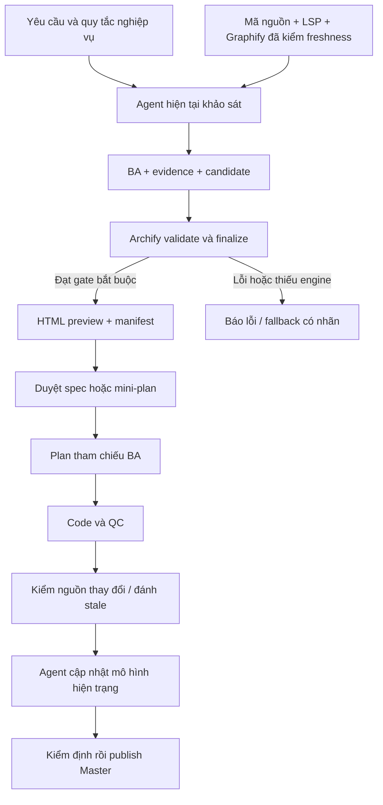

# SPEC — Hoàn thiện Archify đầu-cuối: BA trước code và bản đồ dự án

Ngày: 2026-10-25 · Bản: 1.0 · Brief: ../brief/2026-10-24-2348-hoan-thien-archify.md · Lane: full
Soul: chất lượng > runtime > context cost · luật gốc: skills/tdq-conventions/references/soul.md
Trạng thái: CHỜ DUYỆT

Preview thiết kế: [Mở HTML BA](2026-10-24-2348-hoan-thien-archify-preview.html). Candidate SHA-256: `8217499ddb4b52ac4a105855d54dadfcc338764edd715af9be3b910057b0c583`; HTML SHA-256: `12a2ec993334a36608c5008478caf1bbe036dd14c1a1e3c05dcbadfae1cfa1cb`. Archify explainer validate/deliver/check đạt; browser-check chưa chạy cho preview này. Đây là mô hình đề xuất, không phải nghiệm thu implementation.

## 1. Mục tiêu & phạm vi

Biến phần tích hợp thử nghiệm hiện có thành luồng hoạt động kiểm chứng được: agent đang làm việc khảo sát dự án và viết BA, Archify dựng HTML, dev xem trước duyệt, bản đồ hiện trạng được tái dựng từ nguồn xác định sau thay đổi.

Trong phạm vi:
- Sửa adapter, schema bridge, giao nhận và mở file; không báo PASS khi một bước bắt buộc lỗi.
- Full: sinh preview cùng spec trước duyệt; plan chỉ tham chiếu. Quick: sinh flow cùng mini-plan khi chạm nhiều module hoặc refactor; không thêm cổng duyệt.
- Master Map có entry HTML ổn định, các góc nhìn chi tiết và inventory phạm vi; Task BA có snapshot thiết kế riêng.
- Bằng chứng nguồn, revision, fingerprint, trạng thái current/stale/planned/partial; giữ bản tốt trước khi bản mới kiểm định xong.
- Cài/định vị Archify theo cấu hình khả chuyển, hướng dẫn agent tác giả hóa; kiểm chứng qua CLI và trình duyệt thật.
- Sửa hồi quy do tích hợp; phân loại lỗi nền bằng baseline, không tự sửa mọi vấn đề ngoài phạm vi.

Ngoài phạm vi:
- Không viết lại renderer, viewer, router hoặc fork mã nguồn Archify.
- Không xây autonomous scanner riêng hoặc client API riêng trong đợt này: agent hiện tại đã dùng được để soạn candidate. OpenAI-compatible là hướng dự phòng khi đường agent thực sự không khả dụng, không tự kích hoạt.
- Không tự lấy API key/endpoint từ credential store của host, không gửi dữ liệu ra endpoint chưa được cấu hình.
- Không daemon theo dõi mọi lần gõ phím, không hứa HTML tĩnh tự đọc codebase hoặc tự cập nhật khi không chạy workflow.
- Không coi hoạt ảnh hay đường đi trong sơ đồ là trace runtime hoặc chứng minh tác động thực thi.

## 1b. Lộ trình

| Bước/phase | CÓ-BỎ | Vì sao |
|---|---|---|
| Khảo sát nguồn cục bộ | CÓ | Đã tái hiện lỗi và đối soát hợp đồng upstream |
| Research web bổ sung | BỎ | Phạm vi ghim bản Archify cục bộ; không xây client API trong đường agent-first |
| Spec và preview | CÓ | Chốt hợp đồng BA, lifecycle, đầu ra và tiêu chí nghiệm thu |
| Plan | CÓ | Tách module theo luồng gọi và khai kiểm thử cụ thể |
| Implement | CÓ | Sau duyệt spec/plan mới; không kế thừa quyền triển khai cũ |
| QC ultra độc lập | CÓ | Test hồi quy, render thật và kiểm tra trình duyệt |
| Report | CÓ | Báo đúng PASS/FAIL/CHỜ, không đóng trước tác vụ nền |

## 2. Đầu ra cụ thể

| # | Đầu ra | Vị trí | Điều kiện hoàn thành |
|---|---|---|---|
| O1 | Adapter CLI an toàn và hợp đồng dữ liệu thống nhất | `scripts/tdq_archify.py`, các module `scripts/archify_*.py` được phân ranh tại plan | CLI và skills dùng cùng cú pháp; exit, receipt, output được kiểm; lỗi không bị nuốt |
| O2 | Hướng dẫn BA agent-first cho hai pipeline | `skills/tdq-spec/`, `skills/tdq-intake/`, `skills/tdq-plan/` | Sinh preview trước duyệt theo quy tắc kích hoạt, reuse ở plan; không thêm cổng |
| O3 | Task preview và bộ chứng cứ đi kèm | Full: `docs/tdq/spec/<slug>-preview.html`; Quick: `docs/tdq/plan/<slug>-flow.html`; candidate/manifest cùng khu vực | HTML mở độc lập, liên kết tài liệu nguồn và hash; sửa thiết kế làm preview cũ stale |
| O4 | Master Map và inventory phạm vi | `docs/architecture/index.html`, `docs/architecture/` | Entry tổng quan dẫn tới góc nhìn chi tiết; hiển thị revision, thời điểm sinh, unknown và phần không khảo sát |
| O5 | Lifecycle refresh và kiểm tra freshness | `scripts/tdq_finish.py`, `skills/tdq-build/` và module lifecycle | Finish đánh dấu stale khi nguồn đổi; agent cập nhật vùng liên quan rồi publish lại. Sau merge dùng revision nhánh đích; không đồng bộ bằng cách gộp ý tưởng từ spec |
| O6 | Setup và tài liệu vận hành khả chuyển | `scripts/tdq_setup.py`, `.env.example`, `docs/kien-truc-tich-hop-archify.md` | Không hard-code đường dẫn admin; chế độ agent không đòi API key; cấu hình endpoint chưa hoạt động không được quảng bá là scanner |
| O7 | Bằng chứng nghiệm thu mới | `docs/tdq/qc/`, `docs/tdq/reports/` | Kiểm thử hành vi âm tính, E2E Full/Quick/Master, hồi quy và reviewer độc lập; không tick trước khi có kết quả |

### Hợp đồng BA và artifact

Một BA gồm mục tiêu, actor, trigger, đầu vào, quy tắc nghiệp vụ, happy path, nhánh lỗi/fallback, đầu ra, thành phần chịu trách nhiệm và tiêu chí nghiệm thu. Thiếu dữ kiện thì ghi unknown hoặc hỏi; không tự điền nghiệp vụ.

Mỗi view có ID ổn định, loại sơ đồ, tập thành phần/quan hệ, mục đích đọc và phạm vi lược. Chọn architecture cho module, workflow cho nghiệp vụ, sequence cho tương tác theo thứ tự, lifecycle cho trạng thái, ERD cho dữ liệu. Explainer dùng để tổng hợp; không bắt mọi request dựng mọi loại.

Manifest TDQ riêng chứa request/lane, trạng thái bằng chứng, tài liệu nguồn và hash, candidate hash, artifact hash, phiên bản engine, receipt, snapshot nguồn và coverage. Không nhét trường TDQ tùy ý vào schema upstream. Không lưu secret trong manifest hoặc HTML.

## 2b. Ranh giới module

Ranh giới dựa trên luồng hiện có `main → run_finalize`, `main → sync_master → graphify_to_archify → atomic_delivery`; các vùng mới là thiết kế, không giả là symbol đã tồn tại. LSP trả tham chiếu adapter; Graphify stale không dùng để chứng minh không có caller.

| Module | Vùng file | Phụ thuộc | Đầu ra |
|---|---|---|---|
| Điều phối và kiểm định | `scripts/tdq_archify.py`, `scripts/archify_delivery.py` dự kiến | Node/Archify CLI | O1, O3 |
| Mô hình và bằng chứng | `scripts/archify_model.py` dự kiến | JSON nguồn, Git, evidence do agent thu thập | O1, O4 |
| Lifecycle artifact | `scripts/archify_artifacts.py` dự kiến, `scripts/tdq_finish.py` | Mô hình, điều phối | O3, O4, O5 |
| Quy trình tác giả hóa | `skills/tdq-spec/`, `skills/tdq-intake/`, `skills/tdq-plan/`, `skills/tdq-build/` | Hợp đồng CLI và lifecycle | O2, O5 |
| Môi trường và hướng dẫn | `scripts/tdq_setup.py`, `.env.example`, `docs/kien-truc-tich-hop-archify.md` | Kiểm tra điều phối | O6 |
| Kiểm chứng | `tests/`, tài liệu QC/report của request | Các module trên | O7 |

Tên module mới được chốt trong plan; chỉ tách theo trách nhiệm thực, không thêm tầng rỗng. `tdq_state.py` giữ quyền ghi state; ưu tiên hash manifest nằm trong tài liệu được duyệt thay vì thay đổi schema state.

## 2c. Luồng hoạt động & Sơ đồ kiến trúc

| Khía cạnh | Trước | Sau |
|---|---|---|
| Kết quả finalize | Có HTML cũ vẫn có thể báo thành công khi exit lỗi | Exit và receipt hợp lệ, hash đúng, gate bắt buộc đạt mới công bố |
| Graphify bridge | Top-degree bị coi như toàn cảnh, trường sources sai | Evidence chuẩn, giữ loại/hướng quan hệ, coverage rõ; phân cấp thay vì cắt âm thầm |
| BA Full/Quick | Chỉ dẫn CLI positional không khớp parser | Cùng một hợp đồng gọi và fixture kiểm chứng cho cả hai |
| Master | Chỉ ghi JSON | Render HTML, inventory, freshness và publish snapshot có kiểm định |
| AI | Có biến env nhưng chưa có client | Agent đang có là đường chính; không đòi endpoint ngoài hoặc hứa scanner |
| QC | Kết luận trước kết quả nền | Chỉ kết luận sau tất cả phép kiểm, tách lỗi nền và hồi quy |

## 3. Cách tiếp cận & lý do

Dùng Archify nguyên gốc làm engine và agent hiện tại làm tác giả. Bridge chỉ chuẩn hóa evidence và topology, không tự suy business flow từ tên file. Tái sử dụng cơ chế receipt upstream; TDQ quản lý lifecycle và tính nhất quán tài liệu.

Master mặc định phản ánh snapshot đã commit. Làm việc trên nhánh chưa commit được phép sinh preview riêng có nhãn working-tree và fingerprint; không gắn dòng chưa commit vào SHA của HEAD. Thiết kế mới có nhãn planned, không giả citations mã chưa tồn tại.

Cập nhật theo thay đổi có liên quan: code/config/contract đổi → stale → agent đọc diff và bằng chứng → dựng candidate mới → kiểm định → publish. Thay đổi từ bên ngoài workflow chỉ được phát hiện khi chạy kiểm tra/refresh tiếp theo. Không tuyên bố HTML tự biết thay đổi khi mở offline.

Một entry HTML không có nghĩa một canvas khổng lồ. Overview thể hiện module và luồng chính; các view chi tiết có inventory liên kết. Mỗi file HTML tự chứa tài nguyên runtime; chia sẻ toàn bộ bộ tài liệu cần mang các file view cùng thư mục. Task preview vẫn là file độc lập.

Không dùng `compare` để merge; chỉ dùng diff trực quan giữa candidate trước/sau khi hữu ích. Không áp giới hạn node làm mất quan hệ; tách view khi sơ đồ không còn đọc được, công khai phạm vi chưa được chứng minh.

## 3b. Năng lực & công cụ

| Skill/công cụ | Nguồn | Phán quyết | Vai trò |
|---|---|---|---|
| tdq-intake | plugin:tdq-workflow | DÙNG | BA ở Quick và thông tin đầu vào |
| tdq-spec | plugin:tdq-workflow | DÙNG | Preview và cổng duyệt Full |
| tdq-plan | local | DÙNG | Trace task tới BA đã duyệt |
| tdq-build | plugin:tdq-workflow | DÙNG | Lifecycle finish và bằng chứng QC |
| tdq-browser-test | plugin:tdq-workflow | DÙNG | Kiểm tra tương tác và bố cục sau MCP pre-flight |
| tdq-lean | plugin:tdq-workflow | DÙNG | Giữ module cần thiết, không tái tạo renderer |
| Archify authoring/delivery | local | DÙNG | Native/explainer, schema, receipt |
| dataviz | built-in | DÙNG | Sơ đồ preview và tính dễ đọc |
| LSP/Grep | MCP/local | DÙNG | Callers, cấu trúc và đối soát nguồn |
| Graphify | local | NỀN | Chỉ dùng quan hệ có provenance/freshness rõ |
| Đã xét 5 skill khác | plugin/built-in | KHÔNG | khác lĩnh vực: status, browser-research, frontend-design, cdesktop, keybindings |

## 3c. Giải thuật & Xử lý cốt lõi

1. Kiểm engine, Node và browser theo loại artifact; cấu hình root rõ ràng, không tìm credential host.
2. Thu evidence có source kind và revision; lập inventory module/entrypoint, bỏ artifact sinh tự động khỏi corpus để tránh vòng lặp.
3. Agent xây BA và view; map sources sang `path`, `line`, `end_line` đúng schema. Quan hệ không biết hướng không biến thành call có hướng.
4. Validate candidate bằng engine thật. Dựng trong vùng staging riêng, bounded timeout, UTF-8 rõ ràng; nhận kết quả JSON có kiểm kiểu.
5. Chỉ nhận thành công khi exit thành công, receipt pass và artifact/receipt khớp; native và explainer dùng hợp đồng gate riêng. Missing browser không bị báo native PASS.
6. Publish bộ artifact đã đạt, giữ bản tốt khi lỗi; kiểm chống ghi đè đồng thời và sửa candidate trong khi render.
7. Gắn manifest vào spec/mini-plan để hash tài liệu bao gồm định danh artifact. Trước code, đối chiếu lại; stale thì không tự sử dụng preview khác bản được duyệt.
8. Finish/refresh so fingerprint; thay đổi chỉ đánh stale, không chép to-be vào current. Agent cập nhật rồi render Master từ snapshot mới; giữ lịch sử request riêng.

Chi phí duyệt topology O(V+E), hashing O(B) với B là tổng byte nguồn chọn; bộ nhớ mô hình O(V+E). Chi phí LLM và routing upstream phụ thuộc nội dung/bố cục, chưa có benchmark để cam kết thời gian hoặc token. Không dùng các con số 800 ms/700 tokens của báo cáo cũ.

Ca góc: graph stale/không có → khảo sát bằng LSP và nguồn, ghi thiếu coverage; repo không remote → không bịa URL; dirty tree → nhãn riêng; file nguồn mất/đổi dòng → evidence stale; CLI trả JSON sai kiểu/exit lỗi/HTML cũ → FAIL; endpoint không cấu hình → giữ đường agent, không gọi mạng ngoài; task rất nhỏ → giải thích bằng text, không sinh artifact thừa.

## 3d. Mental Model cho Fresher Dev

Master như bản đồ một tòa nhà đã xây. Task BA là bản thiết kế sửa một khu vực; bản vẽ được duyệt không có nghĩa công trình đã đổi. Agent là người khảo sát và thiết kế, Archify là công cụ kiểm và trình bày bản vẽ, TDQ giữ phiên bản và các bước duyệt.

- Candidate: mô hình đầu vào do agent viết, chưa phải artifact nghiệm thu.
- Evidence: nguồn chứng minh một nhận định; không chỉ là đường dẫn nhìn giống thật.
- Manifest: sổ nhận dạng phiên bản nguồn, thiết kế, HTML và kết quả kiểm.
- Stale: bản vẽ không còn khớp đầu vào hiện tại, chưa chắc nội dung sai toàn bộ.
- Coverage: phần đã khảo sát và phần bị bỏ hoặc chưa rõ.

## 4. Yêu cầu bắt buộc

- Log CLI bật mặc định ở stderr, có timestamp và tắt được; stdout giữ JSON máy đọc. Không log secrets hoặc nguyên repo.
- Không mock trình bày như render thật; unit test có mock phải ghi rõ phạm vi.
- Bảo toàn luật pipeline, tick, test, số cổng duyệt; không nén bỏ luật để vượt token budget. Tách hướng dẫn có điều kiện sang reference và kiểm liên kết/chỉ mục.
- Chỉ gửi dữ liệu dự án qua endpoint nếu đường fallback cần dùng và người dùng đã cấu hình đích. Hiện agent-first hoạt động nên không phát sinh gửi endpoint riêng.
- Không tự commit/push hoặc merge request này khi chưa được yêu cầu; không sửa spec cũ đã duyệt.

## 5. Ràng buộc & rủi ro

- `hooks/` được gọi `scripts/`; `scripts/` không được import `hooks/` — adapter độc lập, không đảo chiều phụ thuộc.
- Chỉ `scripts/tdq_state.py` được ghi `docs/tdq/state.json`; mọi nơi khác chỉ đọc qua CLI.
- File code mới nằm trong `scripts/` hoặc `hooks/`; test ở `tests/` theo quy ước.
- Ghim hợp đồng Archify 3.2.0, Node từ 18 theo gói cục bộ đã đọc. Dùng engine ngoài repo, root explicit; không tự cài gói từ nguồn tùy ý. Thiếu gói phải báo và hướng dẫn setup.
- Archify có update check; khi kiểm thử offline đặt biến tắt update đã được upstream hỗ trợ. Không đồng nhất HTML offline với CLI mặc định không truy cập mạng.
- Endpoint riêng: OpenAI-compatible chỉ là hướng dự phòng. Quyền dữ liệu rộng trong dự án đã được người dùng cấp; không có đích/model được chốt nên không gọi API trong đợt này.

| Rủi ro | Giảm thiểu |
|---|---|
| Đồ thị lớn hoặc lẫn docs sinh tự động | Inventory nguồn, loại corpus derived, chia view; công khai coverage |
| Bản đồ đẹp nhưng sai | Cạnh có loại và nguồn, human/agent review, không suy runtime từ hoạt ảnh |
| Render lỗi làm mất bản tốt | Staging, hash, lock/publish có phục hồi; kiểm thất bại giữ bản cũ |
| Thay đổi nội dung sau duyệt | Manifest gắn tài liệu và kiểm hash trước dùng |
| Lỗi nền bị lẫn hồi quy mới | So sánh baseline cô lập, báo riêng; không mặc định mọi lỗi do request này |
| Browser không có hoặc không kết nối | Báo tình trạng chưa kiểm, không giả PASS; hướng dẫn kết nối MCP trước thử |

## 6. QC & Definition of Done

Mức `ultra`: mỗi đầu ra có kiểm tự động và runtime liên quan; reviewer độc lập đọc bằng chứng. Không lấy cú pháp hợp lệ hoặc mock xanh làm đủ nghiệm thu.

| # | Hạng mục | Điều kiện PASS | Đo trước | Dự phòng nếu trượt |
|---|---|---|---|---|
| Q1 | Adapter và giao nhận | Exit lỗi, receipt sai, stale output, timeout không thể thành công; open không nội suy đường dẫn thành mã shell | Tái hiện exit 1 nhưng status=True | Sửa và tái kiểm; giữ FAIL khi chưa đạt |
| Q2 | Bridge/evidence | Candidate được validator Archify thật chấp nhận; citations khớp snapshot; cạnh vô hướng/unknown không giả call | Trường sources hiện dùng startLine/endLine | Chuẩn hóa đúng schema; graph không đủ chứng cứ thì xuất partial có nhãn |
| Q3 | BA Full/Quick | Fixture hai pipeline tạo HTML trước cổng tương ứng; plan tham chiếu BA; việc nhỏ không bị ép HTML | Cú pháp positional hiện exit 2 | Sửa hợp đồng CLI/skill, không thêm gate |
| Q4 | Master | Từ repo mẫu dựng index HTML và views; coverage đủ inventory hoặc ghi unknown rõ; source đổi làm stale, refresh cập nhật snapshot | sync_master mới ghi JSON, mặc định lọc 25 node | Phân tầng view, không cắt âm thầm hoặc giả toàn repo |
| Q5 | Lifecycle và phê duyệt | Đổi candidate/spec/source phát hiện mismatch; to-be không bị publish thành current; render lỗi giữ snapshot tốt | Chưa có ràng buộc artifact với duyệt | Manifest riêng và liên kết hash trong tài liệu, không sửa state trực tiếp |
| Q6 | Khả chuyển/agent-first | Engine ở root cấu hình chạy được; không hard-code user; agent tạo candidate không cần endpoint/key mới | Preview trước đã finalize bằng CLI local | Báo missing dependency rõ; không triển khai API giả để lấp chỗ trống |
| Q7 | Browser E2E | Mở Full, Quick và Master; kiểm zoom/focus/điều hướng, đọc được nhãn, không lỗi console ảnh hưởng sử dụng | Preview tổng hợp trước đã mở Chrome; chưa E2E adapter | Sửa layout/tương tác, giữ CHỜ nếu không có browser evidence |
| Q8 | Hồi quy và review | Không có hồi quy mới chưa xử lý; toàn bộ kết quả suite được lưu, reviewer xác nhận theo DoD, không có tác vụ nền chưa kết thúc khi báo | Log cũ 2829 tests: 14 failures, 1 error, 9 skipped; tái kiểm vùng hẹp 2 fail/27 pass | Lỗi nền có baseline chứng minh được tách báo cáo; còn lỗi do thay đổi hoặc không xác định thì chưa nghiệm thu |

Các phép kiểm cố định của TDQ vẫn áp dụng: toàn bộ suite, vùng chạm, ràng buộc kiến trúc, clean code. Lỗi nền chưa sửa không được đổi thành PASS toàn repo. Giới hạn runtime/smoke theo quy định QC hiện hành; timeout là FAIL, không tự kéo dài để che lỗi.

## 7. Câu hỏi còn mở

Không còn câu hỏi về phạm vi cần người dùng quyết định trước khi lập plan. Endpoint ngoài không thuộc đường triển khai hiện tại vì đã chứng minh agent đang có dùng được.
