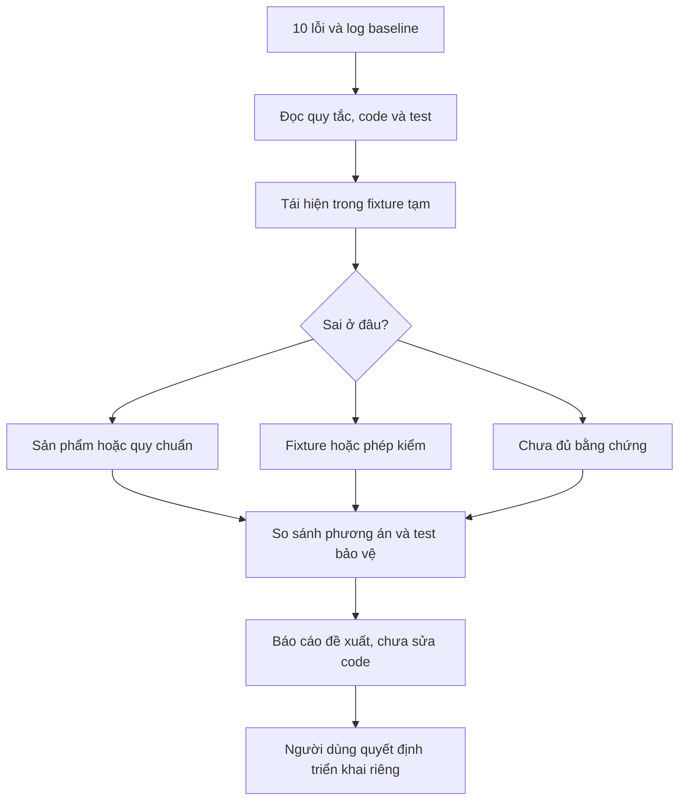

# SPEC — Phân tích và đề xuất xử lý 10 issue nền

Ngày: 2026-10-25 · Bản: 1.0 · Brief: ../brief/2026-10-25-1113-phan-tich-muoi-issue.md · Lane: full
Soul: chất lượng > runtime > context cost · luật gốc: skills/tdq-conventions/references/soul.md
Trạng thái: CHỜ DUYỆT

## 1. Mục tiêu & phạm vi

Tạo báo cáo giúp người dùng quyết định cách xử lý đủ 10 issue nền, phân biệt lỗi sản phẩm/quy chuẩn với fixture hoặc phép kiểm đã lệch. Request này chỉ phân tích và đề xuất, KHÔNG fix.

Trong phạm vi: truy nguyên code/test, bằng chứng tái hiện, so sánh phương án, vùng ảnh hưởng, test bảo vệ, thứ tự triển khai tương lai và đường tiếp tục Archify.

Ngoài phạm vi: sửa scripts/hooks/tests/skills để làm xanh suite; tăng cap hoặc bỏ assert; phát hành, commit/push/merge; dọn worktree dirty; dựng Master Map thật; thay đổi engine Archify hoặc thiết lập endpoint. Duyệt spec này không cấp phép triển khai các phương án sửa lỗi.

## 1b. Lộ trình

| Bước/phase | CÓ-BỎ | Vì sao |
|---|---|---|
| analyze | CÓ | Kiểm source/test và phân loại đủ 10 issue; đối chiếu lỗi thực với kỳ vọng test |
| spec/plan | CÓ | Chốt hợp đồng đầu ra báo cáo và cách kiểm chứng, không cấp phép sửa production |
| implement | CÓ — chỉ tài liệu | Viết báo cáo đề xuất; không sửa scripts/hooks/tests/skills để fix issue |
| qc | CÓ — full | Kiểm dẫn nguồn, đủ 10 issue, test vùng liên quan và một lượt full suite tại cổng; lỗi nền ghi trung thực, không fix trong request tài liệu |
| report | CÓ | Bàn giao đề xuất và liên kết snapshot để tiếp tục Archify khi user yêu cầu |

Research web BỎ: không có ẩn số ngoài repo. Phỏng vấn phạm vi lặp BỎ: người dùng chốt rõ 10 issue và chưa fix. QC độc lập, smoke/runtime BỎ theo mức full; phân tích nhóm độc lập bằng agent chỉ phục vụ khảo sát, không giả là nghiệm thu độc lập.

## 2. Đầu ra cụ thể

| # | Đầu ra | Đường dẫn/vị trí | Đo "xong" bằng |
|---|---|---|---|
| O1 | Báo cáo phân tích và phương án | docs/tdq/reports/2026-10-25-1113-phan-tich-muoi-issue.md | Đủ I01–I10, mỗi issue có triệu chứng, nguyên nhân, chứng cứ file:line, phân loại, phương án chọn/loại, vùng sửa tương lai, test và rủi ro |
| O2 | Bảng thứ tự và phụ thuộc | Cùng báo cáo O1, mục Lộ trình xử lý đề xuất | Gom sửa cùng nguồn quy tắc, giữ coverage, nêu cổng cho phép fix riêng |
| O3 | Hồ sơ kiểm chứng | docs/tdq/qc/2026-10-25-1113-phan-tich-muoi-issue.md | Lệnh/exit/kết quả thật, baseline kế thừa tách khỏi đo mới; không lấy suite đỏ làm PASS |
| O4 | Bàn giao tiếp tục Archify | Báo cáo O1 tham chiếu docs/tdq/reports/2026-10-24-2348-hoan-thien-archify-resume.md và snapshot đã lưu | Snapshot giữ định danh/approval cũ; giải thích proposal chưa sửa lỗi và không tự nghiệm thu Archify |

Danh mục cố định:

| ID | Issue | Trọng tâm phân tích |
|---|---|---|
| I01 | Next step của hai browser skills | Pha không đổi hay chuyển pha, không chỉ sửa câu để regex chấp nhận |
| I02 | Ba reference thiếu link tầng một | Chọn đúng skill chủ, không nhồi link vào skill không liên quan |
| I03 | Link chrome-devtools-mcp-scripts.md chết | Tìm nguồn hướng dẫn tương đương, không tạo tài liệu rỗng |
| I04 | 11 skills nhưng 9 limits | Đồng bộ registry và kiểm coverage, không tăng các cap hiện có |
| I05 | Description 2051 > 1800 | Rút gọn mô tả giữ trigger/phạm vi; không xóa luật hoặc tăng trần |
| I06 | Năm entrypoint thiếu utf8_io | Bootstrap đúng tầng và môi trường portable, test Unicode thực |
| I07 | tdq-spec thiếu link vision-test-loop | Khôi phục liên kết đúng phase, tránh duplicate nội dung |
| I08 | Search gate output không phải JSON | Fixture analyze đối nghịch chính sách miễn chặn; test allow và deny riêng |
| I09 | Bán kính module vượt cap 3 | Phân biệt tham chiếu thật, textual dependency, scanner và số đo lịch sử |
| I10 | Đường dẫn hook Antigravity | Generator quote path nhưng test split sai; kiểm parser theo nền tảng |

## 2b. Ranh giới module

Không tạo module runtime. Vùng dưới đây là ranh giới dữ liệu ghi, không phải suy kiến trúc từ tên thư mục.

| Module | Vùng file | Phụ thuộc module | Đầu ra §2 nào |
|---|---|---|---|
| Tổng hợp đề xuất | docs/tdq/reports/2026-10-25-1113-phan-tich-muoi-issue.md | Hồ sơ kiểm chứng, bàn giao Archify chỉ đọc | O1, O2, O4 |
| Hồ sơ kiểm chứng | docs/tdq/qc/2026-10-25-1113-phan-tich-muoi-issue.md | Code/test hiện tại chỉ đọc | O3 |

Quan hệ nguồn đã đối chiếu: search_gate gọi search_rules.quyet_dinh; fixture đặt phase trước khi hook đọc state. LSP tìm 8 references nhưng metadata vị trí hạn chế nên đối chiếu text. Graphify affected ban_kinh depth2 trả cmd_vung_cham và main; graph stale chỉ là gợi ý. Generator _sinh_hooks_agy dựng command, test_tuyet_doi là consumer kiểm command. Chỉ đề xuất sửa nơi vi phạm contract, không sửa caller đúng để thỏa test sai.

## 2c. Luồng hoạt động & Sơ đồ kiến trúc

Sơ đồ chỉ mô tả cách phân tích, không phải thay đổi runtime. Không sinh HTML/manifest Archify mới: đây là request tài liệu, không thiết kế chức năng nhiều module hoặc refactor; bảng và Mermaid là fallback đọc trực tiếp, không tuyên bố đã review browser.

| Khía cạnh | Trước | Sau request này |
|---|---|---|
| Hiểu lỗi | Biết 10 failures là baseline | Biết nguyên nhân, mức chắc chắn và cách sửa đề xuất |
| Source/test | Đang dirty do Archify, suite đỏ | Giữ nguyên; không có bản vá từ request phân tích |
| Quyết định fix | Dễ nhầm sửa code với sửa test | Có phương án được chứng minh và test bảo vệ trước khi xin triển khai |

## 3. Cách tiếp cận & lý do

Dùng nguồn hiện tại làm chuẩn và log baseline làm mốc. Với mỗi issue, nối assertion thất bại về contract, đường dữ liệu, source producer/consumer; thử giả thuyết bằng lệnh đọc hoặc fixture tạm, không áp patch trên repo.

Đã loại: tăng trần 1800 hay cap3 để xanh; bỏ test; sửa gate để chặn analyze; bỏ dấu nháy generator để test split dễ đọc. Những cách này che nguyên nhân hoặc phá hành vi hợp lệ.

I09 cần so sánh hai phương án trong báo cáo: giữ selector bảo thủ và thay số đo repo biến động bằng fixture có dependency xác định; hoặc lọc comment/docstring qua AST với chứng minh không mất dynamic import/contract strings. Không chọn phương án thứ hai chỉ vì giảm được số module.

## 3b. Năng lực & công cụ

| Skill | Nguồn | Phán quyết | Dùng ở đâu / Lý do loại |
|---|---|---|---|
| tdq-intake | plugin:tdq-workflow | NỀN | Phạm vi, QC full, bảo toàn request cũ |
| tdq-conventions | plugin:tdq-workflow | NỀN | State, nhật ký, ngôn ngữ và approval |
| tdq-spec | plugin:tdq-workflow | NỀN | Đặc tả đầu ra tài liệu |
| dataviz | built-in | DÙNG | Sơ đồ luồng phân tích, nhãn trực tiếp không dùng màu phân loại |
| Đã xét 8 skill TDQ khác và các skill chuyên biệt trong phiên | plugin/built-in | KHÔNG | khác lĩnh vực |

MCP-First: pre-flight LSP rồi tra references; nếu singleton đổi root hoặc không đủ vị trí thì khởi động lại đúng root và đối chiếu Read/Grep. Graph stale ghi giới hạn, không tự semantic extraction có phí. Không cần browser/endpoint cho nội dung này.

## 3c. Giải thuật & Xử lý cốt lõi

1. Lập inventory I01–I10 với test ID và log kế thừa.
2. Đọc input fixture → hàm sản phẩm → output → assertion; ghi điều kiện mà test thực sự kiểm.
3. Tái hiện mục tiêu và kiểm một giả thuyết phân biệt; lỗi thiếu JSON phải xác định allow/deny trước khi quy lỗi serializer.
4. Phân loại code/docs/test/chưa đủ chứng cứ; ghi mức chắc chắn và nguồn.
5. Đề xuất phương án nhỏ nhất giữ contract; so sánh phương án bị loại và ảnh hưởng caller/portable.
6. Thiết kế test âm/dương và hồi quy; xếp thứ tự theo phụ thuộc, không cộng số lượt lặp thành coverage.
7. QC tài liệu, kiểm không có source delta mới, bàn giao đường resume; dừng trước triển khai fix.

Độ phức tạp: đọc nguồn O(B) với B là tổng bytes khảo sát; phân loại O(N) cho N issue; đối chiếu đồ thị O(V+E) khi dùng traversal. Bộ nhớ O(B+V+E) nếu giữ toàn bộ nguồn/graph, giảm bằng đọc đoạn; thời gian chạy tests ghi đo thực tế riêng, không dự đoán bằng công thức.

Ca biên: graph stale → text/LSP và giới hạn coverage; stdout rỗng hợp lệ → không ép parse JSON; path có khoảng trắng/Unicode/8.3 → giữ token/quote; dirty kế thừa → so snapshot, không coi git diff tổng là thay đổi request mới; test timeout → ghi chưa xác minh, không gọi PASS.

## 3d. Mental Model cho Fresher Dev

Giống kiểm tra báo động: đèn đỏ có thể do thiết bị hỏng, cảm biến sai, hoặc bài thử đặt sai hoàn cảnh. Chưa biết nguyên nhân thì không tháo bóng đèn để báo xanh. Request này lập hồ sơ chẩn đoán và phương án sửa, chưa tháo thiết bị.

- Baseline: lỗi đã tồn tại trước request mới, không đồng nghĩa lỗi được chấp nhận.
- Fixture: trạng thái đầu vào test tự dựng, ví dụ phase analyze.
- Contract: quy tắc hành vi mà cả sản phẩm và test phải tuân theo.
- Regression: lỗi mới do thay đổi gây ra.
- Resume snapshot: bản lưu trạng thái/approval để tiếp tục request cũ, không là phê duyệt mới.

## 4. Yêu cầu bắt buộc

Log service: BỎ — không tạo hoặc sửa runtime; dùng log kiểm thử và workinglog có sẵn. Không thêm logger.

Không placeholder hoặc kết luận chưa chạy; mỗi issue có check thực tế hoặc giới hạn xác minh rõ. Test âm/dương trong đề xuất là thiết kế cho lần fix tương lai, không trình bày là đã triển khai. Giữ cấu trúc module, import và luồng lỗi hiện tại; không tạo lớp/helper mới chỉ để phân tích.

## 5. Ràng buộc & rủi ro

Ràng buộc kiến trúc phải giữ: không chạm dòng nào — chỉ ghi tài liệu, đọc code và chạy test fixture. Mọi ghi state vẫn qua scripts/tdq_state.py; không import hooks vào scripts hoặc sửa approval cũ. Hồ sơ docs/kien-truc.md đang nháp, không tự nâng nháp thành luật mới.

Không cài thư viện mới, không tải model, không dùng endpoint. Giữ nguyên dirty Archify và snapshot; không cleanup/commit để vượt gate.

| Rủi ro | Ảnh hưởng | Cách giảm |
|---|---|---|
| Test sai bị hiểu là production sai | Bản vá tương lai gây hồi quy | Đối chiếu producer/consumer và policy trước chọn nơi sửa |
| Test chạy làm sinh derived files | Diff bị trộn với phân tích | Fixture tạm; phân loại file sinh và delta trước/sau |
| Suite nền đỏ | Gọi báo cáo đúng là sản phẩm đã xanh | Ghi PASS tài liệu tách FAIL toàn repo; không tick nghiệm thu Archify |
| Snapshot approval cũ | Khôi phục nhầm thiết kế đã đổi | Recheck digest và nhánh khi continue, không duyệt hộ user |

## 6. QC & Definition of Done

Mức full do user chọn `1a`; không smoke/runtime hoặc QC agent độc lập. Full suite chạy tại cổng QC, không lặp baseline toàn repo ở analyze. Báo cáo có thể đạt hợp đồng phân tích trong khi suite vẫn đỏ baseline; hai kết luận phải tách rõ. Không chuyển sang vòng fix production trong request này.

| # | Hạng mục kiểm | Điều kiện PASS | Đo trước | Dự phòng nếu trượt |
|---|---|---|---|---|
| Q1 | O1 đủ inventory | Có đủ I01–I10, không thiếu mục nguyên nhân/chứng cứ/phương án/test | Đã có 10 lỗi baseline; 3 test mục tiêu tái hiện thất bại ở lượt analyze | Bổ sung mục thiếu, không bỏ issue |
| Q2 | O1 chứng cứ đúng | File và symbol trích dẫn tồn tại; kết luận phân biệt fact/giả thuyết; không mô tả đề xuất như patch đã làm | I08 phase allow, I10 split quote, I09 text matching đã đọc trực tiếp | Hạ kết luận thành chưa đủ chứng cứ và chỉ rõ phép kiểm còn thiếu |
| Q3 | O2 phương án an toàn | Không tăng cap/bỏ assert thuần túy; có âm/dương, caller và thứ tự phụ thuộc | Cap3/4 modules và description2051/1800 là triệu chứng hiện có | Loại phương án làm yếu contract, ghi đánh đổi cần quyết định |
| Q4 | O3 kiểm chứng full | Lưu lệnh, exit, summary và phân loại lỗi; không còn tác vụ kiểm nền khi bàn giao | Lượt kế thừa2974 tests,9 failures,1 error,10 skipped; không là QC của request mới | Ghi FAIL/HOLD cho phép kiểm lỗi, giữ báo cáo trung thực không tự fix |
| Q5 | O4 bảo toàn và chưa fix | Không có thay đổi source/test/skill do request này; snapshot Archify và hướng dẫn continue tồn tại | Snapshot đã đối chiếu trước init;6worktrees dirty giữ nguyên | Dừng thao tác có thể mất dữ liệu, nêu delta để người dùng quyết định |
| Q6 | Tài liệu dùng được | Lint đạt, thuật ngữ rõ, phân biệt hiện trạng với đề xuất và liên kết bàn giao đúng | Brief đã lint đạt; spec đang tự kiểm trước duyệt | Sửa tài liệu, không nới luật lint |

## 7. Câu hỏi còn mở

Không còn câu hỏi về phạm vi. Chỉ phân tích/đề xuất, chưa fix; mọi quyết định triển khai thực tế thuộc bước xin phép riêng sau báo cáo.
