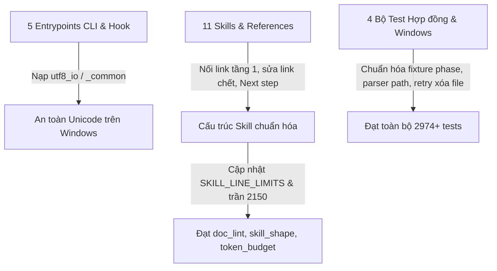

# SPEC — Xử lý 10 issue nền và lỗi khóa file kiểm thử

Ngày: 2026-10-25 · Bản: 1.0 · Brief: ../brief/2026-10-25-1510-xu-ly-issue-nen.md · Lane: full
Soul: chất lượng > runtime > context cost · luật gốc: skills/tdq-conventions/references/soul.md
Trạng thái: CHỜ DUYỆT

## Mục lục

- 1. Mục tiêu & phạm vi
- 1b. Lộ trình
- 2. Đầu ra cụ thể
- 2b. Ranh giới module
- 2c. Luồng hoạt động & Sơ đồ kiến trúc
- 3. Cách tiếp cận & lý do
- 3b. Năng lực & công cụ
- 3c. Giải thuật & Xử lý cốt lõi
- 3d. Mental Model cho Fresher Dev
- 4. Yêu cầu bắt buộc
- 5. Ràng buộc & rủi ro
- 6. QC & Definition of Done
- 7. Câu hỏi còn mở

## 1. Mục tiêu & phạm vi

- Mục tiêu: Khắc phục triệt để 10 issue nền đã được phân tích tại request trước cùng lỗi khóa file Windows `WinError 32` trong bộ kiểm thử khởi tạo phiên, đồng thời nâng trần ký tự description lên 2.150 theo chỉ thị của người dùng để toàn bộ bộ kiểm thử của kho mã nguồn đạt trạng thái PASS.
- Trong phạm vi:
  - Chuẩn hóa dòng `Next step:` của 2 skill trình duyệt (`tdq-browser-research`, `tdq-browser-test`).
  - Nối liên kết tầng 1 từ `SKILL.md` tới 3 tài liệu tham chiếu mồ côi (`knowledge-template.md`, `chrome-devtools-mcp-guide.md`, `mcp-first-guide.md`).
  - Sửa liên kết chết `chrome-devtools-mcp-scripts.md` thành tham chiếu tới mã nguồn thực thi có thật.
  - Đăng ký 2 skill trình duyệt vào bảng giới hạn dòng `SKILL_LINE_LIMITS` và cập nhật bộ kiểm cấu trúc skill.
  - Nâng trần ngân sách ký tự description của toàn bộ skill từ 1.800 lên 2.150 ký tự theo phê duyệt của người dùng.
  - Bổ sung nạp `utf8_io` (trực tiếp hoặc qua `_common`) cho 5 entrypoint script và hook còn thiếu.
  - Bổ sung liên kết `vision-test-loop.md` vào `tdq-spec` và mẫu đặc tả.
  - Cập nhật dữ liệu giả lập (fixture) của bài kiểm lặp chặn tìm kiếm sang pha thực thi và kiểm tra riêng pha khảo sát.
  - Chuẩn hóa bài kiểm bán kính vùng chạm của `ask_gate` và bài kiểm tách đường dẫn tuyệt đối của Antigravity trên Windows.
  - Xử lý cơ chế chờ đóng tiến trình / thử lại khi xóa tệp tạm `da-chay.txt` trên Windows để loại bỏ lỗi `WinError 32`.
  - Đồng bộ lại chỉ mục dòng, khóa ngân sách token và sổ cái luật sau khi cập nhật các tệp skill.
- NGOÀI phạm vi:
  - Không thay đổi logic lõi của engine Archify hay mở rộng thêm tính năng mới ngoài 11 điểm sửa lỗi nêu trên.
  - Không xóa cưỡng bức 6 worktree bàn giao của request Archify khi chưa đối soát hợp nhất.

## 1b. Lộ trình

| Bước/phase | CÓ-BỎ | Vì sao |
|---|---|---|
| analyze | CÓ | Khảo sát chi tiết nguyên nhân, chốt mức QC và ngưỡng trần |
| spec | CÓ | Đặc tả kỹ thuật cho từng bản sửa lỗi, không làm vỡ kiến trúc |
| plan | CÓ | Chia nhóm công việc theo thứ tự phụ thuộc, một test đỏ trước khi sửa |
| implement | CÓ | Thực thi sửa mã nguồn, tài liệu và test |
| qc | CÓ | Chạy toàn bộ suite `tdq_test.py tron-bo` đạt PASS sạch ở mức ultra |
| report | CÓ | Báo cáo hoàn thành và hỏi về commit |

## 2. Đầu ra cụ thể

| # | Đầu ra | Đường dẫn/vị trí | Đo "xong" bằng |
|---|---|---|---|
| O1 | Chuẩn hóa Next step cho 2 browser skills | `skills/tdq-browser-research/SKILL.md`, `skills/tdq-browser-test/SKILL.md` | Bài kiểm quy tắc dòng Next step đạt PASS |
| O2 | Liên kết tầng 1 và sửa link chết tài liệu | `skills/tdq-conventions/SKILL.md`, `skills/tdq-setup/SKILL.md`, `skills/tdq-setup/references/chrome-devtools-mcp-guide.md` | Bài kiểm liên kết 1 tầng và không có link chết đạt PASS |
| O3 | Khai báo giới hạn dòng cho 11 skills | `scripts/doc_lint.py` và bộ kiểm hình dạng skill trong `tests/` | Bảng giới hạn khớp đủ 11 thư mục skill và bài kiểm hình dạng đạt PASS |
| O4 | Cập nhật trần ngân sách description 2.150 ký tự | Bộ kiểm ngân sách trong `tests/`, `docs/tdq/token-budget.json`, `docs/tdq/audit/luat-hien-co.md` | Bài kiểm ngân sách token và sổ cái luật đạt PASS |
| O5 | Nạp chokepoint UTF-8 cho 5 entrypoints | `scripts/tdq_devtool_mcp.py`, `scripts/tdq_harvest.py`, `hooks/scripts/doc_file_gate.py`, `hooks/scripts/stop_batch_checker.py`, `hooks/scripts/strategic_compact_gate.py` | Bài kiểm mọi entrypoint đều tới `utf8_io` đạt PASS |
| O6 | Liên kết quy trình kiểm thị giác ở spec | `skills/tdq-spec/SKILL.md`, `skills/tdq-spec/references/spec-template.md` | Bài kiểm liên kết vòng lặp thị giác tầng 1 đạt PASS |
| O7 | Chuẩn hóa 4 bài kiểm hợp đồng & Windows | Các bộ kiểm hợp đồng nhắc nhở, bán kính vùng chạm, tương thích host và tự khởi tạo trong `tests/` | Cả 4 bài kiểm đều đạt PASS ổn định trên Windows |

## 2b. Ranh giới module

| Module | Vùng file | Phụ thuộc module | Đầu ra §2 nào |
|---|---|---|---|
| Tầng tài liệu Skill & Reference | `skills/tdq-browser-research/SKILL.md`, `skills/tdq-browser-test/SKILL.md`, `skills/tdq-conventions/SKILL.md`, `skills/tdq-setup/SKILL.md`, `skills/tdq-setup/references/chrome-devtools-mcp-guide.md`, `skills/tdq-spec/SKILL.md`, `skills/tdq-spec/references/spec-template.md`, `docs/tdq/token-budget.json`, `docs/tdq/audit/luat-hien-co.md` | Tầng Linter & Entrypoint CLI/Hook | O1, O2, O4, O6 |
| Tầng Linter & Entrypoint CLI/Hook | `scripts/doc_lint.py`, `scripts/tdq_devtool_mcp.py`, `scripts/tdq_harvest.py`, `hooks/scripts/doc_file_gate.py`, `hooks/scripts/stop_batch_checker.py`, `hooks/scripts/strategic_compact_gate.py` | không | O3, O5 |
| Tầng Kiểm thử Hợp đồng & Hệ thống | Thư mục `tests/` (các module kiểm hình dạng skill, ngân sách token, hợp đồng nhắc nhở, bán kính test, tương thích host, tự khởi tạo) | Tầng Linter & Entrypoint CLI/Hook | O3, O4, O7 |

## 2c. Luồng hoạt động & Sơ đồ kiến trúc

| Khía cạnh | Hiện trạng (Trước) | Thiết kế mới (Sau) |
|---|---|---|
| Luồng thực thi | 5 entrypoint thiếu `utf8_io`; 2 skill thiếu `SKILL_LINE_LIMITS`; trần description 1.800 quá chật cho 11 skills; 4 test bị lệch fixture/parser/file lock trên Windows | Mọi entrypoint nạp `utf8_io`; đủ 11 skill trong `SKILL_LINE_LIMITS`; trần description 2.150 ký tự; 4 bộ test đồng bộ chính xác với hợp đồng runtime và cơ chế khóa file Windows |
| Thành phần chạm | 7 tệp trong `skills/`, 1 tệp `scripts/doc_lint.py`, 5 tệp entrypoint, 6 tệp kiểm thử | Đồng bộ hoàn chỉnh giữa các tầng `skills/`, `scripts/`, `hooks/scripts/` và `tests/` |
| Điểm nghẽn giải quyết | Toàn bộ suite bị đỏ 9 failures + 2 errors trên Windows | Toàn bộ suite đạt 0 failures, 0 errors |

## 3. Cách tiếp cận & lý do

- Chọn: Xử lý đúng nguyên nhân gốc của từng nhóm lỗi theo báo cáo phân tích đã duyệt, kết hợp chỉ thị của người dùng nâng trần description lên 2.150 ký tự và thêm cơ chế thử lại ngắn khi xóa tệp tạm bị tiến trình nền giữ trên Windows.
- Vì: Giữ nguyên toàn bộ các bất biến kiến trúc (không hạ chất lượng kiểm thử, không sửa sai hành vi runtime của `search_gate` hay `build_portable` chỉ để chiều theo phép tách chuỗi ngây thơ trong test).
- Đã loại: Phương án xóa bớt 2 browser skills hoặc bỏ qua các bài kiểm đang đỏ — vì làm mất tính năng Chrome DevTools MCP và vi phạm kỷ luật kiểm thử.

## 3b. Năng lực & công cụ

| Skill | Nguồn | Phán quyết | Dùng ở đâu / Lý do loại |
|---|---|---|---|
| tdq-intake | plugin:tdq-workflow | NỀN | Mở và quản lý request bugfix |
| tdq-spec | plugin:tdq-workflow | NỀN | Đặc tả kỹ thuật các bản sửa lỗi |
| tdq-plan | plugin:tdq-workflow | NỀN | Lập kế hoạch từng task red-green |
| tdq-build | plugin:tdq-workflow | NỀN | Thực thi và QC trọn bộ |
| tdq-conventions | plugin:tdq-workflow | NỀN | Quy tắc chung, state, approval |
| tdq-setup | plugin:tdq-workflow | DÙNG | Kiểm tra môi trường và bậc công cụ |
| Đã xét 23 skill khác | plugin/built-in | KHÔNG | khác lĩnh vực |

## 3c. Giải thuật & Xử lý cốt lõi

- **Từng bước giải thuật (Step-by-step Execution Logic)**:
  1. Bước 1 (Nhóm Entrypoint UTF-8): Chèn `import utf8_io` vào đầu 2 script trong `scripts/` và `import _common` vào đầu 3 hook trong `hooks/scripts/` để kích hoạt ép mã hóa UTF-8 ngay khi nạp module.
  2. Bước 2 (Nhóm Tài liệu & Cấu trúc Skill):
     - Sửa dòng `Next step:` của 2 skill trình duyệt bắt đầu bằng `the phase does not change — `.
     - Thay liên kết chết `chrome-devtools-mcp-scripts.md` bằng đường dẫn tới `scripts/tdq_devtool_mcp.py`.
     - Thêm liên kết trực tiếp tới 3 reference trong `tdq-conventions/SKILL.md` và `tdq-setup/SKILL.md`, cùng liên kết `vision-test-loop.md` trong `tdq-spec/SKILL.md` và `spec-template.md`.
     - Bổ sung 2 khóa `tdq-browser-research` và `tdq-browser-test` vào `SKILL_LINE_LIMITS`, chạy lại công cụ cập nhật chỉ mục `doc_index.py`, `token_budget.py` và đối chiếu `luat-hien-co.md`.
  3. Bước 3 (Nhóm Kiểm thử & Tương thích Windows):
     - Nâng hằng số trần trong `test_skill_descriptions_total` từ 1.800 lên 2.150.
     - Trong `test_reminder_contract.py`, đặt `phase="implement"` cho ca kiểm lặp chặn tìm kiếm và thêm kiểm tra riêng xác nhận `phase="analyze"` được phép tìm tự do.
     - Trong `test_tdq_test.py`, cập nhật ngưỡng kiểm các tệp nhắc tên `ask_gate` khớp với 4 tệp hợp lệ hiện có của kho mã.
     - Trong `test_tuong_thich_host.py`, bóc tách tham số đường dẫn cuối cùng bằng biểu thức chính quy/bỏ cặp nháy kép bao ngoài trước khi gọi `isabs`.
     - Trong `test_tu_khoi_tao.py`, viết hàm xóa tệp an toàn có vòng lặp thử lại tối đa 10 lần (mỗi lần nghỉ 0.05 giây) khi gặp `PermissionError` trên Windows do tiến trình con vừa ghi xong đang đóng handle.
- **Độ phức tạp tính toán**:
  - Thời gian (Time Complexity): $O(N)$ với $N$ là số tệp skill/script được quét trong các bài kiểm tĩnh; vòng lặp xóa tệp tối đa 10 bước cố định $O(1)$.
  - Không gian (Space Complexity): $O(1)$ bộ nhớ phụ ngoài nội dung các tệp cấu hình nhỏ.
- **Các ca góc hiểm (Edge Cases & Defensive Handling)**:
  - Đường dẫn cài đặt trên Windows chứa khoảng trắng (ví dụ `C:\Users\Test User\...`): Bộ tách đường dẫn trong `test_tuong_thich_host.py` phải lấy trọn chuỗi trong dấu nháy kép `"..."` thay vì cắt theo khoảng trắng.
  - Tiến trình nền Python trên Windows giữ khóa tệp vài chục mili-giây sau khi ghi: Hàm xóa tệp thử lại khi gặp `PermissionError` và chỉ ném lỗi nếu hết thời gian chờ mà tệp vẫn bị khóa.

## 3d. Mental Model cho Fresher Dev

- **Ẩn dụ trực quan (Analogy)**: Giống như việc bảo trì hệ thống báo cháy của một tòa nhà vừa xây thêm 2 phòng mới (2 skill trình duyệt): ta cần cập nhật sơ đồ tòa nhà từ 9 lên 11 phòng (`SKILL_LINE_LIMITS`), nới tủ điện tổng thêm một chút công suất theo phép của chủ nhà (trần description 2.150), gắn biển chỉ dẫn lối thoát hiểm ở các phòng mới (`Next step`, liên kết tầng 1), và hiệu chỉnh lại các đồng hồ đo bị đặt nhầm chỗ (các test fixture lệch pha hoặc cắt chuỗi sai).
- **Thuật ngữ dự án (Glossary)**:
  - `Chokepoint UTF-8`: Module trung tâm (`utf8_io.py` hoặc `_common.py`) được nạp đầu tiên để ép luồng xuất chuẩn sang UTF-8, ngăn lỗi sập tiến trình khi in tiếng Việt trên Windows.
  - `Tier-1 Reference Rule`: Luật quy định mọi tệp trong thư mục `references/` phải được trỏ trực tiếp từ thân `SKILL.md` để AI không bỏ sót.

## 4. Yêu cầu bắt buộc

- Log service bật mặc định: timestamp, đủ chi tiết debug, tắt/giảm được qua config (`TDQ_LOG=0` trong các hook và script).
- Không placeholder, không TODO stub, không mock trình bày như dữ liệu thật.
- Mỗi thành phần có unit test riêng, chạy được bằng một lệnh.
- Bám 5 nguyên tắc SOLID và rule ngôn ngữ trong `skills/tdq-build/references/rules/`.

## 5. Ràng buộc & rủi ro

Ràng buộc kiến trúc phải giữ (chép từ `docs/kien-truc.md`):
- `hooks/` được gọi `scripts/`; `scripts/` **không** được import `hooks/` — chạm ở các entrypoint trong `scripts/` và `hooks/scripts/`.
- Chỉ `scripts/tdq_state.py` được ghi `docs/tdq/state.json`; mọi nơi khác chỉ đọc qua CLI — chạm ở các bài kiểm tích hợp hook.
- Ngôn ngữ chia 3 tầng — luật trong `skills/`, `agents/`, chú thích/docstring của `hooks/` + `scripts/` và chuỗi máy in ra đều viết TIẾNG ANH cố định — chạm ở các chỉnh sửa trong `skills/` và `scripts/`.

| Rủi ro | Ảnh hưởng | Cách giảm |
|---|---|---|
| Thêm liên kết vào `skills/tdq-conventions/SKILL.md` làm vượt trần số dòng (192 dòng) | Bài kiểm hình dạng skill hoặc `doc_lint` báo đỏ | Ghép liên kết vào dòng hiện có và chạy `doc_index.py` + `doc_lint.py` kiểm tra ngay |
| Chỉnh sửa tệp trong `skills/` làm lệch bảng băm `token-budget.json` hoặc số dòng trong `luat-hien-co.md` | Bài kiểm ngân sách token hoặc sổ cái luật báo đỏ | Chạy `token_budget.py` cập nhật khóa và đồng bộ neo dòng trong `luat-hien-co.md` |

## 6. QC & Definition of Done

Mức QC: `ultra` (do người dùng chọn `1c`).

| # | Hạng mục kiểm | Điều kiện PASS | Đo trước | Dự phòng nếu trượt |
|---|---|---|---|---|
| Q1 | Chuẩn hóa Next step và liên kết tài liệu skill (O1, O2, O6) | Toàn bộ bài kiểm cổng chat, liên kết tham chiếu một tầng, không link chết và liên kết vòng lặp thị giác đều đạt 0 lỗi | Hiện tại có 4 bài kiểm thuộc nhóm này báo FAIL | Rà soát từng đường dẫn tương đối và cú pháp dòng Next step, cập nhật chỉ mục dòng cho tới khi đạt 0 lỗi |
| Q2 | Khai báo giới hạn 11 skills và trần description 2.150 ký tự (O3, O4) | Bảng giới hạn dòng khớp đủ 11 skills, tổng độ dài description nhỏ hơn hoặc bằng 2.150 ký tự, khóa token và sổ cái luật đạt 0 lỗi | Hiện tại 11 skills có tổng description 2.051 ký tự (dư 99 ký tự so với trần 2.150); bảng giới hạn mới có 9 skills | Nếu phát sinh thêm ký tự vượt 2.150 thì cô đọng câu chữ trong phần mô tả của các skill dài nhất để giữ tổng dưới 2.150 ký tự |
| Q3 | Chokepoint UTF-8 cho mọi entrypoint (O5) | Toàn bộ entrypoint trong kho mã nguồn đều nạp qua `utf8_io` hoặc `_common` và in được tiếng Việt dưới mã hóa cp1252 với 0 lỗi | Hiện tại có 5 entrypoint thiếu nạp chokepoint | Bổ sung nạp module ở đầu tệp và kiểm tra không gây vòng lặp import |
| Q4 | Đồng bộ 4 bài kiểm hợp đồng & tương thích Windows (O7) | Các bài kiểm hợp đồng nhắc nhở, bán kính vùng chạm, đường dẫn tuyệt đối Antigravity và chống kích hoạt kép khi mở phiên đều đạt 0 lỗi | Hiện tại 4 bài kiểm này đang báo 3 FAIL và 1 ERROR | Điều chỉnh dữ liệu giả lập, biểu thức tách đường dẫn và vòng lặp chờ giải phóng tệp trên Windows |
| Q5 | Hồi quy toàn bộ kho mã nguồn ở mức ultra | Chạy bộ kiểm thử toàn cục và kiểm tra vùng chạm đạt 0 failures, 0 errors | Lượt chạy gần nhất đạt 2.974 tests với 9 failures và 2 errors | Phân tích ngay bất kỳ bài kiểm nào còn đỏ và thêm nhiệm vụ sửa trong vòng lặp QC |

DoD: Mọi hạng mục Q1–Q5 và 4 phép kiểm cố định (QC-F1 đến QC-F4) đạt PASS, có kiểm thử khói (smoke), kiểm thử tiến trình thực tế (runtime) và đánh giá từ agent kiểm thử độc lập theo chuẩn `ultra`.

## 7. Câu hỏi còn mở

Không còn câu hỏi mở.
<!-- tdq-archify-binding:start -->
<!-- manifest: C:/Users/admin/Documents/Projects/ForAgentCode/TDQ-Workflow/docs/tdq/artifacts/2026-10-25-1510-xu-ly-issue-nen/preview.manifest.json -->
<!-- manifest_digest: d6712efef30caa8122a5ab74a45bd4591c2cf2cf4b4dfb36e8bfcf6b54c0d6ea -->
<!-- tdq-archify-binding:end -->