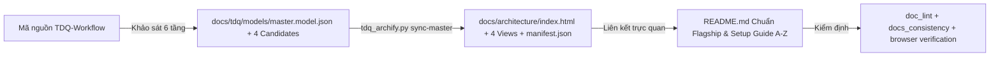

# SPEC — Sinh Master Map 4 góc nhìn và nâng cấp README chuyên nghiệp

Ngày: 2026-10-25 · Bản: 1.0 · Brief: ../brief/2026-10-25-1648-mastermap-va-readme-pro.md · Lane: full
Soul: chất lượng > runtime > context cost · luật gốc: skills/tdq-conventions/references/soul.md
Trạng thái: CHỜ DUYỆT

## Mục lục

- 1. Mục tiêu & phạm vi
- 1b. Lộ trình
- 2. Đầu ra cụ thể
- 2b. Ranh giới module
- 2c. Luồng hoạt động & Sơ đồ kiến trúc
- 3. Cách tiếp cận & lý do
- 3b. Năng lực & công cụ
- 3c. Giải thuật & Xử lý cốt lõi
- 3d. Mental Model cho Fresher Dev
- 4. Yêu cầu bắt buộc
- 5. Ràng buộc & rủi ro
- 6. QC & Definition of Done
- 7. Câu hỏi còn mở

## 1. Mục tiêu & phạm vi

- Mục tiêu: Phân tích kiến trúc thực tế của `TDQ-Workflow` để xây dựng và xuất bản bộ **Master Map** chính thức gồm 4 góc nhìn tương tác tại `docs/architecture/` (kèm nâng cấp giao diện trang chủ `index.html` sang phong cách Dashboard hiện đại), đồng thời viết lại `README.md` theo chuẩn Flagship Open-Source kèm cẩm nang cài đặt dependencies từ A–Z.
- Trong phạm vi:
  - Xây dựng mô hình `docs/tdq/models/master.model.json` và 4 tệp định nghĩa biểu đồ (`overview`, `pipeline-lifecycle`, `search-and-archify`, `hooks-and-gates`) phản ánh đúng 11 skills, 6 agents, 13 hooks và 43 scripts của dự án.
  - Nâng cấp hàm sinh trang chủ `_generate_index_html` trong `scripts/tdq_archify.py` lên giao diện Dashboard hiện đại (giữ nguyên toàn bộ nhãn kiểm thử `Evidence Kind:`, `Revision:`, `Coverage:`, `Views Inventory`, `View Diagram`).
  - Xuất bản bộ Master Map thực tế ra `docs/architecture/` (`index.html`, 4 trang biểu đồ `.html`, `manifest.json`) bằng lệnh `tdq_archify.py sync-master` đạt trạng thái `current`.
  - Tái thiết kế `README.md` (giữ dưới trần 500 dòng của `doc_lint` R6) với bố cục chuyên nghiệp: Badges, Tuyên ngôn 6 trụ cột bất biến, Kiến trúc trực quan & liên kết Master Map, Cẩm nang Setup & Install Dependencies 8 bậc (`tdq_setup.py`, Python >= 3.10, Node.js >= 18, `agent-lsp`, Language Servers, `graphify`, `archify`, Chrome DevTools MCP), Hướng dẫn cài đặt trên 4 host (`Claude Code`, `Codex`, `OpenCode`, `Antigravity`) và Bảng cấu trúc dự án chính xác.
- NGOÀI phạm vi:
  - Không thay đổi giao thức state hay logic chặn của 13 hooks hiện hành.
  - Không thêm thư viện bên thứ ba mới vào runtime Python của plugin.

## 1b. Lộ trình

| Bước/phase | CÓ-BỎ | Vì sao |
|---|---|---|
| analyze | CÓ | Khảo sát toàn bộ ràng buộc kiểm thử trên `README.md` và cấu trúc `sync-master` |
| spec | CÓ | Đặc tả cấu trúc 4 góc nhìn Master Map và bố cục `README.md` chuyên nghiệp |
| plan | CÓ | Chia task dựng model Master Map, nâng cấp portal `index.html`, viết lại `README.md` và kiểm thử |
| implement | CÓ | Thực thi sinh Master Map thật, cập nhật `README.md` và kiểm tra trên trình duyệt |
| qc | CÓ | Kiểm chứng toàn diện theo mức QC `full` người dùng đã chọn |
| report | CÓ | Báo cáo nghiệm thu và hỏi commit |

## 2. Đầu ra cụ thể

| # | Đầu ra | Đường dẫn/vị trí | Đo "xong" bằng |
|---|---|---|---|
| O1 | Giao diện Portal Dashboard cho trang chủ Master Map | `scripts/tdq_archify.py` (`_generate_index_html`) | Trang `index.html` có bố cục thẻ thống kê, bảng danh mục hiện đại và giữ nguyên mọi chuỗi kiểm thử hợp đồng |
| O2 | Mô hình Master Map 4 góc nhìn của TDQ-Workflow | `docs/tdq/models/master.model.json` và 4 tệp candidate trong `docs/tdq/models/` | Qua bộ kiểm hợp lệ `validate_model` và phản ánh đầy đủ 6 tầng kiến trúc của dự án |
| O3 | Bộ Master Map HTML & Manifest xuất bản chính thức | `docs/architecture/index.html`, 4 tệp `.html` góc nhìn và `docs/architecture/manifest.json` | Lệnh `tdq_archify.py status` trả về `status: current` với đủ 4 trang biểu đồ |
| O4 | Tài liệu `README.md` chuẩn Flagship kèm hướng dẫn Setup & Dependencies | `README.md` | Đạt 0 lỗi `doc_lint.py` (dưới 500 dòng) và đạt toàn bộ kiểm thử nhất quán tài liệu (đủ 4 host, đủ số đếm 11 skills / 6 agents / 13 hooks, không chứa tên bundle cũ) |

## 2b. Ranh giới module

| Module | Vùng file | Phụ thuộc module | Đầu ra §2 nào |
|---|---|---|---|
| Trình sinh Portal Master Map | `scripts/tdq_archify.py` | không | O1 |
| Mô hình & Xuất bản Master Map | `docs/tdq/models/master.model.json`, `docs/tdq/models/overview.archify.md`, `docs/tdq/models/pipeline-lifecycle.archify.md`, `docs/tdq/models/search-and-archify.archify.md`, `docs/tdq/models/hooks-and-gates.archify.md`, `docs/architecture/` | Trình sinh Portal Master Map | O2, O3 |
| Tài liệu Cổng chính Dự án | `README.md` | Mô hình & Xuất bản Master Map | O4 |

## 2c. Luồng hoạt động & Sơ đồ kiến trúc

| Khía cạnh | Hiện trạng (Trước) | Thiết kế mới (Sau) |
|---|---|---|
| Bản đồ Master Map | Mới có bản thử nghiệm 1 góc nhìn tại `docs/tdq/master-demo/`; chưa có `docs/architecture/index.html` thực tế của dự án | Có bộ Master Map 4 góc nhìn chính thức tại `docs/architecture/index.html` với giao diện Dashboard và `manifest.json` trạng thái `current` |
| Tài liệu `README.md` | Dạng ghi chú văn bản đơn giản (183 dòng), thiếu hướng dẫn cài đặt dependencies 8 bậc và chưa nêu bật kiến trúc mới (Tam giác tìm kiếm 3 tầng, Archify BA, DevTools 5-Layer Audit) | Trình bày chuẩn Flagship (dưới 500 dòng): có Badges, Tuyên ngôn 6 trụ cột, Sơ đồ luồng, Hướng dẫn cài đặt Dependencies & One-Command Setup (`tdq_setup.py`), Đa nền tảng 4 Host và Bảng cấu trúc chuẩn xác |
| Điểm nghẽn giải quyết | Người đọc mới khó hình dung bức tranh tổng thể và thiếu hướng dẫn cài đặt các công cụ phụ trợ (`agent-lsp`, `graphify`, `archify`, Chrome CDP) | Trải nghiệm đọc ấn tượng, rõ ràng từ bức tranh kiến trúc tới từng lệnh cài đặt và tự phục hồi môi trường |

## 3. Cách tiếp cận & lý do

- Chọn:
  1. Dựng 4 góc nhìn Master Map bằng định dạng Explainer/Workflow giàu ngữ nghĩa của Archify (`overview`, `pipeline-lifecycle`, `search-and-archify`, `hooks-and-gates`), đặt nguồn tại `docs/tdq/models/` và chạy `tdq_archify.py sync-master` để xuất bản nguyên tử vào `docs/architecture/`.
  2. Nâng cấp CSS và bố cục HTML trong `_generate_index_html` (`scripts/tdq_archify.py`) với bảng màu hiện đại, thẻ chỉ số (metric cards) và huy hiệu trạng thái nhưng bảo toàn 100% các chuỗi văn bản mà bộ kiểm tự động đang kiểm tra.
  3. Viết lại `README.md` theo cấu trúc 8 phần mạch lạc, kiểm soát chặt chẽ4 chuỗi lệnh của 4 host và 3 biểu thức chính quy đếm số lượng (`skills/ (11)`, `agents/ (6)`, `hooks/ (13)`).
- Vì: Vừa mang lại diện mạo chuyên nghiệp ("wow") cho cả `README.md` và `docs/architecture/index.html`, vừa đảm bảo 100% bài kiểm tự động của kho mã nguồn tiếp tục xanh.
- Đã loại: Phương án nhúng ảnh tĩnh nặng hoặc dùng thư viện CSS ngoài qua CDN — vì vi phạm nguyên tắc hoạt động hoàn toàn offline của dự án.

## 3b. Năng lực & công cụ

| Skill | Nguồn | Phán quyết | Dùng ở đâu / Lý do loại |
|---|---|---|---|
| tdq-intake | plugin:tdq-workflow | NỀN | Mở và khảo sát request |
| tdq-spec | plugin:tdq-workflow | NỀN | Đặc tả cấu trúc Master Map và README.md |
| tdq-plan | plugin:tdq-workflow | NỀN | Lập kế hoạch từng bước thực thi |
| tdq-build | plugin:tdq-workflow | NỀN | Xây dựng, render Master Map và QC |
| tdq-conventions | plugin:tdq-workflow | NỀN | Quy tắc chung, state, approval |
| tdq-setup | plugin:tdq-workflow | DÙNG | Đối chiếu chính xác 8 bậc cài đặt và tự phục hồi dependency cho phần hướng dẫn trong README.md |
| tdq-browser-test | plugin:tdq-workflow | DÙNG | Kiểm chứng giao diện hiển thị của Master Map (`docs/architecture/index.html` và các trang con) trên Chrome DevTools MCP |
| frontend-design | built-in | DÙNG | Thiết kế giao diện portal `docs/architecture/index.html` của Master Map chuyên nghiệp, hiện đại |
| Đã xét 21 skill khác | plugin/built-in | KHÔNG | khác lĩnh vực |

## 3c. Giải thuật & Xử lý cốt lõi

- **Từng bước giải thuật (Step-by-step Execution Logic)**:
  1. Bước 1 (Nâng cấp Portal Generator): Cập nhật hàm `_generate_index_html` trong `scripts/tdq_archify.py` để bổ sung header gradient, lưới thẻ thông tin (`Evidence Kind`, `Revision`, `Repository`, `Coverage`), danh sách huy hiệu các module đã khảo sát và bảng `Views Inventory` có nút bấm trực quan.
  2. Bước 2 (Dựng Mô hình 4 Góc nhìn & Xuất bản Master Map):
     - Tạo 4 tệp candidate tại `docs/tdq/models/`: `overview.archify.md` (6 tầng kiến trúc), `pipeline-lifecycle.archify.md` (Deep/Express/Direct & Team Worktree), `search-and-archify.archify.md` (Tam giác 3 tầng LSP–Graphify–Grep & Archify 2-Tier BA), `hooks-and-gates.archify.md` (13 Hooks trên 6 sự kiện & Verify-by-Effect).
     - Tạo `docs/tdq/models/master.model.json` khai báo `source_paths: ["scripts", "hooks", "skills", "agents"]`, danh mục coverage 6 cụm module cốt lõi và 4 views.
     - Gọi `python scripts/tdq_archify.py sync-master --model docs/tdq/models/master.model.json --project . --out docs/architecture --quality showcase` để sinh toàn bộ bundle và kiểm tra bằng `tdq_archify.py status`.
  3. Bước 3 (Nâng cấp `README.md` chuẩn Flagship):
     - Biên soạn `README.md` (khoảng 260–340 dòng, dưới trần 500 dòng) gồm: (1) Hero Header & Badges; (2) Điểm khác biệt cốt lõi (6 trụ cột bất biến); (3) Sơ đồ Pipeline & Bản đồ Kiến trúc Tương tác (trỏ tới `docs/architecture/index.html`); (4) Cẩm nang Setup & Install Dependencies từ A–Z (Lệnh tự động `tdq_setup.py` + bảng cài đặt thủ công từng công cụ); (5) Cài đặt trên 4 Host (`Claude Code`, `Codex`, `OpenCode`, `Antigravity`); (6) Quy trình sử dụng hằng ngày & Hệ thống mã nhắc `[TDQ:*]`; (7) Cấu trúc thư mục (`skills/ (11)`, `agents/ (6)`, `hooks/ (13)`); (8) Quy trình phát hành & Cập nhật.
- **Độ phức tạp tính toán**:
  - Thời gian (Time Complexity): $O(V + F)$ với $V = 4$ góc nhìn được render qua engine Archify và $F$ là số tệp mã nguồn được băm trong `source_fingerprint`.
  - Không gian (Space Complexity): $O(F)$ để lưu bảng băm dấu vân tay mã nguồn trong `docs/architecture/manifest.json`.
- **Các ca góc hiểm (Edge Cases & Defensive Handling)**:
  - Nhãn trên cạnh biểu đồ quá dài làm cỡ chữ thu nhỏ dưới 6px: Giữ nhãn cạnh ngắn gọn (1–3 từ) để vượt qua cổng `composition/desktop-readability` của Archify ở độ rộng 1440px.
  - Thay đổi tệp mã nguồn sau khi sinh Master Map làm trạng thái chuyển sang `stale`: Thực hiện bước `sync-master` sau khi đã hoàn tất chỉnh sửa `scripts/tdq_archify.py` để dấu vân tay khớp tuyệt đối (`status: current`).

## 3d. Mental Model cho Fresher Dev

- **Ẩn dụ trực quan (Analogy)**: Nếu kho mã nguồn là một thành phố công nghệ cao, thì `README.md` mới chính là cổng chào kèm cuốn cẩm nang du lịch hạng sang (hướng dẫn khách chuẩn bị hành trang, cài đặt phương tiện chỉ với 1 nút bấm), còn `docs/architecture/index.html` là trung tâm điều hành sa bàn 3D với 4 màn hình chuyên biệt (Tổng quan, Giao thông Pipeline, Radar Tìm kiếm, và Trạm kiểm soát An ninh Hooks).
- **Thuật ngữ dự án (Glossary)**:
  - `Master Map`: Bộ tài liệu HTML tương tác nằm tại `docs/architecture/` phản ánh kiến trúc hiện hành của toàn bộ dự án, được khóa đồng bộ với mã nguồn qua `manifest.json`.
  - `Verify-by-Effect`: Cơ chế đối chiếu hiệu ứng thực tế trên đĩa (file đã sửa, log đã ghi, state đã cập nhật) tại cổng kết thúc lượt làm việc thay vì tin vào lời báo cáo của AI.

## 4. Yêu cầu bắt buộc

- Log service bật mặc định: giữ nguyên cơ chế log có timestamp và tắt qua `TDQ_LOG=0` của `tdq_archify.py`.
- Không placeholder, không TODO stub, không mock trình bày như dữ liệu thật.
- Mỗi thành phần có kiểm thử riêng, chạy được bằng một lệnh.
- Bám 5 nguyên tắc SOLID và rule ngôn ngữ trong `skills/tdq-build/references/rules/`.

## 5. Ràng buộc & rủi ro

Ràng buộc kiến trúc phải giữ (chép từ `docs/kien-truc.md`):
- `hooks/` được gọi `scripts/`; `scripts/` **không** được import `hooks/` — chạm ở `scripts/tdq_archify.py`.
- Chỉ `scripts/tdq_state.py` được ghi `docs/tdq/state.json`; mọi nơi khác chỉ đọc qua CLI.
- Ngôn ngữ chia 3 tầng — luật trong `skills/`, `agents/`, chú thích/docstring của `hooks/` + `scripts/` và chuỗi máy in ra đều viết TIẾNG ANH cố định — chạm ở `scripts/tdq_archify.py`.

| Rủi ro | Ảnh hưởng | Cách giảm |
|---|---|---|
| Viết lại `README.md` làm mất một trong các chuỗi bắt buộc của bài kiểm nhất quán tài liệu | Bài kiểm nhất quán tài liệu báo FAIL | Đối chiếu đầy đủ 4 tên host, 4 câu lệnh cài đặt, 3 chuỗi đếm số lượng (`skills/ (11)`, `agents/ (6)`, `hooks/ (13)`) và cấm các từ khóa bundle cũ |
| Chỉnh sửa `scripts/tdq_archify.py` sau khi chạy `sync-master` làm lệch băm nguồn | `tdq_archify.py status` báo `stale` | Luôn hoàn tất chỉnh sửa `scripts/tdq_archify.py` ở pha đầu trước khi chạy `sync-master` xuất bản Master Map |

## 6. QC & Definition of Done

Mức QC: `full` (do người dùng chọn `3a`).

| # | Hạng mục kiểm | Điều kiện PASS | Đo trước | Dự phòng nếu trượt |
|---|---|---|---|---|
| Q1 | Giao diện Portal `index.html` và 4 góc nhìn Master Map xuất bản thành công (O1, O2, O3) | Tệp `docs/architecture/index.html` cùng 4 tệp biểu đồ góc nhìn tồn tại, lệnh kiểm tra trạng thái Master Map trả về `current` (0 lý do lỗi) và kiểm tra hiển thị trên trình duyệt đạt 0 lỗi console | Hiện tại `docs/architecture/manifest.json` chưa được sinh cho kho mã chính (0 góc nhìn thực tế) | Nếu một góc nhìn bị cảnh báo kích thước chữ trên biểu đồ thì rút gọn nhãn nút/cạnh của góc nhìn đó và chạy lại `sync-master` cho tới khi đạt `current` |
| Q2 | Tài liệu `README.md` chuẩn Flagship và đầy đủ hướng dẫn Setup & Dependencies (O4) | `README.md` có số dòng nhỏ hơn hoặc bằng 500 dòng, đạt 0 vi phạm `doc_lint` và vượt qua toàn bộ bài kiểm nhất quán tài liệu, hình dạng skill | `README.md` hiện tại dài 183 dòng (còn dư 317 dòng so với trần 500 dòng) | Nếu vượt quá 500 dòng thì rút gọn các khối ví dụ JSON phụ sang liên kết tài liệu sẵn có để giữ tổng số dòng dưới 500 |
| Q3 | Hồi quy vùng chạm và toàn bộ kho mã nguồn | Toàn bộ bài kiểm của `archify`, `docs_consistency`, `skill_shape` và bộ kiểm toàn cục đều đạt 0 failures, 0 errors | Lượt chạy gần nhất đạt 2.977 tests với 0 failures, 0 errors | Sửa ngay bất kỳ bài kiểm nào bị ảnh hưởng trước khi đóng pha QC |

DoD: Mọi hạng mục Q1–Q3 và 4 phép kiểm cố định (QC-F1 đến QC-F4) đạt PASS; giao diện Master Map được xác minh trực quan qua [vision-test-loop.md](../../../skills/tdq-build/references/vision-test-loop.md).

## 7. Câu hỏi còn mở

Không còn câu hỏi mở.
<!-- tdq-archify-binding:start -->
<!-- manifest: C:/Users/admin/Documents/Projects/ForAgentCode/TDQ-Workflow/docs/tdq/artifacts/2026-10-25-1648-mastermap-va-readme-pro/preview.manifest.json -->
<!-- manifest_digest: 86ce09234e9b4730849c966e77d234559dcbc9d5ee80a4e5b7d7df734726327d -->
<!-- tdq-archify-binding:end -->