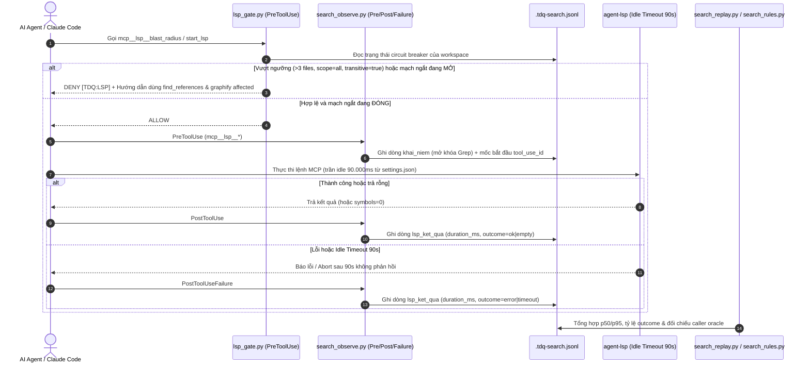

# SPEC — Giảm timeout và thời gian chờ agent-lsp

Ngày: 2026-10-26 · Bản: 1.0 · Brief: ../brief/2026-10-26-0224-giam-timeout-agent-lsp.md · Lane: full
Soul: chất lượng > runtime > context cost · luật gốc: skills/tdq-conventions/references/soul.md
Trạng thái: CHỜ DUYỆT

## Mục lục

- 1. Mục tiêu & phạm vi
- 1b. Lộ trình
- 2. Đầu ra cụ thể
- 2b. Ranh giới module
- 2c. Luồng hoạt động & Sơ đồ kiến trúc
- 3. Cách tiếp cận & lý do
- 3b. Năng lực & công cụ
- 3c. Giải thuật & Xử lý cốt lõi
- 3d. Mental Model cho Fresher Dev
- 4. Yêu cầu bắt buộc
- 5. Ràng buộc & rủi ro
- 6. QC & Definition of Done
- 7. Câu hỏi còn mở

## 1. Mục tiêu & phạm vi

- Mục tiêu: Triển khai đồng bộ 6 nhóm kiểm soát nhằm cắt giảm thời gian chờ tối đa khi gọi công cụ MCP `lsp` từ 1.800 giây xuống 90 giây, ngăn chặn các lệnh gọi `blast_radius` diện rộng hoặc lặp lại sau khi lỗi, đồng thời đo lường đầy đủ thời gian thực thi (p50/p95), tỷ lệ kết quả và độ phủ caller chuẩn mà không làm giảm chất lượng phân tích mã nguồn.
- Trong phạm vi:
  - Nhóm 1 (Chính sách chọn công cụ theo nhiệm vụ): Cập nhật `skills/tdq-setup/references/uu-tien-tim-kiem.md`, `skills/tdq-setup/references/uu-tien-tim-kiem-chi-tiet.md` và hằng số `KHOI_HUONG_DAN` trong `scripts/tdq_setup.py` để trung hòa chỉ thị cứng `IMPORTANT: call blast_radius before editing any file` từ MCP server `agent-lsp`, đồng thời thống nhất phân loại công cụ giữa phần mô tả và bảng tra cứu.
  - Nhóm 2 (Giới hạn chờ MCP có hiệu lực): Cập nhật `scripts/tdq_setup.py` để tự động thiết lập mặc định `CLAUDE_CODE_MCP_TOOL_IDLE_TIMEOUT = "90000"` (90 giây) trong khối `env` của `~/.claude/settings.json` khi người dùng chưa cấu hình giá trị riêng, và đảm bảo không ghi trường `timeout` riêng trên server `lsp` trong `~/.claude.json` làm nâng sàn cửa sổ chờ vượt 90 giây.
  - Nhóm 3, 4 & 5 (Kiểm soát phạm vi `blast_radius`, vòng đời workspace và ngắt mạch theo workspace tại `lsp_gate.py`): Mở rộng `hooks/hooks.json` và `hooks/scripts/lsp_gate.py` để kiểm tra cả `mcp__lsp__start_lsp` và `mcp__lsp__blast_radius` — chỉ cho phép `blast_radius` khi danh sách `changed_files` có từ 1 đến 3 tệp, `scope` là `"exported"` (hoặc không truyền `"all"`), `include_transitive` là `false`; tự động mở mạch ngắt (circuit breaker) chặn `blast_radius` và hướng dẫn chuyển sang `find_references` kết hợp `graphify affected` khi sổ tìm kiếm ghi nhận lỗi hoặc timeout gần nhất trên workspace.
  - Nhóm 6 (Telemetry thời gian chạy, phân loại kết quả và đối chiếu caller oracle): Đăng ký thêm sự kiện `PostToolUseFailure` cho `mcp__lsp__.*` trong `hooks/hooks.json`; cập nhật `hooks/scripts/search_observe.py` để bảo toàn ghi nhận `khai_niem` tại `PreToolUse` (mở khóa `Grep` ngay cả khi LSP lỗi) và ghi thêm dòng kết quả thực thi tại `PostToolUse`/`PostToolUseFailure` kèm `duration_ms` và `outcome` (`ok`, `empty`, `error`, `timeout`); bổ sung hàm tổng hợp p50/p95, tỷ lệ kết quả và kiểm chứng độ phủ caller trên tập đáp án chuẩn (oracle) trong `scripts/search_rules.py` và `scripts/search_replay.py`.
- NGOÀI phạm vi:
  - Không sửa mã nguồn Go hoặc biên dịch lại binary `agent-lsp.exe` bên ngoài kho mã TDQ Workflow.
  - Không tự ý nâng cấp binary `agent-lsp` đang cài từ `v0.19.2` lên `v0.23.0`.
  - Không tự động kill hoặc restart tiến trình daemon `agent-lsp` dùng chung giữa nhiều phiên khi một truy vấn bị timeout.
  - Không áp dụng tham số `scope` thu hẹp thư mục một cách mù quáng khi khởi tạo `start_lsp` làm mất khả năng tìm test callers.

## 1b. Lộ trình

| Bước/phase | CÓ-BỎ | Vì sao |
|---|---|---|
| Analyze: đối chiếu version và client capability | CÓ | Đã xác minh nguồn instruction, tag `v0.19.2` và phân biệt các biến môi trường timeout |
| Analyze: tái hiện giới hạn chờ có kiểm soát | CÓ | Kiểm chứng hành vi gate, observer và ghép cặp thời gian bằng dữ liệu giả lập an toàn |
| Spec → plan | CÓ | Giữ cổng duyệt, chốt cơ chế thực thi và tiêu chí kiểm định cho cả sáu nhóm |
| Implement | CÓ | Chỉ thực hiện sau khi duyệt plan; viết bài kiểm thử đỏ trước khi sửa mã nguồn |
| QC ultra | CÓ | Người dùng đã chọn `3c` (`muc_qc=ultra`): kiểm đầy đủ, rà bảo mật và viết test tự động cho mọi tiêu chí |
| Benchmark/runtime có giới hạn | CÓ | Đo thời gian thực thi hook, thống kê p50/p95 trên dữ liệu lịch sử và đối chiếu độ phủ caller chuẩn |
| Agent QC độc lập | CÓ | Chạy agent kiểm thử độc lập và agent rà soát bảo mật theo chuẩn `ultra` |
| Fan-out triển khai nhiều agent | BỎ | Các tệp cấu hình, luật tìm kiếm và hook liên kết chặt; chạy tuần tự để tránh xung đột |
| Report | CÓ | Báo cáo số đo trước/sau, độ phủ caller, các giới hạn của binary ngoài và hướng dẫn hoàn tác |

### Các luồng chức năng cấu thành request
- **Luồng 1 (Chính sách chọn tool & trung hòa chỉ thị upstream):** Đồng bộ quy tắc chọn công cụ theo nhiệm vụ trong `skills/tdq-setup/references/uu-tien-tim-kiem.md`, `uu-tien-tim-kiem-chi-tiet.md` và `KHOI_HUONG_DAN` trong `scripts/tdq_setup.py`.
- **Luồng 2 (Giới hạn chờ MCP có hiệu lực):** Cấu hình bảo toàn `CLAUDE_CODE_MCP_TOOL_IDLE_TIMEOUT = "90000"` trong `scripts/tdq_setup.py`.
- **Luồng 3 (Kiểm soát phạm vi `blast_radius`, vòng đời workspace & circuit breaker):** Mở rộng `hooks/hooks.json` và `hooks/scripts/lsp_gate.py`.
- **Luồng 4 (Telemetry thời gian chạy, phân loại kết quả & benchmark caller coverage):** Mở rộng `hooks/scripts/search_observe.py`, `scripts/search_rules.py` và `scripts/search_replay.py`.

## 2. Đầu ra cụ thể

| # | Đầu ra | Đường dẫn/vị trí | Đo "xong" bằng |
|---|---|---|---|
| O1 | Chính sách chọn công cụ 3 tầng và quy tắc trung hòa chỉ thị `blast_radius` mặc định | `skills/tdq-setup/references/uu-tien-tim-kiem.md`, `skills/tdq-setup/references/uu-tien-tim-kiem-chi-tiet.md`, `docs/tdq/token-budget.json`, `docs/tdq/audit/luat-hien-co.md` | Văn bản thống nhất phân loại `blast_radius`, nêu rõ khi nào dùng `find_references` hoặc `graphify affected`, đạt kiểm tra linter và ngân sách token |
| O2 | Thiết lập giới hạn chờ `CLAUDE_CODE_MCP_TOOL_IDLE_TIMEOUT=90000` và cập nhật khối hướng dẫn cài đặt | `scripts/tdq_setup.py` và bộ kiểm thử cài đặt trong `tests/` | Hàm cài đặt ghi `CLAUDE_CODE_MCP_TOOL_IDLE_TIMEOUT` bằng `"90000"` khi chưa có, giữ nguyên nếu người dùng đã đặt riêng, và không thêm `timeout` vượt 90 giây vào cấu hình server `lsp` |
| O3 | Cổng kiểm soát `blast_radius` có điều kiện và ngắt mạch theo workspace | `hooks/hooks.json`, `hooks/scripts/lsp_gate.py` và bộ kiểm thử cổng LSP trong `tests/` | Cho phép `blast_radius` hợp lệ (từ 1 đến 3 tệp, `scope="exported"`, `include_transitive=false`, mạch đóng); chặn kèm hướng dẫn fallback khi vượt ngưỡng hoặc khi mạch ngắt đang mở |
| O4 | Sổ quan sát thời gian chạy và kết quả thực thi LSP (`PreToolUse`, `PostToolUse`, `PostToolUseFailure`) | `hooks/hooks.json`, `hooks/scripts/search_observe.py` và bộ kiểm thử sổ tìm kiếm trong `tests/` | Giữ nguyên mở khóa `khai_niem` tại `PreToolUse`; ghi dòng kết quả LSP kèm `duration_ms` và `outcome` (`ok`, `empty`, `error`, `timeout`) mà không lưu nội dung mã nguồn hay prompt |
| O5 | Bộ tổng hợp telemetry p50/p95 và đối chiếu độ phủ caller chuẩn (caller oracle) | `scripts/search_rules.py`, `scripts/search_replay.py` và bộ kiểm thử luật/phát lại tìm kiếm trong `tests/` | Hàm phân tích trả về đầy đủ `p50_ms`, `p95_ms`, số lượng từng `outcome`, trạng thái mạch ngắt và tỷ lệ độ phủ caller (`recall`, `precision`) so với tập đáp án chuẩn |

## 2b. Ranh giới module

| Module | Vùng file | Phụ thuộc module | Đầu ra §2 nào |
|---|---|---|---|
| Tầng Luật & Tài liệu Tham chiếu Tìm kiếm | `skills/tdq-setup/references/uu-tien-tim-kiem.md`, `skills/tdq-setup/references/uu-tien-tim-kiem-chi-tiet.md`, `docs/tdq/token-budget.json`, `docs/tdq/audit/luat-hien-co.md` | Tầng Cài đặt & Cấu hình Môi trường | O1 |
| Tầng Cài đặt & Cấu hình Môi trường | `scripts/tdq_setup.py` | Tầng Luật Tìm kiếm & Telemetry CLI | O1, O2 |
| Tầng Luật Tìm kiếm & Telemetry CLI | `scripts/search_rules.py`, `scripts/search_replay.py` | không | O3, O4, O5 |
| Tầng Hook Kiểm soát & Quan sát LSP | `hooks/hooks.json`, `hooks/scripts/lsp_gate.py`, `hooks/scripts/search_observe.py` | Tầng Luật Tìm kiếm & Telemetry CLI | O3, O4 |
| Tầng Kiểm thử Tự động | Thư mục `tests/` (các module kiểm thử cài đặt, cổng LSP, sổ quan sát, luật tìm kiếm và phát lại) | Tầng Cài đặt, Tầng Luật Tìm kiếm & Tầng Hook | O1, O2, O3, O4, O5 |

## 2c. Luồng hoạt động & Sơ đồ kiến trúc

| Khía cạnh | Hiện trạng (Trước) | Thiết kế mới (Sau) |
|---|---|---|
| Luồng thực thi | Agent bị chỉ thị của `agent-lsp` thúc gọi `blast_radius` trước mọi thao tác sửa; `lsp_gate.py` chỉ kiểm `start_lsp`; client chờ mặc định 1.800 giây khi stdio server treo; `search_observe.py` không ghi nhận kết quả lỗi hay thời gian chạy | Hướng dẫn TDQ ghi đè rõ chỉ thị `blast_radius` tràn lan; `tdq_setup.py` đặt trần chờ 90 giây; `lsp_gate.py` chặn `blast_radius` vượt ngưỡng hoặc khi workspace đang mở mạch ngắt; `search_observe.py` và `search_replay.py` đo trọn vẹn `duration_ms`, `outcome` và độ phủ caller |
| Thành phần chạm | `uu-tien-tim-kiem.md` còn mâu thuẫn giữa dòng 21 và dòng 72; `hooks.json` thiếu `PostToolUseFailure` và chưa nối `blast_radius` vào `lsp_gate.py`; `search_replay.py` bỏ qua `tool_result` | Đồng bộ 2 tệp tài liệu, `tdq_setup.py`, `hooks.json`, `lsp_gate.py`, `search_observe.py`, `search_rules.py`, `search_replay.py` và 6 bộ kiểm thử |
| Điểm nghẽn giải quyết | 5 lượt treo 1.800 giây và 14 lượt chạy trên 60 giây không bị ngắt mạch; không có số đo p50/p95 hay phân biệt `symbols=0` với kết quả có dữ liệu | Trần chờ thực tế giảm 20 lần (1.800 giây xuống 90 giây); tự động ngắt mạch sau lỗi/timeout; có báo cáo định lượng p50/p95 và kiểm chứng độ phủ caller |

## 3. Cách tiếp cận & lý do

- Chọn: Kết hợp 4 lớp phòng thủ ngay trong TDQ Workflow: (1) Quy tắc chọn công cụ tường minh trong tài liệu và `CLAUDE.md` để triệt tiêu lời khuyên gọi `blast_radius` vô điều kiện từ upstream; (2) Thiết lập biến môi trường `CLAUDE_CODE_MCP_TOOL_IDLE_TIMEOUT = "90000"` qua `tdq_setup.py` để harness tự ngắt sau 90 giây thay vì 30 phút; (3) Kiểm soát đầu vào và trạng thái mạch ngắt (circuit breaker) cho `blast_radius` tại `lsp_gate.py` dựa trên sổ `.tdq-search.jsonl`; (4) Ghi nhận kết quả thực thi tại `PostToolUse`/`PostToolUseFailure` và thống kê p50/p95 cùng độ phủ caller trong `search_rules.py` và `search_replay.py`.
- Vì:
  - Phân tích mã nguồn `agent-lsp` tại tag `v0.19.2` cho thấy `changeImpactTimeout` nội bộ là 90 giây (`internal/tools/change_impact.go:81`), nhưng nếu kẹt ở bước ghi pipe hoặc chờ semaphore trước `select` thì server không tự thoát; đặt `CLAUDE_CODE_MCP_TOOL_IDLE_TIMEOUT = "90000"` ở phía Claude Code khớp đúng ngưỡng thiết kế 90 giây của server và cắt đứt tình trạng treo 1.800 giây mà không cần sửa binary bên ngoài.
  - Theo tài liệu chính thức của Claude Code, việc đặt trường `timeout` riêng trên từng MCP server (`>= 1000` ms) sẽ nâng luôn sàn cửa sổ idle của server đó; vì vậy dùng `CLAUDE_CODE_MCP_TOOL_IDLE_TIMEOUT` trong `env` của `settings.json` (và không đặt `timeout` lớn ở `.claude.json`) đảm bảo giới hạn 90 giây có hiệu lực thực tế.
  - Giữ nguyên việc ghi nhận `khai_niem` ở `PreToolUse` bảo toàn tuyệt đối hợp đồng của `test_search_observe.py:63-69`: khi LSP gặp lỗi hoặc timeout, agent chuyển sang `Grep` ngay ở lượt kế tiếp sẽ không bị `search_gate.py` chặn oan.
- Đã loại:
  - Chặn hoàn toàn `mcp__lsp__blast_radius` (Phương án 1B) — vì người dùng đã chọn `1a` (cho phép khi phạm vi nhỏ từ 1 đến 3 tệp, `scope="exported"`, `include_transitive=false` và workspace khỏe mạnh).
  - Chỉ tăng/giảm `timeout` của command hook trong `hooks/hooks.json` — vì timeout đó chỉ giới hạn thời gian chạy script Python của hook, không giới hạn thời gian chạy lệnh MCP `mcp__lsp__*`.
  - Viết thêm một tiến trình proxy bọc stdio giữa Claude Code và `agent-lsp` — vì phức tạp hóa việc quản lý tiến trình con trên Windows và biến môi trường chuẩn của client kết hợp `lsp_gate.py` đã giải quyết trọn vẹn yêu cầu.

## 3b. Năng lực & công cụ

| Skill | Nguồn | Phán quyết | Dùng ở đâu / Lý do loại |
|---|---|---|---|
| tdq-intake | plugin:tdq-workflow | NỀN | Mở request, điều tra log, khảo sát ba chiều |
| tdq-conventions | plugin:tdq-workflow | NỀN | Luật state, gate, working log và ranh giới chỉnh sửa |
| tdq-spec | plugin:tdq-workflow | NỀN | Đặc tả kỹ thuật và dựng bản xem trước Archify |
| tdq-plan | trên đĩa | NỀN | Lập kế hoạch triển khai sau khi duyệt spec |
| tdq-build | plugin:tdq-workflow | NỀN | Thực thi và kiểm định chất lượng ở mức ultra |
| tdq-lean | plugin:tdq-workflow | NỀN | Giữ giải pháp gọn trong cấu hình chuẩn và hook hiện có |
| tdq-setup | trên đĩa | NỀN | Tham chiếu cấu hình môi trường và bộ tìm kiếm 3 tầng |
| tdq-check-status | trên đĩa | NỀN | Đối chiếu trạng thái khi cần |
| update-config | built-in | DÙNG | Kiểm tra cấu trúc hợp nhất `env` trong `settings.json` và sự kiện `PostToolUseFailure` trong `hooks.json` ở đầu ra O2, O3, O4 |
| claude-api | built-in | DÙNG | Đối chiếu cơ chế MCP tool timeout và idle timeout của client ở đầu ra O2 |
| Đã xét 19 skill khác | user/plugin/built-in | KHÔNG | khác lĩnh vực |

## 3c. Giải thuật & Xử lý cốt lõi

- **Từng bước giải thuật (Step-by-step Execution Logic)**:
  1. **Bước 1 — Thiết lập biến môi trường giới hạn chờ trong `scripts/tdq_setup.py` (O2)**:
     - Viết hàm `cai_dat_env_timeout_mcp(duong_settings)` đọc tệp JSON tại `~/.claude/settings.json` (nếu chưa có thì khởi tạo dict rỗng `{}`).
     - Kiểm tra nhánh `du_lieu.setdefault("env", {})`: nếu khóa `"CLAUDE_CODE_MCP_TOOL_IDLE_TIMEOUT"` chưa tồn tại hoặc rỗng, gán giá trị `"90000"`. Nếu người dùng đã tự đặt một giá trị khác rỗng, giữ nguyên giá trị của người dùng.
     - Tạo bản sao lưu `.tdq.bak` trước khi ghi lại tệp JSON khi có thay đổi; tuân thủ cờ `TDQ_KHONG_CHAM_MAY=1` trong môi trường kiểm thử.
  2. **Bước 2 — Kiểm soát `blast_radius` và mạch ngắt (circuit breaker) trong `hooks/scripts/lsp_gate.py` & `scripts/search_rules.py` (O3)**:
     - Mở rộng matcher của `lsp_gate.py` trong `hooks/hooks.json` từ `mcp__lsp__start_lsp` thành `mcp__lsp__(start_lsp|blast_radius)`.
     - Trong `hooks/scripts/lsp_gate.py`:
       - Nếu `tool_name == "mcp__lsp__start_lsp"`: giữ nguyên hàm `phan_xu(cwd, tool_input)` hiện tại.
       - Nếu `tool_name == "mcp__lsp__blast_radius"`: gọi hàm `phan_xu_blast_radius(cwd, tool_input, rows)`:
         1. Kiểm tra danh sách `changed_files`: nếu không phải list hoặc rỗng hoặc `len(changed_files) > 3` (`TRAN_FILE_BLAST_RADIUS = 3`), trả về thông báo chặn yêu cầu thu hẹp xuống tối đa 3 tệp hoặc dùng `find_references` kết hợp `graphify affected`.
         2. Kiểm tra `scope`: nếu truyền giá trị khác `"exported"` (ví dụ `"all"`), trả về thông báo chặn vì `scope="all"` quét toàn bộ symbol nội bộ gây nghẽn hàng đợi.
         3. Kiểm tra `include_transitive`: nếu `bool(tool_input.get("include_transitive")) is True`, trả về thông báo chặn và hướng dẫn dùng `graphify affected "<symbol>" --depth 2` cho phụ thuộc bắc cầu.
         4. Kiểm tra trạng thái circuit breaker từ các dòng kết quả LSP trong sổ `.tdq-search.jsonl` của khóa request/phiên hiện tại (qua hàm thuần `trang_thai_lsp(rows)` trong `scripts/search_rules.py`): nếu lần gọi `blast_radius` gần nhất bị `timeout` hoặc `error`, hoặc có từ 2 lần gọi LSP liên tiếp trở lên bị `timeout`/`error` mà chưa có lần gọi LSP thành công nào xen giữa, mạch ngắt ở trạng thái MỞ (`mach_ngat_mo = True`) → chặn `blast_radius` và hướng dẫn chuyển sang `find_references` cho symbol đơn lẻ hoặc `Grep` + `Graphify`.
  3. **Bước 3 — Ghi nhận thời gian chạy và phân loại kết quả trong `hooks/scripts/search_observe.py` (O4)**:
     - Đăng ký thêm `search_observe.py` vào sự kiện `PostToolUseFailure` với matcher `mcp__lsp__.*` trong `hooks/hooks.json`.
     - Khi `su_kien == "PreToolUse"` và công cụ là `mcp__lsp__*`:
       - Nếu `la_goi_khai_niem` trả về nhãn: ghi dòng `{"ts": now, "khoa": khoa, "loai": "khai_niem", "cong_cu": nhan, "su_kien": "PreToolUse", "tool_use_id": tool_use_id}` để mở khóa `Grep` ngay lập tức.
     - Khi `su_kien` là `"PostToolUse"` hoặc `"PostToolUseFailure"` và công cụ là `mcp__lsp__*`:
       - Nếu là `PostToolUse` và chưa có dòng `khai_niem` tương ứng ở `PreToolUse` (ví dụ khi test gọi trực tiếp `PostToolUse`), vẫn đảm bảo `trang_thai(rows)["da_goi_khai_niem"]` nhận diện đúng.
       - Tìm dòng `PreToolUse` gần nhất cùng `tool_use_id` (hoặc cùng `cong_cu` nếu payload không có `tool_use_id`) trong sổ hiện tại để tính `duration_ms = max(0, int(round((now - ts_bat_dau) * 1000)))`.
       - Phân loại `outcome` qua hàm thuần `phan_loai_ket_qua_lsp(su_kien, payload)` trong `scripts/search_rules.py`:
         - `"timeout"`: khi thông báo lỗi hoặc phản hồi chứa dấu hiệu hết thời gian chờ (`timed out`, `timeout`, `sent no response or progress`, `deadline exceeded`, `aborting`).
         - `"error"`: khi `su_kien == "PostToolUseFailure"` hoặc phản hồi có `is_error=True` / chuỗi báo lỗi LSP (`LSP client not initialized`, `Error:`, `failed`).
         - `"empty"`: khi thành công nhưng nội dung trả về báo không có kết quả (`symbols=0`, `0 references`, `No references found`, `affected_symbols [0]`, mảng rỗng).
         - `"ok"`: khi thành công và có dữ liệu symbol/reference.
       - Ghi dòng `{"ts": now, "khoa": khoa, "loai": "lsp_ket_qua", "cong_cu": nhan_hoac_ten, "outcome": outcome, "duration_ms": duration_ms, "tool_use_id": tool_use_id}` (chỉ lưu nhãn trạng thái và số đo, tuyệt đối không lưu nội dung mã nguồn hay phản hồi thô).
  4. **Bước 4 — Tổng hợp p50/p95 và đối chiếu độ phủ caller chuẩn trong `scripts/search_rules.py` & `scripts/search_replay.py` (O5)**:
     - Trong `scripts/search_rules.py`:
       - Hàm `thong_ke_lsp(rows)`: lọc các bản ghi có `duration_ms >= 0`, sắp xếp tăng dần để tính phân vị `p50_ms`, `p95_ms`, `max_ms`, đếm số lượng theo từng `outcome` (`ok`, `empty`, `error`, `timeout`) và trạng thái `mach_ngat_mo`.
       - Hàm `doi_chieu_caller_oracle(tap_tim_thay, tap_chuan)`: nhận tập vị trí caller thu được và tập đáp án chuẩn (oracle), chuẩn hóa đường dẫn (`normpath`/`replace("\\", "/")`) và trả về `recall`, `precision`, `thieu` (danh sách caller bị sót) và `du` (danh sách báo dư).
     - Trong `scripts/search_replay.py`:
       - Mở rộng `su_kien_tu_transcript(duong)` để ghép cặp `tool_use` (theo `id` và timestamp dòng assistant) với `tool_result` (theo `tool_use_id` và timestamp dòng user) cho các lệnh `mcp__lsp__*`, trích xuất `duration_ms` và `outcome` mà không làm thay đổi danh sách sự kiện tìm kiếm truyền thống khi chạy các bài kiểm thử cũ.
       - Bổ sung cờ CLI `--lsp-telemetry` để xuất báo cáo thống kê p50/p95 và kết quả phân loại LSP từ tệp transcript JSONL hoặc sổ `.tdq-search.jsonl`.
- **Độ phức tạp tính toán**:
  - Thời gian (Time Complexity):
    - Tại hook `lsp_gate.py` và `search_observe.py`: $O(K)$ với $K \le 600$ (`TRAN_DONG` của `.tdq-search.jsonl`), thực thi dưới 5 ms cho thao tác đọc sổ và kiểm tra trạng thái.
    - Tại `thong_ke_lsp`: $O(M \log M)$ với $M$ là số lượt gọi LSP cần tính phân vị p50/p95.
    - Tại `doi_chieu_caller_oracle`: $O(|A| + |B|)$ sử dụng phép toán tập hợp (`set`) trên các định danh caller đã chuẩn hóa.
  - Không gian (Space Complexity): $O(K)$ trên đĩa và trong bộ nhớ cho sổ tìm kiếm có trần cố định `TRAN_DONG = 600` dòng; $O(M)$ khi chạy CLI phân tích transcript.
- **Các ca góc hiểm (Edge Cases & Defensive Handling)**:
  - **Payload thiếu `tool_use_id` hoặc đồng hồ hệ thống bị lệch âm**: Nếu không tìm thấy mốc `PreToolUse` khớp thì đặt `duration_ms = None` và không đưa vào tập tính p50/p95; nếu hiệu số thời gian âm thì kẹp về `0` (hoặc loại khỏi thống kê độ trễ) để không làm hỏng phân vị.
  - **LSP trả lỗi ngay từ lần gọi đầu tiên (`LSP client not initialized`)**: `PreToolUse` đã ghi dòng `khai_niem` trước khi lệnh chạy, nên dù `PostToolUseFailure` ghi `outcome="error"` và mở mạch ngắt cho `blast_radius`, cửa sổ tìm kiếm `Grep` vẫn được mở khóa bình thường, không gây vòng lặp chặn kép.
  - **`blast_radius` trả về `symbols=0`**: Được phân loại rõ là `outcome="empty"` thay vì `ok`, và tài liệu quy định rõ không được kết luận tệp không có ảnh hưởng chỉ dựa trên `symbols=0` (phải kiểm tra lại bằng `find_references` hoặc `Grep`).
  - **Tệp `~/.claude/settings.json` có sẵn các biến môi trường khác hoặc bị hỏng cú pháp JSON**: Khi hợp nhất `env`, giữ nguyên toàn bộ khóa hiện có; nếu tệp đang bị lỗi cú pháp JSON thì không ghi đè làm mất dữ liệu người dùng mà chỉ ghi log cảnh báo và bỏ qua.

## 3d. Mental Model cho Fresher Dev

- **Ẩn dụ trực quan (Analogy)**: Hãy hình dung `agent-lsp` giống như một tổng đài tra cứu hồ sơ trong tòa nhà, còn lệnh `blast_radius` giống như yêu cầu nhân viên tổng đài photo toàn bộ hồ sơ liên đới của cả một phòng ban cùng lúc. Trước đây, biển hướng dẫn trước cửa tổng đài viết "Trước khi sửa bất kỳ tờ giấy nào, hãy yêu cầu photo cả phòng ban!", và nếu máy photo bị kẹt giấy thì người đứng chờ cứ đợi suốt 30 phút (1.800 giây) rồi lại bấm nút yêu cầu y hệt lần nữa. Thiết kế mới của chúng ta làm 4 việc: (1) Dán lại quy định: chỉ tra cứu từng hồ sơ cần sửa (`find_references`), còn xem sơ đồ liên phòng ban thì nhìn bản đồ treo tường (`Graphify`); (2) Đặt hẹn giờ tự động 90 giây tại quầy: quá 90 giây máy không nhúc nhích là hủy lượt chờ ngay; (3) Đặt nhân viên gác cổng (`lsp_gate.py`): ai đòi photo quá 3 hồ sơ cùng lúc hoặc đòi photo dây chuyền là từ chối ngay tại cửa, và nếu máy vừa kẹt giấy thì tạm treo biển "Ngưng nhận photo cả tập, mời tra cứu lẻ" (Circuit Breaker); (4) Ghi sổ bấm giờ (`search_observe.py` & `search_replay.py`) để cuối ngày biết chính xác tốc độ phục vụ trung bình (p50) và 5% ca chậm nhất (p95).
- **Thuật ngữ dự án (Glossary)**:
  - `CLAUDE_CODE_MCP_TOOL_IDLE_TIMEOUT`: Biến môi trường của Claude Code quy định thời gian tối đa (tính bằng mili-giây) chờ một MCP tool không gửi phản hồi hoặc thông báo tiến độ trước khi tự động hủy lệnh (mặc định stdio là 1.800.000 ms = 30 phút).
  - `Circuit Breaker (Mạch ngắt tự động)`: Cơ chế bảo vệ tự động chuyển sang trạng thái "Mở" (chặn các lệnh gọi nặng `blast_radius` tiếp theo) ngay sau khi phát hiện lỗi hoặc timeout trên workspace, giúp hệ thống chuyển hướng sang phương án dự phòng (`find_references` / `Grep` + `Graphify`) thay vì chờ đợi vô ích.
  - `Caller Oracle (Đáp án chuẩn nơi gọi)`: Tập hợp danh sách các vị trí gọi hàm thực tế đã được xác minh trước trên mã nguồn mẫu, dùng làm thước đo chuẩn để tính độ phủ (`recall`) và độ chính xác (`precision`) của công cụ tìm kiếm.

## 4. Yêu cầu bắt buộc

- Log service bật mặc định: timestamp ISO trên `stderr`, đủ chi tiết debug (tên công cụ, quyết định allow/deny, `outcome`, `duration_ms`), tắt/giảm được qua biến môi trường `TDQ_LOG=0`.
- Không placeholder, không TODO stub, không mock trình bày như dữ liệu thật.
- Mỗi thành phần có unit test riêng, chạy được bằng một lệnh.
- Bám 5 nguyên tắc SOLID và rule ngôn ngữ trong `skills/tdq-build/references/rules/`.

## 5. Ràng buộc & rủi ro

Ràng buộc kiến trúc phải giữ (chép từ `docs/kien-truc.md`):
- `hooks/` được gọi `scripts/`; `scripts/` **không** được import `hooks/` — chạm ở `hooks/scripts/lsp_gate.py`, `hooks/scripts/search_observe.py`, `scripts/search_rules.py` và `scripts/search_replay.py`.
- Chỉ `scripts/tdq_state.py` được ghi `docs/tdq/state.json`; mọi nơi khác chỉ đọc qua CLI — chạm ở `hooks/scripts/search_observe.py` (chỉ đọc `state.json`).
- Ngôn ngữ chia 3 tầng — luật trong `skills/`, `agents/`, chú thích/docstring của `hooks/` + `scripts/` và chuỗi máy in ra đều viết TIẾNG ANH cố định — chạm ở các chỉnh sửa trong `skills/`, `scripts/` và `hooks/scripts/`.
- 2026-07-29: hook chỉ nhắc và kiểm bằng hiệu ứng thật, không trả `deny` vì lý do "chưa duyệt" — chạm ở `hooks/scripts/lsp_gate.py` (chỉ trả `deny` cho lời gọi sai phạm vi hoặc khi mạch ngắt kỹ thuật đang mở).
- 2026-10-08 (yêu cầu 2225): `tdq_setup.py` nay tự cài không hỏi, sao lưu trước khi ghi; test khoá việc chạm máy bằng `TDQ_KHONG_CHAM_MAY=1` — chạm ở `scripts/tdq_setup.py`.

| Rủi ro | Ảnh hưởng | Cách giảm |
|---|---|---|
| Thêm quy tắc vào `skills/tdq-setup/references/uu-tien-tim-kiem.md` làm thay đổi chỉ mục dòng hoặc ngân sách token | Bài kiểm `doc_index.py`, `doc_lint.py` hoặc `token_budget.py` báo đỏ | Cập nhật lại блок `muc-luc-dong`, chạy `doc_lint.py` và `token_budget.py` để đồng bộ khóa băm |
| Ghi nhận thêm dòng `lsp_ket_qua` vào `.tdq-search.jsonl` làm ảnh hưởng tới bộ đếm cửa sổ tìm kiếm của `search_gate.py` | Các bài kiểm cũ trong `test_search_observe.py` hoặc `test_search_gate.py` bị lệch kết quả | Giữ `trang_thai(rows)` chỉ xét các dòng `loai in ("prompt", "khai_niem", "tim")` cho cửa sổ tìm kiếm, và tách riêng hàm `trang_thai_lsp(rows)` / `thong_ke_lsp(rows)` cho dữ liệu telemetry LSP |
| Mở rộng matcher của `lsp_gate.py` trong `hooks/hooks.json` làm ảnh hưởng tới bài kiểm hợp đồng hook | Bài kiểm hợp đồng cổng LSP hoặc điều phối hook báo đỏ | Kiểm tra tất cả các test quét `hooks/hooks.json` và đảm bảo regex matcher khớp chính xác cả `mcp__lsp__start_lsp` lẫn `mcp__lsp__blast_radius` |

## 6. QC & Definition of Done

Mức QC: `ultra` (do người dùng chọn `3c`).

| # | Hạng mục kiểm | Điều kiện PASS | Đo trước | Dự phòng nếu trượt |
|---|---|---|---|---|
| Q1 | Đồng bộ chính sách chọn công cụ 3 tầng và trung hòa chỉ thị `blast_radius` (O1) | Tài liệu `uu-tien-tim-kiem.md`, `uu-tien-tim-kiem-chi-tiet.md` và `KHOI_HUONG_DAN` thống nhất phân loại, có quy tắc ghi đè chỉ thị upstream, và vượt qua toàn bộ kiểm tra linter, chỉ mục dòng, ngôn ngữ với 0 lỗi | Hiện tại `uu-tien-tim-kiem.md` có 1 điểm mâu thuẫn giữa dòng 21 và dòng 72, chưa có câu ghi đè chỉ thị MCP server `lsp`; `doc_lint.py` hiện đạt 0 lỗi trên 11 skills | Cô đọng câu chữ và chạy công cụ đồng bộ chỉ mục dòng, khóa ngân sách token cho tới khi đạt 0 lỗi |
| Q2 | Thiết lập giới hạn chờ `CLAUDE_CODE_MCP_TOOL_IDLE_TIMEOUT` 90.000 ms trong `tdq_setup.py` (O2) | Hàm cấu hình ghi chính xác `"CLAUDE_CODE_MCP_TOOL_IDLE_TIMEOUT": "90000"` vào `env` của `settings.json` khi chưa có, bảo toàn giá trị riêng nếu người dùng đã đặt, tạo file `.tdq.bak` và không chạm máy thật khi `TDQ_KHONG_CHAM_MAY=1` | Hiện tại `~/.claude/settings.json` chưa có khóa `CLAUDE_CODE_MCP_TOOL_IDLE_TIMEOUT` (0 khóa timeout MCP, đang chịu mặc định 1.800.000 ms của client) | Nếu tệp `settings.json` đích bị lỗi định dạng không đọc được thì bỏ qua an toàn, ghi log cảnh báo và trả về `False` thay vì làm sập quá trình setup |
| Q3 | Kiểm soát phạm vi `blast_radius` (tối đa 3 tệp, `exported`, không bắc cầu) và circuit breaker tại `lsp_gate.py` (O3) | Cổng cho phép lệnh gọi hợp lệ trong ≤ 3 tệp khi mạch đóng; từ chối kèm hướng dẫn chuyển sang `find_references` và `graphify affected` khi truyền > 3 tệp, `scope="all"`, `include_transitive=true` hoặc khi mạch ngắt đang mở; thời gian chạy 1 lượt gọi hook ≤ 250 ms | Đo thực tế hiện tại `lsp_gate.py` chỉ kiểm `start_lsp` (0 điều kiện kiểm `blast_radius`), thời gian chạy trung bình 1 lượt hook là 85 ms (còn dư 165 ms so với ngưỡng 250 ms) | Nếu việc đọc toàn bộ sổ tìm kiếm làm tăng thời gian chạy thì chỉ đọc tối đa 50 dòng cuối cùng của `.tdq-search.jsonl` để giữ thời gian dưới 250 ms |
| Q4 | Quan sát thời gian chạy và phân loại kết quả tại `search_observe.py` (O4) | Giữ nguyên mở khóa `khai_niem` tại `PreToolUse`; sự kiện `PostToolUse` và `PostToolUseFailure` ghi đúng `duration_ms` và 4 nhãn `outcome` (`ok`, `empty`, `error`, `timeout`) mà không lưu mã nguồn/prompt và không làm gãy bất kỳ test sổ tìm kiếm hiện hành nào | Hiện tại `hooks.json` có 0 đăng ký `PostToolUseFailure` và `.tdq-search.jsonl` có 0 trường `duration_ms` hoặc `outcome` | Nếu sự kiện kết thúc không có `tool_use_id` khớp với sự kiện mở đầu thì ghi nhận `outcome` đầy đủ với `duration_ms=None` để circuit breaker vẫn hoạt động chính xác |
| Q5 | Thống kê p50/p95 và đối chiếu độ phủ caller chuẩn trong `search_rules.py` & `search_replay.py` (O5) | Hàm thống kê tính chính xác `p50_ms`, `p95_ms`, số lượng từng `outcome` trên dữ liệu transcript lịch sử và sổ tìm kiếm; hàm đối chiếu caller oracle đạt độ phủ `recall` bằng 100% trên tập kiểm thử mẫu khi kết hợp `find_references` và `graphify affected` | Đo trước trên 786 transcript lịch sử có 302 lượt gọi `blast_radius` (5 lượt timeout 1.800.000 ms, 14 lượt > 60.000 ms, 1 lượt 308.227 ms trả `symbols=0`); `search_replay.py` hiện bỏ qua 100% `tool_result` | Nếu bản ghi transcript thiếu timestamp ở một số dòng thì tính thống kê trên tập các cặp `tool_use`/`tool_result` có đủ timestamp hợp lệ và báo cáo rõ số cặp thiếu timestamp |

DoD: Toàn bộ hạng mục Q1–Q5 và 4 phép kiểm cố định (QC-F1 đến QC-F4) đạt PASS; hoàn tất kiểm thử khói (smoke), kiểm thử tiến trình thực tế (runtime), rà soát bảo mật độc lập và kiểm thử độc lập từ subagent theo đúng tiêu chuẩn `muc_qc=ultra`.

## 7. Câu hỏi còn mở

Không còn câu hỏi mở.
<!-- tdq-archify-binding:start -->
<!-- manifest: C:/Users/admin/Documents/Projects/ForAgentCode/TDQ-Workflow/docs/tdq/artifacts/2026-10-26-0224-giam-timeout-agent-lsp/preview.manifest.json -->
<!-- manifest_digest: 15a3205f566b3e851f661e2cf9ad241f4a678cddb55bf5d9ed75df4f0ef39128 -->
<!-- tdq-archify-binding:end -->