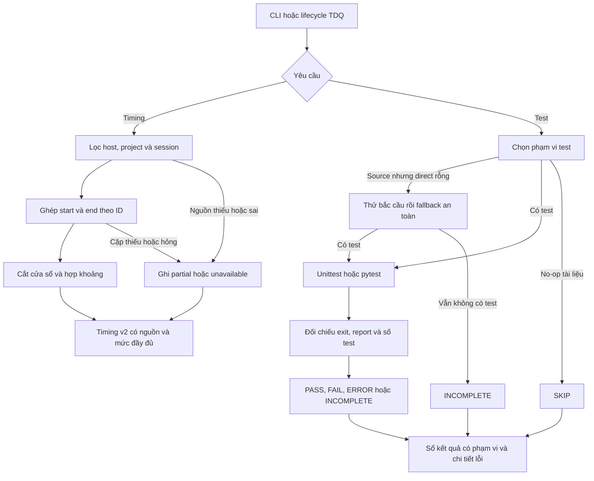

# SPEC — Đợt 1: đo đúng và bảo toàn lỗi

Ngày: 2026-10-27 · Bản: 1.0 · Brief: ../brief/2026-10-27-1246-do-dung-bao-toan-loi.md · Lane: full
Soul: chất lượng > runtime > context cost · luật gốc: skills/tdq-conventions/references/soul.md
Trạng thái: CHỜ DUYỆT

Người dùng đã chọn pipeline chuyên sâu và QC Full bằng hai câu trả lời `1a`. Bản này là thiết kế dự kiến để duyệt; mã runtime chưa thay đổi. Snapshot phân tích: `3e0ef5f8a148cbf8aae1e932995e844e8f62ccd9`, TDQ 0.84.2.

## Mục lục

- 1. Mục tiêu & phạm vi
- 1b. Lộ trình
- 2. Đầu ra cụ thể
- 2b. Ranh giới module
- 2c. Luồng hoạt động & Sơ đồ kiến trúc
- 3. Cách tiếp cận & lý do
- 3b. Năng lực & công cụ
- 3c. Giải thuật & Xử lý cốt lõi
- 3d. Mental Model cho Fresher Dev
- 4. Yêu cầu bắt buộc
- 5. Ràng buộc & rủi ro
- 6. QC & Definition of Done
- 7. Câu hỏi còn mở

## 1. Mục tiêu & phạm vi

Đợt 1 tạo nền đo lường đáng tin cho các đợt giảm runtime sau: đọc đúng log, chỉ đo những khoảng có bằng chứng, giữ thông tin lỗi test và ngăn chứng nhận PASS khi chưa thực sự kiểm chứng. Thành công được đo bằng độ đúng của dữ liệu và khả năng bắt lỗi đã tái hiện, chưa phải phần trăm tăng tốc toàn workflow.

Trong phạm vi:

- Bộ đo thời gian Claude/Codex, cửa sổ request/phase, khoảng chồng lấp và chất lượng dữ liệu; sửa đường dẫn Claude trên Windows.
- Kết quả pytest song song và unittest tuần tự: verdict, số test thực thi, tên test/module lỗi, lỗi thu thập test và dữ liệu thiếu.
- Lựa chọn test khi sửa source nhưng direct selector chọn rỗng; hồi quy lỗi qua phụ thuộc bắc cầu; phân biệt kiểm một vùng với chứng nhận hoàn tất request.
- Tương thích CLI, sổ lịch sử, consumer `tdq_state`, `tdq_finish`, tài liệu timing/status và kiểm thử của vùng thay đổi.
- Báo cáo trước/sau với fixture có thể tái lập và giới hạn số đo.

Ngoài phạm vi: hợp nhất preflight/setup, cache hoặc tái dùng PASS theo fingerprint, quản lý/join job, tăng worker, thay mặc định tuần tự/song song, đổi gate quyền/approval, viết lại toàn bộ luật, nâng plugin đang cài, commit/push/release, triển khai đợt 2–3. Không làm kế toán giá/token hoặc nhận diện model thực của provider. Không cần model/API/dịch vụ mới.

Mục tiêu giảm median thời gian agent hoạt động ít nhất 20% thuộc A/B đợt 3, không phải ngưỡng nghiệm thu ở đây. Số giảm 47,3% của audit chỉ là một cặp chạy bộ con 389 test; không đại diện toàn suite hoặc toàn workflow.

## 1b. Lộ trình

| Bước/phase | CÓ-BỎ | Vì sao |
|---|---|---|
| Analyze và tái hiện nguyên nhân | CÓ — đã làm | Đối chiếu ba chiều, consumer, log host, CI và fixture lỗi |
| Research bổ sung diện rộng | BỎ | Đã có audit và tài liệu pytest chính thức; hiện không còn câu hỏi ngoài repo cần nhiều truy vấn |
| Spec | CÓ | Dùng tdq-spec chốt hợp đồng dữ liệu, ranh giới adapter/tổng hợp/runner, tương thích và DoD với QC Full |
| Sơ đồ thiết kế HTML | CÓ | Dùng Archify dựng preview có nhãn dự kiến và manifest gắn với spec; không coi là mã đã triển khai |
| Plan | CÓ | Sau duyệt spec; chia task kèm test đỏ → xanh và vùng ảnh hưởng thực |
| Implement | CÓ | Sau duyệt plan; thực hiện đúng đợt 1, giữ log và bằng chứng theo task |
| Chia việc phát triển cho agent | BỎ ở spec | Cách thực thi do người dùng chốt sau plan; lựa chọn đó chỉ đổi người thực hiện, không đổi DoD |
| QC: DoD và kiểm hồi quy | CÓ | QC Full: DoD, toàn suite, vùng chạm, kiến trúc và clean code; dùng tdq-build |
| Smoke/runtime và QC độc lập | BỎ | QC Full không thêm các vòng kiểm này; vẫn phải kiểm đủ hành vi của DoD bằng fixture/unit test |
| Browser/visual QC sản phẩm | BỎ | Không sửa UI sản phẩm; preview Archify được kiểm riêng khi sinh spec |
| Benchmark A/B tăng tốc toàn workflow | BỎ | Thuộc đợt 3; đợt 1 ưu tiên độ đúng, không hứa giảm 20% runtime |
| Report và bàn giao | CÓ | Báo thay đổi, test, giới hạn dữ liệu, tương thích và phương án quay lui |

## 2. Đầu ra cụ thể

| # | Đầu ra | Đường dẫn/vị trí | Đo “xong” bằng |
|---|---|---|---|
| O1 | Timing v2: wall time, khoảng API/tool/job quan sát, phần chưa phân loại và mức đầy đủ | `scripts/tdq_timing.py`; dữ liệu mới trong `docs/tdq/timing.jsonl` | D1, D5; JSON và phần trình bày cùng nghĩa |
| O2 | Tìm transcript và chuẩn hóa sự kiện theo host/project/session | `scripts/tdq_transcript.py` mới; wrapper Claude tại `scripts/token_audit.py` | D2; không gộp project sai hoặc dùng dữ liệu thiếu như số 0 |
| O3 | Hợp đồng kết quả test thống nhất, bảo toàn lỗi | `scripts/tdq_test_result.py` mới; runner/ledger tại `scripts/tdq_test.py` | D3; FAIL và thiếu bằng chứng không thành PASS |
| O4 | Lựa chọn bắc cầu khi direct rỗng và phạm vi chứng nhận rõ | `scripts/tdq_test.py`; `.tdq-test.jsonl` và đầu ra CLI | D4; bắt lỗi core → facade → test, no-op không được gọi PASS |
| O5 | Hồi quy consumer, tương thích lịch sử và hướng dẫn số đo | Tests của các module trên; `tdq_state.py`, `tdq_finish.py`, `step_audit.py`; report-template/status | D5–D6; giữ close-once, init, CI unittest và QC Full |
| O6 | Đặc tả, preview thiết kế và hồ sơ bàn giao trước/sau | Spec/preview cùng slug; `docs/tdq/qc/`, `docs/tdq/reports/`, `docs/tdq/artifacts/` cùng slug | D7; có bằng chứng, cách tái lập, giới hạn và quay lui |

### Hợp đồng timing v2

| Thành phần | Nghĩa và quy tắc |
|---|---|
| `schema_version=2` | Phân biệt định nghĩa mới với dòng cũ không có version |
| `slug`, `lane`, `started_at`, `closed_at`, `treo_tuong_giay`, `phases` | Giữ tên và dạng dữ liệu công khai; wall time vẫn gồm thời gian chờ người dùng. `phases` giữ `phase`, `so_lan`, wall time |
| `model_giay` ở tổng và phase | Vẫn có khóa để consumer cũ không lỗi thiếu khóa, nhưng v2 luôn `null`: không có bằng chứng thời gian model thuần. Không gán số API vào khóa mang nghĩa cũ |
| `metrics` ở tổng và phase | Mỗi chỉ số là `{seconds, quality, reason}`; `quality` thuộc `complete`, `partial`, `unavailable`; `seconds=null` khi không đo được, số 0 chỉ khi dữ liệu chứng minh 0 |
| Các chỉ số | `api_request_seconds`, `tool_call_seconds`, `background_job_seconds`, `observed_union_seconds`, `unattributed_seconds` |
| `sources` và `attribution` | Ghi host, session được chọn, trạng thái đọc/ghép, số cặp thiếu/hỏng/trùng; `session` khi caller lọc tường minh, còn tự dò ghi `project_window` |
| Dữ liệu v1 | Đọc được; `model_giay` cũ hiển thị thành “legacy assistant-gap estimate”, không đổi nghĩa thành API/model thực. Không sửa các dòng lịch sử |

`api_request_seconds` là hợp các khoảng từ lúc host ghi gửi API đến phản hồi cuối ghép được, gồm mạng và phía provider; không phải thời gian GPU. `tool_call_seconds` là thời gian host chờ kết quả tool, không khẳng định toàn bộ thời gian tiến trình con. `background_job_seconds` chỉ có số khi có ID cùng mốc bắt đầu/kết thúc job được xác nhận; dữ liệu hiện tại thiếu thì `unavailable` hoặc `partial`.

`observed_union_seconds` là độ dài hợp các khoảng quan sát hợp lệ, kể cả khi các loại chồng lấp. Không cộng ba cột thành wall time. `unattributed_seconds = wall time - observed union` là thời gian chưa phân loại; không tự gọi là chờ user hay model. Khi nguồn thiếu/hỏng, các giá trị tính được chỉ là phần đã quan sát và mang nhãn `partial`; nếu không đọc/nhận diện được nguồn thì các metric là `unavailable`. Số liệu đủ nghĩa trong phạm vi tập log đã chọn, không chứng minh host đã ghi mọi hoạt động.

CLI timing giữ `show`, `status`, `close`, `--json`, `--project`, `--now`, `--transcript-dir`. Thêm `--host auto|claude|codex` (mặc định auto) và `--session-id` lặp được. Đường chỉ định tường minh thay nguồn dò tự động; vẫn kiểm project/session trong metadata. `token_audit.default_transcript_dir` giữ chữ ký và chỉ trả thư mục Claude để các audit cũ không vô tình đọc Codex. Timing auto dùng resolver mới; caller trong state không ép đường Claude mặc định nữa. Mở/đóng timing khi thiếu log vẫn trả thông tin wall time và cảnh báo, không chặn init request.

### Hợp đồng kết quả test

Kết quả nội bộ gồm `status`, `backend`, `tests_run`, `skipped`, `failed_modules`, `failures`, `unmapped_failures`, `details_complete`, `exit_code`, `reason`; ledger mới thêm version và `selection_scope=direct|transitive|full|none`. Tên module là đường tương đối chuẩn hóa theo tập module được runner nhận diện. Giữ các khóa ledger cũ `kind`, `request`, `phase`, `files`, `modules`, `fallback`, `ok`, `seconds` và `failed_modules` nơi hiện có.

| Trạng thái | Khi nào dùng | Exit CLI / `ok` |
|---|---|---|
| `PASS` | Chạy xong; có test không bị skip; không failure/error/unexpected success; bằng chứng kết quả hợp lệ | 0 / true |
| `FAIL` | Có assertion failure hoặc unexpected success; kể cả report chi tiết chưa đầy đủ | Khác 0 / false |
| `ERROR` | Collection/import/setup/usage/runner error được xác định | Khác 0 / false |
| `INCOMPLETE` | Không đủ bằng chứng: không có test cho source, chỉ có skip, timeout/hủy, report thiếu/hỏng hoặc kết quả mâu thuẫn mà chưa có lỗi cụ thể | Khác 0 / false |
| `SKIP` | No-op hợp lệ: không có đầu vào thay đổi hoặc chỉ tài liệu không có test liên quan | 0 / null; in SKIP, không in PASS |

Nếu đã biết FAIL/ERROR thì giữ verdict đó và đánh dấu chi tiết thiếu; không xóa lỗi vì thiếu XML. Exit khác 0 luôn thắng một report trông như xanh. Exit 0 nhưng report không hợp lệ cũng không đủ để PASS. Bộ đếm `tests_run` giữ định nghĩa theo backend, nhưng điều kiện có test thực thi phải loại trường hợp tất cả đều skip.

Không tăng worker, không thêm timeout mặc định toàn suite. Khi runner nhận `TimeoutExpired`/hủy hoặc thấy worker chết, phải giữ kết quả không đạt; tiến trình bị kill cưỡng bức trước khi kịp ghi thì không có chứng nhận cho lượt đó. Không hứa ghi được ledger sau khi toàn bộ process đã bị hệ điều hành kết thúc.

## 2b. Ranh giới module

Ranh giới dựa trên lời gọi đã khảo sát, không chỉ tên thư mục. LSP xác nhận `tong_hop` có 3 tham chiếu, `default_transcript_dir` có 8, `chay_tron_bo` có 2; đi tới định nghĩa import từ timing dẫn về token audit. Đã đối chiếu caller import muộn tại `tdq_state._dong_so_request_cu` và lời gọi subprocess của finish. Graphify depth 2 bổ sung các chuỗi `ban_kinh → cmd_vung_cham` và `chay_tron_bo → cmd_tron_bo`; graph không chứa mọi test hoặc import muộn.

| Module | Vùng file không giao nhau | Phụ thuộc module | Đầu ra §2 |
|---|---|---|---|
| Nguồn transcript | `scripts/tdq_transcript.py` mới; `scripts/token_audit.py` | Thư viện chuẩn; không import timing/state | O2 |
| Tổng hợp thời gian | `scripts/tdq_timing.py`; `scripts/step_audit.py` | Nguồn transcript; state chỉ đọc | O1, O5 |
| Kết quả và lựa chọn test | `scripts/tdq_test_result.py` mới; `scripts/tdq_test.py` | Thư viện chuẩn, đọc state/ghi ledger qua ranh giới hiện có; không phụ thuộc timing | O3, O4 |
| Tích hợp vòng đời | `scripts/tdq_state.py`; `scripts/tdq_finish.py` | Tổng hợp thời gian và runner qua entry point hiện có; giữ import timing muộn | O5 |
| Hướng dẫn và hồ sơ | `skills/tdq-build/references/report-template.md`; `skills/tdq-status/SKILL.md`; tài liệu request cùng slug | Đọc hợp đồng của các module trên, không chép code | O5, O6 |

Chỉ thêm hai module runtime có trách nhiệm tách biệt: nguồn sự kiện và kết quả test. Không tạo package plugin/provider mở rộng, daemon, database hoặc tầng abstraction khác. Mỗi module có unit test cùng trách nhiệm; tên file/lệnh test và caller bổ sung được ghi ở vùng chạm của plan, không đóng cứng trong spec và không mở rộng chức năng ngoài §1.

## 2c. Luồng hoạt động & Sơ đồ kiến trúc

Actor là người dùng hoặc lifecycle caller của TDQ. Trigger là xem/đóng timing hoặc chạy kiểm thử vùng chạm/trọn bộ. Input là project, thời điểm/phase, tùy chọn nguồn log, các file thay đổi và kết quả test. Output là số liệu có nguồn/giới hạn, verdict cùng bằng chứng và ledger; các hàm tổng hợp không tự đổi phase hoặc duyệt gate.

| Khía cạnh | Hiện trạng đã tái hiện | Thiết kế dự kiến |
|---|---|---|
| Thời gian | Khoảng assistant 120 giây bị gọi là model; 360 giây bị bỏ | Ghép ID có start/end; thiếu thì nói rõ, không áp ngưỡng 300 giây để đoán user vắng mặt |
| Nguồn log | Tên thư mục Windows sai; timing chỉ hiểu Claude | Resolver host/project; metadata kiểm lại; Codex không có API span thì để chưa xác định |
| Pytest | FAIL thực nhưng danh sách module lỗi rỗng khi có `::` | Đọc XML cấu trúc, đối chiếu exit; lỗi không ánh xạ được vẫn được lưu |
| Test gián tiếp | Direct rỗng dẫn tới PASS 0 module | Source rỗng thử bắc cầu/fallback; không đủ test thì INCOMPLETE |
| Nghiệm thu | Số đo cũ và phạm vi chạy dễ bị diễn giải quá mức | Version, chất lượng dữ liệu, scope test và QC Full ở trạng thái cuối |

Preview thiết kế: [sơ đồ HTML](2026-10-27-1246-do-dung-bao-toan-loi-preview.html). Candidate và biên nhận nằm trong `../artifacts/2026-10-27-1246-do-dung-bao-toan-loi/`; manifest cạnh HTML liên kết bản preview với nội dung spec. Đây là luồng **dự kiến**, không phải bằng chứng source đã triển khai. Trạng thái kiểm preview được lưu trong biên nhận sau khi render; chỉ trình liên kết khi render và verify thành công.

## 3. Cách tiếp cận & lý do

Chọn sửa các hợp đồng đo lường và chứng nhận trước, rồi mới tối ưu chi phí điều phối ở request sau. Sử dụng adapter sự kiện nhỏ, hợp khoảng thuần dữ liệu và kết quả test có cấu trúc để dễ kiểm bằng fixture.

Claude ghép request bằng `api-request.id`/`assistant.requestRef`; tool bằng `tool_use.id`/`tool_result.tool_use_id`. Codex ghép tool bằng `call_id`; mốc task/turn chỉ mô tả vòng xử lý, không được gán cho API. Các schema này đã đối chiếu ở log thực của cuộc audit; schema chưa nhận diện sẽ có cảnh báo và số đo chưa xác định.

Pytest dùng JUnit XML có sẵn, đọc bằng thư viện chuẩn. [Tài liệu pytest về JUnit XML](https://docs.pytest.org/en/stable/how-to/output.html#creating-junitxml-format-files) và fixture E5 xác nhận có thể xuất kết quả cấu trúc. Không giả định XML luôn có thuộc tính `file`: fixture hiện có `classname` và `name`. Unittest lấy trực tiếp đối tượng kết quả, giữ CI không cần pytest.

Không chọn chỉ vá regex `.py`, lấy khoảng assistant làm model, tính model bằng turn trừ tool, hoặc chạy full ở mọi lần sửa. Các cách đó không giải quyết đủ nguyên nhân hoặc tăng chi phí ngoài phạm vi.

## 3b. Năng lực & công cụ

| Skill | Nguồn | Phán quyết | Dùng ở đâu / Lý do loại |
|---|---|---|---|
| tdq-intake | plugin:tdq-workflow | NỀN | Tiếp nhận và khảo sát đợt 1 |
| tdq-conventions | plugin:tdq-workflow | NỀN | State, approval, nhật ký, kiến trúc và quy tắc chất lượng |
| tdq-setup | plugin:tdq-workflow | NỀN | Preflight đã đạt; không chạy lại khi bằng chứng vẫn còn hợp lệ |
| tdq-spec | plugin:tdq-workflow | NỀN | Viết spec sau khi chốt mức QC |
| archify | local:C:/Users/admin/Documents/archify/archify | DÙNG | Dựng và kiểm sơ đồ HTML thiết kế dự kiến, liên kết với spec |
| tdq-plan | plugin:tdq-workflow | NỀN | Lập plan sau khi spec được duyệt |
| tdq-build | plugin:tdq-workflow | NỀN | Triển khai, QC và báo cáo sau khi plan được duyệt |
| tdq-lean | plugin:tdq-workflow | NỀN | Giữ thay đổi đúng phạm vi, tránh dựng nền telemetry quá mức cần thiết |
| tdq-status | plugin:tdq-workflow | NỀN | Báo trạng thái bằng dữ liệu trên đĩa |
| tdq-check-status | plugin:tdq-workflow | NỀN | Phục hồi nếu phiên bị ngắt; hiện chưa cần kích hoạt |
| tdq-browser-research | plugin:tdq-workflow | NỀN | Không kích hoạt: nguồn ngoài là một URL tài liệu pytest đã biết, không cần SPA |
| tdq-browser-test | plugin:tdq-workflow | NỀN | Không kích hoạt: không có thay đổi UI trong phạm vi đợt 1 |
| Đã xét 17 skill khác | user/plugin/built-in | KHÔNG | khác lĩnh vực |

MCP-First: LSP đã kết nối và trả kết quả ngữ nghĩa; Graphify và Python CLI chạy cục bộ. Nếu LSP ngừng trả kết quả thì ghi nguyên nhân và dùng grep/caller đã kiểm; không báo là đã xác minh bằng LSP. Không cần dịch vụ trình duyệt hoặc API ngoài cho runtime sản phẩm. Archify dùng Node cục bộ để render preview; bước browser của công cụ được báo riêng với kiểm tĩnh. Python, pytest/xdist hiện có phục vụ fixture tùy chọn; không cài thêm package và không nâng môi trường trong đợt này.

## 3c. Giải thuật & Xử lý cốt lõi

### A. Tìm và đọc transcript

1. Chuẩn hóa project bằng quy tắc đường dẫn của host: Windows xử lý drive/separator, không so prefix chuỗi; POSIX giữ phân biệt hoa thường. Đường có Unicode/khoảng trắng và tên slug dễ trùng được giữ thành test riêng.
2. Nếu caller truyền nguồn/session thì dùng tập đó; nếu không, liệt kê nguồn Claude và cây sessions Codex. Không dựa riêng vào mtime hoặc ngày tên thư mục để loại một session kéo dài qua nhiều ngày.
3. Claude thử quy tắc slug đã kiểm trên Windows/POSIX rồi kiểm metadata cwd; Codex đọc `session_meta.cwd` trước khi lấy sự kiện. Metadata mâu thuẫn thì loại file; thiếu metadata chỉ chấp nhận với nguồn/session tường minh và ghi quy thuộc chưa đầy đủ. Nhiều project cho cùng slug không được gộp bằng phỏng đoán.
4. Duyệt JSONL theo dòng; malformed/non-object/không đọc được phải tăng counter và làm giảm quality. Không sao chép nội dung hội thoại, command có secret hoặc output tool vào dữ liệu timing/fixture được commit.
5. Khóa sự kiện bằng host + session + ID, loại bản sao thực sự trùng; hai bản cùng ID nhưng khác nội dung thời gian là xung đột, không chọn tùy tiện. Liên kết parent/child chỉ khi metadata xác nhận; không cộng lặp cùng sự kiện từ log cha và con.
6. Không có liên kết riêng request → session thì ghi `project_window`; cửa sổ thời gian chỉ là phép lọc, không chứng minh quyền sở hữu mọi hoạt động trong đó.

### B. Ghép và tổng hợp thời gian

1. Chuẩn hóa timestamp có timezone về cùng trục thời gian. Thiếu timezone, sai định dạng, end trước start hoặc ID không ghép được đều được chẩn đoán, không lấy trị tuyệt đối hoặc tự đoán thời điểm.
2. Với API streaming, một request chỉ tạo một khoảng từ start đến phản hồi cuối có cùng request ID; phần ghi dở mang nhãn partial. Với tool, ghép theo session + call ID, hỗ trợ sự kiện out-of-order bằng bảng pending.
3. Tool trả job nền chỉ kết thúc khoảng host chờ lần gọi đó. Chỉ tạo span job riêng khi có đủ bằng chứng lifecycle; không coi thời điểm tool trả session ID là job đã hoàn tất. Turn Codex không được thêm như API span.
4. Xây cửa sổ request và các lần vào phase; cắt khoảng tại biên nửa mở `[start, end)`. Một span đi qua nhiều phase được chia, không gán toàn bộ cho phase kết thúc. Mốc phase hỏng hoặc mâu thuẫn được báo, không double count.
5. Sắp xếp và gộp các khoảng giao/chạm nhau theo từng loại; tiếp tục gộp tất cả loại để lấy observed union. Chỉ round ở biên trình bày; dữ liệu tính giữ độ chính xác của timestamp.
6. Tính phần wall time còn lại thành unattributed, kèm quality; thiếu đầu/cuối request thì chưa xác định. Không tổng hợp dữ liệu từ project khác để lấp phần thiếu.
7. Format JSON/Markdown/status từ một kết quả; close chỉ append một dòng theo cặp request + started_at. Init giữ nguyên hợp đồng không thất bại vì thống kê và khôi phục cấu hình log sau khi gọi.

Ví dụ minh họa thuật toán, không phải benchmark: trong cửa sổ 20 giây, API ở [0,10), tool ở [5,15) thì API=10, tool=10, observed union=15, unattributed=5. Hai cột API/tool cộng thành 20 không có nghĩa đã quan sát đủ 20 giây.

### C. Giữ kết quả test

1. Runner tạo kết quả có cấu trúc. Unittest lấy failures/errors/unexpectedSuccesses/skipped/testsRun; pytest tạo report XML tại đường tạm riêng cho mỗi invocation, tránh đọc nhầm report cũ.
2. Đọc testcase/failure/error và thông tin collection. Đối chiếu `file` hoặc tiền tố `classname` với inventory module test thực, ưu tiên tên đầy đủ dài nhất khớp. Parameter ID, nhiều class và dấu `::` không làm mất module. Mơ hồ thì đưa vào `unmapped_failures`.
3. Đối chiếu exit code, report và số test thực thi. Khi lệch, kết quả không PASS; giữ mọi lỗi đã biết và lý do thiếu chi tiết. Output text chỉ là bằng chứng bổ sung, không là nguồn duy nhất xác nhận xanh.
4. Thiếu pytest/xdist được nhận diện trước khi bắt đầu thì giữ fallback unittest hiện có và ghi backend thực. Sau khi pytest đã chạy và trả FAIL/ERROR/timeout/report hỏng thì không chạy lại âm thầm bằng backend khác để biến thành xanh.
5. CLI và ledger dùng cùng verdict. Wrapper boolean/tuple cũ được giữ ở entry point đã có caller, với true chỉ khi PASS; trường hợp lỗi trước đây bị nhận xanh được sửa semantics và khóa bằng regression.
6. Đếm bỏ sót dựa trên module đã chọn thực và `selection_scope`; một chuỗi `fallback` không tự chứng minh đã chạy full. Dòng lịch sử giữ cách đọc cũ; dòng mới có failure chưa ánh xạ hoặc chi tiết thiếu phải báo việc đếm bỏ sót chưa đầy đủ, không kết luận “0 bỏ sót” như một chứng nhận.

### D. Kiểm phụ thuộc gián tiếp và no-op

1. Có thay đổi source: thử selector đang dùng trong phase. Nếu direct chọn rỗng, thử reverse-import bắc cầu bằng AST; không import module ứng dụng để dựng graph.
2. Nếu vẫn rỗng hoặc nguồn không đọc được, dùng fallback full theo quy tắc an toàn hiện có. Nếu repo không có test thực thi thì INCOMPLETE. Cờ giảm heuristic chọn full không được biến trường hợp thiếu bằng chứng thành PASS.
3. Không có thay đổi hoặc chỉ tài liệu với selection rỗng thì SKIP. Tài liệu/skill có test liên quan vẫn chạy các test đã chọn. Full suite được yêu cầu tường minh mà không có test thì INCOMPLETE, không SKIP.
4. Direct có test và chạy xanh chỉ chứng minh tập đã chạy; không đổi thành chứng nhận toàn request. Ở QC Full, dùng toàn suite và hồi quy vùng chạm/bắc cầu theo cổng hiện có.
5. Fixture core → facade → test khóa trường hợp direct rỗng. Fixture bổ sung có một test trực tiếp xanh nhưng một test gián tiếp đỏ khóa ranh giới: lượt direct có thể xanh trong scope của nó, nhưng kiểm bắc cầu/QC phải đỏ.

### Độ phức tạp và ca biên

Gọi F là số file ứng viên, E là số sự kiện đã đọc, I là số span hợp lệ, P là số cửa sổ phase, V/A là số node/cạnh import, S là tổng số byte source được phân tích và R là số testcase/report entry. Tìm/đọc log là O(F+E) thời gian; ghép ID O(E), hợp khoảng O(I log I); quét biên phase đã sắp xếp O(I+P+K) với K số phần giao được tạo. Bộ nhớ O(E+I+P) trong trường hợp xấu khi cần deduplicate/out-of-order; đọc file theo dòng, không giữ raw transcript. AST và reverse traversal là O(S+V+A); parse report O(R) với bộ nhớ O(R). Không có cache dài hạn trong đợt 1.

Các ca biên bắt buộc: log rỗng/hỏng/thiếu quyền; Windows drive và Unicode; log cùng project chạy đồng thời; start/end trùng hoặc đảo thứ tự; span qua phase; streaming bị cắt; job chưa xong; pytest collection error/worker chết; module test trùng tên; tất cả test skip; source đã xóa; repo không có tests; gọi close hai lần. Quy tắc chung là giữ bằng chứng thiếu/lỗi, không tự làm xanh và không thay đổi quyền của request.

## 3d. Mental Model cho Fresher Dev

Hãy hình dung một sổ chấm công: người vào cửa lúc 9h và ra lúc 10h không có nghĩa máy đã tính toán đủ một giờ. Chỉ những phiếu có giờ bắt đầu/kết thúc mới đo được công đoạn. Hai công đoạn chạy cùng lúc không làm người dùng phải chờ gấp đôi. Tương tự, một tờ kiểm tra trống không phải giấy xác nhận hàng đạt chất lượng.

| Thuật ngữ | Nghĩa trong request |
|---|---|
| Transcript / adapter | Log sự kiện của host / lớp đổi định dạng host về dữ liệu chung |
| Span / hợp khoảng | Một khoảng có đầu-cuối / gộp phần chồng lấp để không cộng lặp |
| Attribution | Căn cứ để nói số liệu thuộc phiên hoặc project trong cửa sổ nào |
| Partial / unavailable | Đã đo được một phần nhưng thiếu bằng chứng / chưa có số đo hợp lệ |
| Verdict / selection scope | Kết luận của lượt test / tập mà lượt đó thực sự kiểm |
| Phụ thuộc bắc cầu | Test dùng facade, facade dùng core: sửa core vẫn có thể làm test hỏng |
| JUnit XML | File kết quả test có cấu trúc, không phải một framework bắt buộc mới |
| DoD / QC Full | Điều kiện đủ để hoàn tất / mức kiểm người dùng đã chọn, gồm toàn unit suite |

## 4. Yêu cầu bắt buộc

- Log runtime bật mặc định bằng cơ chế hiện có, có timestamp và lý do nguồn/verdict/fallback; `TDQ_LOG=0` tắt được. Log chẩn đoán ra stderr, JSON stdout không lẫn log. Không tạo log service mới.
- Không placeholder, TODO stub hoặc fixture giả trình bày như số đo thật. Mỗi trách nhiệm có unit test; lệnh chạy cụ thể nằm ở plan.
- Bám SOLID theo trách nhiệm: resolver không ghi state, hàm hợp khoảng không đọc filesystem, parser kết quả không điều phối quyền. Không tạo interface/class chỉ để bọc một hàm không có nhu cầu thay thế.
- Chuỗi máy, comment/docstring source và skill viết tiếng Anh; tài liệu/chat tiếng Việt. Giữ nguyên schema key kỹ thuật.
- Không sao chép transcript thật có nội dung người dùng vào repo. Fixture dùng dữ liệu tối thiểu tổng hợp, thể hiện đúng schema đã quan sát.
- Luôn chạy code thật của chức năng cần kiểm; không mock chính hàm cần chứng minh. Mock chỉ tại ranh giới host/subprocess để mô phỏng lỗi khó tạo và phải kiểm đầu ra/ledger quan sát được.

## 5. Ràng buộc & rủi ro

`docs/kien-truc.md` còn nhãn nháp ở đầu. Các luật dưới đây được giữ cho request này theo cấu trúc đang tồn tại; không biến mọi gợi ý của tài liệu thành quyết định mới. Trích nguyên văn các dòng liên quan:

> `hooks/` được gọi `scripts/`; `scripts/` **không** được import `hooks/` — hook chạy trong tiến trình của Claude Code, kéo ngược sẽ buộc CLI phụ thuộc môi trường hook.

> `skills/` chỉ được **nhắc tên lệnh** của `scripts/`, cấm chép nội dung script vào skill — hai bản chép tay sẽ lệch nhau và không có phép kiểm nào bắt được.

> Chỉ `scripts/tdq_state.py` được ghi `docs/tdq/state.json`; mọi nơi khác chỉ đọc qua CLI.

> File code MỚI bắt buộc nằm trong `scripts/` hoặc `hooks/` — thư mục khác bị `.graphifyignore` loại nên đồ thị không thấy. Ngoại lệ duy nhất: adapter của host (xem mục `Đã chốt`, 2026-09-21), vì đường dẫn do host quy định chứ không do repo chọn.

> `tests/` gọi được vào mọi tầng; không tầng nào được import `tests/`.

Quy định file code mới áp dụng runtime; unit test vẫn nằm ở tầng `tests/` theo cấu trúc và CI hiện có. Các luật trên chạm nguồn transcript, timing, runner và consumer vòng đời. Giữ import timing muộn trong state để tránh vòng import. Không tăng quyền ghi state hoặc thêm approval gate.

Các quyết định đã chốt được giữ: full suite ở QC-F1 và sau vòng sửa QC cuối; chạy vùng chạm ở giữa, với fallback an toàn hiện có. Mức QC là quyết định của user. Nhánh `bugfix/do-dung-bao-toan-loi` mở từ và dự kiến gộp về `dev`; chưa commit/merge khi chưa có chỉ thị.

CI hiện dùng unittest trên Windows/macOS/Linux, Python 3.11/3.13. Không thêm dependency bắt buộc; pytest/xdist vẫn tùy chọn. Không đặt UTF-8 toàn cục cho suite vì có ca kiểm encoding. Không chạy session/hook sống dài hạn ở QC Full.

| Rủi ro | Ảnh hưởng | Cách giảm |
|---|---|---|
| Schema host thay đổi hoặc log không đủ API span | Không đo được một số loại thời gian | Version/quality/reason; adapter chỉ nhận schema được fixture chứng minh |
| Nhiều phiên cùng project hoặc log parent/child | Gán nhầm hoặc đếm lặp | Session filter, key theo host/session, liên kết có bằng chứng; nhãn project_window |
| Consumer cũ đọc model_giay | Diễn giải số mới theo nghĩa cũ | Khóa cũ giữ null ở v2, số mới có tên riêng; hồi quy consumer và nhãn v1 |
| Pytest XML thiếu hoặc classname không ánh xạ được | Mất danh tính lỗi, làm sai sổ bỏ sót | Giữ verdict, lỗi chưa ánh xạ, details_complete=false và cảnh báo phạm vi thống kê |
| Fallback bắc cầu/full làm một số lượt chậm hơn | Runtime tăng cục bộ | Ghi backend/scope/thời gian; chỉ fallback theo điều kiện đã nêu; tối ưu reuse để đợt sau |
| Đọc log dài tốn thời gian | Timing CLI chậm | Streaming, lọc metadata trước sự kiện, không sao raw text; báo giới hạn trong report, không đặt SLA chưa đo |
| Kill cưỡng bức trước khi ghi ledger | Không có record kết thúc | Thiếu record không được coi là chứng nhận; không tuyên bố phục hồi được mọi kill |

Quay lui: hoàn nguyên thay đổi source/tài liệu triển khai của request qua Git; không xóa sổ lịch sử. Dòng v2 giữ khóa cũ để reader cũ đọc được, nhưng quay lui reader có thể chỉ hiện phần chỉ số cũ/null; báo rõ giới hạn này. Không migrate hoặc viết lại các dòng timing/test lịch sử.

## 6. QC & Definition of Done

Mức đã chọn: **Full**. Chạy từng DoD, toàn unit suite, hồi quy vùng chạm, ràng buộc kiến trúc và clean code. Không thêm vòng smoke, runtime session dài hạn hoặc agent QC độc lập. Unit/fixture vẫn phải kiểm hành vi từ entry point và kết quả lưu thực; việc không chạy smoke riêng không miễn các hành vi DoD.

| # | Hạng mục kiểm | Điều kiện PASS | Đo trước | Dự phòng nếu trượt |
|---|---|---|---|---|
| D1 | Đúng nghĩa thời gian — O1 | Fixture có lịch sự kiện biết trước cho kết quả đúng từng chỉ số, clipping, overlap, streaming, duplicate và job thiếu end; không suy model/idle từ gap; mọi số thiếu có quality/reason | E1: gap 120 giây thành model 120, gap 360 giây thành model 0; đây là lỗi định nghĩa | Sửa ghép/tổng hợp; giữ unavailable cho loại chưa đủ bằng chứng, không thay bằng phép đoán |
| D2 | Đúng nguồn — O2 | Claude Windows/POSIX và Codex lọc đúng project/session; metadata mâu thuẫn bị loại; nguồn rỗng/hỏng/thiếu quyền không thành số 0 hợp lệ; tự dò nhiều phiên ghi project_window | E2: đường sinh không tồn tại, thư mục Claude thực tồn tại; hai log Codex đã kiểm cwd | Sửa resolver; trường hợp không nhận diện giữ unavailable với lý do, không nhập log project khác |
| D3 | Bảo toàn lỗi test — O3 | Cả hai backend giữ verdict và mọi lỗi nhận diện được; node ID, collection/setup, unexpected success, skip-only, timeout/hủy, report thiếu/hỏng không thành PASS; lỗi chưa ánh xạ vẫn hiện trong kết quả | E3/E5: pytest thật exit 1, parser cũ failed_modules rỗng; XML giữ một failure | Sửa parser/mapping; chưa ánh xạ thì giữ verdict và chi tiết chưa đầy đủ, không hạ thành xanh |
| D4 | Bảo vệ kiểm gián tiếp — O4 | Source direct rỗng phải thử bắc cầu/fallback và bắt lỗi fixture; source không có test báo INCOMPLETE; no-op báo SKIP; direct xanh không che test gián tiếp đỏ ở QC | E4: direct chọn rỗng và CLI PASS; transitive chọn test_facade và test thật FAIL | Sửa phạm vi/fallback và ledger; thiếu coverage là chưa đạt, không giảm DoD |
| D5 | Tương thích và lifecycle — O1, O5 | V1/v2 đọc đúng nhãn; dòng cũ không bị sửa; close lặp không append trùng; init không bị chặn do timing; stdout JSON sạch; consumer dùng đúng schema và phạm vi | Caller state/finish và tests đã khảo sát; log cũ chưa có version | Sửa adapter/consumer cùng request; giữ alias/null có giải thích, không đổi nghĩa âm thầm |
| D6 | QC Full ở trạng thái cuối — O5 | Toàn unit suite và hồi quy vùng chạm đạt; giữ kiến trúc/quyền/ngôn ngữ/log; CI unittest không cần dependency ngoài; lỗi còn biết hoặc thiếu test không được ghi PASS | Audit bộ con 389 test và 32 subtest đạt; chưa phải chứng nhận toàn suite cho bản sửa | Sửa theo vòng QC hiện có rồi kiểm lại vùng ảnh hưởng và full sau vòng sửa cuối; không dùng baseline cũ thay kết quả mới |
| D7 | Bằng chứng và bàn giao — O6 | QC/report có before/after, verdict, cách tái lập, nguồn fixture và giới hạn; preview tồn tại, manifest khớp spec, phân biệt thiết kế với thực thi; có phương án quay lui | Brief và baseline E1–E5 đã có; preview được sinh ở phase spec | Bổ sung bằng chứng thiếu; nếu công cụ preview lỗi thì công khai fallback Mermaid và phần chưa kiểm, không liên kết artifact cũ như mới |

Ma trận tình huống sau định nghĩa hành vi cần khóa; lệnh cụ thể được viết ở plan, không đóng cứng trong spec.

| Chức năng | Tier 1 — hành trình chính | Tier 2 — biên | Tier 3 — lỗi/phục hồi |
|---|---|---|---|
| Nguồn transcript | Given log đúng cwd · When caller chọn project/session · Then chỉ nguồn đúng được tổng hợp | Given đường Windows/Unicode hoặc session qua ngày · When dò nguồn · Then không nhầm slug hay loại theo mtime; Given phiên đồng thời · When không lọc ID · Then ghi project_window | Given log hỏng/thiếu quyền · When đọc · Then có lý do unavailable/partial; Given nguồn hợp lệ được cung cấp lại · When chạy lại · Then có số đo từ nguồn mới |
| Thời gian | Given span API/tool đã biết · When xem/đóng timing · Then số đo và ledger đúng cùng cửa sổ | Given span chồng/qua phase · When tổng hợp · Then không cộng lặp; Given stream trùng hoặc job chưa xong · When ghép · Then không tạo thời lượng hoàn tất giả | Given timestamp hỏng/cặp thiếu · When tổng hợp · Then không crash init và không đoán 0; Given sửa dữ liệu fixture · When đọc lại · Then trả kết quả có căn cứ |
| Runner | Given test thật đạt hoặc lỗi · When chạy backend · Then verdict, count và danh tính lỗi khớp | Given nhiều node ID/parameter hoặc classname thiếu file · When parse · Then giữ lỗi; Given tất cả skip/không có testcase · When kết thúc · Then không PASS | Given collection error/timeout/worker chết/report hỏng · When runner kết thúc · Then không đạt và giữ lỗi; Given lượt sau chạy thành công · When ghi ledger · Then lưu lượt mới, không xóa lượt lỗi |
| Selector/consumer | Given core ảnh hưởng facade · When kiểm phạm vi và QC · Then test gián tiếp được chạy và bắt lỗi | Given docs-only/rỗng · When vung-cham · Then SKIP; Given direct xanh và indirect đỏ · When kiểm bắc cầu · Then FAIL trong phạm vi rộng | Given source bị xóa/không phân tích được · When chọn test · Then fallback hoặc INCOMPLETE; Given close/init lặp · When gọi lại · Then không trùng lịch sử và không đổi quyền |

Vision Test Loop sản phẩm: BỎ vì đây là CLI, không có ảnh/UI tham chiếu. Preview thiết kế có kiểm artifact và trình duyệt của Archify riêng; chỉ gọi là đã xem thị giác khi thực sự đã mở ảnh/render để xem.

DoD đủ để hoàn tất là D1–D7 đạt cùng các kiểm cố định của QC Full. Không dùng mức giảm runtime hoặc model-time còn thiếu làm điều kiện ép số liệu xanh. Bản spec được duyệt mới chuyển sang plan; plan được duyệt mới triển khai.

## 7. Câu hỏi còn mở
<!-- tdq-archify-binding:start -->
<!-- manifest: 2026-10-27-1246-do-dung-bao-toan-loi-preview.manifest.json -->
<!-- manifest_digest: cbbffd9e249744fc9de920ab31c0cc4c2c6b5b30b2da252cba9d68eb5a6f4d70 -->
<!-- tdq-archify-binding:end -->