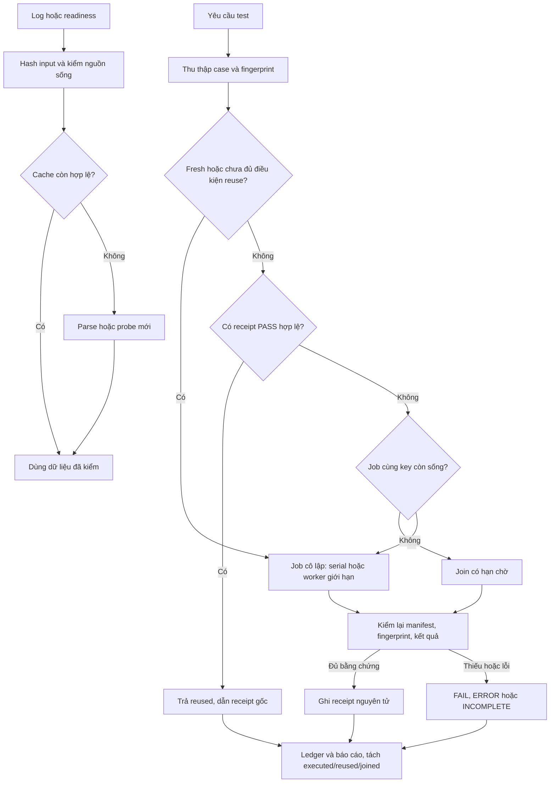

# SPEC — Kiểm chứng và tăng tốc TDQ Workflow
Soul: chất lượng > runtime > context cost · luật gốc: skills/tdq-conventions/references/soul.md

Ngày: 2026-10-27 · Bản: 1.0 · Lane: full · QC: ultra · Trạng thái: CHỜ DUYỆT  
Brief: [2026-10-27-1846-kiem-chung-tang-toc](../brief/2026-10-27-1846-kiem-chung-tang-toc.md)  
Baseline source: `d1b90b825596e84aba7136b02a545bc2fa06c21a` · Python 3.13.15 · pytest 9.1.1 · xdist 3.8.0 · Windows.

Người dùng chọn `1b 2aa`: triển khai cả P0/P1/P2, QC Ultra. Đặc tả này mô tả hành vi dự kiến; chưa có implementation mới.

## Mục lục

- 1. Mục tiêu & phạm vi
- 1b. Lộ trình
- 2. Đầu ra cụ thể
- 2b. Ranh giới module
- 2c. Luồng hoạt động & Sơ đồ kiến trúc
- 3. Cách tiếp cận & lý do
- 3b. Năng lực & công cụ
- 3c. Giải thuật & Xử lý cốt lõi
- 3d. Mental Model cho Fresher Dev
- 4. Yêu cầu bắt buộc
- 5. Ràng buộc & rủi ro
- 6. QC & Definition of Done
- 7. Câu hỏi còn mở

## 1. Mục tiêu & phạm vi

Triển khai ba đợt cải thiện, kiểm chứng bằng test thật và A/B có kiểm soát, rồi đề xuất bước tăng tốc tiếp theo dựa trên số đo. Chất lượng chứng nhận test và tính trung thực của timing là điều kiện tiên quyết; không đặt mục tiêu giảm thời gian bằng cách bỏ case, che lỗi hoặc bỏ duyệt.

Trong phạm vi:

- P0: inventory từng case; skip có lý do; tokenizer và fixture độc lập máy; tmp_path; HOME/basetemp riêng; timeout/cancel và quản lý cây tiến trình.
- P1: receipt có fingerprint, tái sử dụng PASS hợp lệ, join job cùng đầu vào, readiness cache có kiểm tra sống và gộp các thao tác đọc độc lập trong hướng dẫn workflow.
- P2: parallel có số worker giới hạn; cache parse transcript có kiểm chứng nội dung; benchmark cả suite và các đường nóng, báo wall time tách biệt resource time.
- Tích hợp CLI/consumer hiện có, schema tương thích, công tắc tắt/bỏ cache, unit/regression/smoke/simulation/runtime, QC độc lập, báo cáo Markdown và HTML.
- Đo trên Windows quyền người dùng thường. Các case POSIX chỉ xác nhận khi có môi trường POSIX thực; không giả lập permission bits rồi gọi là chứng nhận POSIX.

Ngoài phạm vi: bỏ gate spec/plan; đổi luật chất lượng; đồng bộ/cài bản plugin mới; sửa repo Archify; nâng dependency; thêm model/dịch vụ trả phí; commit/merge/push/release; sửa luật kiến trúc nền của dự án. Chế độ build sẽ được chọn sau duyệt plan. Cache không vượt request hoặc máy để nhận lại PASS; không dùng cache remote.

## 1b. Lộ trình

| Bước/phase | CÓ-BỎ | Vì sao |
|---|---|---|
| Phân tích và chốt phạm vi | CÓ — đã làm | Người dùng chọn triển khai cả P0/P1/P2 và QC Ultra |
| Spec → plan | CÓ | Duyệt riêng; có hợp đồng dữ liệu, phép đo và fallback |
| Preview thiết kế Archify | CÓ | Bản dự kiến gắn với spec; không phải bằng chứng đã triển khai |
| Sửa P0 và kiểm hồi quy | CÓ | Coverage, tokenizer, fixture, isolation, timeout tạo baseline đúng |
| Triển khai P1 | CÓ | Receipt, reuse, join job, readiness và batch được tích hợp thật |
| Triển khai P2 | CÓ | Worker có giới hạn và cache transcript được tích hợp thật |
| Research diện rộng lặp lại | BỎ | Kế thừa bằng chứng; chỉ tra thêm unknown kỹ thuật cụ thể |
| Smoke/simulation/A-B | CÓ | Đầu ra bắt buộc; chạy mã thật và phân biệt dữ liệu dựng với log thật |
| QC Ultra + agent QC độc lập | CÓ | Toàn suite, DoD, smoke/runtime và review độc lập |
| Chế độ build main/subagent | CÓ — chốt sau plan | Không suy từ agent QC độc lập thành chọn chế độ triển khai |
| Report Markdown/HTML | CÓ | Hiện trạng, trước–sau, giới hạn, đề xuất tiếp theo và rollback |

## 2. Đầu ra cụ thể

| # | Đầu ra | Vị trí dự kiến | Đo xong bằng |
|---|---|---|---|
| O1 | Manifest từng case và kết quả thống nhất | scripts/tdq_test_manifest.py mới; scripts/tdq_test_result.py; tích hợp tdq_test.py | D1, D2 |
| O2 | Runner cô lập, timeout/cancel, worker giới hạn; tokenizer portable | scripts/tdq_test_process.py mới; runner; tests/helper.py và test liên quan | D2–D4 |
| O3 | Receipt reuse và join job có kiểm chứng | scripts/tdq_test_receipt.py mới; runner; cache cục bộ của request | D5, D6 |
| O4 | Readiness cache và hướng dẫn batch có ranh giới | scripts/tdq_readiness.py mới; tdq_setup.py/tdq_lsp.py/session_start.py; skill intake/setup/conventions | D7 |
| O5 | Cache parse transcript tích hợp timing | scripts/tdq_transcript_cache.py mới; tdq_transcript.py/tdq_timing.py | D8 |
| O6 | Bộ đo A/B tái lập, cấu hình opt-in và hướng dẫn rollback | scripts/tdq_runtime_bench.py mới; tests; hướng dẫn runtime trong skills | D9, D10 |
| O7 | QC/report, evidence và đề xuất tăng tốc tiếp | docs/tdq/qc, reports, artifacts cùng slug; report .md và .html | D11, D12 |

### Hợp đồng bằng chứng và activation

Manifest chứa version, tập case ID chuẩn hóa, backend, selector/scope, collection diagnostics và fingerprint. ID giữ đủ class/hàm/tham số; subtest là kết quả con của case, không giả làm case mới. Kết quả từng case có pass/fail/error/skip/xfail/xpass; skip có reason/capability. XPASS không được làm chứng nhận thành công. Expected failure giữ trạng thái rõ, không tính vào executed-pass.

Result giữ các khóa v2 đã công khai; bổ sung case coverage và action `executed|reused|joined`, receipt ID nguồn, thời gian kiểm tra/chờ/chạy. Phiên bản receipt/manifest độc lập. Ledger giữ các dòng lịch sử nguyên vẹn; reader cũ vẫn đọc được các khóa cũ, reader mới không dùng dòng legacy thiếu manifest làm cache hit. Reuse không tăng giả số lần test đã thực thi hay runtime đã chạy.

Chứng nhận full dùng pytest khi suite có hàm pytest. Unittest vẫn phục vụ caller và scope thuần unittest; nếu thiếu pytest và không chứng minh được full coverage thì trả INCOMPLETE/ERROR, không fallback thành full PASS. Dependency đã có trên máy; implementation không tự cài khi runner phát hiện thiếu.

Các cờ bổ sung cho runner: `--workers N` là số nguyên dương, mặc định 1; `--parallel` cũ ánh xạ 2 worker, không tự dùng toàn bộ CPU. Xung đột flags báo usage error. `--timeout-seconds` giới hạn cả job, mặc định 1800; `--fresh` bỏ reuse/join để chạy mới; `--reuse off|auto` mặc định off. API cũ vẫn nhận positional arguments như trước; tùy chọn mới là keyword-only.

Cache transcript/readiness hỗ trợ `off|auto`, mặc định off khi bàn giao; đường auto được triển khai và kiểm thật, hướng dẫn kích hoạt dựa trên report. Đưa code vào workflow không đồng nghĩa tự bật cho mọi người. Không đổi settings toàn máy. Khi user opt-in nhưng thiếu bằng chứng, hệ thống tự thực hiện đường fresh và log lý do.

QC-F1 và lần cuối sau sửa QC luôn fresh. Benchmark tắt mọi reuse test, chỉ bật cache được đo ở cặp cold/warm tương ứng. Chạy benchmark là loại job đo riêng, được ghi rõ; không núp trong sổ để tránh ghi số lần Full.

Cache đặt dưới thư mục cục bộ request trong docs/tdq/cache, loại khỏi source fingerprint nhưng không loại bằng quy tắc rộng mọi docs. Nội dung tài liệu mà test thực sự đọc vẫn phải nằm trong fingerprint. Cache chỉ là dữ liệu tái sinh; không sửa state.json ngoài CLI.

## 2b. Ranh giới module

Ranh giới đã đối chiếu source, graph hai bước và LSP: read_transcripts có 13 tham chiếu, chay_tron_bo_result có 4; định nghĩa lời gọi timing đã tra bằng LSP. Graph liên kết runner → wrapper/CLI, transcript → timing.tong_hop → timing.main. Không suy module chỉ từ tên thư mục.

| Module | Vùng file không giao nhau | Phụ thuộc module | Đầu ra |
|---|---|---|---|
| Điều phối test | scripts/tdq_test.py | Manifest/kết quả, Process, Receipt | O1–O3, O6 |
| Manifest/kết quả | scripts/tdq_test_manifest.py; scripts/tdq_test_result.py | Thư viện chuẩn; collector pytest được gọi qua adapter | O1 |
| Process | scripts/tdq_test_process.py | Thư viện chuẩn và cơ chế tiến trình OS; không import state | O2 |
| Receipt | scripts/tdq_test_receipt.py | Manifest/kết quả; hash/atomic file; không import runner | O3 |
| Readiness | scripts/tdq_readiness.py; scripts/tdq_setup.py; scripts/tdq_lsp.py; hooks/scripts/session_start.py | Probe hiện có; hook gọi CLI, không đảo chiều import | O4 |
| Transcript | scripts/tdq_transcript_cache.py; scripts/tdq_transcript.py; scripts/tdq_timing.py | Parser hiện có, hash/atomic file; timing chỉ tiêu thụ dữ liệu | O5 |
| Benchmark | scripts/tdq_runtime_bench.py | API/CLI công khai của các module trên; không thay luật PASS | O6 |
| Tests | tests/ — helper, tokenizer, runner/result/transcript/setup/hook và test mới tương ứng; tên test cụ thể thuộc plan | Các module sản phẩm; nguồn fixture riêng | O1–O6 |
| Hướng dẫn và artifact | skills/tdq-intake; skills/tdq-setup; skills/tdq-conventions; skills/tdq-build; docs/tdq cùng slug | Hợp đồng CLI và receipt đã thực thi | O4, O6, O7 |

Tên file mới là phân chia trách nhiệm dự kiến; plan chốt task và lệnh kiểm. Không thêm framework plugin/cache tổng quát. Wrapper/consumer ngoài vùng trên được regression; chỉ sửa khi cần giữ hợp đồng đã nêu.

## 2c. Luồng hoạt động & Sơ đồ kiến trúc

Actor là agent/CLI caller. Trigger là yêu cầu chạy test hoặc đọc timing/preflight. Input gồm nguồn, test, config, dependency, capability và dữ liệu log. Đường thành công trả kết quả có nguồn bằng chứng; mọi trạng thái không chắc đều quay về fresh hoặc trả incomplete/error.

| Khía cạnh | Trước | Sau dự kiến |
|---|---|---|
| Coverage | So module bỏ sót 16 pytest case | So tập case của chính lượt chạy |
| Parallel | Auto workers; mất tmp_path | Giữ fixture, worker hữu hạn, isolation và timeout |
| Tokenizer | Skip vì đường venv Linux; phụ thuộc plugin thật | Helper portable và fixture inventory xác định |
| Lặp test | Thiếu receipt đủ điều kiện dùng lại | Fresh/reused/joined có fingerprint và provenance |
| Readiness | Có thể lặp probe tốn thời gian | Cache phần tĩnh; probe sống vẫn chạy |
| Transcript | Parse lại các nguồn cũ | Hash nội dung rồi reuse parse từng file; ghép/quality vẫn tính lại |
| Báo runtime | Có nguy cơ cộng thời gian trùng | Wall time, verify/wait/execute và resource time tách riêng |

Preview dự kiến: [sơ đồ HTML](./2026-10-27-1846-kiem-chung-tang-toc-preview.html), manifest cạnh HTML. Chỉ bàn giao liên kết sau khi render/verify thành công; browser automation và visual review được báo riêng. Preview mô tả thiết kế, không khẳng định source mới đã tồn tại. Nội dung sơ đồ bằng tiếng Việt; một số nút điều khiển viewer Archify giữ tiếng Anh vì chưa có catalog tiếng Việt đầy đủ.

## 3. Cách tiếp cận & lý do

Làm P0 trước để baseline đủ test. Sau đó tích hợp receipt/readiness và transcript cache, rồi đo so sánh dưới cùng điều kiện. Dùng thư viện chuẩn cho hash, JSON, XML, file nguyên tử và metadata; pytest/xdist đã có để thu thập/chạy đủ loại test. Không bổ sung daemon, database hoặc dịch vụ điều phối.

Không chọn cache theo HEAD/mtime riêng, dùng kết quả FAIL làm fallback PASS, hash bỏ qua tùy ý docs hoặc bỏ phiên bản dependency. Không chọn tăng worker trước khi sửa shared state.

Tài liệu [pytest collection](https://pytest.org/en/stable/how-to/usage.html) hỗ trợ collection để lập inventory; [xdist distribution](https://pytest-xdist.readthedocs.io/en/stable/distribution.html) cho phép giới hạn worker và giữ test trong file ở cùng worker bằng loadfile. Loadfile không chứng minh hai file độc lập: vẫn cần isolation và regression. [Python 3.13 subprocess](https://docs.python.org/3.13/library/subprocess.html) là cơ sở xử lý timeout; lifecycle cây worker phải kiểm bằng smoke thật, không suy từ việc process cha đã dừng.

## 3b. Năng lực & công cụ

| Skill | Nguồn | Phán quyết | Dùng ở đâu / Lý do loại |
|---|---|---|---|
| tdq-intake | plugin:tdq-workflow | NỀN | Brief và phạm vi đã chốt |
| tdq-conventions | plugin:tdq-workflow | NỀN | Approval, state và log |
| tdq-setup | plugin:tdq-workflow | NỀN | Preflight; không lặp install khi không cần |
| tdq-spec | plugin:tdq-workflow | NỀN | Đặc tả và ngưỡng |
| tdq-plan | plugin:tdq-workflow | NỀN | Task, lệnh kiểm sau duyệt |
| tdq-build | plugin:tdq-workflow | NỀN | Implementation và QC Ultra |
| tdq-lean | plugin:tdq-workflow | NỀN | Soát trách nhiệm/cache không phình |
| tdq-browser-test | plugin:tdq-workflow | NỀN | Kiểm HTML report cuối |
| tdq-browser-research | plugin:tdq-workflow | NỀN | Không kích hoạt SPA; nguồn kỹ thuật là trang tĩnh |
| tdq-status | plugin:tdq-workflow | NỀN | Báo trạng thái |
| tdq-check-status | plugin:tdq-workflow | NỀN | Phục hồi khi đổi phiên |
| archify | local:C:/Users/admin/Documents/archify/archify | DÙNG | Render và bind preview thiết kế spec |
| Đã xét 17 skill khác và catalog context | user/plugin/context | KHÔNG | khác lĩnh vực |

MCP-First: LSP dùng cho semantics; DevTools chỉ sau kiểm kết nối; CLI dùng cho runner/benchmark vì là interface sản phẩm. Preflight Node/Archify đã đạt. Không biến CLI chạy được thành bằng chứng MCP đang kết nối.

## 3c. Giải thuật & Xử lý cốt lõi

### A. Collection, execution và kết quả

1. Chuẩn hóa project/scope, tạo manifest ngay trong cùng môi trường runner. Thu cả unittest và pytest function/parametrization; duplicate ID, import error hoặc discovery thay đổi làm manifest không hợp lệ.
2. Tạo HOME/USERPROFILE và pytest basetemp riêng theo job/worker. Fixture nào cần config/skill thì dựng dữ liệu xác định; không sao chép secret hoặc tự chạy updater trong home thật.
3. Chạy backend với timeout job, giữ tmpdir và log. Windows cần cơ chế sở hữu cây tiến trình (Job Object hoặc fallback đã chứng minh), POSIX dùng process group; không kill theo tên chung.
4. Thu kết quả từng case trong chính session, đối chiếu expected/observed và số lần; source/env fingerprint trước và sau chạy phải khớp. Thay đổi giữa chừng làm receipt không đủ điều kiện reuse.
5. PASS chỉ khi có assertion thực thi, không failure/error/unexpected success, đủ manifest và skip được giải trình. Không có test hoặc chỉ skip không thành PASS. Giữ toàn bộ lỗi trước retry.

### B. Receipt, fingerprint và join

1. Fingerprint bao gồm nội dung source/test/rule/fixture/config và danh sách file, dependency lock + inventory package/interpreter, OS/architecture/quyền, runner/schema/flags, selection/case manifest và env ảnh hưởng. Include file chưa commit; không dùng git HEAD làm thay thế. Secret/env chỉ lưu digest, không lưu giá trị.
2. Cơ chế eligibility mặc định từ chối dữ liệu ngoài không được khai báo, network/live clock hay cấu hình cá nhân không cố định. Scope chỉ được reuse khi dependency envelope có test chứng minh; test mới/chưa phân loại làm scope ineligible. Giữ chạy fresh thay vì đoán.
3. Key gắn project thực, request, fingerprint và chế độ chạy. Chỉ receipt terminal PASS, chi tiết complete, skip hợp lệ, evidence digest đúng mới được dùng. Receipt hỏng, mất, legacy hoặc key khác là miss; caller fresh luôn chạy.
4. Sau miss, tạo lease bằng thao tác nguyên tử. Lưu owner PID + thời điểm khởi động + nonce; caller cùng key còn sống join với deadline. Không coi hết TTL đơn thuần là bằng chứng owner chết; không kill job của caller khác.
5. Owner ghi receipt bằng temp + replace, cập nhật trạng thái terminal rồi giải phóng lease của chính mình. Crash để lại lease được thu hồi chỉ khi xác nhận owner cũ không còn; trường hợp không xác minh được trả incomplete/cho caller fresh, không treo vô hạn.
6. Joined caller nhận đúng verdict kể cả FAIL; không tự khởi chạy lại để che lỗi. Cùng test nhưng worker/flag khác không join. Runtime saved chỉ là estimate dẫn receipt gốc, không cộng thành thời gian đã chạy.

### C. Readiness và batch

1. Cache duy nhất phần kiểm tĩnh đắt theo project, config, đường binary + nội dung/version, language/import roots và phiên bản probe; cache lỗi không được biến thành ready.
2. Probe kết nối sống nhẹ luôn thực hiện; đổi config, binary, module, graph freshness, disconnect hoặc lỗi query làm invalid. Kết quả setup đã đo truyền trực tiếp cho check kế tiếp thay vì probe lại trong cùng invocation.
3. Lỗi cache/readiness quay về probe đầy đủ; việc cài đặt vẫn theo chính sách hiện có. Không dùng readiness cache để khẳng định symbol query trả đúng.
4. Hướng dẫn batch chỉ áp dụng đọc độc lập, có kết quả riêng cho từng call; state mutation, approval và lệnh phụ thuộc giữ thứ tự. Chờ bounded, không loop sleep dài che tiến độ.

### D. Transcript cache

1. Liệt kê nguồn như hiện tại; đọc bytes và hash nội dung. Kiểm stat/identity trước–sau để phát hiện file đang thay đổi. Mtime/size chỉ là tín hiệu kiểm tra, không đủ cho hit.
2. Cache mỗi file theo canonical path, content SHA, parser/schema version và host; chỉ giữ metadata/sự kiện chuẩn hóa cần thiết, không lưu prompt/tool payload thô.
3. File mới/append/truncate/replace/delete hoặc parser thay đổi làm miss; bản đầu ưu tiên parse lại nguyên file đã đổi thay vì checkpoint phức tạp.
4. Ghép sự kiện xuyên file, dedup, lọc project/session và tính quality lại trên tập hiện tại. Không cache kết quả tổng hợp theo project rồi dùng cho cửa sổ khác.
5. File đang ghi/không đọc được/cache hỏng giữ partial/unavailable hoặc parse fresh theo nghĩa hiện tại; không suy thiếu log thành 0. Cache off là oracle đối chiếu.

### E. Benchmark và độ phức tạp

Đặt baseline mới sau P0. So serial pytest với pytest 2 worker/loadfile trên cùng source/environment/node IDs; ít nhất ba cặp đảo thứ tự. Ghi sample thô, median, min/max và tỉ lệ giảm; không loại lượt chậm hoặc thất bại khỏi bảng. Không chạy hai cấu hình benchmark đồng thời.

Reuse đo hai lời gọi cùng key và các ca invalidation; join đo caller đồng thời; readiness và transcript đo cold/warm, input thay đổi và trạng thái lỗi. Dữ liệu fixture ghi nhãn simulation; chạy thật trên fixture không được gọi là số đo toàn workflow thật.

Với B byte nguồn/fixture, T case và E sự kiện log: hash/collection khoảng O(B + T) ngoài chi phí import/collector; diff tập ID O(T), bộ nhớ O(T). Transcript mỗi lượt vẫn đọc O(B_log) để kiểm content, warm tránh parse lại; ghép/sắp span O(E log E), bộ nhớ O(E). Cache không hứa O(1) trên cả kho log. Giới hạn dung lượng/retention cấu hình được; eviction không ảnh hưởng kết quả fresh. Job join có thời hạn, không busy-wait liên tục.

## 3d. Mental Model cho Fresher Dev

Receipt giống phiếu kiểm định có số lô và danh sách mẫu. Chỉ dùng lại khi đúng lô, đúng cách kiểm và phiếu còn đủ bằng chứng. Manifest là danh sách từng mẫu; chỉ đếm số thùng (module) có thể bỏ sót mẫu bên trong. Join giống hai người cùng chờ một lần kiểm định đang chạy, không biến việc đang chờ thành đã đạt.

- Fingerprint: dấu nhận diện nội dung và môi trường liên quan.
- Invalidation: loại kết quả cache khi một điều kiện thay đổi.
- Isolation: mỗi job có không gian tạm riêng để không tranh cấu hình thật.
- Lease: quyền sở hữu job đang chạy có danh tính và thời hạn chờ.
- Cold/warm: lần chưa có cache và lần cache đã được tạo.
- Wall time: thời gian người dùng chờ; resource time: tổng công việc các tiến trình, có thể chồng nhau.
- Partial/unavailable: đo được một phần/chưa đủ dữ liệu; không đồng nghĩa số 0.

## 4. Yêu cầu bắt buộc

Log service bật mặc định, có timestamp/job/phase/cache reason; tắt bằng cấu hình theo convention. Không log secret, transcript thô hoặc nội dung config cá nhân. Mỗi phần có unit và regression test; không dùng placeholder/TODO stub hoặc mock để tuyên bố số đo thực.

Giữ source tiếng Anh theo convention, tài liệu/chat tiếng Việt. Bám trách nhiệm riêng và dependency một chiều; không refactor rộng ngoài hợp đồng. Từng tối ưu có off/fresh fallback dùng được. Test receipt/schema và fixture là một phần bàn giao, không chỉ là script audit trong docs.

## 5. Ràng buộc & rủi ro

Ràng buộc từ docs/kien-truc.md (phần tầng vẫn là bản nháp, các quyết định đã chốt không đổi):
- “hooks/ được gọi scripts/; scripts/ **không** được import hooks/” — process/readiness gọi theo chiều CLI; không import hook.
- “Chỉ scripts/tdq_state.py được ghi docs/tdq/state.json; mọi nơi khác chỉ đọc qua CLI.” — cache không thay state trực tiếp.
- “tests/ gọi được vào mọi tầng; không tầng nào được import tests/.” — runner collection được cô lập, module sản phẩm không phụ thuộc helper test.
- Các cổng Full correctness giữ nguyên; các lượt Full benchmark là công việc đo riêng có receipt và được công khai trong report.

Máy hiện có dependency cần thiết; không dự kiến tải/cài thêm. Nếu thiếu OS/capability, ghi giới hạn rõ; không cài POSIX VM hay nâng quyền hệ thống chỉ để làm xanh test. Nhánh hiện tại kế thừa nhánh request trước chưa merge; không tự tích hợp về dev trong request này.

| Rủi ro | Ảnh hưởng | Cách giảm |
|---|---|---|
| Cache bỏ sót đầu vào | PASS cũ che lỗi mới | Eligibility bảo thủ, mutation test từng thành phần, full QC fresh |
| Cấu hình test phụ thuộc người dùng | Kết quả khác máy, chạm file thật | Fixture riêng, chụp digest file cấu hình được bảo vệ trước/sau |
| Worker/child còn sống | Treo và tranh tài nguyên | Ownership theo cây, timeout/cancel smoke trên process thật |
| Collection chạy mã import | Side effect ngay trước execution | Cùng sandbox env với job; không thu trên HOME thật |
| Cache hash tốn hơn parse/probe | Runtime không giảm | Đo cold/warm; giữ off và báo nguyên nhân |
| Benchmark dao động | Ước lượng sai | Cặp đảo thứ tự, cùng input, báo mọi mẫu và phân tán |
| LSP/DevTools chậm hoặc mất kết nối | Phân tích/visual QA kéo dài | Probe có hạn; fallback có nhãn, không gọi là thành công |
| Full A/B nhiều phút | Request kéo dài | Dự kiến khoảng một giờ cho sáu sample theo baseline cũ; không lặp correctness Full giữa mọi task |

## 6. QC & Definition of Done

QC Ultra: DoD, toàn suite, hồi quy vùng chạm, ràng buộc kiến trúc/clean code, smoke/runtime và agent QC độc lập. Lệnh cụ thể thuộc plan. Runtime smoke có timeout ngoài tiến trình; test unit/Full benchmark là job đo riêng, không biến thành smoke kéo dài. Chỉ tuyên bố xong khi các lỗi correctness đã sửa; ngưỡng tốc độ có fallback ghi trước và phải báo trung thực.

| # | Hạng mục kiểm | Điều kiện PASS | Đo trước | Dự phòng nếu trượt |
|---|---|---|---|---|
| D1 | Coverage từng case | Expected/observed khớp; mixed module, parametrization, collection error, duplicate và subtest được phân biệt; case thiếu không PASS | Review cùng HEAD: 3306 case, 16 trước đó bị bỏ sót | Sửa collector/mapping; không quay về chứng nhận theo module |
| D2 | Skip/tokenizer | Sáu assertion tokenizer chạy bằng fixture xác định; capability skip có lý do; lỗi thực không bị skip | Sáu skip sai đường venv; chẩn đoán 5 pass/1 fail do inventory máy | Sửa fixture/helper; giữ lỗi đỏ cho đến khi đúng; không xóa test |
| D3 | Process/fixture/isolation | tmp_path hoạt động; timeout/cancel giữ non-PASS; job/worker con thuộc job đã dừng; file cấu hình thật không đổi | Smoke no:tmpdir ERROR, đối chứng pass; chưa có cleanup smoke | Sửa process adapter; không bật parallel khi cleanup chưa chứng minh |
| D4 | Hồi quy/tương thích | Full fresh có đủ case hiện tại và case mới; giữ CLI cũ/ledger v2, failure provenance; POSIX thiếu được khai rõ | Full cũ 3206, supplement 100; tổng 13 skip | Sửa regression; không lấy suite trước thay suite sau thay đổi |
| D5 | Reuse | Same key eligible trả reused với receipt gốc; đổi từng input/digest hoặc result thiếu/lỗi phải chạy fresh; không tăng giả executed count | Đối chiếu hash trước 342 file; kiểm phạm vi 1,771 giây; chưa có cache production | Scope không chứng minh hermetic giữ ineligible; không reuse bằng HEAD riêng |
| D6 | Join job | Hai caller cùng key chỉ tạo một job; mỗi caller nhận đúng verdict; crash/cancel/lease cũ có kết quả bounded; không join khác flags | Chưa có registry production, 0 bằng chứng join | Sửa ownership/deadline; nếu nền tảng không hỗ trợ thì trả lý do và dùng fresh, ghi lệch |
| D7 | Readiness/batch | Warm tránh probe tĩnh lặp, vẫn phát hiện disconnect/config/binary/source thay đổi; thao tác phụ thuộc không bị chạy lẫn | Intake trước setup+check đều đạt 8/8 nhưng có kiểm lặp; LSP từng chờ không trả | Cache readiness giữ off nếu freshness không chứng minh; fallback probe thật |
| D8 | Transcript | Cold/warm/off cùng spans/quality/counters nghiệp vụ; append/truncate/replace/delete/version và đang ghi không trả complete sai | Timing show cũ 5,812 giây; parser chưa có cache | Cache off; sửa semantics trước tối ưu; không giảm số nguồn đọc để tăng tốc |
| D9 | A/B parallel | Ít nhất 3 cặp cùng inventory/backend; tất cả kết quả tương đương; median 2 worker giảm ít nhất 20% mới khuyến nghị bật | Full cũ 688,269 giây; mẫu cũ 389 case giảm 47,3%, không đại diện full hiện tại | Giữ mặc định serial; triển khai worker vẫn có opt-in; ghi lệch và báo mọi mẫu |
| D10 | A/B reuse/readiness/transcript | Mỗi đường có ít nhất 3 cặp đo cold/fresh–warm; ghi verify/wait/execute; warm median thấp hơn baseline mới đạt hiệu quả | Historical verify 1,771 giây, collection 1,514 giây, timing 5,812 giây; chưa có số warm implementation | Giữ tính năng off với đường không cải thiện, báo bottleneck và đề xuất tiếp; không hứa % tổng |
| D11 | Runtime/agent QC | Smoke thật bounded tối đa 120 giây mỗi kịch bản; agent độc lập có verdict và evidence; phát hiện được xử lý | Mức Ultra mới chọn; smoke nhỏ trước dưới 3 giây, chưa chứng minh runtime mới | Dừng cây job, ghi non-PASS; sửa correctness; tuân thủ vòng QC, không hạ QC im lặng |
| D12 | Bàn giao/rollback | MD/HTML có kết quả, mẫu thô, giới hạn, before/after, đề xuất tiếp, cách tắt cache/parallel; HTML đọc được desktop/mobile và link evidence tồn tại | Report review trước có 17 link; preview request này sẽ bind trước duyệt | Sửa report/HTML; không công bố link thiếu hoặc số đo chưa có |

Điều kiện hoàn thành: O1–O7 đã tích hợp và có evidence D1–D12; không còn lỗi correctness chưa giải quyết. Đường tối ưu không đạt ngưỡng hiệu quả được bàn giao ở trạng thái off/serial theo fallback đã duyệt, kèm ghi lệch và khuyến nghị; không gọi đó là tăng tốc thành công. Rollback runtime dùng off/fresh/1 worker; revert source chỉ theo thao tác git được phép, giữ artifact lịch sử.

## 7. Câu hỏi còn mở
<!-- tdq-archify-binding:start -->
<!-- manifest: 2026-10-27-1846-kiem-chung-tang-toc-preview.manifest.json -->
<!-- manifest_digest: 7c2f00d1765796e098764ab326f54a3c69d0c6e96ed8169381da428daaea2ba0 -->
<!-- tdq-archify-binding:end -->
