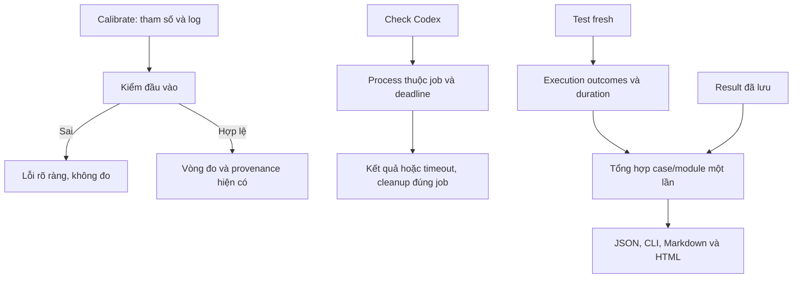

# SPEC — Tối ưu bốn hạng mục sau báo cáo QC
Soul: chất lượng > runtime > context cost · luật gốc: skills/tdq-conventions/references/soul.md

Ngày: 2026-11-01 · Bản: 1.0 · Lane: full · QC: ultra
Brief: [phạm vi đã chốt](../brief/2026-11-01-1045-toi-uu-bon-hang-muc.md)
Trạng thái: CHỜ DUYỆT

## 1. Mục tiêu & phạm vi

Giảm công việc thực thi thừa trong calibration/test; sửa việc timeout2s nhưng chờ30,16s theo bằng chứng cũ; tự động chỉ ra case/module chậm từ evidence. Hoàn thành cả bốn đề xuất, không hứa phần trăm tăng tốc Full khi chưa có phép đo tương đương.

Trong phạm vi: validation calibration, kiểm sống Codex/process ownership, test parser/schema/log đang dựng repo và chạy subprocess lặp, bảng Top20 case/module trong result/CLI/Markdown/HTML. Actor là người chạy CLI hoặc workflow QC; trigger là calibrate, check, test fresh hoặc xuất lại report từ result đã lưu.

Ngoài phạm vi: tăng worker mặc định, bật cache mặc định, benchmark A/B D9/D10 của request trước, chỉnh guard cho PASS, đổi API nhà cung cấp/model, publish/push hoặc tự động commit phần triển khai mới. Không cần cài thêm gói hay dùng model/API ngoài để thực thi tính năng.

## 1b. Lộ trình

| Bước/phase | CÓ-BỎ | Vì sao |
|---|---|---|
| Analyze | CÓ | Chốt QC và hợp đồng từng hạng mục |
| Nghiên cứu mới ngoài repo | BỎ | Có source và tài liệu chính thức từ phân tích trước; cần repro cục bộ |
| Spec → plan | CÓ | Hai gate duyệt riêng của pipeline chuyên sâu |
| Chọn main/subagent | CÓ | Hỏi sau duyệt plan; không kế thừa mode request trước |
| Implement | CÓ | RED/GREEN vùng chạm; không nới assertion/guard |
| QC độc lập/runtime | CÓ | User chọn ultra bằng “a”; mỗi smoke/runtime có cap120s |
| Benchmark D9/D10 cũ | BỎ | User đã bỏ qua; request mới không mở lại phép đo đó |
| Report | CÓ | Trước/sau có provenance, ghi rõ giới hạn số đo |

## 2. Đầu ra cụ thể

| # | Đầu ra | Đường dẫn/vị trí | Đo xong bằng |
|---|---|---|---|
| O1 | Calibration kiểm đầu vào trước việc tốn chi phí | scripts/tdq_bench.py | Input mẫu/log sai hoặc thiếu mẫu xác định được trước vòng đo phải lỗi ngay, không gọi _do_mot_luot, không ghi output mới |
| O2 | Timeout và cleanup có ownership | scripts/tdq_codex.py; primitive process dùng chung | Repro Windows thật; timeout2s thoát trong8s kể cả cleanup, descendant hết, HOME của job được dọn và job khác nguyên vẹn |
| O3 | Test dữ liệu thuần không chạy calibration/git/CLI không liên quan | Các test bench/runner/team/runtime-bench trong vùng chạm | Bảng ánh xạ từng case được đổi; giữ assertions và case baseline; giữ riêng integration/process thật |
| O4 | Tổng hợp Top20 case và Top20 module | scripts/tdq_test_report.py (mới, thuần dữ liệu) | Sort ổn định, tổng setup/call/teardown execution, không cộng subtest lần hai; duration thiếu/không hợp lệ hiện partial/unavailable |
| O5 | Tích hợp và xuất report offline | scripts/tdq_test.py; tiểu lệnh report | Result fresh có slow_tests; CLI in bảng; report --result PATH --out-prefix PATH xuất JSON/MD/HTML mà không chạy test, gắn SHA input |
| O6 | QC và báo cáo kết quả request | docs/tdq/qc và docs/tdq/reports theo slug request | Full fresh, smoke/runtime, reviewer độc lập, browser QA HTML, dữ liệu trước/sau có nguồn và giới hạn |

Tiểu lệnh report là phần thêm mới; các lệnh cũ và return/status cũ giữ hợp đồng. Các định dạng JSON/MD/HTML phải dùng cùng một summary, không tính lại ba công thức riêng. Artifact mặc định nằm cạnh result trong thư mục run; khi không thể ghi, báo lỗi có provenance và không để file hoàn chỉnh giả. Report có lỗi không được biến verdict FAIL/ERROR của test thành PASS.

## 2b. Ranh giới module

| Module | Vùng file | Phụ thuộc module | Đầu ra §2 |
|---|---|---|---|
| Calibration | scripts/tdq_bench.py; test_bench.py (thư mục tests) | Các parser/collector hiện có cùng module | O1, O3 |
| Codex/process | scripts/tdq_codex.py; scripts/tdq_test_process.py; test_codex_cli.py (thư mục tests); test_tdq_test_process.py (thư mục tests) | Primitive ownership hiện có; giữ env/HOME Codex | O2 |
| Test dữ liệu | test_tdq_test.py (thư mục tests); test_team_mode.py (thư mục tests); test_tdq_runtime_bench.py (thư mục tests) | API sản phẩm hiện có | O3 |
| Summary/presentation | scripts/tdq_test_report.py; test_tdq_test_report.py (thư mục tests) | Python stdlib; không gọi process/state | O4 |
| Runner tích hợp | scripts/tdq_test.py; test_tdq_runner_integration.py (thư mục tests) | Summary/presentation + manifest/result/process hiện có | O5 |
| Bàn giao | docs/tdq/artifacts, qc, reports theo slug mới | Evidence đã kiểm của các module | O6 |

Căn cứ LSP: _kiem_song có caller trong check/CLI và test; lenh_thuc_do đi qua dispatch CLI. Graphify affected depth2 xác nhận check → cli và bảng dispatch bench; graph chỉ là hỗ trợ vì đang có cảnh báo freshness. Điểm tích hợp runner nằm sau khi có execution outcomes, không thêm tác dụng phụ vào collector/result parser. Không gộp xử lý ownership với renderer report.

## 2c. Luồng hoạt động & Sơ đồ kiến trúc

| Khía cạnh | Trước | Sau — thiết kế dự kiến |
|---|---|---|
| Calibration | Đo trước rồi mới parse một số input | Kiểm các lỗi xác định được trước khi đo; giữ machine samples thật cho input hợp lệ |
| Timeout | Timeout2s, một case cũ mất30,16s | Xác minh nguyên nhân, giới hạn toàn vòng sở hữu process/cleanup; giữ HOME và caller khác |
| Test | Một số kiểm format/log kích hoạt vòng git/calibration | Kiểm dữ liệu thuần ở lớp thuần; integration thật có mục đích rõ và không mất assertion |
| Report | Phải tự cộng duration từ JSON | Tổng hợp dùng chung, tự gắn vào run và xuất lại từ artifact không cần chạy suite |

Preview thiết kế dự kiến: [HTML](2026-11-01-1045-toi-uu-bon-hang-muc-preview.html), manifest cạnh HTML. Chỉ là thiết kế; receipt render/binding xác nhận snapshot, không chứng nhận code đã triển khai hoặc hiệu năng đã đạt.

## 3. Cách tiếp cận & lý do

Dời validation có thể xác định sớm lên trước side effect, giữ API và schema cũ. Repro timeout trước sửa; tái sử dụng/extract primitive ownership hiện có thay vì thêm thư viện quản process. Giữ hợp đồng CODEX_HOME/argv/stdin khi dùng primitive, không áp môi trường pytest vào Codex.

Các test chỉ kiểm parser/schema/log gọi API thuần hoặc dùng fixture dữ liệu riêng. Các test có mục đích đo thật, task ownership, cleanup hoặc round-trip CLI vẫn chạy thật. Ghi ánh xạ trước/sau cho từng case thay đổi; không xóa assertion để đạt thời gian. Không dùng chung repo mutable giữa các case.

Đường report chỉ đọc result execution và tổng hợp; không sửa parser JUnit để phục vụ trình bày. Đã loại việc bật worker2/cache làm giải pháp mặc định vì parity/hiệu năng chưa được chứng nhận. Không thêm service, database hoặc framework report.

## 3b. Năng lực & công cụ

| Skill | Nguồn | Phán quyết | Dùng ở đâu / Lý do loại |
|---|---|---|---|
| tdq-spec | plugin:tdq-workflow | NỀN | Spec và binding thiết kế |
| tdq-intake | plugin:tdq-workflow | DÙNG | Phạm vi, state và quyết định QC |
| tdq-setup | plugin:tdq-workflow | DÙNG | Chứng minh LSP/Graphify; tự phục hồi theo chỉ đạo user |
| tdq-plan | plugin:tdq-workflow | DÙNG | Sau duyệt spec |
| tdq-build | plugin:tdq-workflow | DÙNG | Sau duyệt plan; unit/full/smoke/runtime và reviewer độc lập |
| tdq-browser-test | plugin:tdq-workflow | DÙNG | HTML desktop/mobile, console và nội dung; preflight Chrome9222 trước dùng |
| Đã xét các skill khác | user/plugin/built-in | KHÔNG | khác lĩnh vực |

Ưu tiên MCP LSP cho symbols/references/blast radius, Chrome DevTools MCP cho HTML. Nếu cổng Chrome chưa kết nối, hướng dẫn bật trước kiểm; có thể dùng native browser của Archify cho preview khi receipt ghi rõ. CLI stdlib xử lý file và evidence, không cần dịch vụ ngoài.

## 3c. Giải thuật & Xử lý cốt lõi

1. Calibration: parse cấu trúc mẫu nhập tay/log một lần; kiểm hợp lệ và điều kiện số mẫu không phụ thuộc machine round. Lỗi trả trước khi tạo repo/vòng đo. Input hợp lệ mới chạy vòng hiện có và kiểm lại số mẫu cuối; giữ nguồn, machine samples và lỗi output theo hợp đồng cũ.
2. Timeout: ghi deadline monotonic; nhận quyền sở hữu trước khi chạy target; đọc output theo deadline, hết hạn dừng đúng cây process và chờ cleanup hữu hạn. Version/say-hi giữ ngân sách hiện có theo từng invocation; phép kiểm2s đo toàn lời gọi test gồm startup/cleanup. Kết thúc luôn dọn riêng HOME của lượt đó. Lỗi ownership phải fail-closed, không chạy target không được quản lý.
3. Summary: chỉ duyệt execution case_outcomes, cộng duration hợp lệ theo phase. Mỗi case chỉ cộng một lần; không cộng duration subtest vào cha đã chứa nó. Gom module theo phần file của case_id; sort giảm dần rồi case_id/module tăng dần khi bằng nhau; lấy tối đa20 mỗi nhóm. Duration thiếu/âm/NaN/Inf hoặc ID trùng phải ghi chất lượng thiếu/không hợp lệ, không tự coi là0 và không double-count. Case thiếu giữ trong danh sách chất lượng; không gán hạng chắc chắn cho tổng incomplete.
4. Tích hợp: thêm field slow_tests có schema_version và quality vào result mới; phiên bản result cũ thiếu duration vẫn đọc được với quality phù hợp. Wall time lấy từ timings.wall_seconds và ghi riêng, không gọi tổng duration case là wall, nhất là khi parallel. Report từ artifact chỉ đọc, kiểm schema/digest input và escape mọi text/ID khi xuất HTML; output cùng prefix ghi qua temp/atomic replace để tránh file nửa vời.

Độ phức tạp: validation O(B) thời gian/O(B) bộ nhớ với B là bytes input/log; không gắn chi phí đo vào lỗi input sớm. Summary O(N log N + M log M) thời gian, O(N+M) bộ nhớ với N case, M module. Trình bày O(K) phần bảng sau tổng hợp, K tối đa20 mỗi nhóm. Process cleanup phụ thuộc số process thuộc job, bị chặn bởi deadline và ngân sách cleanup; không quét/kill theo tên toàn máy.

Ca góc: input rỗng/sai và thiếu mẫu; shell .cmd sinh descendant giữ pipe; job khác đang chạy; version thành công nhưng say-hi lỗi; case không duration; result cũ; duplicate ID; duration không hữu hạn; ít hơn20case; ID chứa HTML; output unwritable hoặc bị ngắt khi ghi. Mỗi nhóm cần kiểm riêng trong plan.

## 3d. Mental Model cho Fresher Dev

Calibration giống kiểm hồ sơ trước khi đặt lịch chạy máy: giấy tờ sai thì chưa bật máy. Ownership giống mỗi đoàn có danh sách thành viên riêng; timeout chỉ gọi đoàn của mình về. Summary giống bảng tổng kết từ phiếu điểm đã chốt: tính một lần rồi in nhiều bản, không bắt học sinh thi lại để in bảng.

- Deadline: mốc thời gian đơn điệu mà job phải dừng chờ.
- Ownership: quyền quản lý đúng process và descendants do invocation tạo.
- Provenance: dấu vết nguồn, input, hành động và digest để đối chiếu kết quả.
- Duration case: tổng phase của một case, không nhất thiết bằng thời gian toàn suite.
- Partial/unavailable: dữ liệu thiếu hoặc không thể đo; không đồng nghĩa0giây.
- Top20: hai bảng xếp hạng tối đa20case và20module, không thay verdict test.

## 4. Yêu cầu bắt buộc

Log service bật mặc định: timestamp, stage/reason, thời gian và trạng thái cleanup/report; tắt bằng cấu hình log hiện có, không lộ secret/payload Codex/log thô. Không placeholder, không TODO stub, không dùng mock làm chứng cứ process thật. Mỗi đầu ra có regression riêng, RED/GREEN và lệnh kiểm được ghi ở plan. Giữ SOLID/module boundaries; code comments/machine strings tiếng Anh, tài liệu và chat tiếng Việt.

## 5. Ràng buộc & rủi ro

Ràng buộc kiến trúc phải giữ từ docs/kien-truc.md:
- “hooks/ được gọi scripts/; scripts/ không được import hooks/” — toàn bộ runtime sửa lần này.
- “Chỉ scripts/tdq_state.py được ghi docs/tdq/state.json; mọi nơi khác chỉ đọc qua CLI.” — report/runner không được tự ghi state.
- “tests/ gọi được vào mọi tầng; không tầng nào được import tests/.” — report thuần không kéo helper/test fixture vào sản phẩm.
- “File code MỚI bắt buộc nằm trong scripts/ hoặc hooks/” — module report mới nằm scripts/.

Không sửa cấu hình cá nhân để làm guard PASS; không kill process ngoài job. Giữ worker1/cacheoff; dùng --fresh và reuseoff ở Full chứng nhận. Không đổi evidence lịch sử. Mã nguồn commit trước là baseline; các SHA/số đo cũ chỉ có ý nghĩa lịch sử, không tự chứng nhận bản mới. Không cài dependency mới; dùng Python/pytest/Archify/Chrome đã có. POSIX chỉ chứng nhận trên host thật, Windows không thay proof POSIX.

| Rủi ro | Ảnh hưởng | Cách giảm |
|---|---|---|
| Primitive process làm đổi HOME/env Codex | Check sai hoặc ghi cấu hình thật | Khóa env/argv/HOME bằng regression; không dùng nguyên môi trường pytest cho Codex |
| Giảm test làm mất kiểm integration | PASS thiếu chứng cứ | Mapping từng case/assertion; giữ real-process và CLI boundary tests |
| Snapshot/external config thay đổi khi chạy QC | Evidence không còn hợp lệ | Guard và receipt giữ FAIL; không lặp chạy để tìm khoảng yên tĩnh |
| Report xếp hạng sai khi thiếu phase/parallel | Dẫn tối ưu sai chỗ | Quality partial, wall riêng, không nội suy thiếu thành0 |
| Full vẫn chậm sau sửa | Lợi ích không đạt kỳ vọng | Không đặt %speedup chưa đo; bàn giao số đo thực và vùng chưa giảm |

## 6. QC & Definition of Done

QC ultra theo user “a”: trọn suite, vùng chạm, smoke/runtime thật và reviewer độc lập. Mỗi smoke/runtime có cap120s; Full suite không áp cap120s. Full ở QC-F1 và sau vòng sửa cuối khi có sửa, không chạy lặp cho mỗi dòng DoD. Không mở lại sáu sample A/B hoặc cache benchmark cũ.

| # | Hạng mục kiểm | Điều kiện PASS | Đo trước | Dự phòng nếu trượt |
|---|---|---|---|---|
| Q1 | Validation sớm | Các input sai đã phân loại không gọi vòng đo, không ghi output mới; input hợp lệ giữ sample/source hợp đồng | Source hiện đo trước validate; case malformed17,39s, thiếu Codex24,08s | Chỉ dời validation xác định được; lỗi correctness sửa trước bàn giao, không nới ngưỡng mẫu |
| Q2 | Timeout/ownership | Repro timeout2s thoát ≤8s gồm cleanup, descendants hết, HOME job dọn, job khác không đổi | Case cũ30,16s; nguyên nhân chưa xác nhận | Điều tra startup/pipe/cleanup và sửa primitive; không chấp nhận PASS chỉ vì trả TimeoutExpired |
| Q3 | Giảm công việc test lặp | Mapping baseline không mất assertion/case; case dữ liệu thuần đã chọn không phát sinh calibration/git subprocess; case integration thật vẫn thực thi | Bốn file chậm434,676s/39,24% case phases ở lượt cũ | Giữ case integration đắt khi cần proof; ghi phần chưa giảm, không mock mục đích real-process |
| Q4 | Top20 chính xác | Hai bảng tối đa20, sort deterministic, tổng phase đúng, subtest không đếm trùng, thiếu/invalid có quality | Evidence cũ có3602case; chưa có summary tự động | Không xuất số giả; sửa aggregator hoặc báo dữ liệu không đủ |
| Q5 | Tích hợp và report offline | Fresh result/CLI có summary; JSON/MD/HTML khớp cùng nguồn SHA; export không gọi runner; result cũ đọc được; lỗi ghi rõ và không output hoàn chỉnh giả | Hiện phải tự đọc/cộng result; report cũ thủ công | Giữ raw result/status, báo export lỗi; không biến test FAIL thành PASS |
| Q6 | Full và tương thích | Full fresh trên source cuối đạt, đối chiếu inventory baseline3602case và case mới, mọi skip có capability/reason; API/status cũ giữ đúng | Lượt31/10:3594PASS/8skip | Sửa hồi quy; không xóa case/guard hoặc dùng kết quả cache làm Full mới |
| Q7 | Runtime/smoke/QC độc lập | Chạy CLI hợp lệ, reject sớm, timeout/cleanup, report offline; mỗi scenario≤120s; reviewer không phải implementer, không finding correctness chưa xử lý | QC cũ6scenario nhưng chưa phủ thay đổi mới | Dừng job đúng ownership khi chạm cap; sửa trong QC loop, không tăng cap hoặc gọi simulation là device/production proof |
| Q8 | HTML và bàn giao | Desktop1440×900/mobile375×812: số liệu/link khớp, escape IDs, không tràn ngang toàn trang, console sạch; MD/HTML có provenance/giới hạn | Report cũ đã QA; chưa có HTML summary mới | Sửa render; khi tool chưa kết nối hướng dẫn bật và ghi phần chưa kiểm, không tuyên bố visual PASS |

Định nghĩa hoàn thành: O1–O6 đều có proof gắn source cuối; Q1–Q8 PASS với bốn mục QC cố định; mọi giới hạn POSIX hoặc số đo thiếu ghi rõ; không suy tăng tốc từ sample cũ khác source. Chưa có lệnh test trong spec; plan sau duyệt sẽ gắn một lệnh kiểm cho mỗi task/DoD.

## 7. Câu hỏi còn mở
<!-- tdq-archify-binding:start -->
<!-- manifest: 2026-11-01-1045-toi-uu-bon-hang-muc-preview.manifest.json -->
<!-- manifest_digest: ce95f1f3e6e97958e0f19b0bfae6d05c75040fc7cba6a21760810af7782c67b4 -->
<!-- tdq-archify-binding:end -->