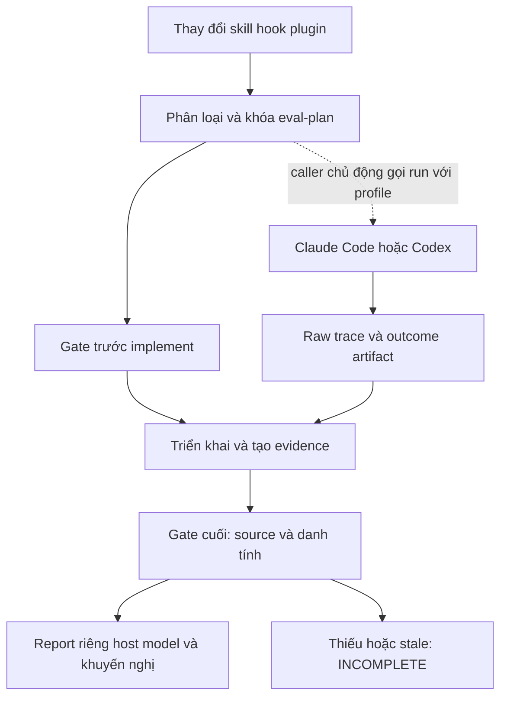

# SPEC — Eval chất lượng skill và plugin TDQ
Soul: chất lượng > runtime > context cost · luật gốc: skills/tdq-conventions/references/soul.md

Ngày: 2026-11-01 · Bản: 1.0 · Brief: ../brief/2026-11-01-1854-eval-chat-luong-skill.md · Lane: full
Trạng thái: CHỜ DUYỆT

## 1. Mục tiêu & phạm vi

Áp dụng năm cải tiến đã duyệt: kế hoạch Eval trước sửa hành vi; đối chứng baseline/candidate; đo riêng trigger/chất lượng/chi phí; báo riêng host/model; khuyến nghị giữ/rút gọn/bỏ hoặc chưa kết luận. Dùng cho repo phát triển TDQ và project cài plugin. Tái dùng nền tảng hiện có, không tạo framework Eval mới.

Trong phạm vi:
- Cổng kiểm kế hoạch và chứng cứ cho thay đổi hành vi skill/hook/plugin, không tự mở rộng thành Eval cho mọi thay đổi code ứng dụng.
- Runner opt-in cho Claude Code và Codex trên Windows, có preflight, nhận manifest thí nghiệm do caller chốt trước chạy. CLI không phụ thuộc script phát triển bị loại khỏi release.
- Schema, corpus mẫu dev/holdout, grader tất định và report JSON/Markdown; compatibility cho dữ liệu/CLI Eval cũ.
- Gắn khai báo Eval vào spec/plan và kiểm ở chuyển phase implement/report; cổng chỉ đọc/chấm chứng cứ, không tự gọi model.
- QC ultra cho cơ chế mới: Full, vùng chạm, smoke/runtime bằng process fixture, reviewer độc lập và kiểm gói plugin.

Ngoài phạm vi:
- Không A/B Ponytail full với ultra; giữ mặc định ultra. Không tự thay mức user đã chọn hoặc tự xóa luật theo recommendation.
- Không chạy phiên LLM trả phí, không chọn ngân sách USD, không cài model hoặc dependency mới trong request này. Không dùng lời duyệt spec để cấp quyền chạy live.
- Không chứng nhận hiệu quả AI của skill hiện tại bằng fixture/offline. Live run về sau cần người dùng gọi rõ ràng với model, quyền, giới hạn phiên/deadline và quota/chi phí trong profile.
- Không mở rộng sang Linux/macOS hay host khác; không sửa toàn bộ CI nền đang đỏ; không xóa/commit source ở 11 worktree cũ để vượt guard.
- Không thêm SaaS, dashboard, LLM-as-judge tự động, rate table giá cố định hoặc plugin Skill Creator bên ngoài.

## 1b. Lộ trình

User duyệt spec là duyệt lộ trình này; không thay các cổng duyệt plan/commit vốn có.

| Bước/phase | CÓ-BỎ | Vì sao |
|---|---|---|
| Scope và phỏng vấn | CÓ | Đã chốt gate cho repo/project, hai host và QC; không chạy pilot Ponytail |
| Research nguồn chính thức | CÓ | Kiểm thiết kế A/B, grader và usage; không vay số doanh nghiệp chưa xác minh |
| Spec → duyệt → plan → duyệt | CÓ | Pipeline full user đã chọn; live profile là input khi gọi runner, không đặt ngân sách giả định |
| Triển khai và test theo task | CÓ | Sau duyệt plan; cần code và fixture thực |
| Chia subagent triển khai | CÓ | Chọn mode sau duyệt plan, không suy mode từ request cũ |
| QC độc lập/runtime | CÓ | User chọn QC ultra; dùng process fixture và CLI preflight, không gọi model để thay smoke |
| Live pilot Ponytail full/ultra | BỎ | User nói rõ không cần A/B hai mức; giữ mặc định ultra |
| Báo cáo và đóng hồ sơ | CÓ | Có provenance, coverage, giới hạn, comparability và khuyến nghị |

## 2. Đầu ra cụ thể

| # | Đầu ra | Đường dẫn/vị trí | Đo xong bằng |
|---|---|---|---|
| O1 | Contract dùng chung: eval-plan, record, report, classifier và quyết định | scripts/tdq_eval_contract.py mới | Validator từ chối thiếu/mâu thuẫn danh tính, giữ unavailable, quyết định tất định có provenance |
| O2 | Entry point dùng trong repo và project cài plugin | scripts/tdq_skill_eval.py mới | Các lệnh plan/check/run/report tách biệt; check/report không launch model |
| O3 | Hai adapter host Windows và chuẩn hóa trace | scripts/tdq_eval_hosts.py mới, tái dùng tdq_transcript và OwnedProcessJob | Native capability preflight; process fixture cho timeout/cleanup/parser của cả hai host |
| O4 | Gắn gate vào workflow, tài liệu và state qua CLI | scripts/tdq_state.py; skills/tdq-intake, tdq-spec, tdq-plan, tdq-build và references liên quan | Khai Eval trước implement; gate cuối phát hiện scope/source stale và không tự launch model |
| O5 | Tái dùng Eval lịch sử và bộ ca mới có đáp án | scripts/tdq_eval.py; evals/skill-quality/ và regression tương ứng | Legacy report vẫn đọc được; fixtures dev/holdout, dương/âm, trace lỗi; không trộn fixture với live |
| O6 | Plugin release có đầy đủ runtime và hướng dẫn | scripts/build_portable.py và regression đóng gói; skills/tdq-build/references/skill-eval.md mới | Gói sạch chạy CLI ngoài source repo, không import tests/dev corpus hoặc tdq_eval lịch sử |
| O7 | Hồ sơ kiểm chứng, report mẫu và preview thiết kế | docs/tdq/artifacts/2026-11-01-1854-eval-chat-luong-skill/ và qc/reports cùng slug | Source/trace/manifest hash kiểm được; report mẫu chỉ ghi synthetic/offline, không nhận là số đo AI |

## 2b. Ranh giới module

| Module | Vùng file | Phụ thuộc module | Đầu ra §2 |
|---|---|---|---|
| Contract thuần | scripts/tdq_eval_contract.py và regression core | stdlib | O1 |
| Host I/O | scripts/tdq_eval_hosts.py và regression host | Contract, tdq_transcript, tdq_test_process | O3 |
| CLI và compatibility | scripts/tdq_skill_eval.py, scripts/tdq_eval.py và regression CLI/manifest | Contract, Host I/O | O2, O5 |
| Workflow | scripts/tdq_state.py; SKILL.md của tdq-intake/spec/plan/build; spec-template.md và qc.md; evals/skill-quality; regression gate/state | CLI check, Contract | O4, O5 |
| Packaging | scripts/build_portable.py và regression đóng gói; skills/tdq-build/references/skill-eval.md | Entry point và dependency closure | O6 |
| Chứng cứ | docs/tdq/artifacts, qc, reports của request | Đọc outputs các module | O7 |

Ba file runtime mới có trách nhiệm riêng: core thuần được hai CLI dùng; I/O có hai host cụ thể; CLI điều phối. Không thêm interface/registry cho host giả định. Giữ parser, token_audit, logging và primitive process đang có khi hợp đồng khớp; không sao chép renderer Top20 test vào báo cáo Eval khác schema.

Căn cứ khảo sát: Graphify depth2 xác nhận chay_phien → chay_va_cham → callback chay. Grep xác nhận các test và hai consumer manifest/legacy report. LSP start/open được nhưng references báo process exited, nên không tuyên bố đã có semantics LSP đầy đủ; trước sửa source phải thử lại, dùng fallback AST/Grep/Graphify và ghi hạn chế nếu server vẫn lỗi. Evidence ở brief và analysis-baseline.json. Vùng state là hub; plan phải khai rõ chuyển phase bị chạm, không refactor toàn hub.

## 2c. Luồng hoạt động & Sơ đồ kiến trúc

Actor: người phát triển TDQ hoặc skill/plugin trong project. Trigger: khai task sửa hành vi hoặc gọi CLI Eval rõ ràng. Inputs: targets, base/candidate, case/rubric, execution profile và chứng cứ đã có. Output gate là PASS/FAIL/INCOMPLETE/WAIVED_USER, không phải model call.

Preview HTML dự kiến `<slug>-preview.html`, manifest gắn digest document; evidence kind planned. Đây là thiết kế, không phải hệ thống đã triển khai hoặc số đo hiệu quả AI. Native render/verify và tình trạng browser được ghi trong artifact; nếu thất bại, chỉ Mermaid/text là fallback được công bố.

| Khía cạnh | Trước | Sau |
|---|---|---|
| Runner | Claude CLI, model và hai snapshot cũ cố định; auth helper hướng macOS | Profile định danh rõ, hai host Windows; CLI dùng được từ plugin cài đặt |
| Gate | QC/CI không bắt buộc kế hoạch Eval thay đổi skill | Kiểm kế hoạch trước implement và evidence trước report, không tự chạy model |
| Paired validation | Chỉ so corpus/check_set | So host/model/scorer/quyền/corpus/cấu hình công cụ và biến thử nghiệm |
| Metrics | Chi phí thiếu có chỗ thành 0 | Null + availability/provenance; tách usage, estimate và billing |
| Kết luận | Bảng tuân thủ hai nhánh lịch sử | Ba nhóm chỉ số, coverage và khuyến nghị có nhánh chưa đủ bằng chứng |

## 3. Cách tiếp cận & lý do

Mở rộng phần có thể tái dùng, không ship bộ đo lịch sử và corpus nội bộ sang mọi project. Entry point mới và core chung được ship; CLI lịch sử giữ tên lệnh/record cũ, dùng core cho contract mới. Record cũ không có host/model/hash chỉ được báo lịch sử chưa xác minh, không tự nâng thành certified evidence mới.

Chọn stdlib, script nhỏ và functional modules theo hai trách nhiệm I/O/thuần; baseline là snapshot hoặc tập file có hash, không chỉ branch name có thể di chuyển. Report đọc offline, không cần auth hoặc checkout base. Gate dùng cùng validator cho CLI và state, không chép logic vào hook từng host.

Nguồn: research cùng slug, hướng dẫn Anthropic eval-first/testing và skill-creator built-in về validator khác behavioral evaluation. Không vay số cải thiện hoặc tên lệnh chưa xác minh trong file video làm chuẩn nghiệm thu.

## 3b. Năng lực & công cụ

| Skill | Nguồn | Phán quyết | Dùng ở đâu / Lý do loại |
|---|---|---|---|
| tdq-intake | plugin:tdq-workflow | NỀN | Scope và khảo sát |
| tdq-setup | plugin:tdq-workflow | NỀN | Preflight và fallback tìm kiếm |
| tdq-conventions | plugin:tdq-workflow | NỀN | State, log, docs và git |
| tdq-check-status | plugin:tdq-workflow | NỀN | Checkpoint request trước |
| tdq-spec | plugin:tdq-workflow | NỀN | Spec và approval binding |
| tdq-plan | plugin:tdq-workflow | NỀN | Testable task/contract sau duyệt |
| tdq-build | plugin:tdq-workflow | NỀN | RED/GREEN, QC và report |
| tdq-lean | plugin:tdq-workflow | NỀN | Giữ module đủ nhỏ và reuse |
| skill-creator | built-in | DÙNG | Rà soát scope/trigger/invariant, validate skill và forward-test không cho trước đáp án |
| archify | local installed | DÙNG | Preview planned của spec, native validate/render/bind |
| Đã xét 18 skill khác trên đĩa và built-in không liên quan | user/plugin/built-in | KHÔNG | khác lĩnh vực |

MCP-First: LSP/Graphify cho code; preflight Node/Archify cho preview; browser phải kiểm kết nối trước dùng. Native CLI phù hợp hơn browser để chạy host Eval. Không dùng MCP hoặc skill ngoài chưa có khả năng thực thi; direct CDP/native browser fallback phải ghi đúng công cụ, không giả MCP PASS.

## 3c. Giải thuật & Xử lý cốt lõi

### Khóa kế hoạch và kích hoạt gate

1. Resolve project và plugin root riêng biệt. Chỉ đọc thay đổi/targets trong project được chỉ định; không quét hoặc sửa cấu hình user để suy quyền.
2. Trước implement, lấy targets dự kiến từ plan qua parser hiện có; cuối request dùng diff thực tế với base đã khóa. Nhận diện skill instructions, metadata ảnh hưởng trigger, hook/plugin manifest và runtime plugin đã khai. Code ứng dụng ngoài targets đó không tự phát sinh Eval.
3. Sửa nội dung instruction/trigger được coi là hành vi; chỉ trường bookkeeping/date/status và sửa docs tham khảo thuần được miễn theo rule đã khai, không cho agent tự gọi mọi thay đổi là typo. Scope không xác định là review-required, không ngầm miễn.
4. Eval-plan lưu target hashes/base/candidate, change_kind, hypothesis, evaluation_kind, case dev/holdout hashes, rubric/oracle, expected trigger/negative cases, required metrics, model/host cells, repetitions/order, thresholds và quyền/tool/cache profile. Trước code, candidate có thể là planned; trước gate cuối phải resolve thành hash thật. Thay kế hoạch/corpus/grader làm evidence cũ stale.
5. Loại đánh giá `mechanism` dùng code oracle/process fixture để kiểm cơ chế; `agent-effectiveness` cần trace live tương ứng. Loại và phạm vi claim khóa trong plan, không được đổi sau khi xem kết quả. Request này kiểm cơ chế, không chứng nhận lợi ích của prompt bằng fixture.
6. Gate trước implement đòi plan hợp lệ cho targets cần Eval. Gate cuối đòi evidence mới theo loại đã khai. Thiếu, scope/source stale hoặc ô model bắt buộc chưa đo → INCOMPLETE, không PASS. Miễn theo chỉ đạo rõ của user lưu reason/source/scope thành WAIVED_USER, không phải một kết quả đo đạt; không tự miễn và không cấp quyền chạy live.

### Thực thi rõ ràng, không tự động phát sinh phiên model

1. `check`, `plan`, `report`, hook, install và chuyển phase không được launch model. Chỉ lệnh run live do caller chủ động với profile đã chốt mới gọi adapter.
2. Profile khóa model ID, host version/capabilities, quyền/tool/sandbox, số ca và số trial hữu hạn, deadlines, giới hạn retry và cách hạch toán quota/cost. Không có giá USD cố định trong source. Subscription có thể dùng quota/trial cap; chi phí không quan sát được vẫn unavailable, không hiển thị 0 USD.
3. Preflight xác minh CLI/flags bằng khả năng native quan sát được; không dùng model “say hi” như kiểm version. Không sao chép token, scan secret store, đọc transcript phiên khác hoặc thêm bypassPermissions/full-access mặc định. Không đủ auth/isolation/capability → UNSUPPORTED hoặc BLOCKED với lý do, không gọi model để thử vận may.
4. Chạy mỗi trial trong workspace/HOME/config riêng theo cơ chế host đã chứng minh; không nạp đồng thời plugin global và candidate. Nếu không cô lập được, từ chối chứng nhận đối chứng. Tái dùng process ownership, timeout, cleanup; không kill process ngoài job. Retry thuộc cùng ngân sách và được giữ trace, không làm biến mất trial lỗi.
5. Ghép cặp bằng case ID, repeat và cùng cell host/model, dùng thứ tự AB/BA cân bằng khai trước; skip/resume theo hash experiment, không theo tên file. Cache condition ghi rõ; không đổi cache/perms/model giữa A và B để tạo delta giả.

### Chuẩn hóa, chấm và tổng hợp

1. Giữ raw trace hash, outcome/artifact hash và cấu hình có thể tái lập không chứa secret. Tái dùng normalizer transcript native khi hỗ trợ schema; schema chưa hiểu là unknown, không suy thành session hoàn thành.
2. Tách execution_status, outcome_quality, identity_comparability và metric_availability. Token input/output/cache, wall latency, tool/model call, retries và intervention chỉ ghi khi quan sát được. Không gọi wall time là model compute; missing khác zero. Giá quy đổi có rate snapshot/source/time và nhãn estimate; billed cost chỉ khi provider trả nguồn tương ứng.
3. Grader task dựa trên artifact/test oracle đã khóa; trigger dựa trên expected use và event có provenance. Không thấy trace quyết định trigger → unavailable. Rubric nhiều chiều dùng score/severity đã khai; không tự dùng cùng model làm judge và gọi là ground truth. Human labels phải có provenance và liên kết trial.
4. Không bỏ lỗi hạ tầng khỏi report hoặc chi phí. Dữ liệu partial, trùng trial, timeout, thiếu result và missing subevents được giữ với reason; không dùng tổng nhỏ do thiếu usage để chứng minh tiết kiệm.
5. Chỉ so cặp đúng identity. So theo case/trial đã đăng ký và báo số mẫu/độ phân tán, không gộp host/model thành một điểm phổ quát, không đếm từng check con tương quan như mẫu độc lập. Repetitions/margins/primary metric được khóa trước run; chưa đủ điều kiện của policy là chưa kết luận.
6. Khuyến nghị giữ/rút gọn/bỏ chỉ khi policy có đủ evidence, quality/critical guardrail không hồi quy và lợi ích có tín hiệu theo tiêu chí đã khóa. Baseline bão hòa, không đủ mẫu hoặc thiếu metric quyết định → INCONCLUSIVE. Recommendation không tự sửa code, xóa skill, bỏ guard hoặc hạ Ponytail ultra.

### Độ phức tạp và biên

Với F file/targets, B byte trace/outcome được đọc, N trial records: validate/normalize O(F+B+N), report sort deterministic O(N log N), bộ nhớ O(N + kích thước một event/artifact đang xử lý). Thời gian LLM bên ngoài được đo riêng; không coi là O(1) của chương trình local. Hash artifact đọc streaming; parser dùng budget kích thước/event từ plan, quá budget ghi error, không âm thầm truncate rồi chấm PASS.

Biên phải có kiểm: schema lạ/nonfinite/duplicate, path traversal/symlink ra ngoài root, branch di chuyển, hash không khớp, model alias unresolved, permissions/cache khác nhau, corpus/holdout bị sửa, lỗi transport có usage partial, cost null, retry vượt quota, budget không kiểm soát được, CLI treo/descendants, native auth không sẵn có, global skill contamination và legacy records thiếu identity. Resume không trộn experiment hoặc chạy bù ngoài hạn mức.

## 3d. Mental Model cho Fresher Dev

Eval giống kiểm định hai quy trình làm một món hàng: dùng cùng nguyên liệu và dụng cụ, chấm sản phẩm theo thước đã chốt, rồi mới xem thời gian/hao phí. Kiểm tra phiếu kiểm định không tự khởi động nhà máy. Một máy chưa chạy thì ghi chưa kiểm; một hóa đơn chưa có không có nghĩa sản xuất miễn phí.

- Baseline/candidate: hai phiên bản được đối chứng, không đồng nghĩa hai mức Ponytail.
- Manifest: phiếu định danh dữ liệu, quyền, model và cách chấm của thí nghiệm.
- Trial/cell: một lần làm một case / một ô host-model-cấu hình.
- Holdout: case chưa dùng để chỉnh skill; sửa đáp án thì đổi phiên bản bộ ca.
- Oracle/grader: phép kiểm sản phẩm thực / bộ chấm đã đăng ký.
- Mechanism/effectiveness: cơ chế chạy đúng / agent thực sự làm tốt hơn; không lấy loại đầu thay loại sau.
- Unavailable/INCONCLUSIVE/WAIVED_USER: chưa có metric / chưa đủ kết luận / user cho miễn có ghi nhận; đều khác PASS đo được.

## 4. Yêu cầu bắt buộc

- Log service ON mặc định, timestamp/experiment/cell/trial/reason/cleanup đủ debug; TDQ_LOG=0 tắt. Không log prompt/tool payload/token/secret nguyên văn; raw trace là artifact riêng có scope truy cập rõ.
- Không TODO stub, placeholder hoặc fixture trình bày như live evidence. Mỗi phần có unit test, RED trước GREEN và regression caller; process fixture phải có handshake PID/ownership/cleanup thực.
- Pure core không I/O, không launch process. Tất cả model calls đi qua adapter/entry point rõ ràng; parser/normalizer không gọi lại model để bù dữ liệu.
- Dữ liệu lịch sử và receipt FAIL giữ nguyên. Report/score offline không gọi host hoặc API; rescore append-only gắn scorer version, không ghi đè raw trace.
- Dùng một core/contract cho repo và plugin cài đặt. Project không cần source tests/evals nội bộ hay global install để đọc report/check plan.
- Giữ mặc định Ponytail ultra và QC default full; request này QC ultra theo user. Không nâng quyền hoặc đổi config cá nhân để làm test PASS.

## 5. Ràng buộc & rủi ro

Ràng buộc kiến trúc phải giữ từ quyết định repo hiện có:
- “hooks/ được gọi scripts/; scripts/ không được import hooks/” — state/CLI/core và adapter.
- “Chỉ scripts/tdq_state.py được ghi docs/tdq/state.json; mọi nơi khác chỉ đọc qua CLI.” — khai gate và evidence pointer.
- “tests/ gọi được vào mọi tầng; không tầng nào được import tests/.” — cả runtime được ship.
- “File code MỚI bắt buộc nằm trong scripts/ hoặc hooks/” — các module sản phẩm mới ở scripts; test theo convention tests hiện hữu.

Không cài package mới: Python/pytest/Archify/Chrome đã có; dùng stdlib cho runtime validator. Không sửa kernel guard/config để tạo PASS. QC runtime mỗi scenario có cap 120 giây theo QC ultra, Full có deadline riêng trong plan. LSP còn lỗi được ghi trong giới hạn, không bịa lời gọi thành công.

| Rủi ro | Ảnh hưởng | Cách giảm |
|---|---|---|
| Gate bắt cả code ứng dụng | Cản công việc ngoài scope | Classifier target và negative cases; cuối request kiểm diff thật, không suy từ mọi file scripts của ứng dụng |
| Native CLI host không cô lập/có auth | Không thể chứng nhận live pair | Preflight và BLOCKED/UNTESTED; fixture chỉ chứng minh adapter mechanics, không che thiếu live |
| Thiếu usage nhưng được cộng bằng 0 | Tuyên bố tiết kiệm và cap sai | Null/availability xuyên parser/report, quota dự phòng chỉ theo profile; không tạo cost claim khi thiếu nguồn |
| Ship thiếu dependency hoặc corpus | Plugin chạy trong dev nhưng hỏng khi cài | Check import closure và CLI ngoài repo; corpus nội bộ không là runtime dependency |
| Gate mới tự chấm chính nó bằng mock | PASS giả hiệu quả agent | Contract phân loại mechanism/agent-effectiveness, report fixture synthetic rõ và không chứng nhận ROI |
| Grader/corpus đổi sau kết quả | Tối ưu theo đáp án | Hash/version, dev/holdout và rescore append-only |
| CI nền/11 worktree cũ/Master stale | Đóng metadata hoặc chứng nhận không đầy đủ | Bảo toàn dữ liệu; refresh Master sau source cuối trong plan; nếu phase QC bị global guard chặn, giữ phase thật và báo blocker, không đánh closed hoặc xóa source cũ |

## 6. QC & Definition of Done

QC ultra: Full sau source cuối, regression vùng chạm, các smoke/runtime hữu hạn không gọi LLM, reviewer độc lập và check package/preview. Không chạy Full cho từng dòng DoD. Chứng cứ đo trước là analysis-baseline.json: diagnostic thuần local, không phải live Eval.

| # | Hạng mục kiểm | Điều kiện PASS | Đo trước | Dự phòng nếu trượt |
|---|---|---|---|---|
| Q1 | Plan và classifier | Nhận diện thay đổi skill/hook/plugin trong repo và project; trước implement có plan, cuối request phát hiện scope/source stale; docs thuần/code app ngoài scope không tự launch hay yêu cầu live | 0 gate giá trị skill trong QC hiện tại; tdq_eval không được ship | Sửa classifier/entry point đúng vùng, không mở rộng sang mọi code app để né phân loại |
| Q2 | Danh tính đối chứng | Từ chối ghép cặp khác host/model/quyền/scorer/corpus/tool-cache profile; candidate/base/hash đúng biến thử nghiệm; record cũ chỉ historical | 4/4 probe khác model/host/quyền/scorer vẫn được validator hiện tại chấp nhận | Không phát delta hoặc certification khi identity chưa đủ; giữ report diagnostic |
| Q3 | Ba nhóm metrics | Trigger, outcome quality và usage/time/retry/intervention độc lập; missing không thành zero; estimate khác billing; schema chưa hiểu không PASS | Probe result thiếu cost hiện trả 0.0; token context estimate không phải provider usage | Ghi unavailable/partial và giới hạn claim, không nội suy số giả |
| Q4 | Hai adapter Windows | Claude và Codex có preflight, parser, finite scheduling, owned process timeout/cleanup và isolation; fixture/CLI version được phân loại đúng, không gọi model trong QC | 1 runner live Claude hằng; Codex chưa là backend Eval; CLI hai host hiện diện, chưa có live profile | Thiếu native capability ghi UNSUPPORTED/UNTESTED; không gọi model hoặc tăng quyền để thử |
| Q5 | Scheduling và evidence | AB/BA theo plan, trial IDs/resume không trộn, retry không vượt giới hạn đã khai; trace/outcome hash hợp lệ, raw append-only | Code cũ xen kẽ nhánh nhưng cost cap kiểm trước phiên, retry chưa kiểm riêng | Dừng đúng hạn mức và ghi incomplete; không chạy bù để đủ mẫu |
| Q6 | Quyết định và report | JSON/MD riêng từng cell; giữ/rút/bỏ có evidence và guardrail; baseline ceiling/thiếu mẫu/metric → chưa kết luận; không sửa luật tự động | 60 record cũ cho hai snapshot lịch sử, chưa là báo cáo hiện tại; chưa có recommendation theo cell | Không phát recommendation kết luận vượt evidence; không gộp cell hoặc dùng số cũ làm hiện tại |
| Q7 | Packaging và compatibility | Runtime CLI ngoài repo có đủ core/adapter, đọc/check/report không cần dev corpus hoặc auth; legacy CLI/record contracts còn được test | tdq_eval bị loại khỏi main/portable; bản 0.85.1 sạch có 169 file | Sửa named dependency/required assets, giữ cap chung file không liên quan; không ship tests/cache/config cá nhân |
| Q8 | Workflow và log | Cổng chỉ check evidence, không launch model; state qua CLI; log on/off sạch; WAIVED_USER khác PASS và giữ reason/scope | Chưa có evaluator gate tự động; các log/CLI convention sẵn có | Giữ verdict FAIL/INCOMPLETE và reason; không tự miễn user hoặc đổi config |
| Q9 | QC/source và hiện trạng | Full/regression/reviewer theo scope source cuối không có finding correctness chưa xử lý; fixture/golden chỉ ghi loại đã kiểm; không tuyên bố hiệu quả AI hay CI đa OS | Nền 0.85.1 có 194 test/296 subtest targeted và guard PASS; chưa có Full cho thay đổi mới; CI nền FAIL | Giữ receipt FAIL/blocker, sửa đúng owner và kiểm lại phần ảnh hưởng; không gọi fixture là model Eval |
| Q10 | Docs và preview | Spec/plan khai eval kind/claims, preview planned có binding hợp lệ; fresher hiểu trước-sau, luồng và biên, không có output link thiếu | 0 preview của request trước bước viết spec; bản sketch Mermaid được mô tả ở §2c | Công bố text/Mermaid fallback và kiểm còn thiếu nếu native render/browser thất bại; không lấy HTML cũ thay |

DoD hoàn thành chức năng khi O1–O7 có evidence và Q1–Q10 được kiểm theo plan; trạng thái phase/CI/live-model phải được báo riêng. Không có live trial trong request này thì chứng nhận chỉ cho cơ chế và khả năng đóng gói, không cho lợi ích AI của một skill cụ thể. Ngân sách live không là cổng chặn viết spec hay triển khai hạ tầng này.

## 7. Câu hỏi còn mở
<!-- tdq-archify-binding:start -->
<!-- manifest: 2026-11-01-1854-eval-chat-luong-skill-preview.manifest.json -->
<!-- manifest_digest: 9dc2d3cb0e1099a49caf3320daff5ef80251ed32077afd40a895bdba9ce79aa5 -->
<!-- tdq-archify-binding:end -->