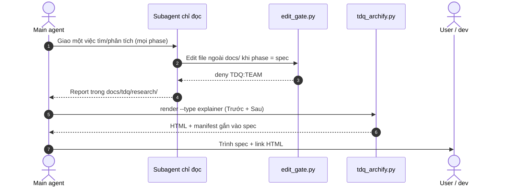

# SPEC — Spec có sơ đồ Trước/Sau, subagent chỉ đọc, DoD bám nghiệp vụ

Ngày: 2026-11-02 · Bản: 1.0 · Brief: ../brief/2026-11-02-1157-nang-cap-spec-subagent.md · Lane: full
Soul: chất lượng > runtime > context cost · luật gốc: skills/tdq-conventions/references/soul.md
Trạng thái: CHỜ DUYỆT

## Mục lục

- 1. Mục tiêu & phạm vi
- 1b. Lộ trình
- 2. Đầu ra cụ thể
- 2b. Ranh giới module
- 2c. Luồng hoạt động & Sơ đồ kiến trúc
- 3. Cách tiếp cận & lý do
- 3b. Năng lực & công cụ
- 3c. Giải thuật & Xử lý cốt lõi
- 3d. Mental Model cho Fresher Dev
- 4. Yêu cầu bắt buộc
- 5. Ràng buộc & rủi ro
- 6. QC & Definition of Done
- 7. Câu hỏi còn mở

## 1. Mục tiêu & phạm vi

- Mục tiêu: (1) mọi spec và mini-plan sửa thứ đã có phải cho dev thấy "cơ chế hiện tại" và "sau update" bằng **một trang HTML có sơ đồ Trước và Sau**, chữ chỉ phụ trợ; (2) main agent được mở subagent ở mọi phase để tìm và phân tích, còn subagent không tự sửa project trước phase implement; (3) DoD và test trỏ đúng hành vi nghiệp vụ, kèm thân PR soạn sẵn ở report.
- Trong phạm vi:
  - Luật spec §2c, luật Archify cho pipeline chuyên sâu và pipeline nhanh.
  - Luật subagent ở `tdq-conventions` §9 và một nhánh chặn trong `edit_gate.py` có sẵn.
  - Luật §6 "mỗi dòng truy về nghiệp vụ hoặc luồng cũ phải giữ".
  - Khối "Thân PR" trong mẫu report.
  - Test khoá các luật trên.
- NGOÀI phạm vi:
  - Không sửa `scripts/tdq_archify.py`, `archify_*.py` — lệnh `render --type explainer` đã đủ.
  - Không thêm hook mới, không sửa `hooks/hooks.json`.
  - Không tự tạo PR trên GitHub (user chọn 4A).
  - Không chặn subagent ghi qua shell (`Bash`/`PowerShell`) — ghi lại ở §5.
  - Không sửa code và test cũ nằm ngoài các vùng ở §2b.

## 1b. Lộ trình

| Bước/phase | Chạy? | Vì sao |
|---|---|---|
| Research web | CÓ (đã xong) | Subagent đọc + tài liệu hooks chính thức về `agent_id` |
| Interview | CÓ (đã xong) | Vòng 1 chốt 5 điểm |
| QC độc lập (agent) | CÓ | `muc_qc=ultra` |
| Chia subagent khi implement | Chờ đo ở plan | `tdq_bench.py simulate` quyết |

## 2. Đầu ra cụ thể

| # | Đầu ra | Đường dẫn/vị trí | Đo "xong" bằng |
|---|---|---|---|
| 1 | §2c mới: "Cơ chế hiện tại vs Sau" do sơ đồ dẫn, bảng chữ phụ trợ; dựng mới ghi "Hiện trạng: chưa có" | `skills/tdq-spec/references/spec-template.md`, `spec-template-huong-dan.md` | test khoá nội dung template |
| 2 | Luật HTML Trước/Sau cho spec: một `explainer` gồm sơ đồ Trước (evidence) và Sau (planned), render + bind bằng lệnh có sẵn | `skills/tdq-spec/references/archify-ba.md` | test khoá + chính spec này có HTML mẫu |
| 3 | Cùng luật cho mini-plan pipeline nhanh, bỏ ngưỡng "≥ 2 module" | `skills/tdq-intake/references/archify-quick.md`, `quick-lane.md` | test khoá |
| 4 | Luật subagent: mở ở mọi phase, mỗi con một việc, trả report; trước implement chỉ ghi `docs/**` | `skills/tdq-conventions/SKILL.md` §9, `references/reminder-codes.md` | test khoá |
| 5 | Nhánh chặn: payload có `agent_id`, phase ≠ implement/qc, file trong project ngoài `docs/` → `deny` mã `TDQ:TEAM` | `hooks/scripts/edit_gate.py` | test hook đỏ → xanh |
| 6 | Luật §6: mỗi dòng QC/DoD truy về một hành vi nghiệp vụ của request hoặc một luồng cũ phải giữ; test viết đỏ trước | `skills/tdq-spec/references/spec-template.md` §6 | test khoá |
| 7 | Khối "Thân PR (soạn sẵn)" ở report: tóm tắt · Trước/Sau (link HTML) · test đã chạy · rủi ro hồi quy | `skills/tdq-build/references/report-template.md` | test khoá |

## 2b. Ranh giới module

| Module | Vùng file | Phụ thuộc module | Đầu ra §2 nào <!-- i18n-allow: canonical spec section names --> |
|---|---|---|---|
| luat-spec | `skills/tdq-spec/references/spec-template.md`, `skills/tdq-spec/references/spec-template-huong-dan.md`, `skills/tdq-spec/references/archify-ba.md` | không | 1, 2, 6 <!-- i18n-allow: canonical spec section names --> |
| luat-quick | `skills/tdq-intake/references/archify-quick.md`, `skills/tdq-intake/references/quick-lane.md` | luat-spec (cùng khuôn HTML) | 3 <!-- i18n-allow: canonical spec section names --> |
| luat-subagent | `skills/tdq-conventions/SKILL.md`, `skills/tdq-conventions/references/reminder-codes.md` | không | 4 <!-- i18n-allow: canonical spec section names --> |
| hook-chan | `hooks/scripts/edit_gate.py` | không (dùng `block`, `effective_phase` có sẵn) | 5 <!-- i18n-allow: canonical spec section names --> |
| luat-report | `skills/tdq-build/references/report-template.md` | không | 7 <!-- i18n-allow: canonical spec section names --> |

File test của từng module do plan khai ở dòng `Chạm:`.

Ranh giới lấy từ người gọi thật: `edit_gate.py` chỉ được `hooks.json` gọi và test chạy qua `run_hook`; `codex_edit_gate.py` chuyển tiếp sang nó nhưng payload Codex không có `agent_id` nên không đổi hành vi. File luật không import nhau, chỉ link.

## 2c. Luồng hoạt động & Sơ đồ kiến trúc

**Bản xem trước Trước/Sau (nội dung chính):** `docs/tdq/spec/2026-11-02-1157-nang-cap-spec-subagent-preview.html` — 4 sơ đồ: luồng spec Trước, luồng spec Sau, ghi file của subagent Trước, ghi file của subagent Sau. Chính trang này là mẫu của luật mới.

Mermaid dự phòng khi máy không có Archify (luồng Sau):

Bảng chữ phụ trợ:

| Khía cạnh | Hiện trạng (Trước) | Thiết kế mới (Sau) |
|---|---|---|
| Sơ đồ trong spec | 1 Mermaid + 1 HTML Archify chỉ vẽ thiết kế mới | 1 HTML vẽ cả Trước và Sau; chữ chỉ giải thích sơ đồ |
| Pipeline nhanh | HTML chỉ khi ≥ 2 module hoặc refactor | Mọi mini-plan sửa thứ đã có |
| Subagent | Luật chỉ quy định tên/model/effort; research ở analyze | Mở ở mọi phase; trước implement chỉ ghi `docs/**`, hook chặn phần còn lại |
| §6 / DoD | Điều kiện đo được, chưa buộc truy về nghiệp vụ | Mỗi dòng nêu hành vi nghiệp vụ hoặc luồng cũ nó bảo vệ |
| Report | Kết thúc bằng câu hỏi commit | Thêm thân PR soạn sẵn, vẫn không tự tạo PR |

## 3. Cách tiếp cận & lý do

- Chọn: sửa luật trong các file có sẵn + một nhánh `if` trong `edit_gate.py`; HTML Trước/Sau dùng dạng `explainer` của Archify qua lệnh `tdq_archify.py render` có sẵn.
- Vì:
  - Thang Ponytail dừng ở bậc 4: Archify đã cài gộp được tối đa 4 sơ đồ native vào một trang; chạy thử 2026-11-02 ra HTML trong 2,0 s, không cần code.
  - Hook nhận `agent_id` khi chạy trong subagent (tài liệu Claude Code hooks, kiểm 2026-11-02) nên phân biệt main/subagent không cần đoán.
  - `edit_gate.py` đã có miễn `docs/**`, hàm `block()` và rào `Chạm:` chặn ghi lệch vùng plan; thêm một nhánh là đủ.
- Mẫu thiết kế giữ ổn định sau nhiều lần đổi:
  - Một người ghi (single writer): chỉ main agent sửa project trước implement.
  - Guard clause trong cổng có sẵn thay vì thêm hook mới.
  - Test cũ là baseline hồi quy: không đổi assert nào, chỉ thêm.
  - Mở rộng file luật bằng cách thêm câu, không viết lại phần đang đúng.
- Đã loại:
  - Lệnh `archify compare architecture` — chỉ so được sơ đồ kiến trúc, không có chữ giải thích cạnh sơ đồ.
  - Tự viết HTML/SVG có nút chuyển Trước/Sau như research gợi ý — thêm code trong khi Archify đã làm được.
  - Hook mới riêng cho subagent — trùng việc với `edit_gate.py`.
  - Mã nhắc mới `TDQ:READONLY` — `TDQ:TEAM` đã là mã cho việc subagent ghi sai chỗ.

## 3b. Năng lực & công cụ

| Skill | Nguồn | Phán quyết | Dùng ở đâu / Lý do loại |
|---|---|---|---|
| tdq-spec, tdq-plan, tdq-build, tdq-conventions, tdq-intake | plugin:tdq-workflow | NỀN | Khung pipeline; cũng là file bị sửa |
| tdq-lean | plugin:tdq-workflow | DÙNG | Soát diff cuối theo Ponytail ultra |
| archify (local) | user | DÙNG | Đầu ra 2: HTML Trước/Sau dạng explainer |
| tdq-browser-test | plugin:tdq-workflow | DÙNG | QC: mở HTML mẫu, chụp ảnh kiểm bố cục (mcp) |
| Đã xét 18 skill khác | user/plugin/built-in | KHÔNG | khác lĩnh vực |

MCP-first: Chrome DevTools cho QC ảnh cần cổng 9222; kiểm kết nối trước khi chạy, thiếu thì báo user bật.

## 3c. Giải thuật & Xử lý cốt lõi

- **Từng bước giải thuật** (nhánh chặn trong `edit_gate.main`, đặt ngay sau dòng miễn `docs/**`):
  1. Bước 1: đã có request đang mở (`state.active_request`) và file đích không nằm trong `docs/`.
  2. Bước 2: `payload["agent_id"]` có giá trị, file nằm trong project, và `effective_phase(state)` không phải `implement` hay `qc`.
  3. Bước 3: đủ cả hai → `block(..., "TDQ:TEAM", 3 dòng lý do)`; thiếu một → chạy tiếp các nhắc và rào cũ y như trước.
- **Độ phức tạp tính toán**:
  - Thời gian (Time Complexity): $O(1)$ — vài phép so chuỗi và một lần đọc state đã có sẵn.
  - Không gian (Space Complexity): $O(1)$ — không thêm cấu trúc dữ liệu.
- **Các ca góc hiểm (Edge Cases & Defensive Handling)**:
  - Không có request mở hoặc state hỏng: hàm đã `return` sớm → không chặn (giữ hành vi fail-open của hook).
  - Payload Codex hoặc main agent không có `agent_id`: không vào nhánh → hành vi cũ.
  - File ngoài project (repo nháp của subagent): không chặn, khớp luật `trong_project` sẵn có.
  - Subagent ở implement/qc: không chặn ở nhánh này; rào `Chạm:` và `TDQ:TICK` cũ vẫn chặn khi lệch plan.

## 3d. Mental Model cho Fresher Dev

- **Ẩn dụ trực quan (Analogy)**: Main agent là kiến trúc sư trưởng giữ bản vẽ; subagent là khảo sát viên được vào mọi phòng, đo đạc và viết biên bản (`docs/`), nhưng chỉ được cầm búa khi công trình đã sang giai đoạn thi công (implement) và đúng phòng ghi trong bản vẽ (`Chạm:`). Bản HTML Trước/Sau là ảnh chụp căn nhà trước khi sửa đặt cạnh bản vẽ sau khi sửa.
- **Thuật ngữ dự án (Glossary)**:
  - `explainer`: dạng trang của Archify gồm panel chữ và tối đa 4 sơ đồ native.
  - `agent_id`: trường Claude Code gắn vào input hook khi hook chạy trong subagent.
  - `TDQ:TEAM`: mã chặn khi subagent ghi vào chỗ nó không được ghi.
  - `evidence-kind`: nhãn bằng chứng của sơ đồ — `planned` cho thiết kế, `working-tree`/`committed` cho hiện trạng.

## 4. Yêu cầu bắt buộc

- Log service: nhánh chặn ghi qua `block()` có sẵn (sổ turn + `permissionDecisionReason`); không thêm kênh log mới.
- Không placeholder, không TODO stub. Thay đổi hành vi skill → plan có eval-plan (đối chiếu trước/sau bằng test khoá luật và một ca chặn thật).
- Mỗi thành phần có unit test riêng, chạy được bằng một lệnh.
- Bám SOLID và rule ngôn ngữ trong `skills/tdq-build/references/rules/` (Python: cyclomatic ≤ 10).

## 5. Ràng buộc & rủi ro

Ràng buộc kiến trúc phải giữ (chép từ `docs/kien-truc.md`):
- "`hooks/` được gọi `scripts/`; `scripts/` **không** được import `hooks/`" — chạm ở `edit_gate.py`, chỉ dùng hàm đã import.
- "2026-07-29: hook chỉ nhắc và kiểm bằng hiệu ứng thật, không trả `deny` vì lý do \"chưa duyệt\"" — chạm ở nhánh chặn mới: lý do chặn là "subagent ghi project trước implement", không phải "chưa duyệt".
- "`skills/` chỉ được **nhắc tên lệnh** của `scripts/`" — chạm ở `archify-ba.md`, `archify-quick.md`.

| Rủi ro | Ảnh hưởng | Cách giảm |
|---|---|---|
| Subagent ghi qua shell lách được nhánh chặn | Luật chỉ đọc không kín | Ghi `ponytail:` ở code; luật §9 cấm rõ; nâng cấp khi đo được ca thật |
| Chặn nhầm `tdq-implementer` chạy trước implement | Đội subagent kẹt | Implementer chỉ được giao ở implement; test ca phase implement không chặn |
| Spec dài hơn vì thêm sơ đồ | Tốn context | Sơ đồ nằm ở HTML ngoài spec; spec chỉ giữ link + bảng chữ ngắn |
| Archify thiếu trên máy user | Không ra HTML | Giữ luật dự phòng có sẵn: báo thiếu, dùng Mermaid Trước + Sau |

## 6. QC & Definition of Done

Mỗi dòng nêu hành vi nghiệp vụ hoặc luồng cũ nó bảo vệ.

| # | Hạng mục kiểm | Điều kiện PASS | Đo trước | Dự phòng nếu trượt |
|---|---|---|---|---|
| Q1 | Spec template buộc mục Trước/Sau do sơ đồ dẫn | Test khoá thấy câu luật mới ở §2c và checklist hướng dẫn | — | — |
| Q2 | Pipeline chuyên sâu ra 1 HTML có sơ đồ Trước và Sau | `archify-ba.md` mô tả explainer Trước/Sau; HTML của chính spec này tồn tại và `verify` trả hợp lệ | — | — |
| Q3 | Pipeline nhanh cùng luật | Test khoá thấy `archify-quick.md` bỏ ngưỡng 2 module và nêu Trước/Sau | — | — |
| Q4 | Subagent ghi src trước implement bị chặn | Test hook: payload có `agent_id`, phase `spec`, file `src/` → `deny` + `TDQ:TEAM` (đỏ trước khi sửa, xanh sau) | — | — |
| Q5 | Subagent vẫn ghi được report/log | Test hook: cùng payload, file `docs/tdq/research/` → không `deny` | — | — |
| Q6 | Luồng cũ giữ nguyên | Test hook: main agent (không `agent_id`) phase `spec` → chỉ nhắc; subagent phase `implement` → nhánh mới không chặn; trọn bộ test cũ xanh | — | — |
| Q7 | Luật subagent và luật DoD có mặt | Test khoá thấy §9 của conventions và câu luật ở §6 template | — | — |
| Q8 | Report có thân PR soạn sẵn | Test khoá thấy khối "Thân PR" trong mẫu report | — | — |
| Q9 | HTML mẫu đọc được bằng mắt | Mở HTML qua trình duyệt, ảnh chụp thấy đủ 4 sơ đồ có nhãn | — | — |
| Q10 | Diff tối thiểu | `tdq-lean` không nêu phần nào xoá được; không file `scripts/` nào đổi | — | — |

DoD: Q1–Q10 PASS; test hook có bằng chứng đỏ → xanh; trọn bộ test xanh ở cổng QC; HTML mẫu kèm ảnh chụp (Vision Test Loop); report có thân PR.

## 7. Câu hỏi còn mở
<!-- tdq-archify-binding:start -->
<!-- manifest: 2026-11-02-1157-nang-cap-spec-subagent-preview.manifest.json -->
<!-- manifest_digest: af68d05d3cd625f6fe737ab7c7574f42902f1bceec0718a0db457094a4eaeb0a -->
<!-- tdq-archify-binding:end -->