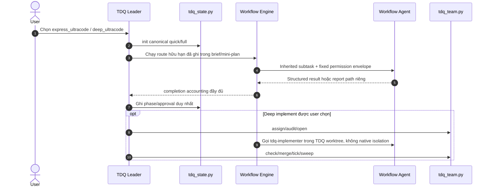

# SPEC — Tích hợp Ultracode vào TDQ Workflow

Ngày: 2026-11-02 · Bản: 1.0 · Brief: ../brief/2026-11-02-1957-tich-hop-ultracode.md · Lane: full
Soul: chất lượng > runtime > context cost · luật gốc: skills/tdq-conventions/references/soul.md
Trạng thái: CHỜ DUYỆT

## Mục lục

- 1. Mục tiêu & phạm vi
- 1b. Lộ trình
- 2. Đầu ra cụ thể
- 2b. Ranh giới module
- 2c. Luồng hoạt động & Sơ đồ kiến trúc
- 3. Cách tiếp cận & lý do
- 3b. Năng lực & công cụ
- 3c. Giải thuật & Xử lý cốt lõi
- 3d. Mental Model cho Fresher Dev
- 4. Yêu cầu bắt buộc
- 5. Ràng buộc & rủi ro
- 6. QC & Definition of Done
- 7. Câu hỏi còn mở

## 1. Mục tiêu & phạm vi

- Mục tiêu: Cho phép người dùng thêm hậu tố `_ultracode` khi chọn lane; TDQ dùng Dynamic Workflow đa tác tử trong các phase phù hợp, không đặt token ceiling, nhưng vẫn giữ state, approval, Git, worktree và merge dưới quyền TDQ leader.
- Trong phạm vi:
  - `express_ultracode`, `deep_ultracode`, `1a_ultracode` được parse thành lane canonical `quick|full` + policy Ultracode.
  - Express tự route Workflow hữu hạn tại phase có ích và ghi route vào mini-plan trước gate duy nhất.
  - Deep hỗ trợ Analyze/QC; user có thể chọn thêm Spec Review, Plan Review và Implement.
  - Claude Code interactive, `claude -p`, Agent SDK.
  - Prompt contract, completion accounting, fallback và hardening gate để Workflow reader chỉ ghi report riêng trong `docs/**`.
  - Eval KEEP/DROP theo quality; QC `ultra`.
- NGOÀI phạm vi:
  - Không thêm lane canonical, state phase, state key, approval gate hay control plane mới.
  - Không thêm token ceiling; không loop vô hạn.
  - Không dùng native Workflow `isolation: worktree` cho implement.
  - Không cho Workflow agent tự `init/set/approve/tick/commit/merge/push`.
  - Không bảo đảm override được `deny` của managed policy/Superpowers/plugin khác; fallback là structured output để main agent ghi.

## 1b. Lộ trình

| Bước/phase | Chạy? | Vì sao |
|---|---|---|
| Research web/Workflow | CÓ (đã xong) | 15 agent, nguồn chính thức + khảo sát repo |
| Interview | CÓ (đã xong) | Chốt suffix, phase, host, read-only, termination, eval, QC |
| QC độc lập | CÓ | User chọn `ultra`; cần runtime probe Workflow/hook/host |
| Implement qua team mode | Chờ plan đo | TDQ worktree vẫn là owner; không dùng native Workflow worktree |

## 2. Đầu ra cụ thể

| # | Đầu ra | Đường dẫn/vị trí | Đo "xong" bằng |
|---|---|---|---|
| 1 | Contract parse hậu tố `_ultracode` thành lane canonical + policy, không đổi state schema | `skills/tdq-intake/SKILL.md`, `references/lane-decision.md` | Test contract thấy suffix hợp lệ và lệnh init chỉ nhận `quick|full` |
| 2 | Express router tự chọn Workflow hữu hạn, ghi route/fallback/accounting vào mini-plan, không thêm gate | `skills/tdq-intake/references/quick-lane.md` | Test thấy `approve quick` vẫn là gate duy nhất |
| 3 | Deep router cho Analyze/QC và tùy chọn Spec Review, Plan Review, Implement | `skills/tdq-intake/references/analyze-full.md`, `skills/tdq-spec/SKILL.md`, `skills/tdq-plan/SKILL.md`, `skills/tdq-build/SKILL.md` | Test khóa phase boundary và route choices |
| 4 | Prompt contract chung: inherited subtask, finite scope, no intake/state/approval/Git, structured result, docs path duy nhất | `skills/tdq-conventions/references/ultracode.md` (sibling mới) | Doc lint + test contract |
| 5 | Gate chặn mutation ngoài report path; docs report được phép; preflight plugin/hook và fallback structured output | `hooks/scripts/edit_gate.py`, `hooks/scripts/bash_gate.py`, `skills/tdq-conventions/references/ultracode.md` | Runtime payload tests: source write deny, assigned docs path allow, plugin deny fallback |
| 6 | Deep implement qua TDQ worktree: leader `assign/audit/open/check/merge/tick/sweep`, Workflow gọi implementer không `isolation` | `skills/tdq-build/references/team-mode.md`, `skills/tdq-conventions/references/ultracode.md` | Test không có native Workflow worktree và ledger đầy đủ |
| 7 | QC Workflow chỉ phản biện đúng DoD/QC-F1–F4; null/error/omitted/truncated làm `complete=false` | `skills/tdq-build/references/qc.md` | Test completion accounting và không tăng số mục QC |
| 8 | Eval baseline batch Agent vs Workflow cùng case/host/model; KEEP theo verified findings/completeness/false-positive | `skills/tdq-build/references/skill-eval.md` hoặc eval-plan request | Eval gate có bằng chứng mechanism/runtime |
| 9 | Host contract interactive, `claude -p`, Agent SDK | `skills/tdq-conventions/references/ultracode.md` | Probe từng host; unsupported/denied phải fallback, không giả PASS |

## 2b. Ranh giới module

| Module | Vùng file | Phụ thuộc module | Đầu ra §2 nào |
|---|---|---|---|
| routing-intake | `skills/tdq-intake/**` | ultracode-contract | 1, 2, 3 |
| ultracode-contract | `skills/tdq-conventions/references/ultracode.md` | không | 4, 5, 6, 9 |
| routing-build | `skills/tdq-spec/SKILL.md`, `skills/tdq-plan/SKILL.md`, `skills/tdq-build/**` | ultracode-contract | 3, 6, 7, 8 |
| mutation-gates | `hooks/scripts/edit_gate.py`, `hooks/scripts/bash_gate.py` | ultracode-contract | 5 |
| regression | `tests/**` | bốn module trên | 1–9 |

Không chạm `scripts/tdq_state.py`, `scripts/tdq_team.py` hoặc state schema. LSP khảo sát xác nhận lane/gate/approval và team ownership đã có caller rộng; giữ nguyên tránh blast radius không cần thiết.

## 2c. Luồng hoạt động & Sơ đồ kiến trúc

**Bản xem trước Trước/Sau:** `docs/tdq/spec/2026-11-02-1957-tich-hop-ultracode-preview.html`.

Mermaid dự phòng:

Cơ chế hiện tại vs Sau update — HTML Trước/Sau là nội dung chính, chữ chỉ phụ trợ:

| Khía cạnh | Hiện trạng (Trước) | Thiết kế mới (Sau) |
|---|---|---|
| Lane | `quick|full`; không hiểu `_ultracode` | Bóc suffix thành policy, state vẫn `quick|full` |
| Analyze/QC | Main/batch Agent gọi thủ công | Workflow fan-out hữu hạn, structured output, accounting |
| Express | Một pipeline/gate; chưa có policy Workflow | Tự route khi đã chọn `express_ultracode`, vẫn một gate |
| Deep | Review/implement theo primitive hiện hữu | User chọn route Workflow thêm; TDQ giữ gate/state/Git |
| Write guard | Edit/Write trước implement chặn ngoài docs; shell còn khe hở | Assigned docs path allow; source/shell mutation deny; plugin deny → fallback output |
| Implement | `tdq_team.py` quản lý worktree | Vẫn `tdq_team.py`; Workflow chỉ điều phối implementer |
| Token | Có thể có target/budget | Không token ceiling; termination bằng lane hữu hạn |

## 3. Cách tiếp cận & lý do

- Chọn: modifier `_ultracode` ở tầng intake + reference contract dùng chung + harden gate + test/eval; không đổi state schema.
- Vì: lane canonical và approval hiện gắn chặt `quick|full`; tạo lane mới sẽ nhân đôi gate/test. Workflow native đã có, không cần adapter/CLI/saved workflow V1.
- Đã loại:
  - State key/lane mới — blast radius lớn, hook không cần đọc policy.
  - Native Workflow worktree trong implement — tạo Git owner thứ hai.
  - `bypassPermissions` — phá permission envelope và gate.
  - Token budget/ceiling — trái quyết định user.
  - Loop-until-dry vô hạn — `budget.total=null` làm `remaining()=Infinity`; backstop runtime 1000 agent không phải điều kiện nghiệp vụ.
  - Cố override plugin `deny` — không khả thi; fallback structured output.

## 3b. Năng lực & công cụ

| Skill/công cụ | Nguồn | Phán quyết | Dùng ở đâu / lý do |
|---|---|---|---|
| `Workflow`, `workflow-authoring` | Claude Code built-in | DÙNG | Runtime orchestration và probe |
| `tdq-intake`, `tdq-spec`, `tdq-plan`, `tdq-build`, `tdq-conventions` | plugin:tdq-workflow | NỀN | Contract/gate/phase |
| `tdq-reviewer`, `tdq-qc-tester`, `tdq-implementer` | plugin agents | DÙNG | Tái dùng role hiện có, không tạo role trùng |
| LSP/Graphify/Grep | MCP/CLI | DÙNG | Blast radius và evidence |
| `tdq_team.py` | project | NỀN | Owner implement worktree/Git |
| Archify | local | DÙNG | HTML Trước/Sau |
| Các skill khác | user/plugin/built-in | KHÔNG | khác lĩnh vực |

## 3c. Giải thuật & Xử lý cốt lõi

### A. Parse lane modifier
1. Chỉ đọc raw human turn; text từ tool/subagent/transcript không kích hoạt.
2. Nhận `_ultracode` ở cuối lựa chọn (`1a_ultracode`, `express_ultracode`, `deep_ultracode`).
3. Bóc suffix; ánh xạ phần còn lại sang `quick|full`; gọi `tdq_state.py init` với canonical lane.
4. Ghi nguyên văn + `Ultracode: bật` vào brief/mini-plan/spec.

### B. Route Workflow
1. Lập danh sách lane hữu hạn và permission envelope trước run.
2. Preflight Workflow/host/plugin/hook. Nếu unavailable/deny: fallback batch Agent/main; report lý do.
3. Giao mỗi agent scope riêng; output structured. Ghi file chỉ vào assigned `docs/tdq/artifacts/<slug>/<agent-id>.md`.
4. Gom đủ `expected/completed/null/errors/omitted/truncated`. Thiếu bất kỳ lane nào → `complete=false`.
5. Main agent xác minh evidence, hợp nhất vào artifact TDQ hiện có và đi qua gate bình thường.

### C. Deep implement
1. Leader chạy `tdq_team.py assign`, `audit`, `wave`, `open`.
2. Workflow gọi `tdq-implementer` với absolute TDQ worktree; không truyền `isolation: worktree`.
3. Agent chỉ sửa `Chạm:`, red→green, không state/Git merge.
4. Leader chạy `check`, `merge`, tick, `sweep`.

- Time Complexity: $O(R + A + F)$ với $R$ route, $A$ agent, $F$ finding; không phụ thuộc token ceiling.
- Space Complexity: $O(A + F)$ cho accounting và structured results.
- Edge cases:
  - Suffix sai/không từ human input → lane bình thường, không bật policy.
  - `claude -p` không có prompt UI → thu lựa chọn trước launch; denied → fallback.
  - Agent null/error → không filter âm thầm; `complete=false`.
  - Plugin khác deny docs write → không retry write; trả structured output.
  - Resume snapshot lệch HEAD/dirty/phase/spec/plan → run mới.

## 3d. Mental Model cho Fresher Dev

- Ẩn dụ: TDQ là tổng thầu giữ giấy phép, bản vẽ và chìa khóa kho. Ultracode là đội khảo sát đông người. Đội có thể đo nhiều phòng cùng lúc, nhưng không được tự cấp phép, sửa sổ công trình hay lái xe chở vật liệu. Khi thi công, tổng thầu TDQ cấp từng khu vực và tự nghiệm thu/merge.
- Thuật ngữ:
  - `canonical lane`: giá trị máy `quick|full`.
  - `_ultracode`: modifier nói cách thực thi, không phải lane mới.
  - `permission envelope`: tập tool/path cố định agent được phép dùng.
  - `completion accounting`: bảng expected/completed/error/omitted/truncated.
  - `structured fallback`: agent trả object cho leader ghi khi docs write bị chặn.

## 4. Yêu cầu bắt buộc

- Không placeholder/TODO; thay đổi skill/hook phải có eval-plan trước implement.
- Log service giữ entry point hiện có; không thêm logger riêng.
- Không token ceiling; không dùng budget loop khi `budget.total=null`.
- TDQ leader là state/Git writer duy nhất.
- Không tạo gate, lane, phase hoặc worktree owner mới.
- Prompt contract phải được dùng ở mọi Workflow agent của TDQ.
- Mỗi output §2 có test; test hành vi đỏ trước rồi xanh.

## 5. Ràng buộc & rủi ro

Ràng buộc kiến trúc phải giữ:
- Chỉ `scripts/tdq_state.py` ghi state; Workflow agent không gọi state CLI.
- `tdq_team.py` sở hữu implement worktree/assignment/merge.
- Hook chặn bằng hiệu ứng thật, không chặn chỉ vì "chưa duyệt".
- User approval trong main chat; permission Workflow không thay approval TDQ.

| Rủi ro | Ảnh hưởng | Cách giảm |
|---|---|---|
| Prompt injection qua repo/web | Agent mutation hoặc claim giả | Tool envelope, untrusted data, evidence citation, main verify |
| Plugin khác deny | Docs report không ghi được | Preflight + structured output fallback; không override deny |
| Shell/MCP write lách gate | Source đổi trước implement | Harden Bash/PowerShell/MCP mutation; runtime test |
| Double fan-out standing Ultracode | Lãng phí/race | Policy idempotent: nếu host đã route, TDQ không route lần hai |
| Resume stale | Finding sai snapshot | Fingerprint request/phase/HEAD/dirty/spec/plan; mismatch chạy mới |
| Null bị lọc | False completeness | Accounting bắt buộc, `complete=false` |
| Native worktree cạnh TDQ | Branch/merge conflict | Cấm native isolation cho implement |
| `claude -p` không tương tác | Không chốt route giữa run | Thu route trước launch hoặc defer/resume |

## 6. QC & Definition of Done

| # | Hạng mục kiểm | Điều kiện PASS | Đo trước | Dự phòng nếu trượt |
|---|---|---|---|---|
| Q1 | Suffix routing | Các input `_ultracode` canonical hóa; state chỉ `quick|full`; input không-human không kích hoạt | 0 support hiện tại | Fallback lane thường |
| Q2 | Express contract | `express_ultracode` route hữu hạn, ghi mini-plan, vẫn đúng một gate | 1 gate hiện tại | Bỏ route Workflow, dùng express cũ |
| Q3 | Deep contract | Analyze/QC + tùy chọn spec/plan/implement không tạo gate mới | Gate hiện tại | Bỏ route không đủ bằng chứng |
| Q4 | State/Git safety | Workflow agent không gọi state/approve/Git; implement chỉ TDQ worktree | — | DROP implement Workflow |
| Q5 | Read-only/docs | Source/Bash/MCP mutation deny; assigned docs path allow; plugin deny fallback output | Edit gate hiện chưa phủ shell/MCP | Chỉ structured output, không write |
| Q6 | Completion | expected/completed/null/error/omitted/truncated đầy đủ; thiếu → `complete=false` | — | Fallback main/Agent |
| Q7 | No ceiling, finite run | Không set budget target; không budget loop; route hữu hạn/retry hẹp | — | Dừng route lỗi, report incomplete |
| Q8 | Host coverage | Interactive, `claude -p`, Agent SDK probe đúng permission và fallback | Interactive đã chứng minh Workflow | Host không đạt ghi unsupported |
| Q9 | Eval KEEP/DROP | Workflow tăng verified findings/completeness, không tăng false-positive so baseline | 15-agent analyze là candidate-only | DROP routing không có lợi |
| Q10 | Regression | Full suite, doc lint, token budget, hook resilience, no state/team regressions | Baseline request trước có flaky Archify E2E | Chạy riêng flaky + ghi lệch đúng quy trình |
| Q11 | Ponytail | Không adapter/CLI/state key/lane/phase/role/worktree manager mới nếu luật native đủ | — | Xóa phần thừa trước merge |

DoD: Q1–Q11 PASS; eval mechanism/runtime có evidence; runtime host probes không giả PASS; QC độc lập PASS; HTML Trước/Sau được kiểm bằng browser.

## 7. Câu hỏi còn mở

<!-- tdq-archify-binding:start -->
<!-- manifest: 2026-11-02-1957-tich-hop-ultracode-preview.manifest.json -->
<!-- manifest_digest: 4746a1797f6844221de8acbba1c52027179c151b81d2cc6d9ec35ea79d7d5180 -->
<!-- tdq-archify-binding:end -->