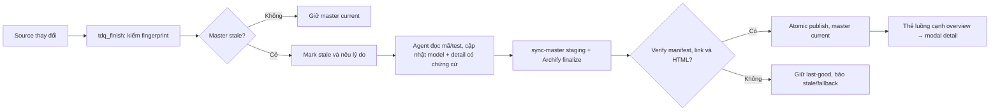

# SPEC — Master kiến trúc Archify có luồng chi tiết

Ngày: 2026-11-04 · Bản: 1.0 · Brief: ../brief/2026-11-03-2055-master-archify-va-trinh-bay.md · Lane: full
Soul: chất lượng > runtime > context cost · luật gốc: skills/tdq-conventions/references/soul.md
Trạng thái: CHỜ DUYỆT

## Mục lục

- 1. Mục tiêu & phạm vi
- 1b. Lộ trình
- 2. Đầu ra cụ thể
- 2b. Ranh giới module
- 2c. Luồng hoạt động & Sơ đồ kiến trúc
- 3. Cách tiếp cận & lý do
- 3b. Năng lực & công cụ
- 3c. Giải thuật & Xử lý cốt lõi
- 3d. Mental Model cho Fresher Dev
- 4. Yêu cầu bắt buộc
- 5. Ràng buộc & rủi ro
- 6. QC & Definition of Done
- 7. Câu hỏi còn mở

## 1. Mục tiêu & phạm vi

- Mục tiêu: project dùng TDQ-Workflow có một master Archify HTML ở `docs/architecture/index.html`, mở được overview và thẻ luồng con; master được kiểm freshness khi kết turn, dựng và verify lại trước nghiệm thu request thay đổi source. Không gọi một HTML stale là kiến trúc mới nhất.
- Trong phạm vi: trình bày master overview + thẻ/link flow cạnh sơ đồ, modal trong cùng HTML; diagram con có bước và nguồn thật; sửa pipeline model/render/freshness và luật lifecycle; kiểm hiện trạng TDQ-Workflow bằng browser.
- Mặt LOẠI: sửa engine Archify để click trực tiếp node; tự đoán data/security flow từ graph; auto-refresh tại mọi tool call/SessionStart; thay soul/setup/user-instruction và style trình bày (request kế tiếp).
- Dự án docs-only/rỗng: overview nêu rõ không có code flow; không dựng luồng mẫu thành sự thật.
- Không cài gói mới, không sửa repo engine Archify, không gọi model/API ngoài để vẽ tự động. Source-backed detail do agent chọn từ mã/test hiện tại; thiếu bằng chứng ghi “chưa xác minh”.

## 1b. Lộ trình

| Bước/phase | Chạy? | Vì sao |
|---|---|---|
| Analyze + scope/detail interview | CÓ | Đã chốt modal/link, độ chi tiết, cổng refresh, fallback và QC. |
| Web research | BỎ | Engine/source/test local là nguồn trực tiếp, không còn unknown bên ngoài. |
| Spec + preview Before/After | CÓ | Thiết kế master mới phải tách khỏi bản stale; hình trước/sau là planned. |
| Plan + eval-plan | CÓ | Skill/lifecycle thay đổi cần khóa phép đo trước code. |
| Implement theo TDQ team | CÓ | Adapter/master/lifecycle/tests có vùng file nóng; chia wave. |
| QC ultra + browser test + agent QC độc lập | CÓ | Kiểm link/modal/keyboard, stale/current, fallback, evidence. |
| Report | CÓ | Báo master current có receipt hoặc nêu stale/fallback đúng sự thật. |

## 2. Đầu ra cụ thể

| # | Đầu ra | Đường dẫn/vị trí | Đo “xong” bằng |
|---|---|---|---|
| O1 | Master HTML: overview và thẻ flow mở diagram con trong modal | `docs/architecture/index.html`, view/candidate trong bundle, `docs/tdq/models/` | Link mở đúng diagram con, bàn phím/đóng trả focus; diagram có nguồn hoặc nhãn chưa xác minh. |
| O2 | Hợp đồng model và adapter kiểm điểm neo của thẻ/diagram, bundle atomic | `scripts/tdq_archify.py`, `scripts/archify_model.py`, `scripts/archify_artifacts.py` hoặc module đã có phù hợp | ID/link sai, nguồn sai hoặc render lỗi phải fail-closed; last-good không mất. Không thêm wrapper/framework. |
| O3 | Freshness ở kết turn và nghĩa vụ refresh+verify trước report/merge của request chạm source | `scripts/tdq_finish.py`, `skills/tdq-build/references/archify-lifecycle.md` và cổng workflow hiện có | Source/candidate/model đổi thì báo stale; refresh thành công mới báo current; lỗi giữ last-good và chỉ ra nguyên nhân. Không refresh trong hook hoặc mỗi tool call. |
| O4 | Spec Before/After, QC/receipt, eval-plan cho thay đổi skill | `docs/tdq/spec/`, `docs/tdq/artifacts/2026-11-03-2055-master-archify-va-trinh-bay/`, `docs/tdq/qc/` | Preview bind valid; test unit+browser thực; eval đúng provenance, thiếu metric thì INCONCLUSIVE. |

## 2b. Ranh giới module

| Module | Vùng file | Phụ thuộc module | Đầu ra §2 nào |
|---|---|---|---|
| Master model/render | `scripts/tdq_archify.py`, `scripts/archify_model.py`, `docs/tdq/models/`, `docs/architecture/` | `archify_artifacts`, engine Archify local | O1, O2 |
| Manifest/freshness | `scripts/archify_artifacts.py`, `scripts/archify_delivery.py` | source fingerprint, bundle atomic của module render | O2, O3 |
| Workflow lifecycle | `scripts/tdq_finish.py`, `skills/tdq-build/references/archify-lifecycle.md` | status/sync của adapter; không import hook | O3 |
| Kiểm & hồ sơ | `tests/` (các bài kiểm Archify hiện có), `docs/tdq/spec/`, `docs/tdq/qc/`, `docs/tdq/artifacts/2026-11-03-2055-master-archify-va-trinh-bay/` | ba module trên | O4 |

Ranh giới dựa trên caller hiện có: `tdq_finish.step_archify` chỉ gọi `archify_artifacts.mark_stale`; CLI `tdq_archify` gọi `archify_model.validate_model`, `archify_delivery.run_finalize`, `archify_artifacts.build_manifest/check_manifest/publish_bundle`. Không nhập engine JS vào CLI Python; không nhúng renderer mới.

## 2c. Luồng hoạt động & Sơ đồ kiến trúc

**HTML Trước/Sau đã bind:** `2026-11-03-2055-master-archify-va-trinh-bay-preview.html` với manifest cùng basename. Đây là **thiết kế planned**, không phải bằng chứng runtime. Trước: `docs/architecture/index.html` chỉ liệt kê view rời, manifest hiện stale; native node mở Passport/focus, không mở detail. Sau: một trang master explainer có overview, thẻ luồng trỏ diagram con; từng diagram có nguồn, status và link. Không sửa node native. Preview không thay cho master current của sản phẩm.

| Khía cạnh | Trước | Sau |
|---|---|---|
| Điểm vào | index tĩnh liệt kê sáu HTML view rời | một master HTML với overview và thẻ flow kế bên |
| Đi sâu | click node chỉ focus + Passport; view rời bằng link | click thẻ mở modal diagram con đúng ID; Esc/đóng trả focus |
| Freshness | `tdq_finish` đánh dấu stale; refresh thủ công | vẫn check ở finish; trước report/merge yêu cầu sync+verify hoặc báo last-good/stale rõ |
| Bằng chứng | graph/HTML có thể cũ dù nhìn đầy đủ | nguồn/manifest/candidate và từng bước phải có chứng cứ; không suy thành trace runtime |

## 3. Cách tiếp cận & lý do

- Chọn: tái dùng Archify `explainer` cho trang master và modal/link; tái dùng source fingerprint, `sync-master` và atomic swap hiện có. Giữ index/view cũ làm last-good trong lúc staged build; kiểm trước khi publish. Thẻ cạnh overview là lựa chọn `1a` cuối.
- Vì: engine native không có node→child diagram link; explainer có `@steps.target` và link block/diagram, modal native viewer cùng HTML; không cần thay engine hoặc thêm JS tự chế.
- Đã loại: tự gắn `onclick` lên SVG node (vi phạm schema/CSP); auto-refresh mỗi hook (làm bẩn repo/chậm turn); lấy login/HTTP/hash từ Graphify `calls` (không có data lineage); refresh trên model cũ rồi gọi current (sai nghĩa freshness).

## 3b. Năng lực & công cụ

| Skill | Nguồn | Phán quyết | Dùng ở đâu / Lý do loại |
|---|---|---|---|
| `tdq-build` + Archify lifecycle | plugin:tdq-workflow | NỀN | Chuyển implement→QC→report và enforce master refresh. |
| `tdq-browser-test` | plugin:tdq-workflow | DÙNG | Browser test thẻ, modal, focus/keyboard và console; preflight Chrome DevTools. |
| Archify `explainer` + `tdq_archify.py` | project | DÙNG | Render/validate/bind master và preview Before/After. |
| LSP + Graphify + Grep | project/MCP | DÙNG | Source-backed flow, đối chiếu caller và vỡ lan; graph stale thì không dùng như evidence. |
| `workflow-authoring` | built-in | DÙNG | Khảo sát/kiểm độc lập cho deep_ultracode, không ghi state/Git. |
| Đã xét các skill khác | plugin/built-in | KHÔNG | khác lĩnh vực |

Preflight: Archify CLI hiện `ready=true` (Node v24.21.0); master `status=stale`. Trước UI test kiểm Chrome CDP endpoint thực, lỗi kết nối thì giữ text/CLI fallback và báo chưa kiểm browser, không giả PASS.

## 3c. Giải thuật & Xử lý cốt lõi

1. **Chụp nguồn:** `tdq_finish` gọi checker hiện có; so model, candidate, child HTML và fingerprint source. Source khác → `stale` với lý do. Không render khi đang ghi từng file.
2. **Agent lập model:** sau thay source, khảo sát symbol/route/test có thật; nhóm overview và các flow con được chọn; với mỗi flow ghi tên bước, nguồn file/dòng và nhãn “chưa xác minh” cho khoảng trống. Project không có code: diagram tổng nêu phạm vi trống, không sinh luồng giả.
3. **Render + bind:** validate ID/link/diagram target; `sync-master` dựng toàn bộ trong staging, check engine receipt/manifest, atomic publish. Cổng trước report/merge chạy `status`; nếu stale thì refresh model và sync, rồi verify. Render lỗi → giữ last-good, không tự tuyên bố current. Nếu chưa thể refresh, báo fallback và lý do ở report (không đồng nghĩa PASS master).
4. **Đọc:** HTML master hiển thị overview và thẻ flow cạnh nó. Thẻ mở modal đúng diagram con; native viewer focus node đã map; Esc và nút đóng trả focus. Thẻ cho flow thiếu bằng chứng chỉ hiển thị “chưa xác minh”, không có diagram bịa.

**Độ phức tạp:** checker giữ $O(F + B)$ thời gian (F file source được fingerprint, B byte của candidate/child), bộ nhớ $O(F)$ cho danh sách hash; render giữ công việc theo tổng sơ đồ $O(V + N + E)$, V view, N node, E cạnh (không khẳng định engine chỉ tuyến tính ở mọi layout). Trang master không nhét toàn bộ graph vào payload; số flow tăng theo bằng chứng đã chọn, không theo mọi symbol.

**Ca góc hiểm:** ID/link trỏ diagram không tồn tại → fail trước publish; graphify stale → đọc source/test trực tiếp, không giả flow; engine lỗi/timeout → giữ bundle cũ và ghi stale; sửa source đồng thời lúc dựng → fingerprint cuối khác snapshot thì không báo current; docs-only → overview minh bạch; cấu hình SACL không thuộc request này.

## 3d. Mental Model cho Fresher Dev

- **Ẩn dụ:** bản đồ nhà ga: trang tổng chỉ nơi có “Quầy Login”; thẻ bên cạnh là cửa mở sơ đồ bên trong quầy; từng mũi tên ở sơ đồ chi tiết cần một tờ chứng cứ (file/test). Lịch tàu đổi thì bản đồ bị dán nhãn “cũ” tới khi người phụ trách xem lại và in bản mới, không tự vẽ đường tàu từ tên ga.
- **Thuật ngữ:** `master` = trang tổng kiến trúc; `flow detail` = một sơ đồ con; `candidate` = nguồn sơ đồ chờ render; `manifest` = danh sách hash dùng xác minh bundle; `stale` = nguồn/bundle đã lệch, không được gọi mới nhất; `last-good` = bản master cũ còn đọc được nhưng phải ghi rõ đã cũ; `Passport` = panel metadata của node native, không phải flow con.

## 4. Yêu cầu bắt buộc

- Log service bật mặc định: timestamp và lý do stale/render failure, tắt được bằng cơ chế log hiện có. Không ghi nội dung nhạy cảm của project vào log/receipt.
- Eval-plan được khóa trước implement vì sửa luật skill/lifecycle; thiếu outcome scorer → INCONCLUSIVE, không tự waive.
- Không placeholder/TODO stub; mỗi thay đổi runtime có test riêng. Tái dùng module hiện có, không thêm framework/phase/hook/dependency.
- Giữ khả năng đọc bundle cũ; không overwrite last-good khi view lỗi; số liệu/report tách “planned”, “working-tree”, “committed”.

## 5. Ràng buộc & rủi ro

Giữ nguyên luật kiến trúc trong `docs/kien-truc.md` (đang NHÁP; đây là ràng buộc workflow theo repo, không tự tuyên bố user đã chốt):
- `hooks/` được gọi `scripts/`; `scripts/` **không** được import `hooks/` — hook chạy trong tiến trình của Claude Code, kéo ngược sẽ buộc CLI phụ thuộc môi trường hook. Không thêm hook, `tdq_finish` gọi adapter CLI.
- `skills/` chỉ được **nhắc tên lệnh** của `scripts/`, cấm chép nội dung script vào skill — lifecycle ghi đường gọi, không copy renderer.
- Chỉ `scripts/tdq_state.py` được ghi `docs/tdq/state.json`; master/checker không ghi state trực tiếp.
- `tests/` gọi được vào mọi tầng; không tầng nào được import `tests/`.

| Rủi ro | Ảnh hưởng | Cách giảm |
|---|---|---|
| Link/ID flow trùng hoặc trỏ sai | Thẻ mở sai modal | Validate cross-reference trước publish; browser click test từng flow. |
| Graph cũ gán nghĩa nhầm cho flow | Tài liệu mô tả sai bảo mật/HTTP | Chỉ ghi điều code/route/test chứng minh; provenance từng bước, “chưa xác minh” nếu thiếu. |
| Refresh trong hook/merge làm tree dirty | Chặn merge/turn hoặc timeout | Check rẻ ở finish; render ở cổng report có owner rõ; không đổi hook. |
| Bất kỳ view render fail | Mất master đang xem | Staging + atomic publish hiện có; giữ last-good, báo stale. |
| Source đổi giữa snapshot và publish | “current” giả | Kiểm fingerprint sau render, từ chối claim current khi lệch. |
| Explainer lớn | Khó đọc/tải chậm | Chỉ chọn flow đã có bằng chứng; đo byte và render browser trên trang thực, không đặt cap suy đoán. |

## 6. QC & Definition of Done

QC `ultra`: full unit suite, kiểm vùng chạm, browser runtime với fixture project local, agent QC độc lập; mỗi smoke/runtime theo cap hiện có của `tdq-build`. Không upload code cá nhân ra dịch vụ ngoài.

| # | Hạng mục kiểm | Điều kiện PASS | Đo trước | Dự phòng nếu trượt |
|---|---|---|---|---|
| Q1 | Master overview + drill-down | `index.html` có overview và thẻ flow mở đúng diagram modal; bàn phím/đóng trả focus, không lỗi console | Portal hiện 6 view rời, không có thẻ flow | Báo browser UNSUPPORTED nếu CDP hỏng; không tuyên bố UI PASS |
| Q2 | Flow có bằng chứng | Mỗi bước có file/line hoặc test; khoảng trống ghi “chưa xác minh”; không tự khẳng định password/HTTP | Graph hiện thiếu lineage, 94/381 file Python có node | Chỉ hiện component/call edge có thật và gắn giới hạn |
| Q3 | Freshness | Đổi source/model/candidate/child khiến stale; sync+verify xong mới current; source đổi lúc render không claim current | Master hiện stale 44 lý do; check ~59–62ms trên 162 file | Giữ last-good + báo stale, không ghi giả current |
| Q4 | Lifecycle | Kết turn kiểm stale; trước report/merge của request sửa source bắt refresh+verify hoặc fallback minh bạch; không chạy refresh mỗi hook | Finish hiện chỉ mark_stale, report chưa enforce | Báo master stale rõ trong report nếu engine không chạy; không ép bypass gate bằng cách sửa status |
| Q5 | Atomic/portability | Render fail không mất master cũ; docs-only/rỗng có overview trung thực; không thêm dependency/permission/hook | Publish bundle đã atomic; test docs-only chưa có | Text fallback khi engine thiếu; giữ last-good nếu có |
| Q6 | Trước/Sau + QC/eval | Preview planned bind valid; test full & browser có receipt; eval skill có source identity và kết luận đúng chứng cứ | Preview trước chưa có; eval-plan chưa lập | Không gọi lỗi render/thiếu eval là PASS; ghi INCONCLUSIVE và trình gate thật |

DoD: O1→Q1/Q2, O2→Q3/Q5, O3→Q3/Q4, O4→Q6. HTML chỉ gọi current sau khi manifest và source fingerprint đúng; kiểm desktop/mobile, keyboard/focus, network/console, file có thật. Không commit/push/release khi chưa được yêu cầu.

## 7. Câu hỏi còn mở
<!-- tdq-archify-binding:start -->
<!-- manifest: 2026-11-03-2055-master-archify-va-trinh-bay-preview.manifest.json -->
<!-- manifest_digest: 1ac5d4b04ddf5f20b6642d7fcb213144a47cca5978d8c0e15490ab8bace96b59 -->
<!-- tdq-archify-binding:end -->