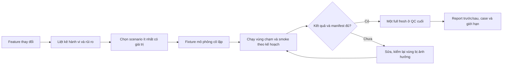

# SPEC — Test TDQ-Workflow theo tính năng, ít nhưng giữ chất lượng

Ngày: 2026-11-05 · Bản: 1.0 · Brief: ../brief/2026-11-05-1448-test-chat-luong-it-lap.md · Lane: full
Soul: chất lượng > runtime > context cost · luật gốc: skills/tdq-conventions/references/soul.md
Trạng thái: CHỜ DUYỆT

## Mục lục
- 1. Mục tiêu & phạm vi
- 1b. Lộ trình
- 2. Đầu ra cụ thể
- 2b. Ranh giới module
- 2c. Luồng hoạt động & Sơ đồ kiến trúc
- 3. Cách tiếp cận & lý do
- 3b. Năng lực & công cụ
- 3c. Giải thuật & Xử lý cốt lõi
- 3d. Mental Model cho Fresher Dev
- 4. Yêu cầu bắt buộc
- 5. Ràng buộc & rủi ro
- 6. QC & Definition of Done
- 7. Câu hỏi còn mở

## 1. Mục tiêu & phạm vi

- Mục tiêu: TDQ tạo **ít test cần thiết nhưng bắt lỗi có giá trị**, nhóm theo tính năng và hành vi thực tế. Mỗi scenario có người dùng/đầu vào mô phỏng cô lập, kết quả mong đợi và rủi ro được bảo vệ; không tăng case chỉ để đủ con số. Trước khi chạy test, chốt tập chọn, thứ tự và lý do; hạn chế chạy lại khi bằng chứng cùng nguồn còn hợp lệ, nhưng cổng QC cuối vẫn có một lượt full fresh.
- Trong phạm vi: luật TDQ hướng dẫn agent chọn/viết test cho repo TDQ và project khác; tổ chức scenario thực của TDQ, fixture mô phỏng nguồn/hook/state/runner thay vì bịa luồng login; lập smoke set theo tính năng/rủi ro, kiểm identity từng case; nhận diện test trùng/ít giá trị bằng chứng cứ, không xóa ồ ạt. Điều phối lượt chạy trong implement/QC và báo `executed`, `reused`, `joined` riêng.
- Mặt LOẠI: không đổi `.github/workflows/test.yml` hoặc lịch CI; không đặt hard-cap 100–200 case lên cả repo; không bỏ test bảo mật, mất dữ liệu, permission, lỗi từng gặp; không thêm một test framework khi stdlib/pytest có sẵn; không trả PASS từ mock luôn thành công; không dùng mẫu login giả cho repo TDQ.
- Mục tiêu thời gian **chỉ cho smoke**, không áp vào QC trọn bộ: khuyến nghị `full` không quá 5 phút, `ultra` không quá 10 phút trên cùng máy; `ultra` có thể nới khi bảo vệ chất lượng cần, nhưng phải ghi số đo và lý do. Không cắt test đúng để vừa ngân sách. `ultra` của request này giữ smoke/runtime thực, agent QC độc lập và full regression.
- Không yêu cầu tải/cài thêm gói hoặc gọi paid model ở bước dựng fixture. Thay đổi luật skill cần eval-plan trước code; thiếu chứng cứ live sẽ ghi `INCONCLUSIVE`, không mạo nhận cải thiện chất lượng.

## 1b. Lộ trình

| Bước/phase | Chạy? | Vì sao |
|---|---|---|
| Analyze: Workflow khảo sát + phản biện theo runner, luật và inventory | CÓ — đã làm | Đối chiếu code, ca lịch sử và rủi ro; không gọi số case là KPI. |
| Research ngoài repo | CÓ — đã làm | Pytest marker, fixture và cache là khả năng, không suy hiệu quả chưa đo. |
| Spec/Plan hai cổng duyệt + review độc lập | CÓ | Đổi luật test và QC là thay đổi rủi ro cao; user phải duyệt trước code. |
| Implement có chứng cứ red→green | CÓ sau duyệt plan | Tái dùng runner/manifest/receipt có sẵn; không thêm dependency. |
| Workflow implement song song trên file nóng | BỎ | Runner, QC và test có vùng chung; TDQ giữ độc quyền state/Git, không chạy nhiều suite chồng. |
| QC ultra + một full fresh cuối + smoke/runtime + agent độc lập | CÓ | Kiểm chất lượng, không dùng receipt cũ thay kết luận cuối. |
| Report Markdown + Archify HTML | CÓ | Trước/sau, case bảo vệ/chưa kiểm, thời gian đo, giới hạn và ngưỡng trượt. |

## 2. Đầu ra cụ thể

| # | Đầu ra | Đường dẫn/vị trí | Đo “xong” bằng |
|---|---|---|---|
| O1 | Luật chọn và viết test theo feature, không spam test | `skills/tdq-build/references/vision-test-loop.md`, `skills/tdq-build/SKILL.md` và reference TDQ liên quan | Given–When–Then cho hành vi mới/rủi ro thật, giải thích mỗi case giữ hoặc bỏ; không ép số scenario khi không có rủi ro tương ứng. |
| O2 | Cách chọn và sắp xếp smoke nhỏ, tách full regression | `scripts/tdq_test.py`, manifest/receipt hiện có hoặc các file luật liên quan | Có danh sách case/feature/risk và thứ tự trước khi chạy; không mất test liên quan/fail-closed; giữ `tron-bo --fresh --reuse off` đúng một lượt ở QC cuối nếu không có fix. |
| O3 | Simulation data và kiểm chứng tình huống thực của TDQ | `tests/` + fixture/receipt request | Chạy luồng CLI/state/hook/runner thật với dữ liệu tạm cô lập; lỗi và đường phục hồi được assert theo output; không bịa feature chưa có. |
| O4 | QC và báo cáo thời gian/chất lượng đối chiếu trước–sau | `docs/tdq/artifacts/2026-11-05-1448-test-chat-luong-it-lap/`, `docs/tdq/qc/`, `docs/tdq/reports/` | Đo chọn case, số lượt executed/joined/reused, kết quả và thời gian smoke theo mức QC; không đánh đồng số case giảm với phát hiện lỗi tốt hơn. |

## 2b. Ranh giới module

| Module | Vùng file | Phụ thuộc module | Đầu ra §2 nào |
|---|---|---|---|
| Chọn & điều phối test | `scripts/tdq_test.py`, `scripts/tdq_test_report.py` | `tdq_test_manifest`, `tdq_test_receipt`, `tdq_test_result`, `tdq_test_process` | O2, O4 |
| Bằng chứng & identity test | `scripts/tdq_test_manifest.py`, `scripts/tdq_test_receipt.py`, `scripts/tdq_test_result.py`, `scripts/tdq_test_process.py` | pytest, process wrapper; runner gọi module này, không import ngược hooks | O2, O4 |
| Luật workflow | `skills/tdq-build/SKILL.md`, `skills/tdq-build/references/qc.md`, `skills/tdq-build/references/runtime-speed.md`, `skills/tdq-build/references/vision-test-loop.md`, `skills/tdq-intake/references/quick-lane-qc.md` | CLI trên chỉ được nhắc tên, không copy thuật toán | O1, O2 |
| Test và fixture | `tests/` (module runner/receipt, case feature có thật), `docs/tdq/artifacts/2026-11-05-1448-test-chat-luong-it-lap/` | gọi CLI/luật; không code runtime import test | O3, O4 |

Ranh giới có chứng cứ từ `mcp__lsp__find_references` và `graphify affected` hai bước: `tdq_test.py` gọi `tdq_test_manifest` (collect/outcome), `tdq_test_receipt` (fingerprint/reuse), `tdq_test_result` (verdict); `tdq_runtime_bench.py` là downstream của runner. `tests/` không import vào runtime. Chỉ sửa các module thật cần khi plan khảo sát test đỏ, tránh đổi cả bốn module chỉ để thêm một bộ smoke.

## 2c. Luồng hoạt động & Sơ đồ kiến trúc

**HTML Trước/Sau (thiết kế planned):** `2026-11-05-1448-test-chat-luong-it-lap-preview.html` + manifest bind cùng tên; không thay bằng chứng runtime. Source hiện tại: `tdq_test.py` có `vung-cham`, `tron-bo` và manifest, nhưng luật đặt tối thiểu 1 luồng chính + 2 biên + 1 lỗi cho *mỗi* feature, QC deep chạy full và receipt reuse mặc định off. Sau thiết kế: mỗi scenario gắn rủi ro thật, tập smoke được chọn và báo riêng, chỉ một lượt full fresh ở cuối.

| Khía cạnh | Hiện trạng (Trước) | Thiết kế mới (Sau) |
|---|---|---|
| Test được viết | Minimum theo 3 tier bất kể rủi ro; test contract có cả source-string | Chọn theo feature/risk, assert output thật; chỉ thêm case khi phân biệt hành vi hoặc lỗi đã biết. |
| Test được chạy | Vùng chạm trực tiếp khi implement, QC full + DoD/ultra có thể lặp module | Lập selection/chi phí trước khi chạy; task/DoD dùng cùng evidence trong vòng khi hợp lệ; full fresh cuối. |
| Báo cáo | Đếm pass/skip/fail và ngân sách full, chưa tách scenario nghiệp vụ | Bảng feature→case→risk→provenance, thời gian smoke và trượt ngưỡng có lý do. |

## 3. Cách tiếp cận & lý do

- Chọn: trước tiên đo baseline selection/smoke bằng fixture tái lập, lập bản đồ feature→risk→test; bỏ test lặp chỉ khi hai case có cùng mục tiêu và một case còn lại vẫn phát hiện lỗi (negative/mutation hoặc lỗi từng gặp). Tái dùng `tdq_test.py`/manifest/receipt đã có; thêm marker/fixture chỉ khi có bằng chứng giúp chọn nhanh trên cả pytest lẫn unittest của repo. QC `full`/`ultra` vẫn full fresh cuối; CI không đổi.
- Vì: số case không đại diện chất lượng. Pytest markers chọn nhóm, fixture có scope giúp data cô lập; `--lf` chỉ chạy lỗi trước, **không** thay regression. Nguồn: [pytest markers](https://docs.pytest.org/en/stable/how-to/mark.html), [pytest cache](https://docs.pytest.org/en/stable/how-to/cache.html), [pytest fixtures](https://docs.pytest.org/en/stable/how-to/fixtures.html), [Test Pyramid](https://martinfowler.com/articles/practical-test-pyramid.html).
- Đã loại: xóa hàng loạt để ép 100–200 nodeid; gộp test con thành một assert; biến một bản pass cũ thành kết luận QC mới; mock login trong repo không có login; sửa CI ngoài phạm vi.

## 3b. Năng lực & công cụ

| Skill | Nguồn | Phán quyết | Dùng ở đâu / Lý do loại |
|---|---|---|---|
| `tdq-intake`, `tdq-spec`, `tdq-plan`, `tdq-build`, `tdq-conventions` | plugin:tdq-workflow | NỀN | Cổng duyệt, red→green, QC/report. |
| `tdq-setup` | plugin:tdq-workflow | NỀN | Kiểm LSP; Python module chứng minh liên tệp với `find_references symbols=3`. |
| `tdq-lean` | plugin:tdq-workflow | DÙNG | Rà test trùng/ít giá trị, đề xuất xóa có bằng chứng. |
| `workflow-authoring` | built-in | DÙNG | Khảo sát theo subsystem và QC độc lập hữu hạn; không ghi state/Git. |
| `tdq-browser-test` | plugin:tdq-workflow | KHÔNG | khác lĩnh vực — request không đổi UI, smoke dựa CLI/fixture. |
| Đã xét các skill khác | plugin/built-in | KHÔNG | khác lĩnh vực |

Preflight: LSP module `python:.` đạt qua MCP (3 references), Archify local ready; `graphify` trả lời nhưng index cũ thì chỉ dùng để định hướng, xác nhận lại bằng mã/test. Không có MCP riêng cho pytest; dùng Python/pytest CLI đã cài. Không thêm permission/dependency.

## 3c. Giải thuật & Xử lý cốt lõi

1. **Lập danh sách:** Từ diff/task và feature thật, ghi hành vi người dùng/caller, input mô phỏng, expected output, rủi ro, test hiện giữ rủi ro đó và test không cần chạy lại. Một case mới phải có tín hiệu quan sát khác hoặc lỗi độc lập so với case đã có; trùng thật thì giữ case giá trị hơn.
2. **Chọn và xếp:** Dùng phạm vi `vung-cham` + phụ thuộc từ AST/manifest hiện có; đưa smoke feature/rủi ro cao lên trước trong tập chọn, sau đó test biên/lỗi cần cho thay đổi. Không biết dependency, file ngoài vùng hoặc mapping thiếu → fail-closed chạy rộng/full theo luật cũ, không ghi SKIP thành PASS. Ghi lựa chọn trước khi spawn process; phân biệt case độc lập, subtest và lượt chạy.
3. **Chạy có chứng cứ:** Fixture dùng thư mục/tiến trình test cô lập, không dữ liệu cá nhân. Đối chiếu nodeid dự kiến/thực thi, outcome, cleanup và fingerprint. Cùng lệnh/phạm vi/source trong *một vòng* chỉ dùng lại kết quả khi còn hợp lệ; mặc định reuse off xuyên vòng, không gỡ quy định final fresh. Bị lỗi hoặc đổi source → test lại vùng bị ảnh hưởng; cổng QC cuối một full fresh.
4. **Báo cáo:** Đếm scenario cần thiết, kết quả và số lượt `executed/reused/joined`; đo smoke trên cùng môi trường, báo mục tiêu đạt/trượt không thay đổi nghĩa PASS/FAIL. Thiếu số đo hoặc coverage → `INCOMPLETE`/`INCONCLUSIVE`, không cắt test để lấy mốc. Đây là luật chọn test, không cam kết giảm đủ số lượng trong một lần nếu chưa có baseline đối chiếu.

Độ phức tạp dự kiến của bước chọn: $O(F\times T + E)$ thời gian cho F file đổi, T test source cần so sánh và E quan hệ import/manifest; bộ nhớ $O(T+E)$ cho chọn module và đồ thị. Không gọi phép này là nhanh hơn khi chưa benchmark trên cùng input. Bộ chọn chạy trước process; không quét toàn bộ suite lại chỉ để xếp thứ tự nếu manifest còn hợp lệ.

Ca góc hiểm: (a) input rỗng hoặc chỉ docs → không tạo PASS giả, giữ `SKIP`/lý do hoặc test tài liệu có thật; (b) import không giải được, test đổi tên, dependency ngoài vùng → fallback full; (c) case lỗi/timeout → giữ raw evidence và chạy lại có lý do, không gộp vào PASS; (d) dữ liệu mô phỏng nhạy cảm → dùng giá trị giả, không đọc credential thật; (e) cùng case bị chọn qua nhiều đường → dedup nodeid nhưng không xóa test case.

## 3d. Mental Model cho Fresher Dev

- Ẩn dụ: thay một cửa ở tòa nhà thì kiểm khóa cửa đó và các cửa nối sang nó trước, sau cùng vẫn kiểm lối thoát hiểm của cả tòa nhà một lần. Một checklist chỉ có số dòng nhỏ không chứng minh cửa nào an toàn; mỗi dòng phải nói nó bảo vệ điều gì.
- Glossary: `scenario` = một hành vi đầu–cuối có đầu vào và kết quả mong đợi; `test nodeid` = định danh pytest thu thập, có thể là test tham số; `subtest` = bằng chứng con của một test cha; `smoke` = tập đại diện rủi ro chạy sớm; `vùng chạm` = test liên quan diff và phụ thuộc; `full fresh` = chạy lại toàn suite từ nguồn hiện tại; `receipt` = bằng chứng nguồn/case/kết quả, không tự thay kiểm thử cuối.

## 4. Yêu cầu bắt buộc

- Runtime đổi phải giữ log service có timestamp và tắt được bằng `TDQ_LOG=0`; log chỉ metadata test, không ghi credential hoặc dữ liệu riêng. Giữ phân loại `executed/reused/joined`, không gọi chờ job là chạy lần hai.
- Thay đổi skill/hook cần eval-plan source-bound trước implement; nếu thiếu live outcome scorer, ghi `INCONCLUSIVE` và trình gate thật, không tự tuyên PASS. Không thêm placeholder/TODO stub.
- Mỗi phần thay đổi có test red→green; test kiểm public entry/CLI hoặc side effect thật, không chỉ đếm tên test; tối thiểu theo rủi ro thực chứ không ép ba tier ở mọi thay đổi nếu không có ca tương ứng. Giữ code đơn giản, không thêm interface/framework mới khi stdlib/pytest hiện đủ.
- Trọn bộ QC `ultra` chạy `--fresh --reuse off` sau cùng. Smoke và runtime check mỗi phép vẫn theo trần 120 giây đã có; mục tiêu tổng smoke 5/10 phút là **khuyến nghị** và không tự nới trần 120 giây/per-check.

## 5. Ràng buộc & rủi ro

`docs/kien-truc.md` còn NHÁP; giữ các luật phù hợp với code thực:
- `hooks/` được gọi `scripts/`; `scripts/` **không** được import `hooks/` — runner không phụ thuộc tiến trình hook.
- `skills/` chỉ được **nhắc tên lệnh** của `scripts/`, cấm chép nội dung script vào skill — luật viết scenario không copy thuật toán chọn test.
- Chỉ `scripts/tdq_state.py` được ghi `docs/tdq/state.json`; runner chỉ đọc request và ghi ledger test riêng.
- `tests/` gọi được vào mọi tầng; không tầng nào được import `tests/`.
- Giữ `main` release sạch không chứa `tests/`, `docs/`; mọi file source mới của runner nằm trong `scripts/`.

| Rủi ro | Ảnh hưởng | Cách giảm |
|---|---|---|
| Bộ smoke nhỏ bỏ sót lỗi liên module | PASS giả ở request | Giữ bán kính và fallback full; full fresh cuối; đo module lỗi sót từ lịch sử. |
| Test gộp thành 1 để giảm số | Mất chẩn đoán và identity | So nodeid độc lập/negative case trước và sau; chỉ xóa test thật trùng có chứng cứ. |
| Fixture mô phỏng không giống runtime | Test xanh giả | Chạy public CLI/hook trong fixture cô lập, assert file/exit code/cleanup; tách test runtime/CI riêng. |
| Lượt smoke/full bị lặp | Chậm mà không tăng bằng chứng | Kế hoạch một lần mỗi fingerprint/vòng; full cuối; phân biệt action executed/reused/joined. |
| Mục tiêu 5/10 phút xung đột 120 giây mỗi check | Vi phạm QC ultra | Giữ trần per-check hiện có; báo vượt tổng smoke nếu cần, xin user duyệt khi muốn đổi trần per-check. |
| CI chạy unittest, local runner chạy pytest | Lệch bề mặt kiểm | Không đổi CI; kiểm scenario/fixture tương thích cả hai khi có thể; nói rõ hai bộ không tương đương. |

## 6. QC & Definition of Done

QC `ultra` cho request này: kiểm DoD, test vùng chạm, full suite fresh một lượt tại QC cuối sau khi nguồn ổn, smoke/runtime có deadline 120 giây mỗi phép và agent QC độc lập. Sau sửa QC cuối, chạy lại đúng vùng bị ảnh hưởng; full lại nếu verdict cũ không còn gắn được nguồn. Không chạy root `pytest` quét `docs/` backup.

| # | Hạng mục kiểm | Điều kiện PASS | Đo trước | Dự phòng nếu trượt |
|---|---|---|---|---|
| Q1 | Test mới theo feature/risk | Case mới nêu rõ hành vi, fixture mô phỏng, oracle output và lỗi bảo vệ; không có hai case chỉ đổi tên cùng oracle hoặc mock chính đối tượng được test | Receipt lịch sử: 4.161 nodeid/193 module, 10 skipped; chưa đo case trùng | Không xóa case chưa chứng minh trùng; ghi nợ với lý do và giữ coverage cũ |
| Q2 | Chọn & xếp smoke | Chọn tập có identity/reason trước khi chạy; feature đổi, happy/failure và rủi ro cao được bao; mapping thiếu fallback rộng/full, không SKIP giả | Runner hiện chọn module theo path/import, fallback khi ≥60%; chưa có baseline smoke thời gian | Báo `INCONCLUSIVE` cho mục tiêu thời gian, chạy chọn vùng và full hiện hành, không giảm test |
| Q3 | Tránh lặp mà giữ chứng cứ | Lượt chạy cùng nguồn/phạm vi không bị nhân đôi trong một vòng; vẫn có một full fresh cuối, phân biệt executed/reused/joined; nguồn đổi hoặc lỗi → chạy lại đúng vùng | `docs/tdq/reuse-policy.json` vắng; reuse off; full theo luật deep QC-F1 | Không reuse khi thiếu policy, giữ chạy fresh và báo thời gian tăng; không nhận receipt cũ làm verdict mới |
| Q4 | Luật cho project khác | Hướng dẫn không ép số scenario mỗi feature; ví dụ chỉ dùng feature có thật, data simulation cô lập, positive/negative theo rủi ro; giữ test mất dữ liệu/bảo mật/quyền | Hiện vision-test-loop quy định tối thiểu 1+2+1 scenario/feature | Bỏ rule cứng đếm scenario nếu gây test vô nghĩa, nhưng giữ lỗi/biên có rủi ro; thiếu chứng cứ thì giữ test hiện tại |
| Q5 | Mục tiêu thời gian smoke | Báo tổng thời gian smoke, số scenario và hệ máy; `full` mục tiêu không quá 5 phút, `ultra` không quá 10 phút, cho phép nới ultra có lý do, không đổi PASS nếu trượt | Chưa có baseline smoke; receipt full cũ ~1.280 giây KHÔNG là thời gian smoke | Ghi `TRƯỢT MỤC TIÊU` và nguyên nhân, không bỏ test hoặc nới per-check 120 giây |
| Q6 | Hồi quy & đánh giá | Test runner/contract, CI tương thích, full fresh cuối và QC độc lập PASS; eval skill có source identity và verdict đúng provenance | Lần full lịch sử 4.161 pass + 10 skip; chưa chạy trên source request | Nếu full lỗi: sửa rồi chạy lại full cần thiết; eval thiếu live: `INCONCLUSIVE` + cổng quyết định, không tự miễn |

DoD: O1→Q1/Q4, O2→Q2/Q3, O3→Q1/Q4, O4→Q5/Q6. Report cuối tách `planned` preview, runtime `working-tree`, case đã chạy/chưa chạy và số lượt thực. Không cam kết giảm mọi case ngay. Không commit/push/release nếu user chưa yêu cầu.

## 7. Câu hỏi còn mở
<!-- tdq-archify-binding:start -->
<!-- manifest: 2026-11-05-1448-test-chat-luong-it-lap-preview.manifest.json -->
<!-- manifest_digest: 01c60de0065cc1b8f17d51bfea3e168abd52b7100f71d060f0d545649b14ec1f -->
<!-- tdq-archify-binding:end -->