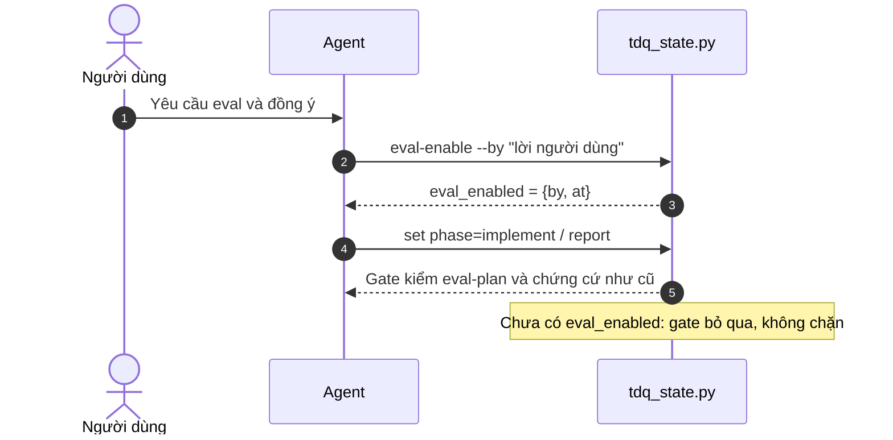

# SPEC — Eval chỉ chạy khi người dùng yêu cầu và đồng ý

Ngày: 2026-11-05 · Bản: 1.0 · Brief: ../brief/2026-11-05-2104-eval-chi-chay-khi-duoc-duyet.md · Lane: full
Soul: chất lượng > runtime > context cost · luật gốc: skills/tdq-conventions/references/soul.md
Trạng thái: CHỜ DUYỆT

## Mục lục

- 1. Mục tiêu & phạm vi
- 1b. Lộ trình
- 2. Đầu ra cụ thể
- 2b. Ranh giới module
- 2c. Luồng hoạt động & Sơ đồ kiến trúc
- 3. Cách tiếp cận & lý do
- 3b. Năng lực & công cụ
- 3c. Giải thuật & Xử lý cốt lõi
- 3d. Mental Model cho Fresher Dev
- 4. Yêu cầu bắt buộc
- 5. Ràng buộc & rủi ro
- 6. QC & Definition of Done
- 7. Câu hỏi còn mở

## 1. Mục tiêu & phạm vi

- Mục tiêu: eval hành vi skill không tự mở. Gate `implement` và `report` chỉ chặn khi người dùng đã yêu cầu eval và đồng ý kích hoạt bằng lệnh ghi lời của họ vào state. Chưa kích hoạt thì không gate nào chặn và agent không tự nhắc eval.
- Trong phạm vi: lệnh mới `tdq_state.py eval-enable --by "<lời người dùng>"` ghi `eval_enabled`; hai gate bỏ qua khi chưa có cờ; bỏ lệnh `eval-waive`, khóa `eval_waiver` và test của nó; sửa luật skill/spec-template/plan/intake/qc/skill-eval để eval là opt-in; neo luật, ngân sách token và `phases.md` cập nhật theo.
- NGOÀI phạm vi: `scripts/tdq_eval_contract.py`, `scripts/tdq_skill_eval.py`, `tdq_eval_hosts.py` (vẫn chạy tay khi cần); CI; xóa dữ liệu eval cũ; gọi model trả phí; đổi cách phân loại `classify_targets`.

## 1b. Lộ trình

| Bước/phase | Chạy? | Vì sao |
|---|---|---|
| Analyze (Grep + LSP + Graphify) | CÓ — đã làm | Đã lập bảng vùng chạm. |
| Research ngoài | BỎ | Thuần nội bộ, không ẩn số ngoài. |
| Interview | CÓ — đã làm | Chốt 1a 2b 3a 4a. |
| QC độc lập bằng agent | BỎ | `muc_qc=full`, không phải ultra. |
| Workflow implement | BỎ | Một file code nóng (`tdq_state.py`) cùng vài file luật, một chủ ghi. |
| Spec → Plan → Implement → QC → Report | CÓ | Khung bất biến. |

## 2. Đầu ra cụ thể

| # | Đầu ra | Đường dẫn/vị trí | Đo "xong" bằng |
|---|---|---|---|
| O1 | Lệnh `eval-enable` và cờ `eval_enabled` | `scripts/tdq_state.py` | `eval-enable --by "x"` ghi `eval_enabled` có `by` và `at`; thiếu `--by` thì lỗi. |
| O2 | Hai gate bỏ qua khi chưa bật | `scripts/tdq_state.py` | Plan chạm skill, chưa bật: `set phase=implement` và `set phase=report` thành công; đã bật: chặn như cũ. |
| O3 | Bỏ `eval-waive` | `scripts/tdq_state.py` và test gate tương ứng | `eval-waive` báo lệnh không tồn tại; state cũ có `eval_waiver` vẫn load được. |
| O4 | Luật opt-in | `skills/tdq-build/SKILL.md`, `references/qc.md`, `references/skill-eval.md`, `skills/tdq-spec/SKILL.md`, `references/spec-template.md`, `skills/tdq-plan/SKILL.md`, `skills/tdq-intake/SKILL.md` | Không còn câu ép eval-plan; có câu "eval chỉ chạy khi người dùng yêu cầu và đồng ý; chưa bật thì report ghi một dòng". |
| O5 | Chỉ mục luật đồng bộ | `docs/tdq/audit/luat-hien-co.md`, `docs/tdq/token-budget.json`, `skills/tdq-conventions/references/phases.md` | Test chỉ mục, ngân sách token, `phases.md` đều xanh. |

## 2b. Ranh giới module

| Module | Vùng file | Phụ thuộc module | Đầu ra §2 nào |
|---|---|---|---|
| State & gate | `scripts/tdq_state.py` | `tdq_eval_contract` (chỉ gọi `classify_targets`, `validate_eval_plan`, `check_eval_gate`, không sửa) | O1, O2, O3 |
| Test gate | test của gate eval trong vùng test | gọi CLI `tdq_state.py` | O1, O2, O3 |
| Luật workflow | `skills/tdq-build/**`, `skills/tdq-spec/**`, `skills/tdq-plan/SKILL.md`, `skills/tdq-intake/SKILL.md` | không phụ thuộc code | O4 |
| Chỉ mục & ngân sách | `docs/tdq/audit/luat-hien-co.md`, `docs/tdq/token-budget.json`, `phases.md` | sinh/khóa từ các file luật | O5 |

Ranh giới theo `graphify affected` hai bước và LSP: chỉ `cli()` gọi `_chan_eval_plan_chua_co`, `_chan_eval_evidence_chua_co`, `_cli_eval_waive`; `tdq_eval_contract` không import ngược `tdq_state`.

## 2c. Luồng hoạt động & Sơ đồ kiến trúc

Bản xem trước Trước/Sau: `2026-11-05-2104-eval-chi-chay-khi-duoc-duyet-preview.html` (planned, gắn manifest).

| Khía cạnh | Hiện trạng (Trước) | Thiết kế mới (Sau) |
|---|---|---|
| Luồng thực thi | Plan chạm skill/hook/plugin thì gate tự chặn tới khi có eval-plan hoặc `eval-waive` | Gate bỏ qua mặc định; chỉ chặn khi đã `eval-enable` |
| Thành phần chạm | `_chan_eval_plan_chua_co`, `_chan_eval_evidence_chua_co`, `_cli_eval_waive`, khóa `eval_waiver` | Hai gate thêm điều kiện `eval_enabled`; thêm `_cli_eval_enable`; bỏ waive |
| Điểm nghẽn giải quyết | Mọi request đổi skill đều bị buộc eval hoặc xin miễn, kể cả khi không muốn | Eval là lựa chọn của người dùng, có ghi lời đồng ý |

## 3. Cách tiếp cận & lý do

- Chọn: thêm cờ `eval_enabled` đặt cạnh `eval_plan_file` trong state; mỗi gate thêm một dòng `if not state.get("eval_enabled"): return` ở đầu, thay cho dòng kiểm `eval_waiver`.
- Vì: sửa nhỏ nhất, dùng đúng cơ chế state/CLI sẵn có, lưu được lời đồng ý như `eval-waive` từng làm; không đụng logic hợp đồng eval.
- Đã loại: chỉ dựa `eval_plan_file` (không lưu lời đồng ý); giữ `eval-waive` (thừa khi mặc định tắt); thêm khóa cấu hình riêng (không cần, state đủ).

## 3b. Năng lực & công cụ

| Skill | Nguồn | Phán quyết | Dùng ở đâu / Lý do loại |
|---|---|---|---|
| `tdq-intake`, `tdq-spec`, `tdq-plan`, `tdq-build`, `tdq-conventions` | plugin:tdq-workflow | NỀN | Cổng duyệt, red→green, QC/report. |
| `tdq-lean` | plugin:tdq-workflow | DÙNG | Rà diff cuối, giữ nhỏ nhất. |
| `tdq-setup` | plugin:tdq-workflow | NỀN | LSP module `python:.` đã đạt (3 references). |
| `tdq-browser-test` | plugin:tdq-workflow | KHÔNG | khác lĩnh vực — không đổi UI. |
| Đã xét 18 skill khác | user/plugin/built-in | KHÔNG | khác lĩnh vực |

## 3c. Giải thuật & Xử lý cốt lõi

- Từng bước:
  1. `eval-enable --by "<lời>"`: đọc state, thiếu `--by` thì lỗi; ghi `eval_enabled = {by, at}`; lưu với kiểm `updated_at` như lệnh khác.
  2. Gate `implement`/`report`: không có `eval_enabled` thì return ngay. Có thì chạy phần kiểm cũ (phân loại target, eval-plan, chứng cứ `pre_report`).
  3. Luật skill: chưa bật thì report ghi một dòng "eval: chưa kích hoạt (opt-in)".
- Độ phức tạp: Time O(1) cho nhánh bỏ qua, nhánh bật giữ chi phí cũ; Space O(1), thêm một khóa nhỏ trong state.
- Ca góc:
  - State cũ còn `eval_waiver`: bỏ qua khóa này, không lỗi, không còn tác dụng miễn.
  - State cũ đã có `eval_plan_file` nhưng chưa `eval_enabled`: gate vẫn bỏ qua; muốn gate chạy phải `eval-enable`.
  - `--by` rỗng hoặc chưa `init`: lỗi rõ, không ghi cờ.

## 3d. Mental Model cho Fresher Dev

- Ẩn dụ: như công tắc kiểm định chất lượng đặt ở trạng thái tắt. Chỉ khi khách (người dùng) nói "bật" và ký tên thì dây chuyền mới chạy kiểm định.
- Thuật ngữ:
  - `eval_enabled`: cờ trong state, có `by` (lời người dùng) và `at` (thời điểm); chưa có nghĩa là eval tắt.
  - Gate: chốt chặn khi `set phase=implement` hoặc `phase=report`.
  - `eval-plan`: kế hoạch đo hiệu quả skill, chỉ cần khi eval đã bật.

## 4. Yêu cầu bắt buộc

- Log service bật mặc định: BỎ — request chỉ sửa CLI/gate state và luật tài liệu, không thêm runtime mới; `tdq_state.py` giữ cơ chế thông báo hiện có.
- Không placeholder, không TODO stub; eval hành vi skill là opt-in theo yêu cầu của người dùng, không tự thêm eval-plan.
- Mỗi thành phần có unit test riêng, chạy được bằng một lệnh.
- Bám 5 nguyên tắc SOLID và rule ngôn ngữ trong `skills/tdq-build/references/rules/`.

## 5. Ràng buộc & rủi ro

Ràng buộc kiến trúc phải giữ: không chạm dòng nào trong `docs/kien-truc.md` — request không đổi tầng hay luật gọi, chỉ thêm điều kiện trong gate và sửa luật tài liệu.

| Rủi ro | Ảnh hưởng | Cách giảm |
|---|---|---|
| Người dùng quên bật nên đổi skill không có eval | Mất lưới an toàn cũ | Đúng ý người dùng; report vẫn ghi "eval: chưa kích hoạt" để thấy rõ. |
| Sửa luật làm lệch chỉ mục, ngân sách token, `phases.md` | Test hook/chỉ mục đỏ | Chạy `doc_index.py`, `token_budget.py`, `phases-doc --plugin-root`, cập nhật neo luật. |
| Test cũ về waiver/gate còn dựa hành vi cũ | Test đỏ | Viết test đỏ trước, đổi hai test gate, xóa test waiver. |
| State cũ có `eval_waiver` | Lỗi load | Khóa lạ bị bỏ qua; có test ca này. |

## 6. QC & Definition of Done

QC `full`: kiểm DoD, trọn unit test, hồi quy vùng chạm, ràng buộc kiến trúc, clean code. Không chạy runtime test.

| # | Hạng mục kiểm | Điều kiện PASS | Đo trước | Dự phòng nếu trượt |
|---|---|---|---|---|
| Q1 | `eval-enable` | Ghi `eval_enabled` có `by`, `at`; thiếu `--by` hoặc chưa init thì lỗi | — | — |
| Q2 | Gate tắt mặc định | Plan chạm skill, chưa bật: `phase=implement` và `phase=report` thành công | — | — |
| Q3 | Gate khi đã bật | Đã `eval-enable` và thiếu eval-plan: chặn `implement`; thiếu chứng cứ: chặn `report` | — | — |
| Q4 | Bỏ `eval-waive` | Lệnh không còn; state cũ có `eval_waiver` vẫn load | — | — |
| Q5 | Luật opt-in | 7 file luật không còn ép eval-plan; có câu opt-in; chỉ mục, ngân sách token, `phases.md` khớp | — | — |
| Q6 | Hồi quy | Test vùng chạm xanh; một full fresh `tron-bo --workers 1 --fresh --reuse off` ở QC cuối PASS; CI không đổi | — | — |

DoD: Q1–Q6 đạt; `tdq_eval_contract.py` và `tdq_skill_eval.py` không đổi (diff rỗng); eval vẫn chạy tay được sau `eval-enable`.

## 7. Câu hỏi còn mở

(Rỗng.)
<!-- tdq-archify-binding:start -->
<!-- manifest: 2026-11-05-2104-eval-chi-chay-khi-duoc-duyet-preview.manifest.json -->
<!-- manifest_digest: 358af3ce92f04eb47788df3e40fd9ac7898031fb1cbe5ead29209995af07f317 -->
<!-- tdq-archify-binding:end -->