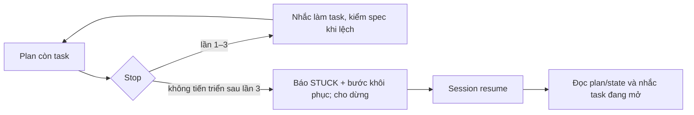

# SPEC — Hạn chế ngắt giữa plan trên Claude Code

Ngày: 2026-11-06 · Bản: 1.1 · Brief: ../brief/2026-11-06-1250-han-che-ngat-giua-plan.md · Lane: full
Soul: chất lượng > runtime > context cost · luật gốc: skills/tdq-conventions/references/soul.md
Trạng thái: CHỜ DUYỆT

## 1. Mục tiêu & phạm vi

- Mục tiêu: khi phase `implement` còn task chưa xong, Claude Code nhắc đúng bước cần làm và hạn chế dừng sớm; sau ba lần Stop không tiến triển vẫn cho dừng an toàn nhưng chẩn đoán rõ để khôi phục. Khi resume/compact, chỉ rõ task đang làm và bước tiếp theo. Lệch nhỏ đối chiếu spec rồi ghi `lech add`, tiếp tục và gom duyệt ở report.
- Trong phạm vi: Stop/SessionStart/UserPromptSubmit của Claude Code, luật build và test tương ứng; giữ trần 3 lần. Bổ sung cách đưa điều kiện `/goal` kiểm plan/DoD/QC để người dùng **chủ động xác nhận và bật** trong session; không tạo scheduler/model evaluator riêng.
- Ngoài phạm vi: Antigravity, watchdog ngoài session, can thiệp API/tool khi đang chạy, tự chạy lại tool/kill process, TDQ tự bật `/goal` hoặc `/loop`, đổi quyền hay cổng duyệt, push, tự miễn eval.

## 1b. Lộ trình

| Bước/phase | Chạy? | Vì sao |
|---|---|---|
| Analyze → spec → plan → implement → QC → report | CÓ | Thay đổi Stop hook ảnh hưởng mọi request; hai cổng duyệt, test đỏ→xanh và report. |
| Research chính thức | CÓ — đã làm | Xác thực giới hạn event boundary và trần 8 Stop blocks của host. |
| `/goal` do người dùng bật | CÓ — tùy chọn | TDQ trình điều kiện hoàn thành để người dùng xác nhận và chạy trong session; không tự kích hoạt. |
| `/loop`, watchdog, Antigravity | BỎ | Ngoài phạm vi; không tự tạo lịch hoặc chạy trùng. |
| QC agent độc lập | BỎ | Người dùng chọn `full`, không phải `ultra`. |

## 2. Đầu ra cụ thể

| # | Đầu ra | Đường dẫn/vị trí | Đo xong bằng |
|---|---|---|---|
| O1 | Stop nhắc tiếp tục và chẩn đoán khi kẹt | `hooks/scripts/stop_gate.py` | Còn task: chặn tối đa ba lần; sau trần báo số task và bước tiếp theo, cho dừng; không chặn khi pause, đã giao trợ lý, ngoài implement, hoặc thiếu plan. |
| O2 | Khôi phục hướng làm sau resume/compact | `hooks/scripts/session_start.py`, `hooks/scripts/prompt_context.py` nếu cần | Với plan mở: nêu task `[~]`/task đầu chưa làm và lệnh/đường dẫn plan; không tự chạy tool, không ghi state. |
| O3 | Luật khi lệch nhỏ | `skills/tdq-build/SKILL.md` hoặc reference hiện có | Ưu tiên làm theo plan; plan mâu thuẫn spec thì spec đã duyệt làm chuẩn; lệch nhẹ dùng dự phòng + `lech add` rồi làm tiếp; commit chỉ để gỡ blocker, gom lệch để duyệt ở report. |
| O4 | Điều kiện `/goal` tùy chọn | luật build/plan hoặc hướng dẫn request hiện có | Trình một điều kiện đo được: task và DoD đã tick, QC có receipt thật; nêu lối thoát blocker hợp lệ và không tự push. Người dùng xác nhận rồi tự bật `/goal`; không phát sinh lượt đánh giá khi chưa bật. |
| O5 | Hồi quy và báo cáo | test Stop/SessionStart/prompt + `docs/tdq/qc`, `docs/tdq/reports` | Test đỏ→xanh, trọn suite QC `full`, báo cáo Markdown + Archify HTML với bằng chứng và giới hạn. |

## 2b. Ranh giới module

| Module | Vùng file | Phụ thuộc module | Đầu ra §2 |
|---|---|---|---|
| Stop Claude Code | `hooks/scripts/stop_gate.py` | đọc `tdq_state.plan_tick_state`, `task_open_count`, `load`; không ghi state | O1 |
| Hồi phục context | `hooks/scripts/session_start.py`, `hooks/scripts/prompt_context.py` | đọc `tdq_state.plan_tick_state`, `render_next`; không import ngược từ scripts sang hooks | O2 |
| Luật build | `skills/tdq-build/SKILL.md`, reference hiện có khi cần | nhắc tên CLI `tdq_state.py lech add`, đưa tùy chọn `/goal` nhưng không gọi thay người dùng | O3, O4 |
| Test | test Stop/SessionStart/prompt đang có | gọi hook bằng fixture, không runtime import test | O1–O5 |

LSP `unfinished_reason` có 11 references ở hook/test; Graphify `affected plan_tick_state` 2 bước dẫn tới Stop, SessionStart, prompt_context, edit_gate và scripts. Chỉ sửa caller cần; không sửa `tdq_state.py` nếu không có test đỏ chứng minh cần.

## 2c. Luồng hoạt động & Sơ đồ kiến trúc

Bản Trước/Sau Archify: `2026-11-06-1250-han-che-ngat-giua-plan-preview.html` (planned; verify binding trước khi duyệt). Mermaid dự phòng:

| Khía cạnh | Trước | Sau |
|---|---|---|
| Stop | Ba lần `[TDQ:UNFINISHED]` rồi `[TDQ:STUCK]` chung chung | Vẫn ba lần; khi kẹt nêu số task, task đang làm/nhiệm vụ tiếp theo và hướng xử lý |
| Resume | Anchor có `doing`/`dispatched` nhưng thiếu hướng cụ thể khi plan chưa đánh `[~]` | Nhắc task đầu mở/đang làm, đọc lại plan và tiến hành; không tự replay tool |
| Lệch nhẹ | Đã có `lech add`/fallback nhưng thứ tự ưu tiên plan–spec không rõ | Quy tắc một dòng về ưu tiên, giới hạn lệch nhỏ và commit gỡ blocker |
| Tiếp tục nhiều lượt | Chỉ có Stop hook | Người dùng có thể xác nhận và tự bật `/goal` với điều kiện hoàn tất plan/DoD/QC; không bật mặc định |

## 3. Cách tiếp cận & lý do

- Chọn: dùng lại Stop hook, `plan_tick_state`, và anchor `SessionStart`; bổ sung thông điệp cụ thể chỉ khi có bằng chứng plan. Giữ trần không tiến triển. Đưa `/goal` như tùy chọn rõ ràng cho người dùng xác nhận rồi tự bật, không tạo state/scheduler mới.
- Vì: theo [Hooks](https://code.claude.com/docs/en/hooks), Stop chỉ chạy cuối lượt; [Hooks guide](https://code.claude.com/docs/en/hooks-guide.md#stop-hook-hits-the-block-cap) Claude Code cưỡng chế trần 8 block không có tool call. [`/goal`](https://code.claude.com/docs/en/goal) kiểm sau mỗi lượt bằng model riêng và có phí, có thể dừng khi nhiều lượt không tiến triển.
- Loại: tăng trần vô hạn (lặp); TDQ tự bật `/goal`/cron (chưa có API host xác thực cho plugin âm thầm gắn goal vào session, phí và nguy cơ chạy trùng); watchdog (ngoài phạm vi).

## 3b. Năng lực & công cụ

| Skill/công cụ | Nguồn | Phán quyết | Dùng ở đâu / Lý do loại |
|---|---|---|---|
| `tdq-intake`, `tdq-spec`, `tdq-plan`, `tdq-build` | plugin:tdq-workflow | NỀN | Pipeline duyệt và QC. |
| LSP, Graphify, Grep | MCP/CLI hiện có | DÙNG | Bản đồ caller và phạm vi test. |
| `tdq-lean` | plugin:tdq-workflow | DÙNG | Rà diff tránh thêm scheduler. |
| `tdq-browser-research`, `tdq-browser-test` | plugin:tdq-workflow | KHÔNG | khác lĩnh vực — không sửa UI. |
| `/goal` | Claude Code | DÙNG | Điều kiện hoàn thành tùy chọn; trình để người dùng xác nhận và tự bật, không gọi model khi chưa bật. |
| `/loop` | Claude Code | KHÔNG | spec §3 đã chọn cách khác tốt hơn — `/goal` theo điều kiện, không chạy lịch định kỳ. |

## 3c. Giải thuật & Xử lý cốt lõi

1. Khi Stop: đọc state + tick từ plan; nếu phase khác implement, plan thiếu/đã xong, pause hoặc có task `[>]`, giữ hành vi im lặng hiện tại.
2. Nếu còn task: lần 1–3 với cùng plan SHA → chặn và nhắc task/bước hành động, có thông điệp `lech add` cho lệch nhỏ. Plan đổi/tick tiến triển → reset streak như hiện tại.
3. Sau ba lần không tiến triển → cho dừng với `[TDQ:STUCK]` kèm số task, task đang làm/đầu chưa xong và gợi ý resume hoặc `pause` có lý do khi blocker thật. Lời nhắc chỉ dùng dữ liệu plan đã đọc, không tự claim test/commit.
4. Khi SessionStart resume/compact: đọc plan để đưa cùng task còn mở vào anchor; nhắc kiểm nguồn/result trước khi chạy lại tool. Không khởi động session phụ.
5. Tại cổng chuẩn bị build, nếu người dùng muốn bảo đảm tiếp tục nhiều lượt: trình điều kiện `/goal` gắn request và path plan, task + DoD đã tick, QC receipt hợp lệ, lối thoát pause hợp lệ và cấm tự push. Chỉ khi người dùng xác nhận mới hướng dẫn họ bật goal trong session; TDQ không tự gửi lệnh `/goal`, không âm thầm trả phí. Goal có thể dừng do host/không tiến triển, nên Stop và resume vẫn là lớp mặc định.
- Thời gian: O(N) theo số dòng plan để tìm task; Stop đã đọc plan, chỉ thêm scan có giới hạn; không gian O(1) nếu chỉ giữ một task/đếm, không đọc transcript lớn.
- Ca biên: plan thiếu/hỏng thì im/fallback hiện tại; task `[>]` chưa có kết quả thì chờ, không chạy trùng; pause có lý do thì không block; nhiều Stop không tool thì hạ cấp; session mới không được suy kết quả chỉ từ `[x]`; không xác định output tool cũ thì quan sát trước retry.

## 3d. Mental Model cho Fresher Dev

Như bảng công việc gắn cửa ra: còn ô chưa tích, bảo vệ nhắc làm tiếp. Nhắc ba lần không có ô nào đổi thì cửa cho đi để tránh kẹt, nhưng để lại giấy ghi chính xác ô nào cần làm khi quay lại.

- `Stop`: sự kiện cuối lượt, không phải đồng hồ giám sát API đang chạy.
- `streak`: số lần bị nhắc liên tiếp mà nội dung plan không đổi.
- `lech add`: sổ lệch ngưỡng/spec để báo cáo cuối, không phải giấy phép bỏ kiểm tra an toàn.

## 4. Yêu cầu bắt buộc

- Log service bật mặc định: giữ logging `_info`/`_warn` có timestamp và `TDQ_LOG=0`; không tạo kênh mới.
- Không placeholder, không TODO stub; eval skill chỉ khi người dùng yêu cầu và đồng ý.
- Test từng nhánh Stop/Resume không gọi model trả phí; `/goal` chỉ hướng dẫn bật sau khi người dùng xác nhận riêng. Giữ ngữ nghĩa `pause` và duyệt.
- Giữ nguyên luật gọi hook→scripts, không viết state trực tiếp; không đổi Antigravity hoặc CI.

## 5. Ràng buộc & rủi ro

Kiến trúc `docs/kien-truc.md` đang NHÁP, dùng như gợi ý: `hooks/` được gọi `scripts/`, `scripts/` không import `hooks/`; chỉ `tdq_state.py` ghi `state.json`; `tests/` không được import bởi runtime. Chạm hook Stop/SessionStart; không đổi các hướng gọi.

| Rủi ro | Ảnh hưởng | Giảm |
|---|---|---|
| Hook chặn vô hạn | Kẹt phiên/model nhỏ | Giữ trần 3 và test bước hạ cấp; không tăng giới hạn host. |
| Task `[>]` còn chạy | Retry trùng | Không chặn Stop để chờ notification như hiện tại. |
| Hint sai khi plan hỏng/missing | Chặn oan | Không suy từ transcript; nếu không đủ bằng chứng thì im hoặc hint chung như hiện tại. |
| Lệch nhỏ bị dùng để bỏ bảo mật/đầu ra | Sai spec | Luật ghi phạm vi lệch nhỏ; thay đổi phạm vi, quyền, dữ liệu khó đảo ngược vẫn dùng gate/pause. |
| `/goal` bị hiểu là bảo đảm tuyệt đối hoặc tự bật | Phí model, lặp/chạy trùng | Chỉ trình điều kiện và yêu cầu xác nhận riêng; không tự gọi, báo giới hạn host và không thay cổng Stop. |

## 6. QC & Definition of Done

QC `full`: DoD, unit trọn repo, hồi quy vùng chạm, ràng buộc kiến trúc và clean code; không chạy runtime test. Test đỏ thật trước sửa.

| # | Hạng mục | PASS khi | Đo trước | Dự phòng nếu trượt |
|---|---|---|---|---|
| Q1 | Stop còn việc | Lần Stop 1–3 chặn, nêu bước kế tiếp; plan hoàn tất/pause/`[>]`/ngoài implement không chặn | Ba lần chặn, lần bốn hint chung | Giữ trần 3, giảm chi tiết hint nếu >300 ký tự |
| Q2 | Hạ cấp an toàn | Lần bốn không tiến triển không block, `[TDQ:STUCK]` nêu đúng task và số còn mở; tick tiến triển reset streak | Hint chung, không nêu task | Nếu plan hỏng thì fallback hint chung, không chặn |
| Q3 | Resume/compact | Anchor nêu task `[~]` hoặc task đầu mở, phân biệt `[>]`, không tự chạy lại tool hoặc ghi state | Có `doing`/`dispatched`, thiếu task đầu chưa làm | Nếu plan hỏng chỉ in anchor hiện có |
| Q4 | Luật lệch nhỏ | Plan ưu tiên; spec đã duyệt giải quyết xung đột; `lech add`/fallback rồi làm tiếp; commit chỉ gỡ blocker; bốn pause và cổng duyệt giữ nguyên | Đã có fallback/lech, thiếu ưu tiên rõ | Ghi lệch chờ duyệt report nếu không chắc ngưỡng |
| Q5 | `/goal` tùy chọn | Có điều kiện đo task/DoD/QC và lối thoát blocker; chỉ hướng dẫn sau xác nhận riêng; không tự bật hoặc gọi model trong test | Chưa có hướng dẫn `/goal` trong TDQ | Không dùng goal nếu host không hỗ trợ; Stop/resume vẫn hoạt động |
| Q6 | Hồi quy | Full suite và test vùng chạm PASS; không đổi Antigravity, CI; Archify report verify | Test Stop gate hiện có; full chưa chạy cho request | Fix lỗi thực và chạy lại sau nguồn ổn định |

DoD: Q1–Q6 có bằng chứng, không gọi model trial trong QC; report Markdown + Archify HTML nêu trước/sau, phép kiểm, kết quả và giới hạn hook event boundary.

## 7. Câu hỏi còn mở

(Rỗng.)
<!-- tdq-archify-binding:start -->
<!-- manifest: 2026-11-06-1250-han-che-ngat-giua-plan-preview.manifest.json -->
<!-- manifest_digest: 381def14180481005dc24c40ef210d5d9934f397b35114720bf5970e17e88d01 -->
<!-- tdq-archify-binding:end -->