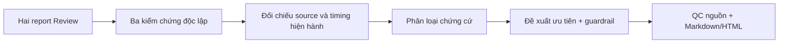

# SPEC — Rà soát rút ngắn thời gian TDQ Workflow

Ngày: 2026-11-06 · Bản: 1.0 · Brief: ../brief/2026-11-06-1549-ra-soat-thoi-gian-workflow.md · Lane: full
Soul: chất lượng > runtime > context cost · luật gốc: skills/tdq-conventions/references/soul.md
Trạng thái: CHỜ DUYỆT

## 1. Mục tiêu & phạm vi

- Mục tiêu: báo cáo ngắn, dễ hiểu nhưng đủ bằng chứng, xếp ưu tiên cách rút thời gian xử lý; kiểm độc lập claim từ hai report ở `Review-TDQWorkflow`, đối chiếu repo TDQ hiện tại. Phân loại mandatory/conditional/optional-chờ-duyệt/reject, không trình bày giả thuyết thành tốc độ đã đo.
- Trong: số liệu timing/LSP/Graphify/full suite, approval/search/report/telemetry/setup, guardrail và lộ trình benchmark; ba góc review độc lập đã fanout.
- Ngoài: sửa runtime, thiết lập công cụ, chạy benchmark/full suite/model eval, đổi policy bắt buộc, xoá test, sửa repo Review. Không đặt KPI 50% wall nếu không có cohort hợp lệ.

## 1b. Lộ trình

| Bước/phase | Chạy? | Vì sao |
|---|---|---|
| Analyze → spec → plan → implement (viết report) → QC → report | CÓ | Lane full đã chọn; giữ hai cổng duyệt. |
| Fanout subagents | CÓ — 3/3 đã làm | Runtime, optional, benchmark độc lập; kết quả có bất đồng. |
| Research web ngoài | BỎ | Dữ liệu nội bộ, không cần nguồn ngoài. |
| Benchmark/paid eval/source edit | BỎ | Chỉ đề xuất, không triển khai hoặc làm thay đổi baseline. |

## 2. Đầu ra cụ thể

| # | Đầu ra | Vị trí | Điều kiện xong |
|---|---|---|---|
| O1 | Ma trận claim → verdict → nguồn → giới hạn | `docs/tdq/reports/2026-11-06-1549-ra-soat-thoi-gian-workflow.md` | Tách CONFIRMED/UNCERTAIN/CONFLICT; ghi số mới và số lịch sử. |
| O2 | Danh sách ưu tiên giảm critical path | Cùng report | Mỗi đề xuất ghi cơ chế, expected chưa đo, phép đo promote/rollback, không cộng phần trăm. |
| O3 | Bảng mandatory/conditional/optional/reject | Cùng report | Không đề xuất optional trái luật HTML, search, approval, QC; nêu yêu cầu user duyệt nếu đổi policy. |
| O4 | Báo cáo trực quan trước/sau và QC | `docs/tdq/reports/2026-11-06-1549-ra-soat-thoi-gian-workflow.html` + QC | Archify verify current/binding; rõ đã kiểm gì, không chạy full/model. |

## 2b. Ranh giới module

| Module | Vùng | Quan hệ | Đầu ra |
|---|---|---|---|
| Tài liệu audit ngoài | `Review-TDQWorkflow/docs/tdq/reports/`, `timing.jsonl`, ledger hiện còn | Nguồn tuyên bố cần kiểm, không ghi | O1–O3 |
| Runtime hiện hành | `scripts/tdq_finish.py`, `tdq_lsp.py`, `tdq_test.py`, `tdq_timing.py`, hooks | `main()` gọi `step_graphify` (LSP refs/Graphify affected); chỉ đọc để xác thực claim | O1–O2 |
| Policy | `skills/tdq-build/references/report-template.md`, `qc.md`, `skills/tdq-intake/references/quick-lane.md`, global CLAUDE.md | Luật bắt buộc được đối chiếu, không sửa | O3 |
| Báo cáo | `docs/tdq/spec/`, `plan/`, `qc/`, `reports/` của request | Tạo tài liệu mới; không import runtime | O4 |

## 2c. Luồng hoạt động & Sơ đồ kiến trúc

Preview Trước/Sau planned: `2026-11-06-1549-ra-soat-thoi-gian-workflow-preview.html`.

| Mặt | Trước | Sau request |
|---|---|---|
| Kết luận | Hai report có số lịch sử/ước lượng xen lẫn | Ma trận claim với proven/uncertain/conflict và nguồn hiện hành |
| Optional | Một số đề xuất cắt HTML/search/gate | Bảng giữ bắt buộc vs điều kiện hóa hợp lệ vs chỉ sau duyệt |
| Tốc độ | Giả định 50% wall từ cohort thiếu | Đề xuất đo riêng active/critical path và cohort ≥10 trước hứa tốc độ |

## 3. Cách tiếp cận & lý do

- Chọn: 3 review độc lập rồi so chéo với source/ledger, ưu tiên cơ chế giảm *critical path* có khả năng đo và không thay policy hiện hành. Gắn mỗi claim với nguồn và trạng thái dữ liệu.
- Loại: lấy 300s timeout Graphify làm latency thực, coi LSP outlier thiếu duration là p95, coi 2–3 request đủ chứng nhận 50%, bỏ Archify HTML hoặc full fresh vì muốn nhanh.

## 3b. Năng lực & công cụ

| Skill/công cụ | Nguồn | Phán quyết | Dùng ở đâu / Lý do loại |
|---|---|---|---|
| `tdq-intake`, `tdq-spec`, `tdq-plan`, `tdq-build` | plugin:tdq-workflow | NỀN | Cổng duyệt và báo cáo. |
| 3 `Explore` subagents | built-in | DÙNG | Kiểm độc lập runtime, optional, benchmark. |
| LSP, Graphify, Grep | MCP/CLI | DÙNG | Đối chiếu liên kết code và vùng tác động, chỉ đọc. |
| Archify | installed CLI | DÙNG | Preview và report HTML bắt buộc. |
| Setup/tavily/browser | plugin/CLI | KHÔNG | khác lĩnh vực — không cài/sửa host hoặc thử UI. |

## 3c. Giải thuật & Xử lý cốt lõi

1. Đọc hai report + receipt/timing còn lại; mỗi claim tách số đo/nguồn/thời điểm.
2. So claim với source 0.94.0 và 3 phản biện; thiếu log hoặc cohort thì đánh UNCERTAIN, mâu thuẫn snapshot/closed thì CONFLICT.
3. Chấm đề xuất theo thời gian critical path, khả năng đo, nguy cơ false PASS và policy bắt buộc; ghi thứ tự P0/P1/P2, điều kiện rollback.
4. Sinh cặp MD/HTML, kiểm link và Archify binding. O(N) theo số claim, O(N) bảng chứng cứ; không quét transcript riêng tư để trích vào report.
- Input thiếu/corrupt → ghi unavailable, không đoán. Không benchmark chạy, không gán unknown cho người dùng/model; tránh cộng khoảng thời gian API/tool chồng lấp.

## 3d. Mental Model cho Fresher Dev

Như soi hóa đơn: chỉ khoản có biên lai mới ghi "đã tốn"; khoản dự kiến ghi "cần đo". Chuyển một bước sang optional chỉ sau khi biết nó không phải chốt an toàn hay yêu cầu bắt buộc.

- `critical path`: chuỗi thao tác quyết định lúc kết thúc thực sự; tiết kiệm các đoạn song song không được cộng thẳng.
- `partial`: có số đo nhưng không phủ hết sự kiện; không được suy phần còn lại.

## 4. Yêu cầu bắt buộc

- Log service: BỎ — không tạo/sửa runtime; `tdq_finish.py --log` chỉ ghi dấu nghiên cứu. Không placeholder, không TODO stub; eval model opt-in, chưa kích hoạt. Báo cáo phải rõ trước/sau, đã test gì, kết quả thật.
- Giữ Git/source sạch ngoài tài liệu request; không biến đề xuất thành thay đổi policy.

## 5. Ràng buộc & rủi ro

Ràng buộc kiến trúc phải giữ: không chạm runtime; `docs/kien-truc.md` vẫn NHÁP, luật `hooks/` gọi `scripts/` và chỉ `tdq_state.py` ghi state không thay đổi.

| Rủi ro | Giảm |
|---|---|
| Nguồn Review cũ/ledger bị compact | Đánh UNCERTAIN, dẫn file/dòng và mức thiếu; không giả tái kiểm chứng. |
| Optional trái user instruction | HTML Markdown+Archify và approvals/QC/search safety giữ mandatory; thay đổi cần duyệt riêng. |
| KPI 50% từ n=3/partial | Chỉ mục tiêu thử nghiệm, yêu cầu cohort ≥10/nhóm và đo error/rework. |

## 6. QC & Definition of Done

QC `full` cho *báo cáo read-only*: kiểm từng claim/nguồn, số học, link, doc lint, HTML render+verify; không chạy trọn test repo vì không sửa code.

| # | Hạng mục | PASS khi | Đo trước | Dự phòng nếu trượt |
|---|---|---|---|---|
| Q1 | Số liệu | 2 timing record/nguồn còn lại, số 31,84% tính đúng, full suite lịch sử vs gần đây tách | n=3 claim chưa đủ raw | Ghi UNCERTAIN nếu không tái dựng cohort |
| Q2 | Giải pháp | P0/P1/P2 kèm điều kiện đo, không dùng timeout như duration | Graphify timeout 300s | Đo p95 mới trước dự báo savings |
| Q3 | Optional | HTML/report, approval, QC, search bắt buộc; phân loại conditional/optional chính xác | Hai report đề xuất cắt HTML | Giữ bắt buộc, đề nghị request riêng nếu muốn đổi |
| Q4 | Chất lượng | 3/3 phản biện, tài liệu lint, Markdown+Archify verify; không sửa runtime | 3/3 agent đã hoàn thành | Text fallback nêu rõ nếu renderer không sẵn |

DoD: Q1–Q4 và report bốn phần có bằng chứng; không hứa giảm 50% khi baseline thiếu.

## 7. Câu hỏi còn mở

(Rỗng.)
<!-- tdq-archify-binding:start -->
<!-- manifest: 2026-11-06-1549-ra-soat-thoi-gian-workflow-preview.manifest.json -->
<!-- manifest_digest: 0e25fb2adc0a7b418534463fb6a10dd130064244d0af64513270632b7d273a89 -->
<!-- tdq-archify-binding:end -->