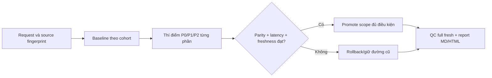

# SPEC — Tối ưu thời gian xử lý TDQ Workflow

Ngày: 2026-11-07 · Bản: 1.0 · Brief: ../brief/2026-11-07-0928-toi-uu-runtime-toan-dien.md · Lane: full
Soul: chất lượng > runtime > context cost · luật gốc: skills/tdq-conventions/references/soul.md
Trạng thái: CHỜ DUYỆT

## 1. Mục tiêu & phạm vi

- Mục tiêu: xử lý P0/P1/P2 từ `docs/tdq/reports/2026-11-06-1549-ra-soat-thoi-gian-workflow.md:20-40`, đo critical path trước/sau cùng điều kiện, giảm thời gian thực mà không tăng false PASS, flake, defect hoặc bỏ gate.
- Trong: instrument SessionStart/LSP, đo và thử giảm rebuild Graphify, chống full-suite receipt vô hiệu, benchmark workers/cache, tối ưu ledger hook I/O, batch read độc lập và routing lane đúng điều kiện. Mỗi mục chỉ bật sau parity, đạt ngưỡng và có rollback; mục không đủ mẫu giữ mặc định cũ, ghi rõ chưa chứng nhận.
- Ngoài: cài dependency/đổi quyền, model eval, UI sản phẩm, dữ liệu người dùng, API public mới; không gộp deep approval, không tắt search gate/B1, HTML report hoặc QC fresh. Không cam kết giảm 50% khi baseline thiếu. Browser UI test không cần vì không đổi UI.

## 1b. Lộ trình

| Bước/phase | Chạy? | Vì sao |
|---|---|---|
| Analyze → spec → plan → implement → QC → report | CÓ | Full, duyệt spec/plan riêng, QC full đã chọn. |
| Baseline và benchmark đủ mẫu; rollout từng phần | CÓ | User chọn `1a 2a`; không dùng lượt benchmark thay full fresh QC. |
| Research web ngoài, model eval, auto-install | BỎ | Nội bộ repo, không có yêu cầu provider/dependency mới hoặc đồng ý eval/cài đặt. |
| QC agent độc lập, browser UI | BỎ | `muc_qc=full`, không phải ultra; không đổi UI. |

## 2. Đầu ra cụ thể

| # | Đầu ra | Vị trí | Điều kiện xong |
|---|---|---|---|
| O1 | Baseline/benchmark có receipt, cohort, source/env fingerprint, p50/p95, parity và unknown | `docs/tdq/artifacts/2026-11-07-0928-toi-uu-runtime-toan-dien/` | Chạy phép đo đủ mẫu theo loại, giữ cả failed sample; thiếu corpus ghi chưa chứng nhận chứ không suy savings. |
| O2 | P0: SessionStart/LSP health đúng, Graphify freshness on-demand có rollback, full-suite source barrier | `hooks/scripts/session_start.py`, `scripts/tdq_lsp.py`, `scripts/tdq_finish.py`, `scripts/tdq_test.py` và test liên quan | Latency đo trước/sau, proof kết nối/graph/test không yếu đi; từng thay đổi có đường cũ khi fail. |
| O3 | P1: workers/cache benchmark và hook ledger I/O; chỉ promote scope đạt parity | `scripts/tdq_runtime_bench.py`, `scripts/tdq_test.py`, `hooks/scripts/search_observe.py`, `hooks/scripts/read_gate.py`, test | Worker/cache không global mặc định; semantic decision gate 100% tương đương; benchmark sai giữ serial/off. |
| O4 | P2: batch read độc lập và lane routing đúng tier, không cắt B1/approval | `skills/tdq-build/references/runtime-speed.md`, `skills/tdq-intake/` và test policy | Không tự batch mutation hay đổi gate; route nhỏ/quick/deep đúng điều kiện và được đo theo cohort. |
| O5 | QC full và báo cáo trước/sau Markdown + Archify HTML | `docs/tdq/qc/`, `docs/tdq/reports/` | Full fresh cuối, DoD, lint, HTML verify; nêu từng tối ưu đã promote/rollback/chưa chứng nhận. |

## 2b. Ranh giới module

| Module | Vùng file | Phụ thuộc module | Đầu ra |
|---|---|---|---|
| Startup/readiness | `hooks/scripts/session_start.py`, `scripts/tdq_lsp.py`, `scripts/tdq_readiness.py` | Hook gọi CLI readiness; không import hook ngược | O1,O2 |
| Close-out/graph | `scripts/tdq_finish.py` | `main()` gọi `step_graphify()` theo LSP và Graphify affected depth 2; đọc readiness từ module Startup | O1,O2 |
| Test/receipt/bench | `scripts/tdq_test.py`, `scripts/tdq_test_receipt.py`, `scripts/tdq_runtime_bench.py` | Runner ghi receipt, benchmark verify parity; QC đọc receipt | O1,O2,O3 |
| Hook ledger/gate | `hooks/scripts/search_observe.py`, `hooks/scripts/read_gate.py`, `hooks/scripts/search_gate.py` | Ledger cung cấp dữ kiện cho gate; không tắt telemetry nếu gate dùng | O1,O3 |
| Luật lane/runtime | `skills/tdq-intake/`, `skills/tdq-build/references/runtime-speed.md` | Policy chỉ dẫn CLI/hook hiện có, không chép runtime | O4 |
| Chứng cứ | `docs/tdq/artifacts/`, `docs/tdq/qc/`, `docs/tdq/reports/` của request | Đọc receipts và source, không import runtime | O1,O5 |

## 2c. Luồng hoạt động & Sơ đồ kiến trúc

Preview planned Trước/Sau: `2026-11-07-0928-toi-uu-runtime-toan-dien-preview.html`; candidate `../artifacts/2026-11-07-0928-toi-uu-runtime-toan-dien/truoc-sau.archify.md`.

| Mặt | Trước | Sau nếu chứng nhận |
|---|---|---|
| SessionStart/LSP | Đường nóng có update/setup/doctor; outlier LSP chưa tái dựng đủ | Đo cold/warm; stamp/health proof và circuit breaker, doctor fresh khi stale |
| Graphify | `tdq_finish.py:198-207,300-323` extract đồng bộ sau code change | Bỏ chờ per-turn chỉ nếu graph stale không lọt vào query/QC; fallback per-turn |
| Full suite | Receipt có thể vô hiệu khi source thay giữa run | Fingerprint/writer barrier; một full fresh cuối, invalidation fail-closed |
| P1/P2 | Worker 1, reuse off; read và lane policy có overhead | Opt-in workers/cache đủ parity, hook I/O ít hơn, batch read an toàn và route đúng |

## 3. Cách tiếp cận & lý do

- Chọn: baseline riêng từng đường nóng → thay đổi nhỏ một cụm → benchmark serial với cùng source/env → parity/freshness/QC → promote hoặc rollback. Không cộng savings chồng lấp, không lấy timeout làm latency.
- Loại: bật workers/cache mặc định theo mẫu cũ, cắt full fresh/HTML/approval/search, hoặc tự cài công cụ để lấy PASS; những cách này đánh đổi chất lượng chứng cứ và trái yêu cầu hiện hành.

## 3b. Năng lực & công cụ

| Skill/công cụ | Nguồn | Phán quyết | Dùng ở đâu / Lý do loại |
|---|---|---|---|
| `tdq-intake`, `tdq-spec`, `tdq-plan`, `tdq-build` | plugin:tdq-workflow | NỀN | Các phase và cổng duyệt O1–O5. |
| LSP, Graphify, Grep | MCP/CLI | DÙNG | Truy vết caller và vỡ lan cho O2/O3, preflight readiness và fallback nếu graph stale. |
| `tdq_runtime_bench.py`, `tdq_test.py` | installed CLI | DÙNG | Benchmark parity, full fresh và receipts O1/O3/O5. |
| Archify | installed CLI | DÙNG | Preview planned và HTML report O5, verify binding. |
| Setup tự cài, model eval | plugin/CLI | KHÔNG | khác lĩnh vực — không biến benchmark runtime thành cài đặt/eval model. |

## 3c. Giải thuật & xử lý cốt lõi

1. Ghi source/env fingerprint và mốc monotonic cho từng span; tách cold/warm, wall/observed union/unknown, lỗi timeout, số full rerun. Thiếu span ghi unavailable, không gán cho model/người dùng.
2. Mỗi tối ưu đọc trạng thái hiện hành và kiểm freshness/permission; chọn fast path chỉ khi health proof và fingerprint còn hợp lệ. Lỗi/unknown → đường cũ có bằng chứng hoặc fail-closed nếu receipt không hợp lệ.
3. Đo A/B theo cùng inventory/source, so latency và decision equivalence. Workers dùng ≥3 cặp AB/BA/AB, reuse ≥3 triplet off/cold/warm; startup ≥20 cold/warm, graph qua nhiều repo; cohort lane ≥10 request/bucket. Sample lỗi giữ lại; không cộng phần trăm các tối ưu.
4. Promote từng scope chỉ khi parity 100%, ngưỡng giảm và quality đạt; không đủ mẫu hoặc threshold → giữ mặc định cũ, ghi kết quả. Cuối cùng full fresh QC riêng; report kết quả, rollback và giới hạn.
5. Độ phức tạp: check health/fingerprint O(F) theo file liên quan; scan ledger hiện O(N) theo record, thử tail/index O(1) trên append/read mới sau khi có chứng cứ semantic equivalence; benchmark O(R×T) theo số lượt và suite duration, không giấu chi phí đo. File rỗng, corrupt, timeout, clock drift hoặc concurrent writer → không dùng cache/stale result làm PASS.

## 3d. Mental Model cho Fresher Dev

Như trạm kiểm soát: có vé còn hạn thì đi làn nhanh; vé mờ hoặc cổng mất tín hiệu thì quay làn kiểm tra đầy đủ. Muốn mở làn nhanh phải đo thời gian **và** chứng minh kiểm soát vẫn bắt đúng lỗi.

- `critical path`: các bước thực sự quyết định thời điểm xong; phần tiết kiệm song song không cộng thẳng.
- `parity`: cùng tập ca và cùng kết quả/decision, không chỉ cùng dòng chữ PASS.
- `freshness`: nguồn, graph, cache và receipt tương ứng đúng revision hiện hành.

## 4. Yêu cầu bắt buộc

- Runtime có log timestamp bật mặc định qua log hiện có, có thể tắt bằng config hiện hành; không tạo service mới nếu log đã đủ. Unit test riêng cho từng cơ chế, test đỏ→xanh; không placeholder/TODO stub.
- Tuân thủ ranh giới module và complexity floor; eval model opt-in, chưa kích hoạt. Không thay policy mandatory nếu không có duyệt riêng.

## 5. Ràng buộc & rủi ro

`docs/kien-truc.md` còn NHÁP; ràng buộc thực thi phải giữ theo source/skill hiện hành: `hooks/` gọi `scripts/`, không import ngược; chỉ `tdq_state.py` ghi state; test không biến fail thành skip; báo cáo cả Markdown + Archify HTML.

| Rủi ro | Ảnh hưởng | Giảm |
|---|---|---|
| Stale Graphify/LSP health giả | Bỏ sót vùng chạm, false PASS | Invalidate trên source/marker đổi, query/QC proof, rollback per-turn/doctor fresh. |
| Worker/cache sai fingerprint | Receipt sai hoặc flake | AB/BA/AB parity 100%, fresh cuối, fallback serial/off, giữ failed samples. |
| Hook ledger tối ưu sai | Search gate quyết định khác | So decision replay 100%, fail-safe và quay full parse. |
| Benchmark dài/không đồng nhất | Số tiết kiệm gây hiểu nhầm | Same host/source/env, log failed/missing sample; không đủ bằng chứng thì không promote. |

## 6. QC & Definition of Done

| # | Hạng mục | PASS khi | Đo trước | Dự phòng nếu trượt |
|---|---|---|---|---|
| Q1 | Baseline/evidence | Có receipts cold/warm và source/env fingerprint, phân biệt partial/unavailable; sample lỗi giữ lại, mỗi số savings có n và scope | Cohort n=3 thiếu raw; API/tool partial | Không công bố % giảm toàn request nếu thiếu cohort; đo bổ sung theo bucket. |
| Q2 | P0 startup/graph/test | Gate/readiness, graph freshness, receipt invalidation giữ hành vi qua unit + mutation/timeout; p95 đường nóng sau không xấu hơn trước trong mẫu đủ | Chưa có p95 hợp lệ của cả ba | Nếu thiếu baseline/không đạt: giữ doctor fresh/per-turn rebuild/full fresh, báo chưa promote. |
| Q3 | P1 workers/cache/hooks | Parity case/skip/decision 100%; workers ≥3 AB/BA/AB cải thiện median ≥20%, cache ≥3 off/cold/warm cải thiện warm ≥25%, hook decision tương đương | Workers=2 mẫu cũ fail parity; cache chưa đủ | Giữ `workers=1 --fresh --reuse off`; hook full parse khi mismatch, không bật default. |
| Q4 | P2 routing/batch | Batch chỉ Read độc lập, không mutation/approval; tier `nhỏ` 4 điều kiện, B1/2 gate giữ nguyên, kiểm rework/defect cohort ≥10/bucket | Cohort quick cũ n=3 theo `docs/tdq/reports/2026-11-06-1549-ra-soat-thoi-gian-workflow.md:14`, chưa đủ 10/bucket | Giữ routing cũ, không tuyên bố speedup P2. |
| Q5 | QC/report | Full fresh cuối sau source edit PASS, radius miss rõ; report MD+HTML verify, nêu promote/rollback và browser chưa chạy | Full gần đây 800,34s trước 0.94.0 | Lỗi runtime phải sửa rồi chạy lại full; renderer thiếu thì text fallback ghi rõ, không báo HTML verified. |

DoD Q1–Q5, không lấy benchmark thay QC-F1; mọi ngưỡng số có baseline ở cột Đo trước và fallback. Không tự cắt nhiệm vụ vì đo thiếu: vẫn hoàn tất cơ chế an toàn, ghi tính năng chưa promote.

## 7. Câu hỏi còn mở

(Rỗng.)
<!-- tdq-archify-binding:start -->
<!-- manifest: 2026-11-07-0928-toi-uu-runtime-toan-dien-preview.manifest.json -->
<!-- manifest_digest: d1a15e0194771434c629d849d4d8067cafdc14f45ff10817becfcf241810dbf9 -->
<!-- tdq-archify-binding:end -->