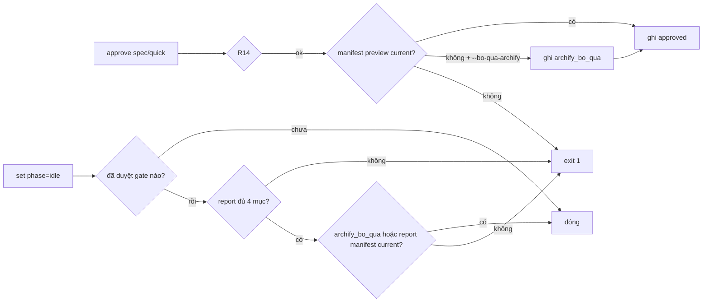

# SPEC — Gate cứng cho Trước/Sau + sơ đồ Archify ở spec và report (`2026-11-09-0143-gate-truoc-sau-archify` · full · feature/gate-truoc-sau-archify)

Ngày: 2026-11-09 · Bản: 1.0 · Brief: ../brief/2026-11-09-0143-gate-truoc-sau-archify.md · Lane: full
Soul: chất lượng > runtime > context cost · luật gốc: skills/tdq-conventions/references/soul.md
Trạng thái: CHỜ DUYỆT

## 1. Mục tiêu & phạm vi

- **Mục tiêu:** spec (lane full), mini-plan (lane quick) và report (cả 2 lane) **không qua được cổng** khi thiếu sơ đồ Trước/Sau Archify đã render + verify `current`, hoặc report thiếu 4 mục Trước/Sau/Đã test/Kết quả.
- **Sự cố gốc (play3clone):** 6 spec + 11 report đến `11-07-1649` đủ sơ đồ; 6 spec + 18 report từ `11-08-0005` mất hết. Luật vẫn còn trong skill nhưng không có code chặn, agent bỏ qua skill là trôi luôn.
- **Trong phạm vi:** `scripts/tdq_state.py` (3 gate + lối thoát), test, cập nhật 3 file luật (`archify-ba.md`, `archify-quick.md`, `report-template.md`).
- **NGOÀI phạm vi:** sửa spec/report cũ của play3clone; luật doc_lint Mermaid (Q4 = không); đổi engine Archify; chặn `init`/`reset` đè request chưa xong.

## 1b. Lộ trình

| Bước/phase | Chạy? | Vì sao |
|---|---|---|
| Research web | BỎ | thuần nội bộ |
| Vòng scope | BỎ | phạm vi đã rõ từ điều tra |
| implement mode main, TDD | CÓ | 1 file chính + test |
| QC full (vùng chạm + full fresh) | CÓ | `muc_qc=full` |
| QC độc lập (agent) | BỎ | mức full không đòi |
| report MD + Archify HTML | CÓ | request này tự chịu gate mới |

## 2. Đầu ra cụ thể

| # | Đầu ra | Đường dẫn/vị trí | Đo "xong" bằng |
|---|---|---|---|
| 1 | Gate `approve spec` (full) đòi preview manifest current | `scripts/tdq_state.py` `_archify_gate` | thiếu/stale → exit 1, state không đổi |
| 2 | Gate `approve quick` đòi flow manifest current | cùng hàm | như trên |
| 3 | Gate `set phase=idle` đòi report đủ 4 mục + report manifest current | `scripts/tdq_state.py` `_chan_report_thieu` | thiếu → exit 1 |
| 4 | Lối thoát `approve … --bo-qua-archify "<lý do>"` → `archify_bo_qua` | `_parse_approve_args`, `default_state` | ghi lý do; gate idle bỏ phần manifest, vẫn đòi 4 mục |
| 5 | Luật ghi rõ gate | `archify-ba.md`, `archify-quick.md`, `report-template.md` | doc_lint 0 lỗi |

## 2b. Ranh giới module

| Module | Vùng file | Phụ thuộc module | Đầu ra §2 nào |
|---|---|---|---|
| state-gate | `scripts/tdq_state.py` | archify-verify (import lười) | 1–4 |
| archify-verify | `scripts/tdq_archify.py` `verify_document_and_manifest` | không — chỉ gọi, không sửa | 1–3 |
| luật | 3 file `.md` ở trên | không | 5 |

Nguồn: graphify affected — `_cli_approve` chỉ có caller `cli()`; `verify_document_and_manifest` chỉ có `handle_verify`.

## 2c. Luồng hoạt động & Sơ đồ kiến trúc

Bản xem trước Trước/Sau (Archify, bound): `docs/tdq/spec/2026-11-09-0143-gate-truoc-sau-archify-preview.html` · nguồn `docs/tdq/artifacts/2026-11-09-0143-gate-truoc-sau-archify/truoc-sau.archify.md`.

| Khía cạnh | Hiện trạng (Trước) | Thiết kế mới (Sau) |
|---|---|---|
| `approve spec` | chỉ R14 | R14 + preview manifest current |
| `approve quick` | không kiểm gì | flow manifest current |
| `set phase=idle` | không kiểm report | 4 mục + report manifest current |
| Agent bỏ qua skill | spec/report trôi qua | bị chặn, thông điệp chỉ lệnh render |

## 3. Cách tiếp cận & lý do

- **Chọn:** gate trong **lệnh CLI** `tdq_state.py`, cạnh `_r14_gate`, gọi lại `tdq_archify.verify_document_and_manifest` (đã có, đã test).
- **Vì:** cùng chỗ với gate đo duy nhất hiện có; không phụ thuộc hook (host thiếu hook vẫn bị chặn); không viết verifier mới.
- **Đã loại:** hook Stop kiểm file (chỉ nhắc được, agent vẫn đóng được) · luật doc_lint R15 Mermaid (trùng manifest, user chọn Q4=A) · kiểm HTML bằng chuỗi `data-archify-artifact` (giả được; manifest có hash).

## 3b. Năng lực & công cụ

| Skill | Nguồn | Phán quyết | Dùng ở đâu / Lý do loại |
|---|---|---|---|
| tdq-intake / tdq-spec / tdq-plan / tdq-build | plugin:tdq-workflow | NỀN | pipeline đang chạy |
| Archify CLI (`tdq_archify.py`) | project | DÙNG | render + verify preview/report của chính request này; hàm verify cho gate |
| Python unittest + `tdq_test.py` | project | DÙNG | đỏ→xanh, full fresh ở QC |
| Đã xét 25 skill khác | user/plugin/built-in | KHÔNG | khác lĩnh vực |

## 3c. Giải thuật & Xử lý cốt lõi

1. `ARCHIFY_MOC = "2026-11-09-0143"`. `_archify_bat_buoc(state)`: slug khớp `\d{4}-\d{2}-\d{2}-\d{4}` và `slug[:15] >= ARCHIFY_MOC`.
2. `_archify_gate(cwd, state, target, bo_qua)` — gọi sau `_r14_gate`:
   - Bỏ khi: target `plan`; không bắt buộc (bước 1); target `spec` mà lane ≠ full.
   - `spec` → doc `spec_file`, manifest `docs/tdq/spec/<slug>-preview.manifest.json`. `quick` → doc `docs/tdq/plan/<slug>.md`, manifest `docs/tdq/plan/<slug>-flow.manifest.json`.
   - `verify(...)["status"] == "current"` → qua. Khác → có `bo_qua` thì ghi `archify_bo_qua={ly_do, at, cong}` và qua; không thì in lý do + lệnh render + gợi ý `--bo-qua-archify`, exit 1, state không đổi.
   - Exception khi import/verify → cảnh báo, qua (fail-open như R14 — công cụ hỏng không được khóa duyệt).
3. `_chan_report_thieu(cwd, state)` — trong nhánh `set phase=idle`:
   - Bỏ khi: không bắt buộc; chưa gate nào duyệt (`spec_approved`/`quick_approved` false — bỏ request giữa chừng vẫn đóng được).
   - Đọc `docs/tdq/reports/<slug>.md`; thiếu file → fail. Mỗi mục cần ≥ 1 nhãn (không phân biệt hoa thường): `trước request|before request`, `sau request|after request`, `đã test|what was tested`, `kết quả test|test result`. Thiếu → fail, liệt kê mục thiếu.
   - `archify_bo_qua` khác null → bỏ phần manifest. Không thì verify `docs/tdq/reports/<slug>.md` + `<slug>.manifest.json` phải `current`.
- **Độ phức tạp:** O(L) theo số dòng report/spec (đọc 1 lần); O(1) bộ nhớ ngoài nội dung file. Verify băm các file nguồn trong manifest — O(tổng kích thước nguồn).
- **Ca góc:** slug cũ/không đúng dạng → bỏ; manifest JSON hỏng → verify trả `invalid` → chặn; sửa report sau khi render → binding `stale` → chặn, thông điệp bảo render lại; approve lặp lại khi spec không đổi → nhánh "already approved" trả về trước gate (giữ như cũ).

## 3d. Mental Model cho Fresher Dev

- **Ẩn dụ:** kiểm định xe. Trước đây sổ tay hướng dẫn bảo "phải có ảnh chụp trước/sau khi sửa", nhưng trạm cấp tem không hỏi ảnh. Giờ trạm (lệnh `approve`/`set phase=idle`) đòi ảnh có dấu niêm phong (manifest có hash); mất điện không chụp được thì ghi biên bản lý do (`--bo-qua-archify`).
- **Thuật ngữ:**
  - `manifest`: file JSON Archify ghi hash của tài liệu, nguồn và HTML; lệch hash → `stale`.
  - `binding`: tài liệu được gắn với đúng manifest; sửa tài liệu sau khi render làm vỡ binding.
  - `ARCHIFY_MOC`: slug mốc; request mở trước mốc không bị gate.

## 4. Yêu cầu bắt buộc

- Log: mỗi lần chặn/bỏ qua in `_warn` kèm cổng, file, trạng thái verify.
- Không placeholder. Mỗi gate có test đỏ trước.
- Giữ 6 trụ cột; lối thoát chỉ qua `approve` (thời điểm có lời duyệt của user), không qua `set`.

## 5. Ràng buộc & rủi ro

Ràng buộc kiến trúc phải giữ: không chạm dòng nào — `docs/kien-truc.md` không có luật về tầng gate trong CLI.

| Rủi ro | Ảnh hưởng | Cách giảm |
|---|---|---|
| Agent tự thêm `--bo-qua-archify` | lách gate | chỉ nhận ở `approve` (bash_gate đã đòi signal của user); lý do in vào report `Giới hạn` |
| Quick tính năng mới hoàn toàn không có "Trước" | phải render trang chỉ có "Sau" | `archify-quick.md` đổi thành luôn render (`Hiện trạng: chưa có`) |
| Sửa report sau render (thêm timing) | binding stale, chặn idle | thông điệp chỉ lệnh render lại; luật ghi "render sau cùng" |
| Test cũ dùng slug ≥ mốc | test đỏ ngoài ý | đã grep: 0 slug cố định ≥ mốc; QC full fresh bắt slug động |
| Máy không có Node | không render được | verify không cần Node; thiếu manifest → lối thoát có lý do |

## 6. QC & Definition of Done

| # | Hạng mục kiểm | Điều kiện PASS | Đo trước | Dự phòng nếu trượt |
|---|---|---|---|---|
| Q1 | `approve spec` slug mới thiếu/stale preview manifest | exit ≠ 0, `spec_approved` vẫn false | — | — |
| Q2 | `approve spec` có manifest current | duyệt được | — | — |
| Q3 | `approve quick` thiếu flow manifest / có manifest | chặn / qua | — | — |
| Q4 | `--bo-qua-archify "<lý do>"` | qua, `archify_bo_qua.ly_do` ghi đúng; lý do rỗng bị từ chối | — | — |
| Q5 | `set phase=idle` report thiếu mục / thiếu manifest / đủ | chặn (liệt kê mục) / chặn / qua | — | — |
| Q6 | Slug trước mốc, hoặc chưa duyệt gate nào | không bị gate | — | — |
| Q7 | Chính request này đi qua 3 gate bằng manifest thật | approve spec + idle qua không cần lối thoát | — | — |
| Q8 | Full fresh suite + doc_lint 3 file luật | xanh, 0 lỗi | — | — |

DoD: Q1–Q8 PASS; report MD + Archify HTML có 4 phần Trước/Sau/Đã test/Kết quả.

## 7. Câu hỏi còn mở

*(Không có.)*
<!-- tdq-archify-binding:start -->
<!-- manifest: 2026-11-09-0143-gate-truoc-sau-archify-preview.manifest.json -->
<!-- manifest_digest: d955e10c2fbb2ec9e02c40a5b7235ff2af3f3db71901b387a195db0d89e27df6 -->
<!-- tdq-archify-binding:end -->