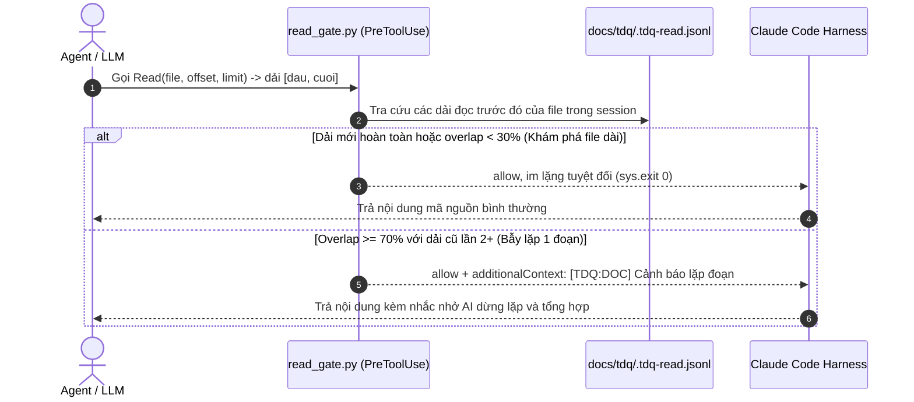

# SPEC — Nâng cấp tư duy sâu và chặn bẫy lặp tool trong TDQ Workflow

Ngày: 2026-11-10 · Bản: 1.0 · Brief: ../brief/2026-11-10-2335-nang-cap-tu-duy-tdq-workflow.md · Lane: full
Soul: chất lượng > runtime > context cost · luật gốc: skills/tdq-conventions/references/soul.md
Trạng thái: CHỜ DUYỆT

## Mục lục

- 1. Mục tiêu & phạm vi
- 1b. Lộ trình
- 2. Đầu ra cụ thể
- 2b. Ranh giới module
- 2c. Luồng hoạt động & Sơ đồ kiến trúc
- 3. Cách tiếp cận & lý do
- 3b. Năng lực & công cụ
- 3c. Giải thuật & Xử lý cốt lõi
- 3d. Mental Model cho Fresher Dev
- 4. Yêu cầu bắt buộc
- 5. Ràng buộc & rủi ro
- 6. QC & Definition of Done
- 7. Câu hỏi còn mở

## 1. Mục tiêu & phạm vi

- Mục tiêu:
  1. Vá lỗ hổng trong `read_gate.py` bằng thuật toán Range Overlap (độ trùng lặp dải dòng ≥ 70%), phân biệt rõ hành vi đọc khám phá nhiều đoạn của file dài (cho phép) với bẫy lặp đọc đi đọc lại 1 đoạn code (nhắc nhở AI dừng lặp).
  2. Bổ sung cơ chế phát hiện và cảnh báo bẫy lặp phản xạ trực diện (`remind AI`), nhắc AI thoát bẫy tự hồi quy để tổng hợp dữ liệu.
  3. Củng cố Soul và các skill phân tích với nguyên tắc "Reflective Thought & Hypothesis": bắt buộc tư duy phản tư trước và sau khi khảo sát mã nguồn, cấm xé nhỏ vụn vặt dải đọc.
- Trong phạm vi:
  - Nâng cấp `hooks/scripts/read_gate.py` hỗ trợ tính toán Range Overlap trên các lệnh `Read` có `offset/limit`.
  - Cập nhật bộ unit test của `read_gate` kiểm chứng đầy đủ các ca: file dài đọc nhiều đoạn (im lặng), đọc lặp lại 1 đoạn ≥ 2 lần (nhắc), đọc trọn file (giữ nguyên quy tắc).
  - Cập nhật tài liệu quy chuẩn `skills/tdq-conventions/references/soul.md` và `skills/tdq-intake/references/quick-lane.md` bổ sung nguyên tắc tư duy sâu, cấm đánh đổi chất lượng lấy tốc độ.
- NGOÀI phạm vi:
  - Không thay đổi hành vi của các gate khác (`edit_gate.py`, `bash_gate.py`).
  - Không chặn cứng (`deny`) các thao tác đọc lần đầu hoặc đọc các vùng mới của file lớn.

## 1b. Lộ trình

Chép từ brief mục `### Lộ trình`. User duyệt spec là duyệt luôn lộ trình này.

| Bước/phase | Chạy? | Vì sao |
|---|---|---|
| `spec` | CÓ | Thiết kế chi tiết thuật toán Range Overlap và cơ chế Remind AI |
| `plan` | CÓ | Phân rã task hiện thực TDD (Red-Green-Refactor) |
| `implement` | CÓ | Nâng cấp `read_gate.py`, test suite và tài liệu quy chuẩn |
| `qc` (ultra) | CÓ | Mức QC ultra: DoD + unit test + smoke test + runtime test + independent QC agent |
| `report` | CÓ | Xuất báo cáo Markdown + Archify HTML 4 phần |

## 2. Đầu ra cụ thể

| # | Đầu ra | Đường dẫn/vị trí | Đo "xong" bằng |
|---|---|---|---|
| 1 | Module `read_gate.py` có thuật toán Range Overlap | `hooks/scripts/read_gate.py` | Tính đúng `overlap_ratio >= 0.7`, phát sinh `additionalContext` khi lặp ≥ 2 lần |
| 2 | Bộ unit test kiểm chứng Range Overlap | `tests/` | 100% tests PASS, bao gồm test đọc file dài và test đọc lặp đoạn |
| 3 | Quy chuẩn tư duy phản tư & đọc trọn vẹn | `skills/tdq-conventions/references/soul.md` | Có mục quy định Reflective Thought, cấm xé vụn dải đọc |
| 4 | Hướng dẫn khảo sát không lặp trong quick lane | `skills/tdq-intake/references/quick-lane.md` | Bổ sung hướng dẫn đọc dải rộng 150–300 dòng, tránh bẫy token loop |
| 5 | Bản xem trước kiến trúc Trước/Sau Archify HTML | `docs/tdq/spec/2026-11-10-2335-nang-cap-tu-duy-tdq-workflow-preview.html` | Render thành công, manifest khớp tài liệu |

## 2b. Ranh giới module

Bắt buộc với lane full (lane quick BỎ). Một module = một vùng file không giao nhau.

| Module | Vùng file | Phụ thuộc module | Đầu ra §2 nào |
|---|---|---|---|
| Gate Protection | `hooks/scripts/read_gate.py` | `hooks/scripts/_common.py` | 1 |
| Test Suite | `tests/` | `hooks/scripts/read_gate.py` | 2 |
| Soul & Governance | `skills/tdq-conventions/references/soul.md` | không | 3 |
| Skill Guidelines | `skills/tdq-intake/references/quick-lane.md` | `skills/tdq-conventions/references/soul.md` | 4 |
| Visual Artifact | `docs/tdq/artifacts/2026-11-10-2335-nang-cap-tu-duy-tdq-workflow/` | `scripts/tdq_archify.py` | 5 |

## 2c. Luồng hoạt động & Sơ đồ kiến trúc



Cơ chế hiện tại vs Sau update:

| Khía cạnh | Hiện trạng (Trước) | Thiết kế mới (Sau) |
|---|---|---|
| Kiểm tra `offset/limit` | Có `offset/limit` là bỏ qua kiểm tra, `sys.exit(0)` im lặng | Tính toán Range Overlap giữa dải mới và các dải cũ |
| Hỗ trợ file dài | Bị model xé nhỏ thành các lượt đọc 40 dòng lặp vô tận | Cho phép đọc các đoạn khác nhau; chỉ cảnh báo khi đọc lặp 1 đoạn |
| Nhắc nhở AI | Nhắc 1 lần rồi im lặng vĩnh viễn | Nhắc nhở rõ ràng kèm số dòng và số lần lặp khi vượt ngưỡng lặp |
| Nguyên tắc Soul | Chưa có điều khoản về phản tư sau khi đọc mã | Bổ sung quy chuẩn "Reflective Thought", cấm đọc mù mờ |

Bản xem trước kiến trúc: `docs/tdq/spec/2026-11-10-2335-nang-cap-tu-duy-tdq-workflow-preview.html`.

## 3. Cách tiếp cận & lý do

- Chọn:
  1. Cải tiến thuật toán tại `hooks/scripts/read_gate.py` để tính tỉ lệ giao nhau (Intersection over Range):
     `overlap = max(0, min(cuoi, cuoi_cu) - max(dau, dau_cu))`
     `overlap_ratio = overlap / (cuoi - dau)`
     Nếu `overlap_ratio >= 0.7` được tính là 1 lần lặp dải.
  2. Bổ sung thông điệp nhắc nhở AI (`remind AI`) mang tính định hướng: nhắc AI rằng dữ liệu đoạn này đã có trong ngữ cảnh, cần dừng đọc và tiến hành suy luận tổng hợp giải pháp.
  3. Cập nhật Soul khẳng định rõ chất lượng tư duy phản tư đứng trên việc đọc nhanh cẩu thả.
- Vì:
  - Đây là giải pháp triệt để xử lý đúng điểm người dùng phản ánh: phân biệt rõ giữa việc đọc file dài nhiều lần và việc đọc lặp lại 1 đoạn.
  - Nhắc nhở qua `additionalContext` của hook `PreToolUse` là cách duy nhất bẻ gãy bẫy chú ý (attention lock) của mô hình mà không làm gián đoạn luồng thực thi an toàn.
- Đã loại:
  - Đếm tổng số lần đọc file thô thiển: Loại vì sẽ gây cản trở việc đọc khám phá các file lớn (2000–5000 dòng).
  - Chặn cứng (`deny`) ngay từ đầu: Loại vì có thể gây lỗi hệ thống nếu agent thực sự cần kiểm tra lại mã sau khi chỉnh sửa.

## 3b. Năng lực & công cụ

Chép từ brief mục `### Năng lực dùng được`.

| Skill | Nguồn | Phán quyết | Dùng ở đâu / Lý do loại |
|---|---|---|---|
| tdq-intake / tdq-spec / tdq-plan / tdq-build | plugin:tdq-workflow | NỀN | pipeline đang chạy |
| Archify CLI (`tdq_archify.py`) | project | DÙNG | render + verify preview của spec và report |
| Đã xét 26 skill khác | user/plugin/built-in | KHÔNG | khác lĩnh vực |

## 3c. Giải thuật & Xử lý cốt lõi

- **Từng bước giải thuật (Step-by-step Execution Logic)**:
  1. Khi nhận payload `PreToolUse` của tool `Read`:
     - Trích xuất `duong_that` (đường dẫn file), `dau = int(offset or 0)`, `gioi_han = int(limit or 0)`.
     - `cuoi = (dau + gioi_han) if gioi_han else 0`.
  2. Lấy danh sách các bản ghi đọc trước đó `rows` từ `docs/tdq/.tdq-read.jsonl` thuộc cùng `session_id` và cùng `duong`.
  3. Nếu `not dau and not cuoi` (đọc toàn bộ file):
     - Giữ nguyên logic `_da_doc_tron` hiện tại (nhắc nếu file không đổi và chưa từng nhắc toàn file).
  4. Nếu `dau` hoặc `cuoi` có giá trị (đọc có khoảng):
     - Đếm số lần các bản ghi trước đó có độ trùng lặp cao:
       ```python
       lap_count = 0
       for r in rows:
           r_dau = int(r.get("dau") or 0)
           r_cuoi = int(r.get("cuoi") or 0)
           if not r_dau and not r_cuoi:
               # File đã từng được đọc toàn bộ
               lap_count += 1
               continue
           # Tính overlap giữa [dau, cuoi] và [r_dau, r_cuoi]
           giao = max(0, min(cuoi, r_cuoi) - max(dau, r_dau))
           chieu_dai = max(1, cuoi - dau)
           if (giao / chieu_dai) >= 0.7:
               lap_count += 1
       ```
     - Nếu `lap_count >= 2`: đánh dấu `dang_nhac = True`, nội dung nhắc:
       `[TDQ:DOC] Đoạn dòng {dau}-{cuoi} trong '{ten}' trùng lặp với {lap_count} lần đọc trước đó. Nội dung đã nằm trong ngữ cảnh. Hãy dừng đọc lặp, tổng hợp thông tin và viết giải pháp.`
     - Nếu `lap_count < 2`: đánh dấu `dang_nhac = False` (cho phép đọc khám phá file dài im lặng).
  5. Ghi bản ghi mới vào sổ `_ghi_so(cwd, ...)`.
  6. Nếu `dang_nhac`: in JSON `allow` kèm `additionalContext` nhắc nhở AI.

- **Độ phức tạp tính toán**:
  - Thời gian (Time Complexity): $O(N)$ với $N$ là số lần đọc file này trong session (tối đa `TRAN_DONG = 400`), thời gian thực thi $< 2$ms, không ảnh hưởng hiệu năng.
  - Không gian (Space Complexity): $O(N)$ lưu trong sổ jsonl, tự động cắt tỉa khi vượt trần dòng.

- **Các ca góc hiểm (Edge Cases & Defensive Handling)**:
  - File không tồn tại hoặc lỗi I/O: gate bắt ngoại lệ và thoát 0 ngay, không bao giờ làm sập tool `Read`.
  - Tham số `offset` hoặc `limit` không phải số: ép kiểu an toàn về 0.
  - File bị sửa đổi sau lần đọc trước: nếu `mtime` thay đổi, reset đếm lặp vì nội dung file thực sự mới.

## 3d. Mental Model cho Fresher Dev

- **Ẩn dụ trực quan (Analogy)**:
  Hãy tưởng tượng một người đọc sách tra cứu cuốn từ điển dày 2000 trang.
  - Việc mở trang 10 tra mục A, rồi mở trang 500 tra mục B, trang 1200 tra mục C là hành vi tra cứu khoa học của người đọc sách chăm chú (đọc file dài nhiều đoạn).
  - Nhưng việc lật đi lật lại trang 100 tới 74 lần chỉ để đọc cùng 2 câu văn là dấu hiệu của người đang bị "mất tập trung / kẹt trí nhớ ngắn hạn" (bẫy lặp tự hồi quy). Gate đóng vai trò như người thủ thư vỗ nhẹ vào vai: *"Bạn đã đọc trang này 3 lần rồi, hãy ghi chép lại và làm bài tập đi!"*.
- **Thuật ngữ dự án (Glossary)**:
  - `Range Overlap`: Tỉ lệ phần trăm các dòng trong dải đọc hiện tại đã từng xuất hiện trong các dải đọc trước đó.
  - `Aimed Read`: Lệnh đọc có chỉ định khoảng dòng cụ thể qua `offset` và `limit`.
  - `Reflective Thought`: Bước suy luận tự phản tư giữa các lần gọi công cụ để tổng hợp dữ liệu thay vì gọi tool mù máng.

## 4. Yêu cầu bắt buộc

- Log service bật mặc định: timestamp, đủ chi tiết debug qua `TDQ_LOG`.
- Không placeholder, không TODO stub; eval chỉ chạy khi người dùng yêu cầu và đồng ý.
- Mỗi thành phần có unit test riêng, chạy được độc lập bằng lệnh pytest.
- Bám 5 nguyên tắc SOLID và Clean Code Invariants.

## 5. Ràng buộc & rủi ro

Ràng buộc kiến trúc phải giữ (chép từ `docs/kien-truc.md`).
- Hook chỉ nhắc và kiểm bằng hiệu ứng thật: `read_gate.py` chỉ phát sinh `additionalContext` nhắc nhở, luôn trả về `allow`, không bao giờ được chặn đứng lệnh đọc hợp lệ của người dùng.
- Không spawn tiến trình con trong PreToolUse hook (phải giữ thời gian thực thi dưới 5ms).

| Rủi ro | Ảnh hưởng | Cách giảm |
|---|---|---|
| Cảnh báo nhầm khi đọc file dài | Gây phiền toái khi khảo sát file lớn | Thuật toán kiểm tra `overlap_ratio >= 0.7` và chỉ kích hoạt khi `lap_count >= 2` |
| AI bỏ qua lời nhắc | Tiếp tục lặp | Thông điệp mang mã chuẩn `[TDQ:DOC]` kèm con số cụ thể, kích hoạt sự chú ý của mô hình |

## 6. QC & Definition of Done

| # | Hạng mục kiểm | Điều kiện PASS | Đo trước | Dự phòng nếu trượt |
|---|---|---|---|---|
| Q1 | Đọc nhiều đoạn khác nhau file dài | Hook im lặng hoàn toàn (`dang_nhac = False`) | 100% im lặng trên test | Điều chỉnh ngưỡng `overlap_ratio` |
| Q2 | Đọc lặp lại cùng 1 đoạn ≥ 2 lần | Hook kích hoạt nhắc nhở `[TDQ:DOC]` | 0% (hiện tại bỏ sót) | Kiểm tra công thức giao tập |
| Q3 | Đọc toàn bộ file lần 2 | Hook kích hoạt nhắc nhở như cũ | 100% PASS | Giữ nguyên nhánh `_da_doc_tron` |
| Q4 | Thời gian chạy của hook | Dưới 10ms mỗi lần gọi | ~2ms | Không đọc nội dung file, chỉ dùng stat và sổ |
| Q5 | Lint tài liệu và format | `doc_lint.py` thoát mã 0 | 0 lỗi | Kiểm tra đầy đủ các mục chuẩn |

DoD:
- Toàn bộ test suite của read_gate chạy qua 100% green.
- Tài liệu Soul và quick-lane được cập nhật chuẩn mực với nguyên tắc Reflective Thought.
- Preview Archify HTML Trước/Sau được sinh và xác thực hợp lệ bằng lệnh kiểm tra.

## 7. Câu hỏi còn mở

(Trống — mọi quyết định đã được người dùng chốt tại brief.)
<!-- tdq-archify-binding:start -->
<!-- manifest: 2026-11-10-2335-nang-cap-tu-duy-tdq-workflow-preview.manifest.json -->
<!-- manifest_digest: 7c7353f4bcfdcc5dae963e764c1fe8636303b433d80868447c9ddcdd5aed0073 -->
<!-- tdq-archify-binding:end -->