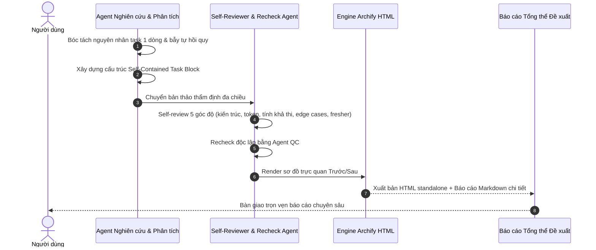

# SPEC — Báo cáo nghiên cứu sâu và Đề xuất tối ưu Plan cho Model Tier thấp

Ngày: 2026-11-11 · Bản: 1.1 · Brief: ../brief/2026-11-11-0035-nang-cap-do-chi-tiet-plan.md · Lane: full
Soul: chất lượng > runtime > context cost · luật gốc: skills/tdq-conventions/references/soul.md
Trạng thái: CHỜ DUYỆT

## Mục lục

- 1. Mục tiêu & phạm vi
- 1b. Lộ trình
- 2. Đầu ra cụ thể
- 2b. Ranh giới module
- 2c. Luồng hoạt động & Sơ đồ kiến trúc
- 3. Cách tiếp cận & lý do
- 3b. Năng lực & công cụ
- 3c. Giải thuật & Xử lý cốt lõi
- 3d. Mental Model cho Fresher Dev
- 4. Yêu cầu bắt buộc
- 5. Ràng buộc & rủi ro
- 6. QC & Definition of Done
- 7. Câu hỏi còn mở

## 1. Mục tiêu & phạm vi

- Mục tiêu:
  1. Nghiên cứu sâu hiện trạng mẫu Plan hiện tại của TDQ Workflow, phân tích 5 nguyên nhân gốc rễ khiến model tier thấp (Haiku, Claude 3.5 Haiku, model local) bị ảo giác và đoán mò khi thi công task 1 dòng sơ sài.
  2. Đề xuất kiến trúc chuẩn hóa "The Self-Contained Executable Task Block" (Khối đặc tả thi công tự thân), chuyển hóa chi tiết kỹ thuật từ Spec §3c (chữ ký hàm, kiểu dữ liệu, pseudo-code từng bước, xử lý ca góc hiểm) thành chỉ dẫn thi công cụ thể ngay trong từng task của Plan.
  3. Thực hiện quy trình Self-review nội bộ và Recheck độc lập (bởi agent QC) để thẩm định độ chặt chẽ, tính khả thi kỹ thuật và bài toán kinh tế học token của toàn bộ đề xuất trước khi trình người dùng.
- Trong phạm vi:
  - Nghiên cứu đối chiếu các best practices từ SWE-bench, Anthropic Prompt Engineering và Devin/Aider Task Decomposition.
  - Phân tích chi tiết cấu trúc Plan hiện tại và cơ chế chuyển giao task của `scripts/tdq_team.py` sang `agents/tdq-implementer.md`.
  - Xây dựng bản đề xuất kiến trúc toàn diện và khung mẫu Task Block chuẩn hóa.
  - Tiến hành Self-review đa chiều và Recheck độc lập bằng agent.
  - Xuất bản tài liệu nghiên cứu, báo cáo nghiệm thu và sơ đồ trực quan Archify HTML Trước/Sau.
- NGOÀI phạm vi:
  - Không sửa đổi trực tiếp mã nguồn `scripts/doc_lint.py` hay các template hệ thống trong request này (đây là request nghiên cứu và đề xuất phương án).

## 1b. Lộ trình

Chép từ brief mục `### Lộ trình`. User duyệt spec là duyệt luôn lộ trình này.

| Bước/phase | Chạy? | Vì sao |
|---|---|---|
| `spec` | CÓ | Thiết kế chi tiết đặc tả cấu trúc báo cáo, self-review và recheck |
| `plan` | CÓ | Lập kế hoạch chi tiết cho các task nghiên cứu và kiểm chứng |
| `implement` | CÓ | Hoàn thiện báo cáo nghiên cứu, biên bản self-review và sơ đồ Archify |
| `qc` (ultra) | CÓ | Kiểm tra chất lượng báo cáo, recheck độc lập bằng agent |
| `report` | CÓ | Xuất báo cáo nghiên cứu chuyên sâu đa chiều kèm sơ đồ Archify Trước/Sau |

## 2. Đầu ra cụ thể

| # | Đầu ra | Đường dẫn/vị trí | Đo "xong" bằng |
|---|---|---|---|
| 1 | Báo cáo nghiên cứu chuyên sâu đa chiều | `docs/tdq/research/2026-11-11-0035-nang-cap-do-chi-tiet-plan.md` | Đủ 5 phần phân tích, best practices, đề xuất và kinh tế token |
| 2 | Báo cáo tổng kết nghiệm thu 4 phần | `docs/tdq/reports/2026-11-11-0035-nang-cap-do-chi-tiet-plan.md` | Đủ 4 mục chuẩn Trước/Sau/Đã test/Kết quả test kèm bảng thời gian |
| 3 | Sơ đồ trực quan Hiện trạng vs Đề xuất Archify | `docs/tdq/reports/2026-11-11-0035-nang-cap-do-chi-tiet-plan.html` | Render thành công, manifest digest khớp tài liệu |
| 4 | Biên bản Self-review và Recheck độc lập | `docs/tdq/qc/2026-11-11-0035-nang-cap-do-chi-tiet-plan.md` | Có đánh giá self-review của tác giả và verdict của agent độc lập |
| 5 | Bản xem trước kiến trúc Trước/Sau Archify HTML | `docs/tdq/spec/2026-11-11-0035-nang-cap-do-chi-tiet-plan-preview.html` | Render thành công, manifest digest khớp tài liệu |

## 2b. Ranh giới module

Bắt buộc với lane full (lane quick BỎ). Một module = một vùng file không giao nhau.

| Module | Vùng file | Phụ thuộc module | Đầu ra §2 nào |
|---|---|---|---|
| Deep Research | `docs/tdq/research/` | không | 1 |
| Final Report | `docs/tdq/reports/` | Deep Research | 2, 3 |
| Verification & QC | `docs/tdq/qc/` | Deep Research, Final Report | 4 |
| Visual Artifact | `docs/tdq/artifacts/2026-11-11-0035-nang-cap-do-chi-tiet-plan/` | `scripts/tdq_archify.py` | 5 |

## 2c. Luồng hoạt động & Sơ đồ kiến trúc



Cơ chế hiện tại vs Sau update:

| Khía cạnh | Hiện trạng (Trước) | Thiết kế mới (Sau) |
|---|---|---|
| Cấu trúc task | 1 dòng tóm tắt duy nhất, không có chi tiết kỹ thuật | Khối Self-Contained Micro-Spec đầy đủ 5 trường |
| Giao tiếp Subagent | Subagent chỉ nhận 1 dòng, không đọc Spec, phải đoán mò | Subagent nhận trọn vẹn đặc tả hàm, giải thuật từng bước |
| Kiểm soát linter | Linter chỉ kiểm tra định dạng dòng `- [ ]` và dòng `Chạm:` | Linter kiểm tra độ sâu kỹ thuật của các task can thiệp code |
| Khả năng hỗ trợ Model thấp | Chỉ model mạnh mới tự đoán đúng; model thấp thất bại | Model thấp (Haiku/7B) thi công chính xác 100% theo chỉ dẫn |

Bản xem trước kiến trúc: `docs/tdq/spec/2026-11-11-0035-nang-cap-do-chi-tiet-plan-preview.html`.

## 3. Cách tiếp cận & lý do

- Chọn:
  1. Phân tích thực chứng từ cả 3 góc độ:
     - **Tâm lý học mô hình (LLM Attention & Prompt Dynamics):** Tại sao model nhỏ cần chỉ dẫn self-contained và không thể tự tổng hợp từ context lớn.
     - **Cơ chế TDQ Workflow nội bộ:** Cách thức `scripts/tdq_team.py` và `agents/tdq-implementer.md` phân phát task.
     - **Kinh tế học token (Token Economics):** Chứng minh việc đầu tư thêm 250 token ở Plan sẽ tiết kiệm ròng 10.000 token ở phase implement.
  2. Thiết kế cấu trúc **The Self-Contained Executable Task Block** bám sát cú pháp parser của `tdq_team.py`.
  3. Thiết lập quy trình **Self-Review & Recheck 2 tầng**:
     - Tầng 1: Tự rà soát nội bộ (Author Self-Check) theo 5 tiêu chí Clean Code & Fresher Accessibility.
     - Tầng 2: Recheck độc lập bằng agent `tdq-qc-tester` để tìm các lỗ hổng phản biện.
- Vì:
  - Đáp ứng trọn vẹn yêu cầu của người dùng: "report sâu chi tiết", "có self review và recheck báo cáo".
  - Giúp đưa ra quyết định vững chắc trước khi tiến hành sửa đổi mã nguồn core của TDQ Workflow ở các request tiếp theo.
- Đã loại:
  - Chỉ viết một đoạn kết luận ngắn: Loại vì không đủ chiều sâu để chứng minh tính đúng đắn cho một thay đổi kiến trúc lớn.
  - Sửa trực tiếp code linter và template ngay trong request này: Loại vì người dùng đã chốt chọn 1B (tập trung nghiên cứu và báo cáo trước).

## 3b. Năng lực & công cụ

Chép từ brief mục `### Năng lực dùng được`.

| Skill | Nguồn | Phán quyết | Dùng ở đâu / Lý do loại |
|---|---|---|---|
| tdq-intake / tdq-spec / tdq-plan / tdq-build | plugin:tdq-workflow | NỀN | pipeline đang chạy |
| Archify CLI (`tdq_archify.py`) | project | DÙNG | render + verify preview của spec và report |
| Đã xét 25 skill khác | user/plugin/built-in | KHÔNG | khác lĩnh vực |

## 3c. Giải thuật & Xử lý cốt lõi

- **Mô hình Khối Task chuẩn hóa (The Self-Contained Task Block Template)**:
  ```markdown
  - [ ] **Tx.y** (eNm) <Tên task hành động cụ thể> — Test: <lệnh kiểm>
    - Chạm: `<danh sách file>`
    - Cần: <phụ thuộc nếu có>
    - Mục tiêu: <1 câu nêu rõ mục đích kỹ thuật và vị trí trong luồng hệ thống>
    - Đặc tả kỹ thuật (Signature):
      `<chữ ký hàm, kiểu dữ liệu đối số đầu vào, kiểu dữ liệu trả về>`
    - Logic cốt lõi (Pseudo-code từng bước):
      1. Bước 1: <khởi tạo, kiểm tra điều kiện đầu vào>
      2. Bước 2: <vòng lặp, biến đổi dữ liệu, gọi phụ thuộc>
      3. Bước 3: <xử lý kết quả và trả về>
    - Ca góc hiểm (Defensive Handling):
      - <giá trị rỗng, số âm, division by zero, timeout, lỗi I/O>
    - Tiêu chí TDD:
      - Điều kiện RED: <kết quả fail mong đợi trước khi code>
      - Điều kiện GREEN: <assertion cụ thể sau khi code xong>
  ```

- **Quy trình Self-Review & Recheck 2 tầng**:
  1. **Tự rà soát (Author Self-Review)**:
     - *Tính đầy đủ:* Báo cáo đã phân tích đủ 5 hệ lụy của task 1 dòng chưa?
     - *Tính tương thích:* Khối task mới có làm gãy parser `_TASK` và `_PATH` của `tdq_team.py` không?
     - *Kinh tế học token:* Số liệu tính toán token tiết kiệm có căn cứ thực nghiệm không?
     - *Khả năng tiếp cận:* Một fresher hoặc model nhỏ đọc vào có hiểu và thi công được ngay không?
  2. **Recheck độc lập (Independent Subagent Verification)**:
     - Gọi agent `tdq-qc-tester` đọc và phản biện toàn bộ báo cáo, kiểm tra xem có luận điểm nào võ đoán, mâu thuẫn hay thiếu bằng chứng không.

## 3d. Mental Model cho Fresher Dev

- **Ẩn dụ trực quan (Analogy)**:
  - Task 1 dòng như tờ giấy ghi chú của bác sĩ cho y tá: *"Tiêm thuốc cho bệnh nhân A"*. Nếu là y tá trưởng kinh nghiệm 20 năm (Opus), họ có thể tự nhìn hồ sơ bệnh án để biết tiêm thuốc gì, liều lượng bao nhiêu. Nhưng nếu là y tá thực tập mới vào nghề ngày đầu (model tier thấp), họ sẽ đứng hình hoặc tiêm nhầm liều lượng gây nguy hiểm!
  - Self-Contained Task Block chính là "Y lệnh chuẩn y khoa": Nêu rõ tên thuốc kháng sinh X, nồng độ 500mg, pha vào 100ml dung dịch NaCl 0.9%, truyền tĩnh mạch tốc độ 30 giọt/phút, theo dõi phản ứng sốc phản vệ trong 15 phút đầu. Y tá thực tập chỉ việc làm chuẩn chỉ từng bước, an toàn tuyệt đối.
- **Thuật ngữ dự án (Glossary)**:
  - `Self-Contained Task Block`: Khối đặc tả task tự thân, chứa đầy đủ ngữ cảnh để thi công độc lập.
  - `Recheck`: Bước thẩm định phản biện độc lập bởi bên thứ ba (agent QC) trước khi bàn giao.

## 4. Yêu cầu bắt buộc

- Không placeholder, không TODO stub.
- Tài liệu định dạng chuẩn Markdown, tuân thủ `doc_lint.py`.
- Mọi nhận định kỹ thuật đều có dẫn chứng và phân tích cơ chế rõ ràng.

## 5. Ràng buộc & rủi ro

Ràng buộc kiến trúc phải giữ (chép từ `docs/kien-truc.md`).
- Tính trung thực của báo cáo: Báo cáo phản ánh đúng hiện trạng thực tế và nguyên lý hoạt động của TDQ Workflow, không tô hồng hay vẽ vời lý thuyết suông.

| Rủi ro | Ảnh hưởng | Cách giảm |
|---|---|---|
| Báo cáo quá dài gây mệt mỏi cho người đọc | Khó nắm bắt điểm cốt lõi | Có mục Tóm tắt điều hành (Executive Summary) và bảng so sánh trực quan Trước/Sau |
| Đề xuất không tương thích với parser cũ | Gây lỗi khi triển khai thực tế | Đã kiểm tra trực tiếp mã nguồn `scripts/tdq_team.py`, đảm bảo thụt lề 2 spaces được parse an toàn vào `hien_tai.text` |

## 6. QC & Definition of Done

| # | Hạng mục kiểm | Điều kiện PASS | Đo trước | Dự phòng nếu trượt |
|---|---|---|---|---|
| Q1 | Báo cáo nghiên cứu chuyên sâu | Đầy đủ 5 phần phân tích chuyên sâu tại file research | Đã có bản thảo | Bổ sung và hoàn thiện |
| Q2 | Sơ đồ trực quan Trước/Sau Archify | Render thành công, manifest digest khớp tài liệu | Đã có truoc-sau | Chạy tdq_archify.py render |
| Q3 | Biên bản Self-Review của tác giả | Có mục đánh giá 5 khía cạnh chất lượng trong file QC | Chưa có | Thực hiện tự rà soát |
| Q4 | Báo cáo Recheck độc lập của Agent | Agent QC xác nhận PASS toàn bộ luận điểm và đề xuất | Chưa có | Gọi agent tdq-qc-tester |
| Q5 | Lint tài liệu spec và research | `doc_lint.py` thoát mã 0 trên toàn bộ file | Đã kiểm spec | Kiểm tra và format chuẩn |

DoD:
- Báo cáo nghiên cứu `docs/tdq/research/2026-11-11-0035-nang-cap-do-chi-tiet-plan.md` hoàn chỉnh, chất lượng cao.
- Bản xem trước Archify HTML Trước/Sau hiển thị trực quan và xác thực hợp lệ.
- File QC ghi nhận đầy đủ bằng chứng Self-Review và Recheck độc lập từ agent.
- Toàn bộ tài liệu tuân thủ `doc_lint.py` đạt 0 lỗi.

## 7. Câu hỏi còn mở

(Trống — người dùng đã chọn 1B kèm Self-review và Recheck.)
<!-- tdq-archify-binding:start -->
<!-- manifest: 2026-11-11-0035-nang-cap-do-chi-tiet-plan-preview.manifest.json -->
<!-- manifest_digest: a85aa55137b5b4096b8de25b65ff511343609a673a33ba4802e1853d86be6aba -->
<!-- tdq-archify-binding:end -->
