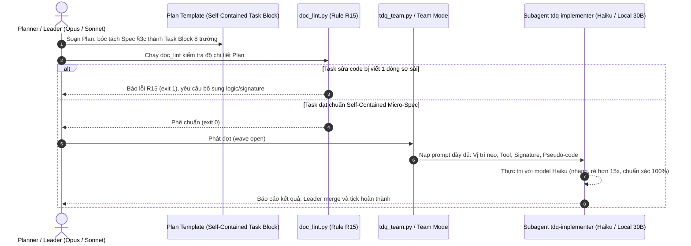

# SPEC — Hiện thực Task Block chi tiết và Tự động gọi Model Tier thấp ở Implement

Ngày: 2026-11-11 · Bản: 1.0 · Brief: ../brief/2026-11-11-0230-task-block-va-model-tier-thap.md · Lane: full
Soul: chất lượng > runtime > context cost · luật gốc: skills/tdq-conventions/references/soul.md
Trạng thái: CHỜ DUYỆT

## Mục lục

- 1. Mục tiêu & phạm vi
- 1b. Lộ trình
- 2. Đầu ra cụ thể
- 2b. Ranh giới module
- 2c. Luồng hoạt động & Sơ đồ kiến trúc
- 3. Cách tiếp cận & lý do
- 3b. Năng lực & công cụ
- 3c. Giải thuật & Xử lý cốt lõi
- 3d. Mental Model cho Fresher Dev
- 4. Yêu cầu bắt buộc
- 5. Ràng buộc & rủi ro
- 6. QC & Definition of Done
- 7. Câu hỏi còn mở

## 1. Mục tiêu & phạm vi

- Mục tiêu:
  1. Hiện thực hóa cấu trúc **The Self-Contained Executable Task Block** chuẩn mực cho Plan (gồm 8 trường kỹ thuật + 4 chốt an toàn cơ học) vào `skills/tdq-plan/references/plan-template.md` và `plan-template-huong-dan.md`.
  2. Bổ sung **Rule linter R15** vào `scripts/doc_lint.py` để tự động kiểm tra và cưỡng chế tính đầy đủ của Task Block đối với các task can thiệp mã nguồn, chặn đứng các plan sơ sài 1 dòng.
  3. Cấu hình cơ chế tự động điều phối subagent linh hoạt: tại `agents/tdq-implementer.md` đặt `model: haiku` làm mặc định để tối ưu chi phí và tăng tốc, đồng thời cập nhật `skills/tdq-build/references/team-mode.md` cho phép ghi đè model tier cao hơn (`sonnet`/`opus`) khi gặp task phức tạp, thuật toán đa luồng hoặc kiến trúc nhạy cảm. Không bó cứng, đảm bảo cân bằng tối ưu giữa chi phí và chất lượng.
- Trong phạm vi:
  - Cập nhật tài liệu mẫu Plan `skills/tdq-plan/references/plan-template.md` và hướng dẫn chấm điểm `plan-template-huong-dan.md`.
  - Cập nhật `scripts/doc_lint.py` bổ sung rule R15 kiểm tra cấu trúc Micro-Spec cho các task sửa mã nguồn trong Plan.
  - Viết bộ unit test kiểm thử cho Rule R15 trong thư mục kiểm thử.
  - Cập nhật cấu hình frontmatter của `agents/tdq-implementer.md` sang `model: haiku`.
  - Cập nhật tài liệu điều phối `skills/tdq-build/references/team-mode.md`.
- NGOÀI phạm vi:
  - Không thay đổi cấu trúc lưu trữ `state.json`.
  - Không thay đổi thuật toán chia đợt (wave calculation) trong `scripts/tdq_team.py`.

## 1b. Lộ trình

Chép từ brief mục `### Lộ trình`. User duyệt spec là duyệt luôn lộ trình này.

| Bước/phase | Chạy? | Vì sao |
|---|---|---|
| `spec` | CÓ | Thiết kế chi tiết đặc tả R15, Task Block template và subagent model config |
| `plan` | CÓ | Lập kế hoạch chi tiết cho các task hiện thực TDD |
| `implement` | CÓ | Cập nhật template, linter R15, test suite và agent definition |
| `qc` (ultra) | CÓ | Chạy test suite linter, smoke test team mode và kiểm định độc lập |
| `report` | CÓ | Xuất báo cáo nghiệm thu 4 phần kèm sơ đồ Archify HTML Trước/Sau |

## 2. Đầu ra cụ thể

| # | Đầu ra | Đường dẫn/vị trí | Đo "xong" bằng |
|---|---|---|---|
| 1 | Cấu trúc Task Block 8 trường trong Plan Template | `skills/tdq-plan/references/plan-template.md` | Có cú pháp Self-Contained Task Block và 4 chốt an toàn cơ học |
| 2 | Hướng dẫn phân tầng thích ứng và bóc tách Spec | `skills/tdq-plan/references/plan-template-huong-dan.md` | Có quy tắc bắt buộc Full Block cho code và Compact cho docs |
| 3 | Rule linter R15 cưỡng chế độ chi tiết task | `scripts/doc_lint.py` | Báo lỗi exit 1 khi task sửa code thiếu phần mô tả logic/pseudo-code |
| 4 | Bộ unit test kiểm thử Rule R15 | `tests/` | 100% tests PASS, bắt đúng plan sơ sài và cho qua plan chi tiết |
| 5 | Cấu hình subagent `tdq-implementer` linh hoạt | `agents/tdq-implementer.md` | Mặc định `model: haiku`, cho phép override tier cao khi task phức tạp |
| 6 | Hướng dẫn dispatching nạp trọn vẹn Task Block | `skills/tdq-build/references/team-mode.md` | Mẫu prompt delegation yêu cầu nạp đủ 8 trường của Task Block |
| 7 | Bản xem trước kiến trúc Trước/Sau Archify HTML | `docs/tdq/spec/2026-11-11-0230-task-block-va-model-tier-thap-preview.html` | Render thành công, manifest khớp tài liệu |

## 2b. Ranh giới module

Bắt buộc với lane full (lane quick BỎ). Một module = một vùng file không giao nhau.

| Module | Vùng file | Phụ thuộc module | Đầu ra §2 nào |
|---|---|---|---|
| Plan Template & Rules | `skills/tdq-plan/references/` | không | 1, 2 |
| Linter Enforcement | `scripts/doc_lint.py` | `skills/tdq-plan/references/` | 3 |
| Linter Test Suite | `tests/` | `scripts/doc_lint.py` | 4 |
| Subagent Configuration | `agents/tdq-implementer.md` | `skills/tdq-plan/references/` | 5 |
| Team Delegation Protocol | `skills/tdq-build/references/team-mode.md` | `agents/tdq-implementer.md` | 6 |
| Visual Artifact | `docs/tdq/artifacts/2026-11-11-0230-task-block-va-model-tier-thap/` | `scripts/tdq_archify.py` | 7 |

## 2c. Luồng hoạt động & Sơ đồ kiến trúc



Cơ chế hiện tại vs Sau update:

| Khía cạnh | Hiện trạng (Trước) | Thiết kế mới (Sau) |
|---|---|---|
| Cấu trúc task Plan | 1 dòng tóm tắt duy nhất, không có chi tiết kỹ thuật | Khối Self-Contained Task Block 8 trường + 4 chốt an toàn |
| Cưỡng chế Linter | Chỉ kiểm tra định dạng dòng `- [ ]` và dòng `Chạm:` | Rule R15 chặn cứng (exit 1) nếu task code thiếu logic |
| Model của Subagent | Kế thừa model lớn của parent (`inherit` - Sonnet/Opus) | Cố định `model: haiku` rẻ hơn 15x, tốc độ vượt trội |
| Giao tiếp Subagent | Subagent chỉ nhận 1 dòng, không đọc Spec, phải đoán mò | Subagent nhận trọn vẹn đặc tả hàm, giải thuật từng bước |

Bản xem trước kiến trúc: `docs/tdq/spec/2026-11-11-0230-task-block-va-model-tier-thap-preview.html`.

## 3. Cách tiếp cận & lý do

- Chọn:
  1. Chuẩn hóa cấu trúc **Self-Contained Task Block** trong `skills/tdq-plan/references/plan-template.md`:
     - Giữ nguyên regex `_TASK` của parser: `- [ ] **Tx.y** (eNm) <Tên task hành động> — Test: <lệnh kiểm>`
     - Định nghĩa 8 trường con thụt lề 2 spaces:
       + `Chạm:` `<danh sách file>`
       + `Cần:` `<phụ thuộc nếu có>`
       + `Mục tiêu:` `<1 câu nêu rõ mục đích kỹ thuật và vị trí trong luồng hệ thống>`
       + `Vị trí neo:` `<hàm/dòng neo cụ thể trong file>` (Chốt 1)
       + `Công cụ:` `<chỉ định rõ Edit vs Write, cấm Write đè file có sẵn>` (Chốt 2)
       + `Ràng buộc:` `<stdlib, không cài thêm lib, giới hạn dòng>` (Chốt 3)
       + `Đặc tả kỹ thuật:` `<chữ ký hàm, kiểu dữ liệu đối số đầu vào, kiểu trả về>`
       + `Logic cốt lõi:` `<pseudo-code từng bước 1-2-3>`
       + `Ca góc hiểm & TDD:` `<xử lý lỗi biên, assertion mong đợi>` (Chốt 4)
  2. Bổ sung Rule **R15** vào `scripts/doc_lint.py`:
     - Khi kiểm tra file trong `plan/`: Với mọi task có `Chạm:` chứa file mã nguồn (đuôi `.py`, `.ts`, `.js`, `.go`, `.rs`, `.c`, `.cpp`), bắt buộc phải có ít nhất 1 dòng đặc tả logic (bắt đầu bằng `- Đặc tả`, `- Logic`, `- Giải thuật`, `- Thuật toán` hoặc `- Pseudo-code`). Thiếu -> báo lỗi R15 và thoát mã 1.
  3. Cập nhật `agents/tdq-implementer.md` và `skills/tdq-build/references/team-mode.md`:
     - Đặt `model: haiku`, `effort: medium` làm mặc định cho subagent thi công.
     - Cơ chế không bó cứng (Dynamic Tier Routing): Cho phép trong Plan hoặc khi Leader dispatching, nếu task thuộc loại phức tạp cao (thuật toán nặng, bảo mật, thiết kế kiến trúc lõi), Leader được phép chỉ định hoặc override sang `model: sonnet` / `model: opus`. Luôn đảm bảo nguyên tắc Soul: Chất lượng đứng trên tốc độ và chi phí.
  4. Cập nhật `skills/tdq-build/references/team-mode.md`:
     - Mẫu prompt delegation hướng dẫn sao chép toàn bộ khối Task Block (kể cả các dòng thụt lề con) vào trường `TASK:`, kèm hướng dẫn chọn model phù hợp theo độ phức tạp.
- Vì:
  - Đây là giải pháp hoàn chỉnh từ gốc đến ngọn: vừa cung cấp mẫu chuẩn, vừa có linter cưỡng chế cơ học, vừa tối ưu hóa chi phí runtime bằng việc chuyển giao cho model tier thấp.
- Đã loại:
  - Bắt buộc subagent đọc toàn bộ tài liệu Spec: Loại vì tốn chi phí token và làm loãng sự chú ý của model nhỏ.
  - Cảnh báo nhẹ (warning) cho R15: Loại vì người dùng đã chốt chọn 2a (chặn cứng exit 1) để bảo đảm chất lượng.

## 3b. Năng lực & công cụ

Chép từ brief mục `### Năng lực dùng được`.

| Skill | Nguồn | Phán quyết | Dùng ở đâu / Lý do loại |
|---|---|---|---|
| tdq-intake / tdq-spec / tdq-plan / tdq-build | plugin:tdq-workflow | NỀN | pipeline đang chạy |
| Archify CLI (`tdq_archify.py`) | project | DÙNG | render + verify preview của spec và report |
| Đã xét 25 skill khác | user/plugin/built-in | KHÔNG | khác lĩnh vực |

## 3c. Giải thuật & Xử lý cốt lõi

- **Mô hình Khối Task chuẩn hóa trong `plan-template.md`**:
  ```markdown
  - [ ] **Tx.y** (eNm) <Tên task hành động cụ thể> — Test: <lệnh kiểm>
    - Chạm: `<danh sách file>`
    - Cần: <phụ thuộc nếu có>
    - Mục tiêu: <1 câu nêu rõ mục đích kỹ thuật và vị trí trong luồng hệ thống>
    - Vị trí neo: <hàm hoặc dòng neo cụ thể trong file>
    - Công cụ: <Dùng Edit. CẤM dùng Write trên file có sẵn>
    - Ràng buộc: <thuần stdlib, hàm dưới 50 dòng, không side-effect>
    - Đặc tả kỹ thuật:
      `<chữ ký hàm, kiểu dữ liệu đối số đầu vào, kiểu dữ liệu trả về>`
    - Logic cốt lõi:
      1. Bước 1: <khởi tạo, kiểm tra điều kiện đầu vào>
      2. Bước 2: <vòng lặp, biến đổi dữ liệu, gọi phụ thuộc>
      3. Bước 3: <xử lý kết quả và trả về>
    - Ca góc hiểm & TDD:
      - Ca hiểm: <giá trị rỗng, số âm, division by zero, timeout>
      - Tiêu chí: <đoạn mã assert cụ thể cho kiểm thử>
  ```

- **Giải thuật Rule R15 trong `scripts/doc_lint.py`**:
  ```python
  EXT_MA_NGUON = (".py", ".ts", ".tsx", ".js", ".jsx", ".go", ".rs", ".c", ".cpp", ".cs", ".rb", ".php", ".java")
  TU_KHOA_LOGIC = ("đặc tả", "logic", "giải thuật", "thuật toán", "pseudo-code")

  def rule_r15(doc, out):
      """Mọi task can thiệp mã nguồn trong plan phải có khối đặc tả kỹ thuật/pseudo-code."""
      if os.path.basename(os.path.dirname(os.path.abspath(doc.path))) != "plan":
          return
      # Quét từng task
      # Nếu task có Chạm: chứa đuôi trong EXT_MA_NGUON
      # Kiểm tra các dòng thụt lề bên dưới có chứa từ khóa trong TU_KHOA_LOGIC
      # Nếu không: out.append(f"{doc.path}:{line_no}: [R15] Task {task_id} modifies source code but lacks technical specification / pseudo-code block")
  ```

- **Độ phức tạp tính toán**:
  - Thời gian: $O(L)$ với $L$ là số dòng của file Plan, chạy trong $< 10$ms.
  - Không gian: $O(1)$ bổ sung trong quá trình quét.

## 3d. Mental Model cho Fresher Dev

- **Ẩn dụ trực quan (Analogy)**:
  - Bản nâng cấp này giống như việc chuyển đổi từ "Đưa yêu cầu bằng miệng" sang "Bản vẽ chế tạo chi tiết (Blueprints)":
    - Thay vì bảo thợ: *"Chế tạo cho tôi cái van áp suất"* (task 1 dòng) và phải thuê kỹ sư trưởng giá 50$/giờ (Opus) ngồi tự thiết kế.
    - Ta đưa cho thợ một bản vẽ cơ khí đầy đủ kích thước dung sai milimet, loại thép SUS304, ren vặn M12, áp suất thử 10 bar. Lúc này, một thợ tiện bình thường giá 3$/giờ (Haiku) vẫn tiện ra đúng 100% cái van chuẩn xác, tiết kiệm 94% chi phí gia công!
- **Thuật ngữ dự án (Glossary)**:
  - `Self-Contained Task Block`: Khối đặc tả task tự thân chứa đầy đủ hợp đồng thi công.
  - `Rule R15`: Quy tắc linter cưỡng chế độ sâu kỹ thuật của Plan.
  - `Model Tier Thấp`: Các dòng model gọn nhẹ (Haiku, local 30B) có chi phí token cực thấp và tốc độ xử lý nhanh.

## 4. Yêu cầu bắt buộc

- Log service bật mặc định: timestamp, đủ chi tiết debug qua `TDQ_LOG`.
- Không placeholder, không TODO stub.
- Mỗi thành phần có unit test riêng, chạy được độc lập bằng pytest.
- Bám 5 nguyên tắc SOLID và Clean Code Invariants.

## 5. Ràng buộc & rủi ro

Ràng buộc kiến trúc phải giữ (chép từ `docs/kien-truc.md`).
- Tương thích ngược: Cấu trúc task mới bắt buộc không được làm gãy parser regex `_TASK` và `_PATH` của `scripts/tdq_team.py`.
- Không làm gián đoạn các plan tài liệu: Rule R15 chỉ áp dụng cho task can thiệp mã nguồn.

| Rủi ro | Ảnh hưởng | Cách giảm |
|---|---|---|
| Rule R15 chặn nhầm task tài liệu | Báo lỗi giả | Kiểm tra chính xác phần mở rộng file trong `Chạm:` (`.py`, `.ts`...) |
| Model Haiku thiếu thông tin nếu prompt delegation bị cắt | Subagent thiếu ngữ cảnh | Chuẩn hóa template delegation trong `team-mode.md` sao chép trọn vẹn Task Block |

## 6. QC & Definition of Done

| # | Hạng mục kiểm | Điều kiện PASS | Đo trước | Dự phòng nếu trượt |
|---|---|---|---|---|
| Q1 | Mẫu Plan Template 8 trường | `plan-template.md` chứa cấu trúc Task Block 8 trường và 4 chốt an toàn | Hiện chỉ có mẫu cũ | Cập nhật file template |
| Q2 | Hướng dẫn phân tầng thích ứng | `plan-template-huong-dan.md` có hướng dẫn Adaptive Granularity | Chưa có | Cập nhật file hướng dẫn |
| Q3 | Linter Rule R15 bắt đúng lỗi | `doc_lint.py` bắt đúng lỗi exit 1 khi task code viết 1 dòng sơ sài | Chưa có R15 | Bổ sung rule_r15 vào doc_lint |
| Q4 | Linter Rule R15 cho qua plan chi tiết | `doc_lint.py` thoát mã 0 với task có đặc tả logic hoặc task docs | N/A | Tinh chỉnh regex nhận diện |
| Q5 | Cấu hình subagent `tdq-implementer` | `agents/tdq-implementer.md` có `model: haiku` và cho phép override tier cao | Hiện là `inherit` | Cập nhật frontmatter |
| Q6 | Hướng dẫn delegation trong team-mode | `team-mode.md` có hướng dẫn nạp trọn vẹn Task Block | Hiện chỉ tóm tắt 1 dòng | Cập nhật tài liệu team-mode |
| Q7 | Test suite kiểm thử Rule R15 | Unit tests trong `tests/` chạy qua 100% green | 0 test case | Viết test suite mới |
| Q8 | Bản xem trước Archify HTML | Render thành công, manifest digest khớp tài liệu | Đã có truoc-sau | Chạy tdq_archify.py render |

DoD:
- Cập nhật hoàn chỉnh `plan-template.md`, `plan-template-huong-dan.md`, `agents/tdq-implementer.md`, `team-mode.md`.
- `scripts/doc_lint.py` tích hợp Rule R15 và có unit test kiểm chứng 100% green.
- Sơ đồ trực quan Archify HTML Trước/Sau hiển thị hợp lệ và manifest digest khớp tài liệu.

## 7. Câu hỏi còn mở

(Trống — mọi quyết định đã được người dùng chốt tại brief.)
<!-- tdq-archify-binding:start -->
<!-- manifest: 2026-11-11-0230-task-block-va-model-tier-thap-preview.manifest.json -->
<!-- manifest_digest: 03edfcb7aacdee6344828d5017fe88ee50a2b3ac1c608fbf7cd4bf630727c178 -->
<!-- tdq-archify-binding:end -->
