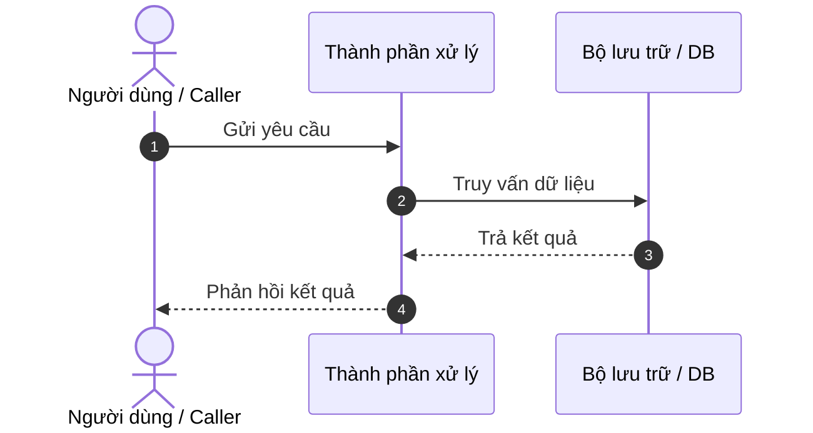

# The spec shape
<!-- muc-luc-dong:
  File em=145
-->

Copy the whole block below into `docs/tdq/spec/<slug>.md` and fill it in. Drop a section
that does not apply, but say **why** it does not apply.

<!-- i18n-allow: spec template written in the default document language -->
```markdown
# SPEC — <tên việc>

Ngày: YYYY-MM-DD · Bản: 1.0 · Brief: ../brief/<slug>.md · Lane: full
Soul: chất lượng > runtime > context cost · luật gốc: skills/tdq-conventions/references/soul.md
Trạng thái: CHỜ DUYỆT

## Mục lục

- 1. Mục tiêu & phạm vi
- 1b. Lộ trình
- 2. Đầu ra cụ thể
- 2b. Ranh giới module
- 2c. Luồng hoạt động & Sơ đồ kiến trúc
- 3. Cách tiếp cận & lý do
- 3b. Năng lực & công cụ
- 3c. Giải thuật & Xử lý cốt lõi
- 3d. Mental Model cho Fresher Dev
- 4. Yêu cầu bắt buộc
- 5. Ràng buộc & rủi ro
- 6. QC & Definition of Done
- 7. Câu hỏi còn mở

## 1. Mục tiêu & phạm vi
- Mục tiêu: <1–3 câu, đo được>
- Trong phạm vi: <gạch đầu dòng>
- NGOÀI phạm vi: <gạch đầu dòng — nêu rõ để khỏi trôi việc. Có chạy vòng scope thì
  BẮT BUỘC chép các mặt bị loại ở brief `### Phạm vi đã chốt` vào đây>

## 1b. Lộ trình
Chép từ brief mục `### Lộ trình`. User duyệt spec là duyệt luôn lộ trình này.

| Bước/phase | Chạy? | Vì sao |
|---|---|---|
| Research web | CÓ/BỎ | <lý do> |
| Interview | CÓ/BỎ | <lý do> |
| QC độc lập (agent) | CÓ/BỎ | <lý do> |

## 2. Đầu ra cụ thể
| # | Đầu ra | Đường dẫn/vị trí | Đo "xong" bằng |
|---|---|---|---|
| 1 | | | |

## 2b. Ranh giới module
Bắt buộc với lane full (lane quick BỎ). Một module = một vùng file không giao nhau.

| Module | Vùng file | Phụ thuộc module | Đầu ra §2 nào <!-- i18n-allow: canonical spec section names --> |
|---|---|---|---|
| <tên ngắn> | `<đường/dẫn>` | <tên module khác, hoặc "không"> | <số thứ tự ở §2> <!-- i18n-allow: canonical spec section names --> |

## 2c. Luồng hoạt động & Sơ đồ kiến trúc

Trực quan hóa luồng dữ liệu và tương tác hệ thống. Bắt buộc có sơ đồ Mermaid (Sequence Diagram hoặc Flowchart) để fresher dev dễ hình dung.



Nếu việc này là cập nhật, tối ưu hoặc refactor mã nguồn: BẮT BUỘC có bảng đối chiếu Trước vs Sau:

| Khía cạnh | Hiện trạng (Trước) | Thiết kế mới (Sau) |
|---|---|---|
| Luồng thực thi | <mô tả luồng cũ> | <mô tả luồng mới tối ưu> |
| Thành phần chạm | <danh sách thành phần cũ> | <thành phần mới / thay thế> |
| Điểm nghẽn giải quyết | <vấn đề tồn đọng> | <kết quả cải thiện đo được> |

## 3. Cách tiếp cận & lý do
- Chọn: <cách làm>
- Vì: <lý do, kèm nguồn research nếu có>
- Đã loại: <phương án> — vì <lý do>

## 3b. Năng lực & công cụ
Chép từ brief mục `### Năng lực dùng được`. Phán quyết: DÙNG / KHÔNG (+ lý do) / NỀN.
Ưu tiên MCP-First: Luôn rà soát MCP tools/skills phù hợp (Roblox, Unity, DevTools, DB...) và đặt điều kiện pre-flight check kết nối.

| Skill | Nguồn | Phán quyết | Dùng ở đâu / Lý do loại |
|---|---|---|---|
| <tên> | <user|project|plugin:x|built-in> | DÙNG | <đầu ra hoặc task nào> |
| Đã xét <N> skill khác | user/plugin/built-in | KHÔNG | khác lĩnh vực |

## 3c. Giải thuật & Xử lý cốt lõi

Bóc tách thuật toán chi tiết để lập trình viên fresher nắm chắc nghiệp vụ logic:

- **Từng bước giải thuật (Step-by-step Execution Logic)**:
  1. Bước 1: <khởi tạo cấu trúc dữ liệu, đọc tham số đầu vào>.
  2. Bước 2: <vòng lặp, điều kiện rẽ nhánh, biến đổi trạng thái>.
  3. Bước 3: <tổng hợp kết quả, xử lý trả về>.
- **Độ phức tạp tính toán**:
  - Thời gian (Time Complexity): $O(\dots)$ — <giải thích ngắn gọn>.
  - Không gian (Space Complexity): $O(\dots)$ — <giải thích bộ nhớ đệm sử dụng>.
- **Các ca góc hiểm (Edge Cases & Defensive Handling)**:
  - Đầu vào rỗng hoặc null: <cách xử lý phòng thủ>.
  - Timeout, mất kết nối hoặc dữ liệu không hợp lệ: <cách phục hồi an toàn>.

## 3d. Mental Model cho Fresher Dev

- **Ẩn dụ trực quan (Analogy)**: <1 đoạn ngắn ví von cơ chế hoạt động với một hiện tượng thực tế đời thường giúp dev dễ hình dung>.
- **Thuật ngữ dự án (Glossary)**:
  - `<Khái niệm A>`: <giải thích ngắn gọn 1 câu>.
  - `<Khái niệm B>`: <giải thích ngắn gọn 1 câu>.

## 4. Yêu cầu bắt buộc
- Log service: bật mặc định (có runtime) hoặc BỎ (không runtime) — <lý do>.
- Không placeholder, không TODO stub, không mock trình bày như dữ liệu thật.
- Mỗi thành phần có unit test riêng, chạy được bằng một lệnh.
- Bám 5 nguyên tắc SOLID và rule ngôn ngữ trong `skills/tdq-build/references/rules/`.

## 5. Ràng buộc & rủi ro
Ràng buộc kiến trúc phải giữ (chép từ `docs/kien-truc.md`, không chạm → ghi "không chạm dòng nào — <lý do>"):
- <nguyên văn dòng luật> — chạm ở <file/hàm>

| Rủi ro | Ảnh hưởng | Cách giảm |
|---|---|---|

## 6. QC & Definition of Done
| # | Hạng mục kiểm | Điều kiện PASS | Đo trước | Dự phòng nếu trượt |
|---|---|---|---|---|
| Q1 | | | <số đo hoặc —> | <phương án hoặc —> |

DoD: <liệt kê điều kiện đủ để tuyên bố xong; có tham chiếu thị giác thì kèm Vision Test Loop>

## 7. Câu hỏi còn mở
(Phải RỖNG. Còn câu hỏi → quay lại phase analyze.)
```

## File em

[spec-template-huong-dan.md](spec-template-huong-dan.md) — Hướng dẫn chi tiết các mục spec,
§6 giữ điều kiện chứ không giữ lệnh, checklist tự soát và fresher accessibility check.
Đọc khi soát spec trước khi trình.

